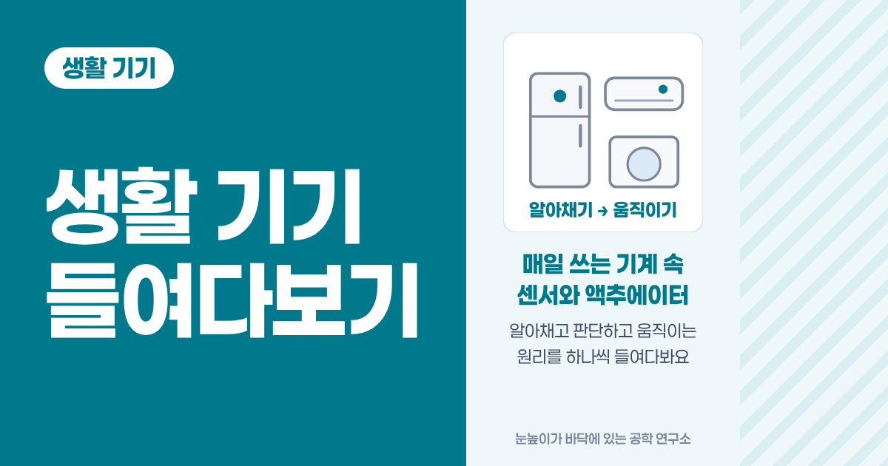
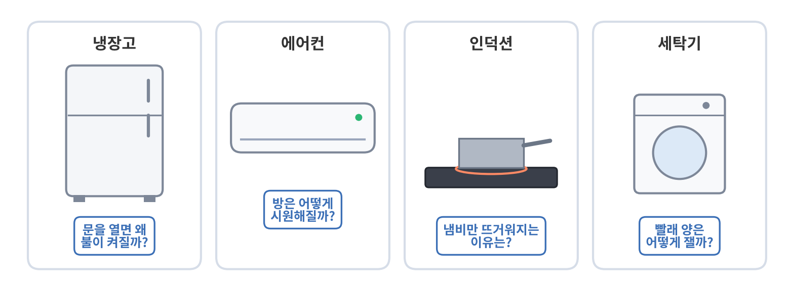
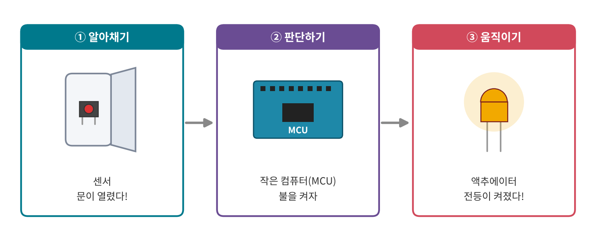
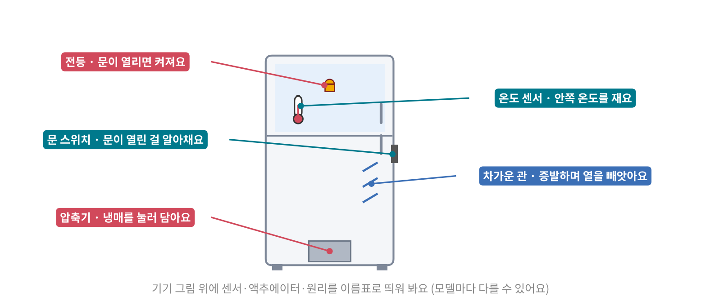

<!--
title: "생활 기기 들여다보기: 매일 쓰는 기계 속 센서와 액추에이터"
field: 생활 기기
order: 100
level: 기초
tags: [생활 기기, 센서, 액추에이터]
summary: "무심코 쓰는 전자기기 안에는 생각보다 많은 센서와 액추에이터, 그리고 과학 원리가 숨어 있어요."
-->

# 생활 기기 들여다보기: 매일 쓰는 기계 속 센서와 액추에이터

<!-- 목차 -->

## 1. 이런 게 궁금했던 적 없나요?

냉장고 문을 열면 불이 켜지고 에어컨을 켜면 방이 시원해져요.

인덕션 위에 냄비를 올리면 냄비만 뜨거워지고 세탁기는 빨래 양을 알아서 재요.

매일 쓰는데, 이게 왜 이렇게 움직이는지 궁금했던 적 없나요?

무심코 쓰는 전자기기 안에는 생각보다 많은 센서와 액추에이터, 그리고 과학 원리가 숨어 있어요.

이 시리즈에서는 그걸 하나씩 들여다볼 거예요.

## 2. 기계는 모두 세 단계로 움직여요

복잡해 보이는 기계도 하는 일을 나눠 보면 세 단계예요.

1. 알아채기: 센서가 온도, 빛, 무게, 사람 같은 바깥 변화를 알아채요.
2. 판단하기: 기계 안의 작은 컴퓨터(MCU)가 센서 값을 보고 "이제 무엇을 할지" 정해요.
3. 움직이기: 모터, 히터, 전등 같은 액추에이터가 실제로 일을 해요.

예를 들어 냉장고 문을 열면 이렇게 돼요.

세 단계로 나눠 보기

1. 알아채기: 문 쪽 스위치가 "문이 열렸다"는 걸 알아채요.
2. 판단하기: "문이 열렸으니 불을 켜자"고 정해요.
3. 움직이기: 안쪽 전등이 켜져요.

센서와 액추에이터가 무엇인지는 [전자 부품 지도: 센서·액추에이터와 회로를 받치는 부품](<../전자 부품 110 전자 부품 지도/index.md>)에서 자세히 다뤘어요.

이 시리즈는 그 부품들이 우리 집 기계 안에서 어떻게 쓰이는지 보는 쪽이에요.

## 3. 이 시리즈를 보는 방법

강좌마다 기기 하나(또는 원리가 같은 기기 둘)를 골라 이렇게 봐요.

- 기기가 하는 일을 동작별로 나눠요. 예를 들어 냉장고는 "차갑게 하기", "문 열면 불 켜기", "성에 녹이기"처럼요.
- 동작마다 어떤 센서가 알아채고 어떤 액추에이터가 움직이는지 기기 그림 위에 이름표로 띄워요.
- 그 동작 뒤에 있는 과학 원리를 생활 속 예시로 먼저 보고 그다음 기기 안에서 어떻게 쓰이는지 봐요.

> ⚠️ 기기를 직접 뜯지는 않아요.
>
> 같은 기기라도 제조사와 모델마다 부품과 방식이 달라요.
> 이 시리즈는 "보통 이런 방식을 쓴다"는 대표적인 원리만 골라 보여 줘요.
> 전원이 연결된 기기나 큰 전기를 쓰는 기기는 함부로 열지 마세요.

## 4. 시리즈 목차

지금까지 올라온 강좌예요.

새 강좌가 나오면 이 목록이 공부 순서대로 늘어나요.

<!-- 시리즈 목차 -->

1. **생활 기기 들여다보기: 매일 쓰는 기계 속 센서와 액추에이터** (지금 보는 글)
2. [냉장고와 에어컨: 차가움을 만드는 게 아니라 열을 옮겨요](<../생활 기기 110 냉장고와 에어컨/index.md>)

<!-- /시리즈 목차 -->

앞으로는 인덕션, 전자레인지, 세탁기 같은 기기를 다룰 계획이에요.

순서는 바뀔 수 있어요.

## 5. 직접 해 보기

<b>Q1.</b> 해가 지면 저절로 켜지는 현관 센서등이 있어요.

세 단계로 나눠 볼까요?

정답 보기

1. 알아채기: 빛 센서가 어두워졌다는 걸, 동작 감지 센서가 사람이 왔다는 걸 알아채요.
2. 판단하기: "어둡고 사람이 왔으니 켜자"고 정해요.
3. 움직이기: 전등이 켜져요.

제품에 따라 빛 센서 없이 동작 감지만 쓰기도 해요.

<b>Q2.</b> 전기밥솥은 밥이 다 되면 "보온"으로 바뀌어요.

무엇을 알아채고 무엇이 움직일까요?

정답 보기

보통 바닥의 온도 센서가 솥의 온도를 알아채요.

물이 다 졸아들면 솥 바닥 온도가 확 오르는데, 이걸 보고 "다 됐다"고 판단해요.

그다음 히터의 힘을 줄여 따뜻하게만 유지해요.

## 참고 자료

- [Wikipedia: Sensor](https://en.wikipedia.org/wiki/Sensor)
- [Wikipedia: Actuator](https://en.wikipedia.org/wiki/Actuator)

## 강좌 이동

- 이전 강좌: 없어요. 생활 기기 강좌의 첫 강좌예요.
- 다음 강좌: [냉장고와 에어컨: 차가움을 만드는 게 아니라 열을 옮겨요](<../생활 기기 110 냉장고와 에어컨/index.md>)
