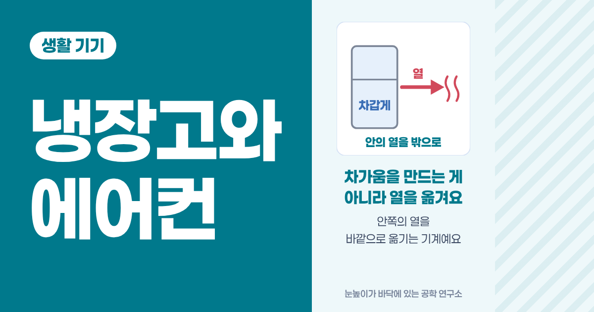
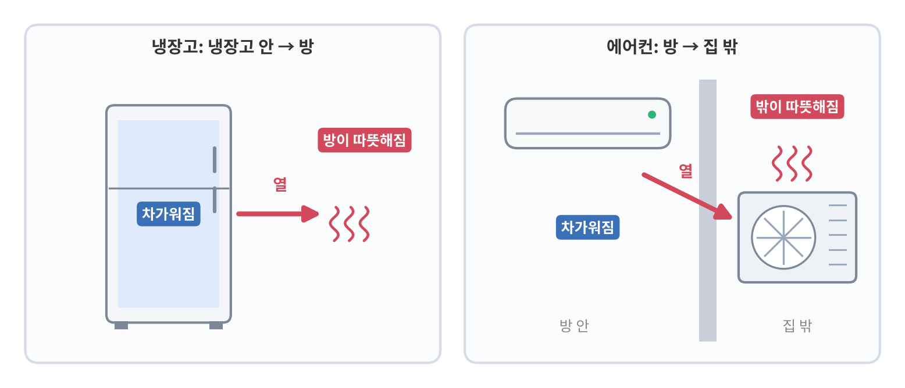
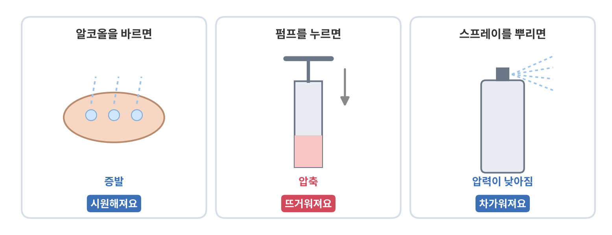
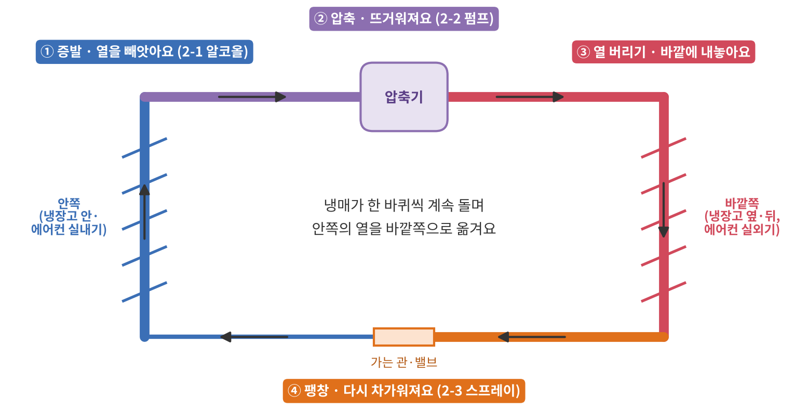
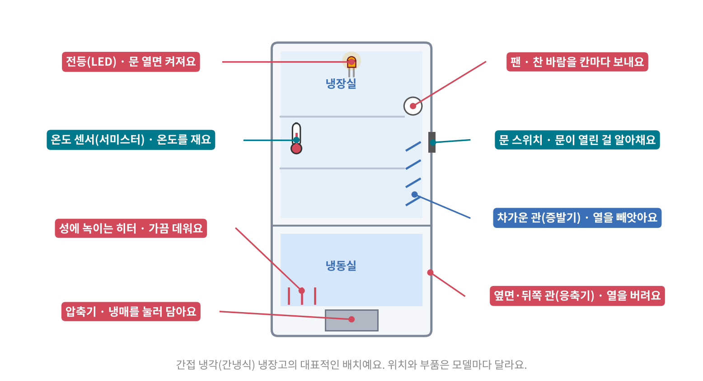
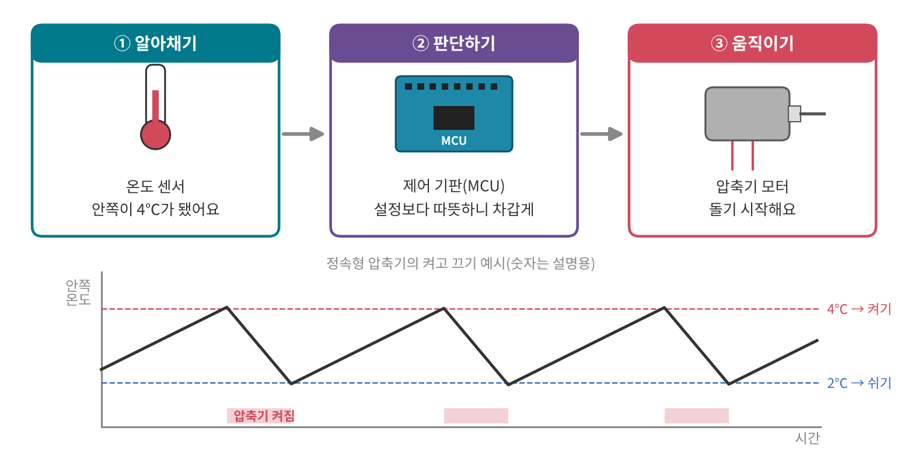
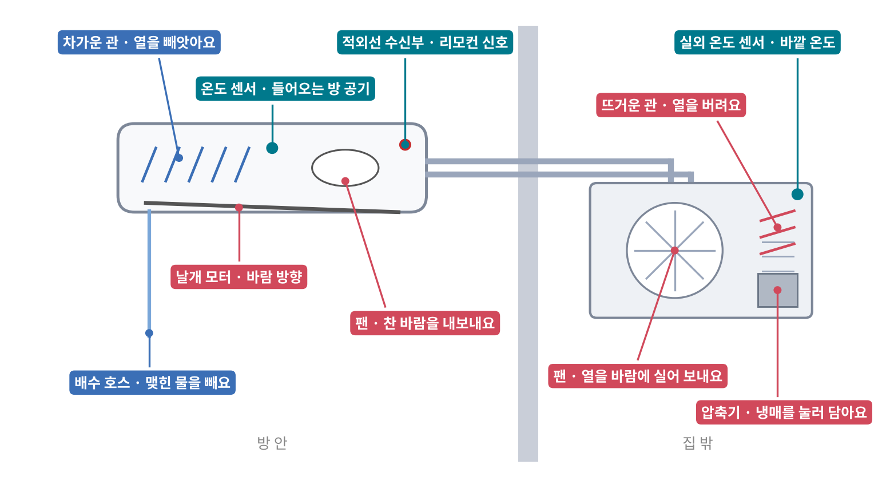
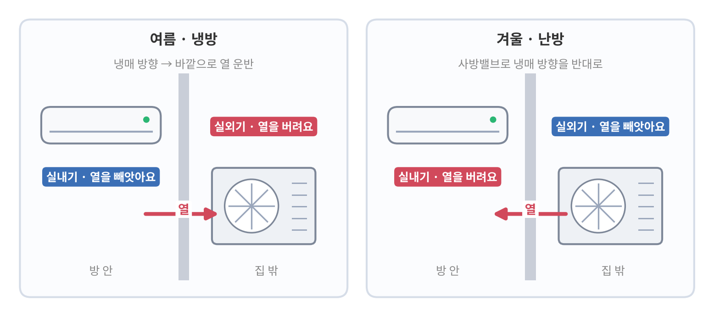

<!--
title: "냉장고와 에어컨: 차가움을 만드는 게 아니라 열을 옮겨요"
field: 생활 기기
order: 110
level: 기초
tags: [생활 기기, 냉장고, 에어컨, 히트펌프]
summary: "냉장고와 에어컨은 차가움을 만드는 기계가 아니라, 안쪽의 열을 바깥으로 옮기는 기계예요."
-->

# 냉장고와 에어컨: 차가움을 만드는 게 아니라 열을 옮겨요

<!-- 목차 -->

## 1. 먼저 한 줄로

냉장고와 에어컨은 차가움을 만드는 기계가 아니라, 안쪽의 열을 바깥으로 옮기는 기계예요.

냉장고는 냉장고 안의 열을 꺼내 방으로 버려요.

에어컨은 방 안의 열을 꺼내 집 밖으로 버려요.

열을 빼앗긴 쪽은 차가워지고 열을 받은 쪽은 따뜻해져요.

냉장고 옆면이나 뒤쪽이 따뜻한 이유, 에어컨 실외기에서 뜨거운 바람이 나오는 이유가 여기에 있어요.

둘은 크기와 모양만 다를 뿐, 열을 옮기는 방법이 거의 같아요.

그래서 한 강좌에서 같이 볼게요.

## 2. 예시로 먼저 감 잡기

열을 옮기는 방법은 생활 속 세 가지 현상을 이어 붙인 거예요.

### 2-1. 손등에 알코올을 바르면

손 소독제를 바르면 손이 시원해져요.

왜 그럴까요?

정답 보기

알코올이 날아가면서(증발하면서) 손의 열을 가져가기 때문이에요.

액체가 기체로 바뀌려면 열이 필요해요.

그 열을 주변에서 빼앗아 가니 주변이 차가워져요.

여름에 땀이 마르면 시원한 것도 같은 원리예요.

### 2-2. 자전거 펌프를 계속 누르면

자전거 바퀴에 바람을 넣다 보면 펌프 아래쪽이 따뜻해져요.

정답 보기

공기를 좁은 곳에 꾹 눌러 담으면(압축하면) 온도가 올라가요.

누르는 힘이 열로 바뀌는 셈이에요.

### 2-3. 스프레이를 오래 뿌리면

뿌리는 파스나 스프레이를 오래 누르고 있으면 캔이 차가워져요.

정답 보기

캔 안에는 높은 압력으로 눌린 액체가 들어 있어요.

뿌리면 캔 안의 압력이 낮아지고 그만큼 액체가 기체로 바뀌면서 캔의 열을 빼앗아요.

압력이 낮아지면 차가워져요.

### 2-4. 세 가지에서 찾은 규칙

| 현상 | 일어나는 일 | 온도 |
| --- | --- | --- |
| 알코올 | 액체가 기체로(증발) | 주변이 차가워져요 |
| 자전거 펌프 | 기체를 눌러 담음(압축) | 뜨거워져요 |
| 스프레이 | 압력이 낮아짐(팽창) | 차가워져요 |

냉장고와 에어컨은 이 세 가지를 한 바퀴로 이어서 계속 돌려요.

## 3. 열을 옮기는 네 단계

냉장고와 에어컨 안에는 관이 한 바퀴로 이어져 있고 그 안을 냉매라는 물질이 돌아요.

냉매는 아주 낮은 온도에서도 쉽게 증발하는 물질이에요.

한 바퀴는 네 단계예요.

### 3-1. 증발: 열을 빼앗아요

차갑고 압력이 낮은 냉매가 안쪽 관(증발기)을 지나며 증발해요.

2-1의 알코올처럼 주변의 열을 빼앗아요.

그래서 냉장고 안, 에어컨 실내기 앞의 공기가 차가워져요.

### 3-2. 압축: 뜨겁게 만들어요

열을 머금은 기체 냉매를 압축기(컴프레서)가 꾹 눌러 담아요.

2-2의 자전거 펌프처럼 냉매가 뜨거워져요.

이 압축기를 돌리는 모터가 냉장고와 에어컨에서 가장 중요한 액추에이터예요.

### 3-3. 열 버리기: 바깥에 열을 내놓아요

뜨거워진 냉매가 바깥쪽 관(응축기)을 지나며 주변 공기에 열을 버려요.

열을 잃은 냉매는 다시 액체가 돼요.

냉장고 옆면·뒤쪽과 에어컨 실외기가 따뜻한 게 바로 이 단계예요.

### 3-4. 팽창: 다시 차갑게 만들어요

액체 냉매가 아주 가는 관이나 밸브를 지나며 압력이 확 떨어져요.

2-3의 스프레이처럼 냉매가 차가워져요.

차가워진 냉매는 다시 3-1로 돌아가 열을 빼앗아요.

### 3-5. 한 바퀴를 한 줄로

> 열을 옮기는 한 바퀴
>
> - 안쪽에서 증발하며 열을 빼앗고(차가워짐)
> - 압축해서 뜨겁게 만든 뒤
> - 바깥쪽에서 열을 버리고(따뜻해짐)
> - 압력을 낮춰 다시 차갑게 만든다.

냉매는 닳지 않고 이 길을 계속 돌아요.

전기는 냉매를 압축하고 팬을 돌리는 데 써요.

## 4. 냉장고 들여다보기

### 4-1. 부품 지도

냉장고가 하는 일을 동작별로 나누면 이래요.

| 동작 | 알아채기(센서) | 움직이기(액추에이터) |
| --- | --- | --- |
| 차갑게 유지하기 | 온도 센서 | 압축기 모터 |
| 찬 바람 골고루 보내기 | 온도 센서 | 팬 모터 |
| 문 열면 불 켜기 | 문 스위치 | 안쪽 전등(LED) |
| 성에 녹이기 | 시간·온도 | 히터 |

판단은 모두 냉장고 안의 제어 기판(MCU)이 해요.

### 4-2. 차갑게 유지하기

냉장고는 계속 같은 세기로 돌지 않아요.

1. 알아채기: 냉장실 안의 온도 센서가 온도를 재요. 보통 온도에 따라 저항이 바뀌는 서미스터를 써요.
2. 판단하기: 설정 온도보다 따뜻해지면 "차갑게 하자", 충분히 차가워지면 "쉬자"고 정해요.
3. 움직이기: 압축기 모터를 돌리거나 멈춰요.

예전 방식(정속형)은 압축기를 켜고 끄기만 해요.

요즘 많이 쓰는 인버터 방식은 압축기 속도를 바꿔서, 조금 따뜻해지면 천천히, 많이 따뜻해지면 빠르게 돌려요.

그래서 보통 온도가 덜 출렁이고 전기도 덜 써요.

### 4-3. 문 열면 불 켜기

문을 닫으면 문이 냉장고 몸체의 스위치를 눌러요.

문을 열면 스위치에서 문이 떨어지고 이걸 보고 안쪽 전등을 켜요.

제품에 따라 누르는 스위치 대신 자석으로 문 위치를 알아채는 센서를 쓰기도 해요.

문이 오래 열려 있으면 "삐삐" 알려 주는 것도 같은 신호를 써요.

### 4-4. 찬 바람 보내기와 성에 녹이기

냉장고는 차가운 관(증발기)을 어디에 두느냐에 따라 직접 냉각과 간접 냉각으로 나뉘어요.

| 방식 | 차갑게 하는 법 | 성에 |
| --- | --- | --- |
| 직접 냉각(직냉식) | 칸 벽 속 차가운 관이 직접 식혀요 | 벽에 성에가 끼어요 |
| 간접 냉각(간냉식) | 뒤쪽 차가운 관에서 식힌 바람을 팬이 칸마다 보내요 | 보통 히터로 자동으로 녹여요 |

공기 속 수분은 차가운 관에 닿으면 얼어붙어 성에가 돼요.

간냉식은 정해진 때가 되면 히터로 관을 잠깐 데워 성에를 녹이고 녹은 물은 관을 따라 밖으로 빼내요.

## 5. 에어컨 들여다보기

### 5-1. 왜 둘로 나뉠까요?

냉장고는 열을 방에 버려도 괜찮아요.

에어컨은 방을 식히는 기계라서 열을 방에 버리면 안 돼요.

그래서 열을 빼앗는 부분(실내기)과 열을 버리는 부분(실외기)을 나눠 두고 둘 사이를 냉매 관으로 이어요.

### 5-2. 부품 지도

| 동작 | 알아채기(센서·입력) | 움직이기(액추에이터) |
| --- | --- | --- |
| 리모컨 명령 받기 | 적외선 수신부 | 없음(제어 기판이 받음) |
| 방 온도 맞추기 | 실내 온도 센서 | 실외기 압축기 모터 |
| 찬 바람 내보내기 | 설정 바람 세기 | 실내기 팬 모터 |
| 바람 방향 바꾸기 | 리모컨 설정 | 날개 모터 |
| 열 버리기 | 실외 온도 센서 | 실외기 팬 모터 |

### 5-3. 리모컨과 온도 맞추기

리모컨 버튼을 누르면 리모컨 앞쪽에서 눈에 안 보이는 적외선 신호가 나가요.

실내기의 수신부가 이 신호를 받아 "희망 온도 24℃" 같은 명령으로 읽어요.

그다음은 냉장고와 같아요.

실내기로 빨려 들어오는 방 공기의 온도를 재서, 희망 온도보다 높으면 압축기를 세게, 가까워지면 약하게 돌려요.

### 5-4. 바람 방향 날개

바람이 나오는 곳의 날개는 보통 작은 모터가 정해진 각도만큼씩 움직여요.

"위아래 자동"을 켜면 이 모터가 날개를 천천히 오르내리게 해요.

### 5-5. 에어컨에서 물이 나오는 이유

실내기 안의 차가운 관에 방 공기가 닿으면, 차가운 컵 겉면에 물방울이 맺히듯 공기 속 수분이 물방울로 맺혀요.

이 물은 배수 호스로 밖에 빼내요.

방 공기에서 물기가 빠지니 에어컨을 켜면 습도도 내려가요.

제습 모드는 이 효과를 주로 쓰는 운전이에요.

### 5-6. 거꾸로 돌리면 난방

냉난방 겸용 에어컨은 같은 기계로 난방도 해요.

보통 밸브 하나(사방밸브)로 냉매가 도는 방향을 바꿔요.

그러면 실외기가 바깥 공기의 열을 빼앗고 실내기가 그 열을 방에 버려요.

추운 겨울 바깥 공기에도 열은 남아 있어서 그 열을 모아 안으로 옮기는 거예요.

이렇게 열을 낮은 쪽에서 높은 쪽으로 퍼 올린다고 해서 히트펌프라고 불러요.

## 6. 냉장고와 에어컨 비교

| 비교 | 냉장고 | 에어컨(냉방) |
| --- | --- | --- |
| 열을 빼앗는 곳 | 냉장고 안 | 방 안(실내기) |
| 열을 버리는 곳 | 방(옆면·뒤쪽) | 집 밖(실외기) |
| 압축기 위치 | 냉장고 아래 뒤쪽 | 실외기 |
| 온도를 재는 곳 | 냉장실·냉동실 안 | 실내기로 들어오는 공기 |
| 생기는 물 | 성에(히터로 녹임) | 물방울(배수 호스로 뺌) |
| 반대로 돌리면 | 보통 그렇게 쓰지 않아요 | 난방(히트펌프) |

## 7. 자주 헷갈리는 점

### 7-1. 냉장고 문을 열어 두면 방이 시원해질까요?

정답 보기

아니요, 오히려 조금씩 더워져요.

냉장고는 앞에서 빼앗은 열을 뒤쪽으로 같은 방에 다시 버려요.

열이 방 안에서 한 바퀴 돌 뿐이고 여기에 압축기 모터가 쓴 전기까지 열로 더해져요.

에어컨이 실외기를 집 밖에 두는 이유가 이거예요.

### 7-2. 에어컨은 바깥 공기를 들여와 식히나요?

정답 보기

보통 가정용 벽걸이·스탠드 에어컨은 방 공기를 빨아들여 식힌 다음 다시 내보내요.

실내기와 실외기 사이를 오가는 건 관 속 냉매뿐이에요.

방 공기는 바깥과 섞이지 않아요.

그래서 에어컨만으로는 환기가 되지 않아요.

### 7-3. 냉매는 쓰다 보면 닳아서 채워야 하나요?

정답 보기

냉매는 닫힌 관 속을 계속 돌기 때문에 원래는 줄어들지 않아요.

냉매가 부족하다면 어딘가 새고 있다는 뜻이라, 채우기 전에 새는 곳을 찾는 게 먼저예요.

## 8. 같은 원리를 쓰는 다른 기기

열을 옮기는 한 바퀴는 냉장고와 에어컨 말고도 여러 곳에서 써요.

- 제습기: 차가운 관으로 물기를 맺히게 하고 뜨거운 관 옆을 지나게 해서 다시 내보내요. 그래서 제습기를 틀면 방이 조금 따뜻해져요.
- 김치냉장고·정수기 냉수: 같은 방식으로 안쪽을 식혀요.
- 히트펌프 건조기: 뜨거운 쪽으로 빨래를 말리고 차가운 쪽으로 물기를 모아요.

제품에 따라 다른 방식(전기 소자로 식히는 방식 등)을 쓰는 경우도 있어요.

## 9. 한 장 요약

> 냉장고와 에어컨: 열을 옮기는 기계
>
> - 냉장고와 에어컨은 열을 안에서 밖으로 옮긴다.
> - 냉매가 증발 → 압축 → 열 버리기 → 팽창을 한 바퀴씩 돈다.
> - 증발하는 쪽은 차가워지고 열을 버리는 쪽은 따뜻해진다.
> - 냉장고: 온도 센서가 재고 제어 기판이 판단하고 압축기·팬·히터·전등이 움직인다.
> - 에어컨: 열을 빼앗는 실내기와 열을 버리는 실외기로 나뉜다.
> - 냉매가 도는 방향을 바꾸면 에어컨이 난방기가 된다(히트펌프).

## 10. 셀프 퀴즈

<b>Q1.</b> 여름에 에어컨 실외기 앞에 서면 뜨거운 바람이 나와요.

이 열은 어디서 온 걸까요?

정답 보기

대부분 방 안에서 빼앗아 온 열이에요.

여기에 압축기를 돌리는 데 쓴 전기의 열이 더해져요.

<b>Q2.</b> 냉장고 압축기가 멈췄다 돌았다를 반복해요.

무엇이 무엇을 보고 정하는 걸까요?

정답 보기

냉장고 안의 온도 센서가 온도를 재고 제어 기판이 설정 온도와 비교해 압축기를 돌릴지 쉴지 정해요.

<b>Q3.</b> 냉난방 에어컨이 겨울에 난방을 할 때, 실외기는 무슨 일을 할까요?

정답 보기

바깥 공기의 열을 빼앗는 쪽이 돼요.

여름에 실내기가 하던 일을 겨울에는 실외기가 해요.

냉매가 도는 방향만 반대로 바뀐 거예요.

## 참고 자료

- [Danfoss: 냉장고 작동 원리 - 기본 교육](https://www.danfoss.com/ko-kr/about-danfoss/our-businesses/cooling/the-fridge-how-it-works/)
- [비건뉴스: 히트펌프 난방은 전기로 열을 옮긴다](https://www.vegannews.co.kr/news/article.html?no=390956)
- [Wikipedia: Reversing valve](https://en.wikipedia.org/wiki/Reversing_valve)

## 강좌 이동

- 이전 강좌: [생활 기기 들여다보기: 매일 쓰는 기계 속 센서와 액추에이터](<../생활 기기 100 생활 기기 들여다보기/index.md>)
- 다음 강좌: 준비 중이에요.
