<!--
title: "냉장고와 에어컨: 차가움을 만드는 게 아니라 열을 옮겨요"
field: 생활 기기
order: 110
level: 기초
tags: [생활 기기, 냉장고, 에어컨, 히트펌프]
summary: "냉장고와 에어컨은 차가움을 만드는 기계가 아니라, 안쪽의 열을 바깥으로 옮기는 기계예요."
-->

# 냉장고와 에어컨: 차가움을 만드는 게 아니라 열을 옮겨요

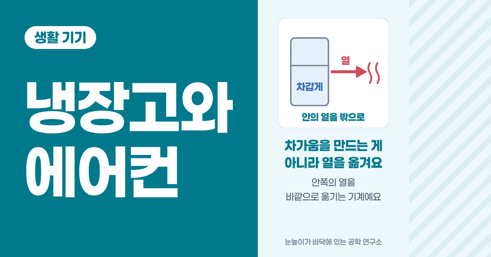

<!-- 목차 -->

## 1. 먼저 한 줄로

냉장고와 에어컨은 차가움을 만드는 기계가 아니라, 안쪽의 열을 바깥으로 옮기는 기계예요.

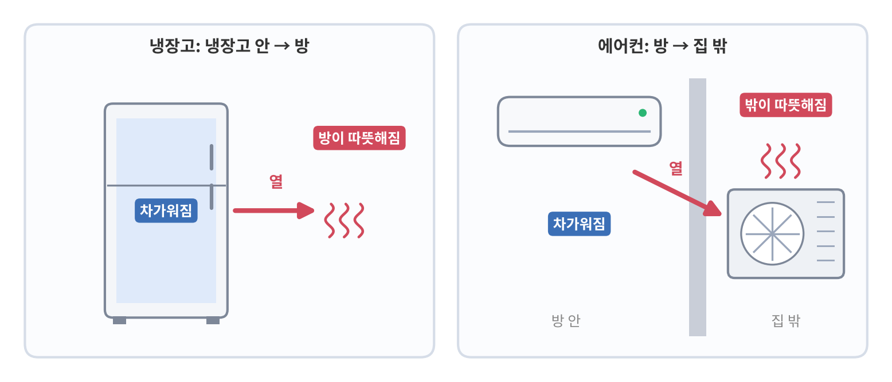

냉장고는 냉장고 안의 열을 꺼내 방으로 버려요.

에어컨은 방 안의 열을 꺼내 집 밖으로 버려요.

열을 빼앗긴 쪽은 차가워지고 열을 받은 쪽은 따뜻해져요.

냉장고 옆면이나 뒤쪽이 따뜻한 이유, 에어컨 실외기에서 뜨거운 바람이 나오는 이유가 여기에 있어요.

둘은 크기와 모양만 다를 뿐, 열을 옮기는 방법이 거의 같아요.

그래서 한 강좌에서 같이 볼게요.

## 2. 예시로 먼저 감 잡기

열을 옮기는 방법은 생활 속 세 가지 현상을 이어 붙인 거예요.

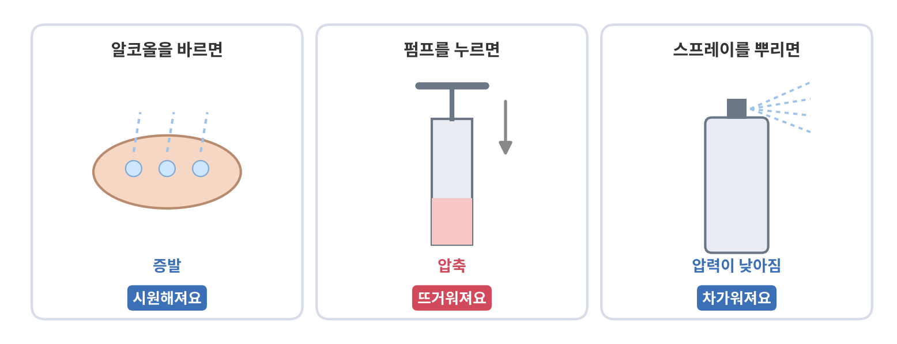

### 2-1. 손등에 알코올을 바르면

손 소독제를 바르면 손이 시원해져요.

왜 그럴까요?

정답 보기

알코올이 날아가면서(증발하면서) 손의 열을 가져가기 때문이에요.

액체가 기체로 바뀌려면 열이 필요해요.

그 열을 주변에서 빼앗아 가니 주변이 차가워져요.

여름에 땀이 마르면 시원한 것도 같은 원리예요.

### 2-2. 자전거 펌프를 계속 누르면

자전거 바퀴에 바람을 넣다 보면 펌프 아래쪽이 따뜻해져요.

정답 보기

공기를 좁은 곳에 꾹 눌러 담으면(압축하면) 온도가 올라가요.

누르는 힘이 열로 바뀌는 셈이에요.

### 2-3. 스프레이를 오래 뿌리면

뿌리는 파스나 스프레이를 오래 누르고 있으면 캔이 차가워져요.

정답 보기

캔 안에는 높은 압력으로 눌린 액체가 들어 있어요.

뿌리면 캔 안의 압력이 낮아지고 그만큼 액체가 기체로 바뀌면서 캔의 열을 빼앗아요.

압력이 낮아지면 차가워져요.

### 2-4. 세 가지에서 찾은 규칙

| 현상 | 일어나는 일 | 온도 |
| --- | --- | --- |
| 알코올 | 액체가 기체로(증발) | 주변이 차가워져요 |
| 자전거 펌프 | 기체를 눌러 담음(압축) | 뜨거워져요 |
| 스프레이 | 압력이 낮아짐(팽창) | 차가워져요 |

냉장고와 에어컨은 이 세 가지를 한 바퀴로 이어서 계속 돌려요.

## 3. 원리 1: 열은 뜨거운 쪽에서 차가운 쪽으로만 흘러요

냉장고 속에서는 네 가지 원리가 한 바퀴로 이어져 있어요.

먼저 가장 바탕이 되는 원리부터 볼게요.

### 3-1. 열은 저절로 거꾸로 흐르지 않아요

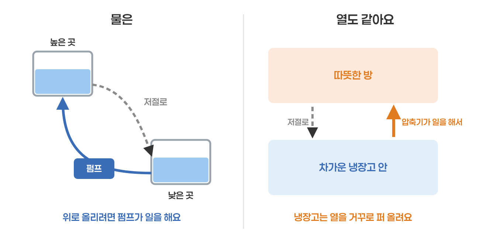

뜨거운 국은 그냥 두면 식고, 찬 음료는 그냥 두면 미지근해져요.

열은 저절로 뜨거운 쪽에서 차가운 쪽으로 흘러요([Wikipedia: Refrigeration](https://en.wikipedia.org/wiki/Refrigeration)).

그런데 냉장고가 하는 일은 반대예요.

차가운 냉장고 안에서 열을 꺼내 더 따뜻한 방으로 내보내요.

물이 높은 곳에서 낮은 곳으로만 흐르듯, 열도 저절로는 거꾸로 가지 않아요.

물을 위로 올리려면 펌프가 일을 해야 하는 것처럼, 열을 차가운 곳에서 뜨거운 곳으로 옮기려면 누군가 일을 해야 해요(같은 출처).

냉장고에서 그 일을 하는 것이 전기로 도는 압축기예요.

그래서 냉장고와 에어컨을 열을 퍼 올리는 펌프, 곧 히트펌프라고도 불러요.

### 3-2. 그래서 냉매의 온도를 두 번 바꿔요

열이 뜨거운 쪽에서 차가운 쪽으로만 흐른다면, 거꾸로 옮기는 방법은 하나예요.

열을 받을 때는 냉매를 냉장고 안보다 더 차갑게 만들어요.

그러면 냉장고 안의 열이 저절로 냉매 쪽으로 흘러 들어와요.

열을 버릴 때는 냉매를 방보다 더 뜨겁게 만들어요.

그러면 냉매의 열이 저절로 방으로 흘러 나가요.

냉매를 차갑게 만드는 것이 증발과 팽창이고, 뜨겁게 만드는 것이 압축이에요.

이 두 가지가 왜 일어나는지 차례로 볼게요.

### 3-3. 들인 전기보다 더 많은 열을 옮겨요

열을 직접 만드는 전기난로는 전기 1만큼으로 열을 1까지만 만들 수 있어요.

냉장고와 에어컨은 열을 만드는 게 아니라 이미 있는 열을 옮기기 때문에 이보다 적은 전기로 더 많은 열을 옮겨요([Wikipedia: Coefficient of performance](https://en.wikipedia.org/wiki/Coefficient_of_performance)).

같은 출처에 따르면 에어컨은 대부분 전기 1로 열을 약 3.5~5만큼 옮겨요.

## 4. 원리 2: 증발하면 열을 빼앗아요

### 4-1. 1755년, 에테르로 얼음을 만든 실험

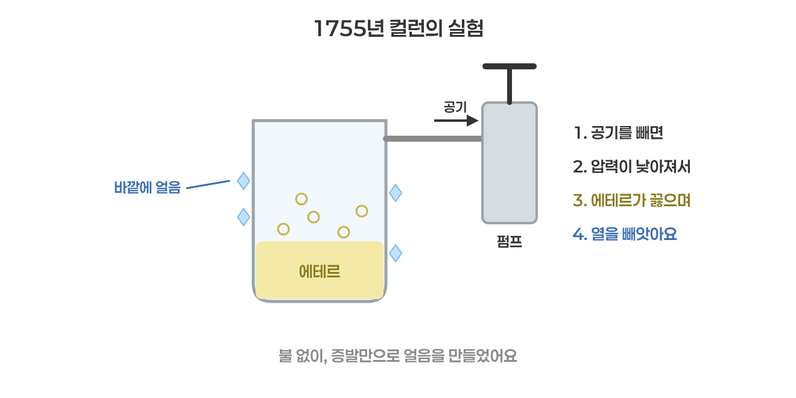

1755년 스코틀랜드의 의사이자 화학자 윌리엄 컬런은 펌프로 에테르 위의 공기를 빼냈어요([Wikipedia: Refrigeration](https://en.wikipedia.org/wiki/Refrigeration)).

공기가 빠져 압력이 낮아지자 에테르가 끓으면서 주변 공기의 열을 빨아들였어요.

이 실험으로 작은 얼음까지 생겼어요(같은 출처).

불을 하나도 쓰지 않고 액체를 증발시키는 것만으로 얼음을 만든 거예요.

2-1의 손 소독제가 시원한 것과 같은 원리예요.

### 4-2. 왜 증발하면 차가워질까요?

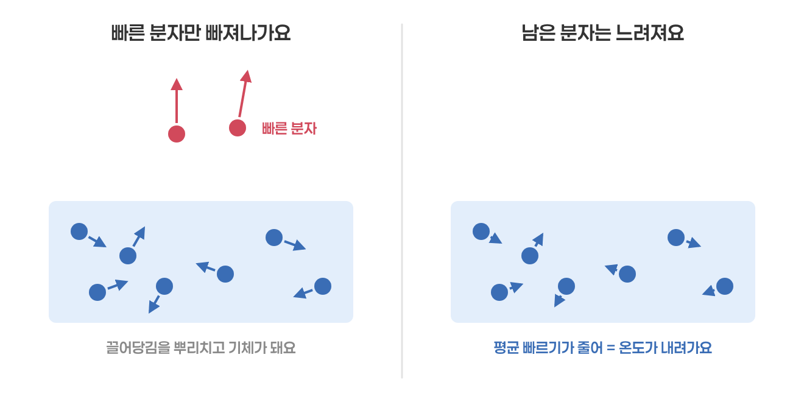

액체 속 분자들은 서로 끌어당기며 붙어 있어요.

분자들은 저마다 다른 빠르기로 움직이는데, 그중 아주 빠른 분자만 이웃의 끌어당김을 뿌리치고 기체로 날아갈 수 있어요.

빠른 분자가 빠져나가면 남은 분자들의 평균 빠르기가 느려져요.

온도는 분자들이 평균적으로 얼마나 빨리 움직이는지를 나타내니, 남은 액체의 온도가 내려가요([Wikipedia: Evaporation](https://en.wikipedia.org/wiki/Evaporation)).

액체는 내려간 온도만큼 맞닿은 손이나 공기에서 다시 열을 받아 와요.

그래서 증발이 계속되는 동안 주변의 열이 계속 빠져나가요.

### 4-3. 증발이 빼앗는 열은 아주 커요

액체가 기체가 되려면 분자들 사이의 끌어당김을 끊을 에너지가 필요해요([Wikipedia: Enthalpy of vaporization](https://en.wikipedia.org/wiki/Enthalpy_of_vaporization)).

물 1g이 100°C에서 증발하려면 약 2,257J의 열이 필요해요(같은 출처).

물 1g을 1°C 데우는 데는 약 4.2J이 드니, 증발 한 번에 그 500배가 넘는 열을 가져가는 셈이에요.

그래서 땀이 조금만 말라도 몸이 꽤 시원해져요.

냉장고가 냉매를 굳이 증발시키는 까닭도 여기 있어요.

같은 양의 냉매로 가장 많은 열을 빼앗는 방법이 증발이에요.

### 4-4. 냉매는 영하에서 끓어요

물은 100°C에서 끓으니 냉장고 안 온도로는 증발하지 않아요.

그래서 냉장고에는 아주 낮은 온도에서 끓는 냉매를 써요.

요즘 가정용 냉장고에 많이 쓰는 냉매 R-600a(이소부탄)는 보통 압력에서 약 -12°C에 끓어요([Wikipedia: Isobutane](https://en.wikipedia.org/wiki/Isobutane)).

## 5. 원리 3: 압력이 끓는점을 바꿔요

### 5-1. 에베레스트에서는 71°C에서 끓어요

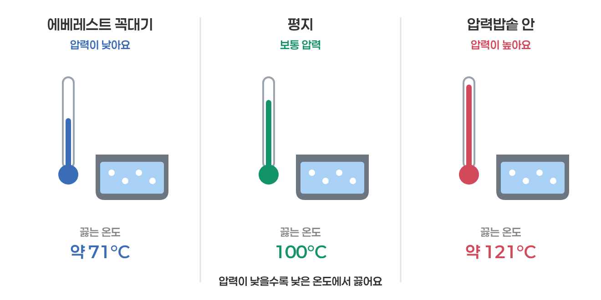

물이 늘 100°C에서 끓는 건 아니에요.

에베레스트 꼭대기처럼 공기 압력이 낮은 곳에서는 물이 약 71°C에서 끓어요([Wikipedia: Boiling point](https://en.wikipedia.org/wiki/Boiling_point)).

압력이 낮을수록 끓는점이 내려가요(같은 출처).

반대로 압력밥솥은 뚜껑을 닫아 김을 가둬 안쪽 압력을 높여요.

그러면 물이 약 121°C가 되어서야 끓어서 음식이 더 빨리 익어요([Wikipedia: Pressure cooking](https://en.wikipedia.org/wiki/Pressure_cooking)).

4-1의 컬런이 에테르 위 공기를 빼낸 것도 압력을 낮춰 더 낮은 온도에서 끓게 하려던 거예요.

### 5-2. 냉장고는 압력을 두 칸으로 나눠요

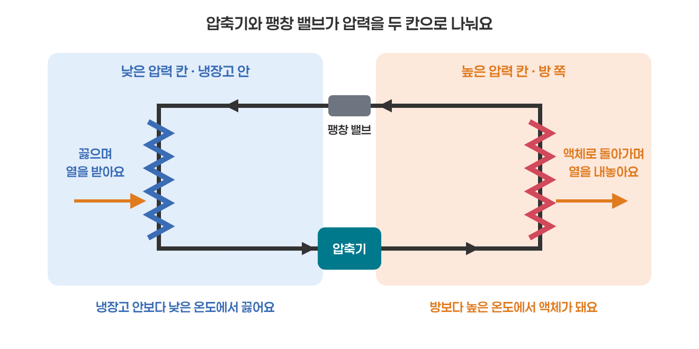

냉장고는 이 원리를 그대로 써요.

냉매가 도는 길은 압축기와 팽창 밸브를 경계로 두 칸으로 나뉘어요.

| 칸 | 압력 | 냉매가 하는 일 |
| --- | --- | --- |
| 냉장고 안쪽 관(증발기) | 낮아요 | 낮은 온도에서도 끓어 냉장고 안의 열을 빼앗아요 |
| 바깥쪽 관(응축기) | 높아요 | 높은 온도에서도 다시 액체가 되며 방으로 열을 내놓아요 |

압력이 낮은 안쪽에서는 냉매가 냉장고 안보다 더 낮은 온도에서 끓어요.

압력이 높은 바깥쪽에서는 냉매가 방보다 높은 온도에서도 액체로 돌아가요.

기체가 액체로 돌아갈 때는 증발할 때 가져갔던 열을 그대로 내놓아요.

그래서 3-2에서 말한 「안에서는 더 차갑게, 밖에서는 더 뜨겁게」가 압력 차이 하나로 이뤄져요.

## 6. 원리 4: 누르면 뜨거워지고, 풀면 차가워져요

### 6-1. 왜 누르면 뜨거워질까요?

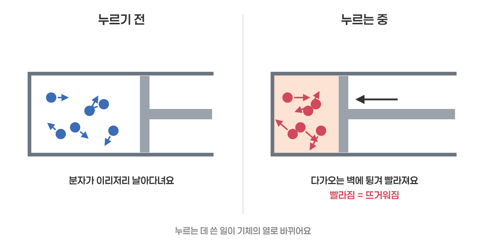

기체 분자들은 통 안을 날아다니며 벽에 부딪혀 튕겨 나와요.

피스톤을 밀어 넣으면 다가오는 벽에 부딪힌 분자는 더 빠르게 튕겨 나가요.

탁구공을 라켓으로 마주 받아치면 더 빨라지는 것과 같아요.

분자들이 빨라졌다는 건 온도가 올라갔다는 뜻이에요.

누르는 데 쓴 일이 기체의 열로 바뀐 거예요.

2-2의 자전거 펌프가 따뜻해지는 까닭이 이거예요.

> 오, 그래? 공기를 아주 빠르게 누르기만 해도 불을 붙일 수 있어요. 불 피스톤이라는 도구는 통 안 공기를 확 눌러 260°C가 넘게 데워서 끝에 붙인 불쏘시개에 불을 붙여요([Wikipedia: Fire piston](https://en.wikipedia.org/wiki/Fire_piston)). 냉장고 기술자 카를 폰 린데가 이 도구로 담뱃불을 붙이는 걸 본 제자 루돌프 디젤이, 공기를 눌러 연료에 불을 붙이는 디젤 엔진을 만들었어요(같은 출처). 린데는 1876년에 믿을 만한 암모니아 압축식 냉장 장치를 만든 사람이에요([Wikipedia: Carl von Linde](https://en.wikipedia.org/wiki/Carl_von_Linde)).

### 6-2. 압축기는 두 가지 일을 함께 해요

냉장고의 압축기는 기체 냉매를 꾹 눌러요.

그러면 6-1처럼 냉매가 방보다 뜨거워지고, 동시에 압력이 높아져서 5-2처럼 바깥쪽 관에서 액체로 돌아가며 열을 내놓을 수 있게 돼요.

압축기를 돌리는 모터가 냉장고와 에어컨에서 가장 중요한 액추에이터인 까닭이에요.

### 6-3. 풀면 차가워져요

바깥쪽 관을 지나 열을 버린 액체 냉매는 아주 가는 관이나 밸브를 지나요.

좁은 길을 빠져나가는 순간 압력이 확 떨어져요.

압력이 떨어지면 5-1처럼 끓는점이 내려가서 냉매 일부가 그 자리에서 끓어요.

끓으려면 4-3처럼 열이 필요한데, 그 열을 냉매 스스로에게서 가져가니 냉매가 확 차가워져요.

2-3의 스프레이 캔이 차가워지는 것과 같아요.

## 7. 네 원리를 한 바퀴로

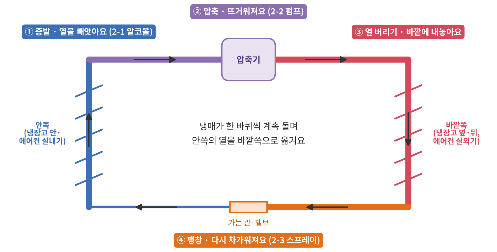

냉장고와 에어컨 안에는 관이 한 바퀴로 이어져 있고, 그 안을 냉매가 돌아요.

| 단계 | 어디서 | 무슨 일이 | 어떤 원리 |
| --- | --- | --- | --- |
| 증발 | 안쪽 관(증발기) | 낮은 압력에서 끓으며 냉장고 안의 열을 빼앗아요 | 원리 2·3 |
| 압축 | 압축기 | 눌러서 뜨겁고 압력 높은 기체로 만들어요 | 원리 4 |
| 열 버리기 | 바깥쪽 관(응축기) | 방보다 뜨거우니 열이 방으로 흘러 나가고, 액체로 돌아가요 | 원리 1·3 |
| 팽창 | 가는 관·밸브 | 압력이 떨어지며 일부가 끓어 다시 차가워져요 | 원리 3·4 |

냉장고 옆면·뒤쪽과 에어컨 실외기가 따뜻한 건 「열 버리기」 단계 때문이에요.

> 열을 옮기는 한 바퀴
>
> - 안쪽에서 낮은 압력으로 증발하며 열을 빼앗고(차가워짐)
> - 압축해서 뜨겁고 압력 높게 만든 뒤
> - 바깥쪽에서 열을 버리며 액체로 돌아가고(따뜻해짐)
> - 압력을 낮춰 다시 차갑게 만든다.

냉매는 닳지 않고 이 길을 계속 돌아요.

전기는 냉매를 압축하고 팬을 돌리는 데 써요.

## 8. 냉장고 들여다보기

### 8-1. 부품 지도

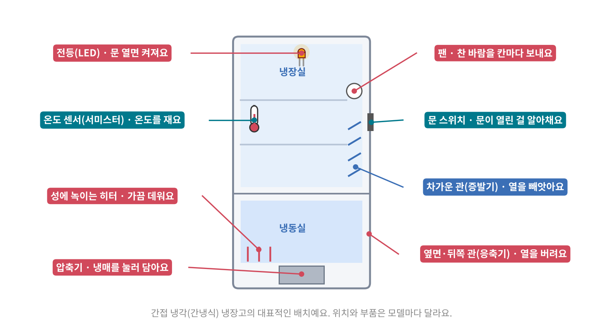

냉장고가 하는 일을 동작별로 나누면 이래요.

| 동작 | 알아채기(센서) | 움직이기(액추에이터) |
| --- | --- | --- |
| 차갑게 유지하기 | 온도 센서 | 압축기 모터 |
| 찬 바람 골고루 보내기 | 온도 센서 | 팬 모터 |
| 문 열면 불 켜기 | 문 스위치 | 안쪽 전등(LED) |
| 성에 녹이기 | 시간·온도 | 히터 |

판단은 모두 냉장고 안의 제어 기판(MCU)이 해요.

### 8-2. 차갑게 유지하기

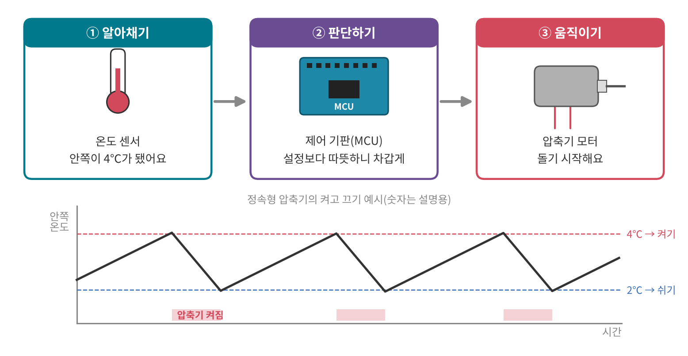

냉장고는 계속 같은 세기로 돌지 않아요.

1. 알아채기: 냉장실 안의 온도 센서가 온도를 재요. 보통 온도에 따라 저항이 바뀌는 서미스터를 써요.
2. 판단하기: 설정 온도보다 따뜻해지면 "차갑게 하자", 충분히 차가워지면 "쉬자"고 정해요.
3. 움직이기: 압축기 모터를 돌리거나 멈춰요.

예전 방식(정속형)은 압축기를 켜고 끄기만 해요.

요즘 많이 쓰는 인버터 방식은 압축기 속도를 바꿔서, 조금 따뜻해지면 천천히, 많이 따뜻해지면 빠르게 돌려요.

그래서 보통 온도가 덜 출렁이고 전기도 덜 써요.

### 8-3. 문 열면 불 켜기

문을 닫으면 문이 냉장고 몸체의 스위치를 눌러요.

문을 열면 스위치에서 문이 떨어지고 이걸 보고 안쪽 전등을 켜요.

제품에 따라 누르는 스위치 대신 자석으로 문 위치를 알아채는 센서를 쓰기도 해요.

문이 오래 열려 있으면 "삐삐" 알려 주는 것도 같은 신호를 써요.

### 8-4. 찬 바람 보내기와 성에 녹이기

냉장고는 차가운 관(증발기)을 어디에 두느냐에 따라 직접 냉각과 간접 냉각으로 나뉘어요.

| 방식 | 차갑게 하는 법 | 성에 |
| --- | --- | --- |
| 직접 냉각(직냉식) | 칸 벽 속 차가운 관이 직접 식혀요 | 벽에 성에가 끼어요 |
| 간접 냉각(간냉식) | 뒤쪽 차가운 관에서 식힌 바람을 팬이 칸마다 보내요 | 보통 히터로 자동으로 녹여요 |

공기 속 수분은 차가운 관에 닿으면 얼어붙어 성에가 돼요.

간냉식은 정해진 때가 되면 히터로 관을 잠깐 데워 성에를 녹이고 녹은 물은 관을 따라 밖으로 빼내요.

## 9. 에어컨 들여다보기

### 9-1. 왜 둘로 나뉠까요?

냉장고는 열을 방에 버려도 괜찮아요.

에어컨은 방을 식히는 기계라서 열을 방에 버리면 안 돼요.

그래서 열을 빼앗는 부분(실내기)과 열을 버리는 부분(실외기)을 나눠 두고 둘 사이를 냉매 관으로 이어요.

### 9-2. 부품 지도

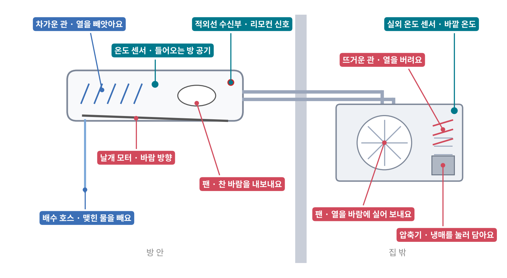

| 동작 | 알아채기(센서·입력) | 움직이기(액추에이터) |
| --- | --- | --- |
| 리모컨 명령 받기 | 적외선 수신부 | 없음(제어 기판이 받음) |
| 방 온도 맞추기 | 실내 온도 센서 | 실외기 압축기 모터 |
| 찬 바람 내보내기 | 설정 바람 세기 | 실내기 팬 모터 |
| 바람 방향 바꾸기 | 리모컨 설정 | 날개 모터 |
| 열 버리기 | 실외 온도 센서 | 실외기 팬 모터 |

### 9-3. 리모컨과 온도 맞추기

리모컨 버튼을 누르면 리모컨 앞쪽에서 눈에 안 보이는 적외선 신호가 나가요.

실내기의 수신부가 이 신호를 받아 "희망 온도 24℃" 같은 명령으로 읽어요.

그다음은 냉장고와 같아요.

실내기로 빨려 들어오는 방 공기의 온도를 재서, 희망 온도보다 높으면 압축기를 세게, 가까워지면 약하게 돌려요.

### 9-4. 바람 방향 날개

바람이 나오는 곳의 날개는 보통 작은 모터가 정해진 각도만큼씩 움직여요.

"위아래 자동"을 켜면 이 모터가 날개를 천천히 오르내리게 해요.

### 9-5. 에어컨에서 물이 나오는 이유

실내기 안의 차가운 관에 방 공기가 닿으면, 차가운 컵 겉면에 물방울이 맺히듯 공기 속 수분이 물방울로 맺혀요.

이 물은 배수 호스로 밖에 빼내요.

방 공기에서 물기가 빠지니 에어컨을 켜면 습도도 내려가요.

제습 모드는 이 효과를 주로 쓰는 운전이에요.

### 9-6. 거꾸로 돌리면 난방

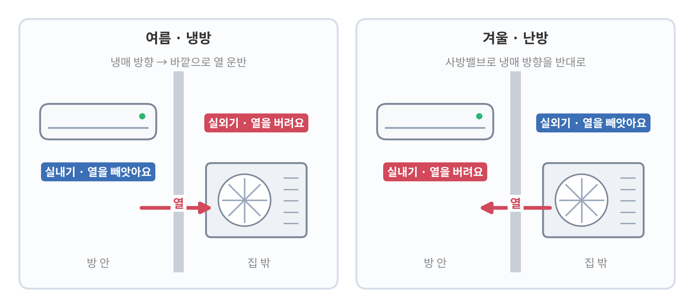

냉난방 겸용 에어컨은 같은 기계로 난방도 해요.

보통 밸브 하나(사방밸브)로 냉매가 도는 방향을 바꿔요.

그러면 실외기가 바깥 공기의 열을 빼앗고 실내기가 그 열을 방에 버려요.

추운 겨울 바깥 공기에도 열은 남아 있어서 그 열을 모아 안으로 옮기는 거예요.

이렇게 열을 낮은 쪽에서 높은 쪽으로 퍼 올린다고 해서 히트펌프라고 불러요.

## 10. 냉장고와 에어컨 비교

| 비교 | 냉장고 | 에어컨(냉방) |
| --- | --- | --- |
| 열을 빼앗는 곳 | 냉장고 안 | 방 안(실내기) |
| 열을 버리는 곳 | 방(옆면·뒤쪽) | 집 밖(실외기) |
| 압축기 위치 | 냉장고 아래 뒤쪽 | 실외기 |
| 온도를 재는 곳 | 냉장실·냉동실 안 | 실내기로 들어오는 공기 |
| 생기는 물 | 성에(히터로 녹임) | 물방울(배수 호스로 뺌) |
| 반대로 돌리면 | 보통 그렇게 쓰지 않아요 | 난방(히트펌프) |

## 11. 자주 헷갈리는 점

### 11-1. 냉장고 문을 열어 두면 방이 시원해질까요?

정답 보기

아니요, 오히려 조금씩 더워져요.

냉장고는 앞에서 빼앗은 열을 뒤쪽으로 같은 방에 다시 버려요.

열이 방 안에서 한 바퀴 돌 뿐이고 여기에 압축기 모터가 쓴 전기까지 열로 더해져요.

에어컨이 실외기를 집 밖에 두는 이유가 이거예요.

### 11-2. 에어컨은 바깥 공기를 들여와 식히나요?

정답 보기

보통 가정용 벽걸이·스탠드 에어컨은 방 공기를 빨아들여 식힌 다음 다시 내보내요.

실내기와 실외기 사이를 오가는 건 관 속 냉매뿐이에요.

방 공기는 바깥과 섞이지 않아요.

그래서 에어컨만으로는 환기가 되지 않아요.

### 11-3. 냉매는 쓰다 보면 닳아서 채워야 하나요?

정답 보기

냉매는 닫힌 관 속을 계속 돌기 때문에 원래는 줄어들지 않아요.

냉매가 부족하다면 어딘가 새고 있다는 뜻이라, 채우기 전에 새는 곳을 찾는 게 먼저예요.

## 12. 같은 원리를 쓰는 다른 기기

열을 옮기는 한 바퀴는 냉장고와 에어컨 말고도 여러 곳에서 써요.

- 제습기: 차가운 관으로 물기를 맺히게 하고 뜨거운 관 옆을 지나게 해서 다시 내보내요. 그래서 제습기를 틀면 방이 조금 따뜻해져요.
- 김치냉장고·정수기 냉수: 같은 방식으로 안쪽을 식혀요.
- 히트펌프 건조기: 뜨거운 쪽으로 빨래를 말리고 차가운 쪽으로 물기를 모아요.

제품에 따라 다른 방식(전기 소자로 식히는 방식 등)을 쓰는 경우도 있어요.

## 13. 한 장 요약

> 냉장고와 에어컨: 열을 옮기는 기계
>
> - 냉장고와 에어컨은 열을 안에서 밖으로 옮긴다.
> - 원리 1: 열은 저절로 뜨거운 쪽에서 차가운 쪽으로만 흐른다. 거꾸로 옮기려면 일(압축기)이 필요하다.
> - 원리 2: 증발하면 빠른 분자가 빠져나가 남은 쪽이 차가워진다. 물 1g 증발은 1°C 데우는 열의 500배가 넘는 열을 가져간다.
> - 원리 3: 압력이 낮으면 낮은 온도에서 끓고, 높으면 높은 온도에서도 액체로 돌아간다.
> - 원리 4: 기체를 누르면 뜨거워지고, 압력을 풀면 일부가 끓으며 차가워진다.
> - 냉매가 증발 → 압축 → 열 버리기 → 팽창을 한 바퀴씩 돌며 이 네 원리를 이어 쓴다.
> - 냉장고: 온도 센서가 재고 제어 기판이 판단하고 압축기·팬·히터·전등이 움직인다.
> - 에어컨: 열을 빼앗는 실내기와 열을 버리는 실외기로 나뉜다.
> - 냉매가 도는 방향을 바꾸면 에어컨이 난방기가 된다(히트펌프).

## 14. 셀프 퀴즈

<b>Q1.</b> 여름에 에어컨 실외기 앞에 서면 뜨거운 바람이 나와요.

이 열은 어디서 온 걸까요?

정답 보기

대부분 방 안에서 빼앗아 온 열이에요.

여기에 압축기를 돌리는 데 쓴 전기의 열이 더해져요.

<b>Q2.</b> 냉장고 압축기가 멈췄다 돌았다를 반복해요.

무엇이 무엇을 보고 정하는 걸까요?

정답 보기

냉장고 안의 온도 센서가 온도를 재고 제어 기판이 설정 온도와 비교해 압축기를 돌릴지 쉴지 정해요.

<b>Q3.</b> 냉난방 에어컨이 겨울에 난방을 할 때, 실외기는 무슨 일을 할까요?

정답 보기

바깥 공기의 열을 빼앗는 쪽이 돼요.

여름에 실내기가 하던 일을 겨울에는 실외기가 해요.

냉매가 도는 방향만 반대로 바뀐 거예요.

<b>Q4.</b> 냉장고는 왜 냉매를 굳이 압축기로 꾹 눌러야 할까요?

정답 보기

열은 저절로 차가운 냉장고 안에서 따뜻한 방으로 흐르지 않아요.

냉매를 눌러 방보다 뜨겁게, 압력을 높게 만들어야 바깥쪽 관에서 열이 방으로 흘러 나가고 냉매가 액체로 돌아가요.

## 참고 자료

- [Wikipedia: Refrigeration](https://en.wikipedia.org/wiki/Refrigeration)
- [Wikipedia: Evaporation](https://en.wikipedia.org/wiki/Evaporation)
- [Wikipedia: Enthalpy of vaporization](https://en.wikipedia.org/wiki/Enthalpy_of_vaporization)
- [Wikipedia: Boiling point](https://en.wikipedia.org/wiki/Boiling_point)
- [Wikipedia: Fire piston](https://en.wikipedia.org/wiki/Fire_piston)
- [Wikipedia: Coefficient of performance](https://en.wikipedia.org/wiki/Coefficient_of_performance)
- [Danfoss: 냉장고 작동 원리 - 기본 교육](https://www.danfoss.com/ko-kr/about-danfoss/our-businesses/cooling/the-fridge-how-it-works/)
- [비건뉴스: 히트펌프 난방은 전기로 열을 옮긴다](https://www.vegannews.co.kr/news/article.html?no=390956)
- [Wikipedia: Reversing valve](https://en.wikipedia.org/wiki/Reversing_valve)

## 강좌 이동

- 이전 강좌: [생활 기기 들여다보기: 매일 쓰는 기계 속 센서와 액추에이터](<../생활 기기 100 생활 기기 들여다보기/index.md>)
- 다음 강좌: [인덕션: 불 없이 냄비만 뜨거워지는 이유](<../생활 기기 120 인덕션/index.md>)
