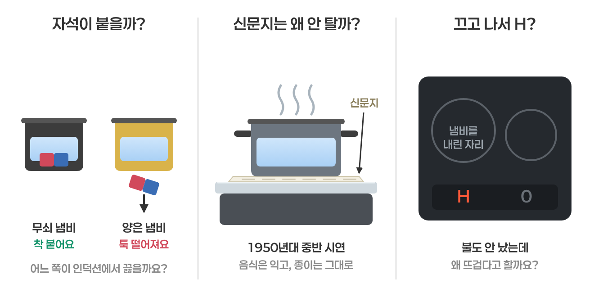
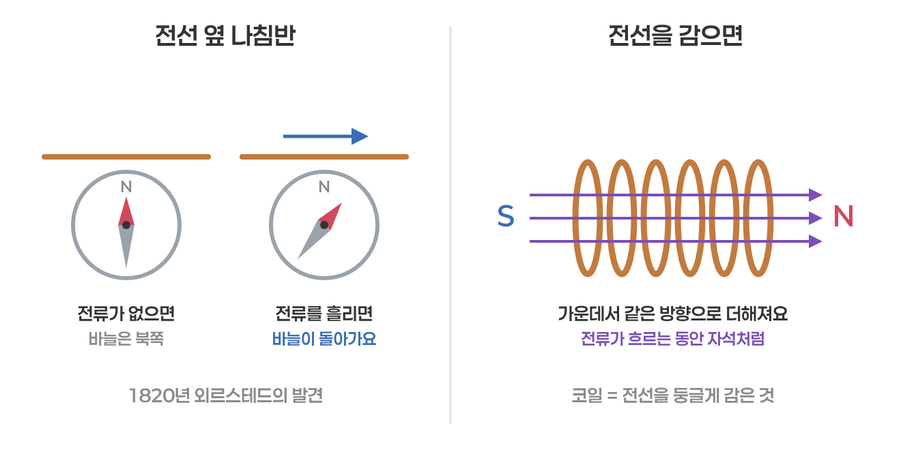
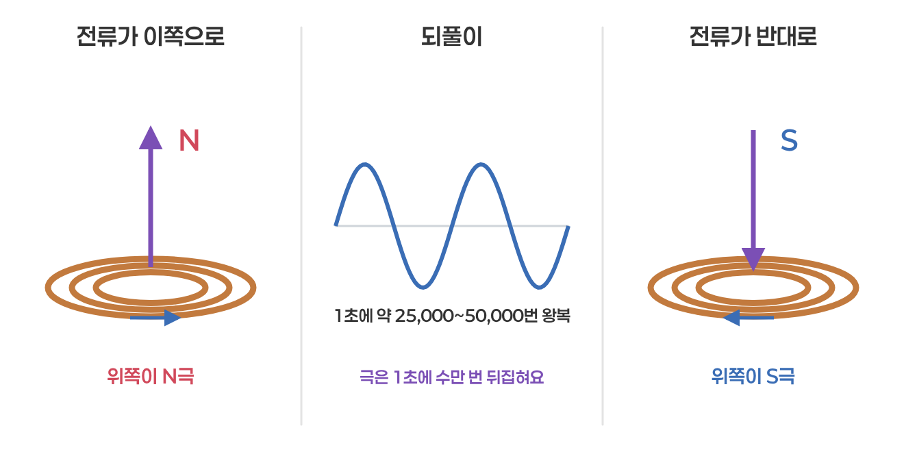
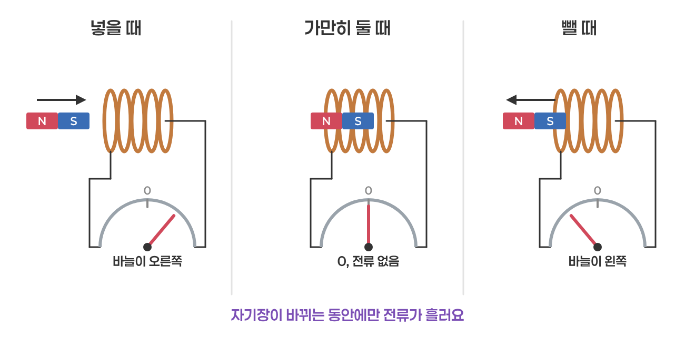
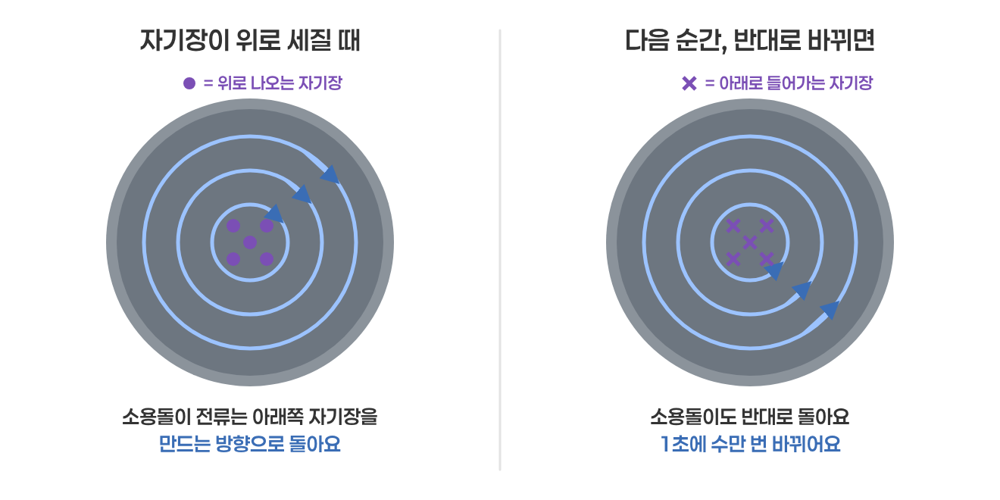
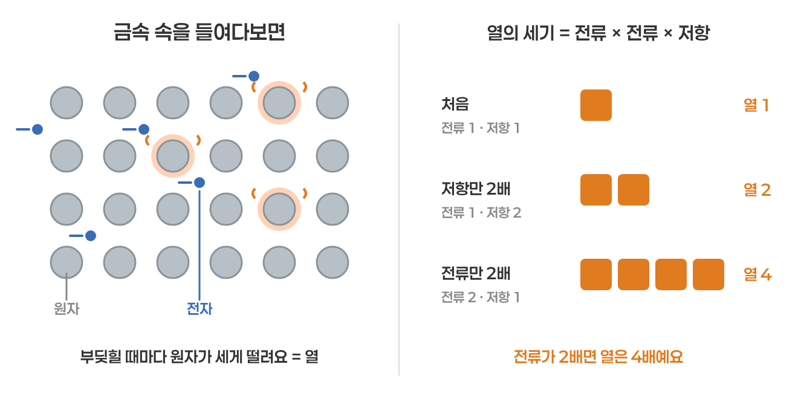
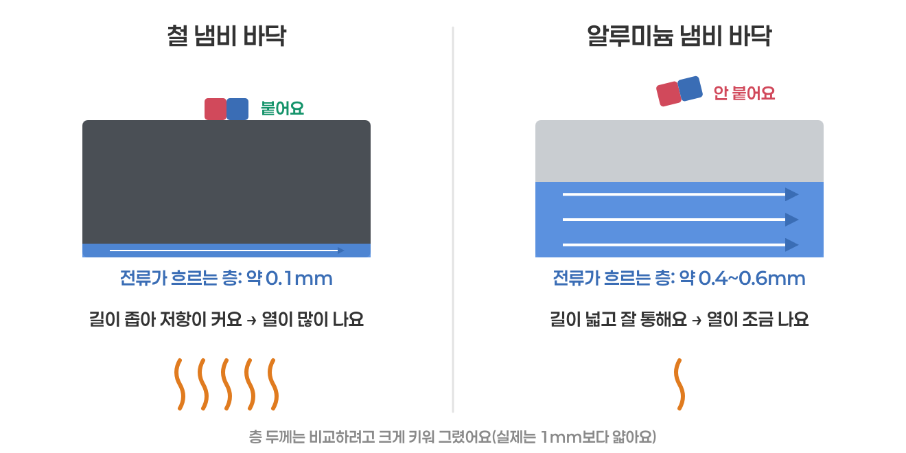
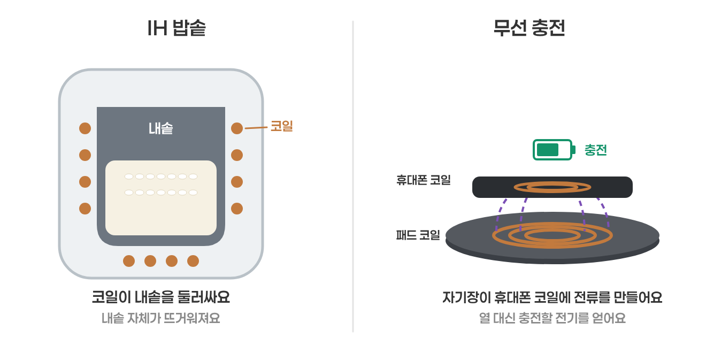

<!--
title: "인덕션: 불 없이 냄비만 뜨거워지는 이유"
field: 생활 기기
order: 120
level: 기초
tags: [생활 기기, 인덕션, 전자기 유도, 소용돌이 전류]
summary: "인덕션은 상판을 데우는 기계가 아니라, 자기장으로 냄비 바닥에 전류를 흘려서 냄비가 스스로 뜨거워지게 하는 기계예요."
-->

# 인덕션: 불 없이 냄비만 뜨거워지는 이유

<!-- 목차 -->

## 1. 먼저 한 줄로

인덕션은 상판을 데우는 기계가 아니라, 자기장으로 냄비 바닥에 전류를 흘려서 냄비가 스스로 뜨거워지게 하는 기계예요.

가스레인지는 불꽃이 냄비 바닥을 데워요.

하이라이트 같은 전기레인지는 상판 아래 열선이 상판을 데우고, 뜨거워진 상판이 냄비를 데워요.

인덕션은 둘 다 아니에요.

상판 아래 코일이 보이지 않는 자기장을 만들고, 그 자기장이 냄비 바닥 안에 전류를 흐르게 해요.

열은 냄비 바닥에서 생겨요.

그래서 불도 없고 빨갛게 달아오르는 곳도 없는데 냄비 속 물은 끓어요.

## 2. 예시로 먼저 감 잡기

인덕션을 쓰다 보면 고개를 갸웃하게 되는 순간이 있어요.

세 가지만 먼저 풀어 볼게요.

### 2-1. 양은 냄비는 왜 안 끓을까요?

라면을 끓이려고 노란 양은 냄비를 인덕션에 올리면 끓지 않아요.

인덕션 화면에 "사용 불가" 같은 표시가 뜨기도 해요.

그런데 무쇠 프라이팬은 금방 뜨거워져요.

지금 부엌에서 바로 해 볼 수 있는 실험이 있어요.

냉장고에 붙은 자석을 떼어 냄비 바닥에 대 보세요.

자석이 붙는 냄비와 안 붙는 냄비가 있을 거예요.

어느 쪽이 인덕션에서 끓을까요?

정답 보기

자석이 붙는 냄비예요.

인덕션은 바닥이 자석에 붙는 냄비에서만 제대로 가열돼요([삼성전자서비스: IH 가열 방식이란](https://www.samsungsvc.co.kr/solution/1025831)).

양은 냄비는 알루미늄이라 자석이 붙지 않아요.

왜 자석이 붙어야 하는지는 6장에서 풀어 볼게요.

### 2-2. 신문지를 깔고 요리한 시연

1950년대 중반 미국 가전 회사 프리지데어는 인덕션 레인지를 사람들 앞에서 시연했어요.

이때 레인지와 냄비 사이에 신문지를 깔고 요리를 해 보였어요([Wikipedia: Induction cooking](https://en.wikipedia.org/wiki/Induction_cooking)).

안전하다는 걸 보여 주려는 시연이었고, 이 레인지는 끝내 팔리지 않았어요(같은 출처).

냄비 속 음식은 익었는데 신문지는 불이 붙지 않았어요.

어떻게 이럴 수 있었을까요?

정답 보기

열이 레인지가 아니라 냄비 바닥에서 생기기 때문이에요.

자기장은 신문지를 그냥 지나가요.

종이는 전기가 통하지 않아서 자기장이 지나가도 그 안에 전류가 흐르지 않고, 그래서 열도 생기지 않아요.

다만 뜨거워진 냄비 바닥이 종이에 오래 닿아 있으면 종이가 그을릴 수 있어요.

집에서는 따라 하지 마세요.

### 2-3. 불도 안 났는데 "H"가 떠요

요리를 마치고 전원을 끄면 화구 자리에 "H"가 떠요.

인덕션은 상판을 데우지 않는다면서, 왜 뜨겁다고 알려 줄까요?

정답 보기

뜨거워진 냄비가 상판 위에 앉아 있었기 때문이에요.

냄비 바닥의 열이 맞닿은 상판으로 옮겨 가요.

"H"는 화구 자리가 아직 뜨겁다는 잔열 표시예요([LG전자: 똑똑한 기능 활용법](https://www.lge.co.kr/support/solutions-20152789859736)).

옆 화구를 쓰다가 열이 옮겨 온 자리에서도 "H"가 켜질 수 있어요([Whirlpool: H - Residual Heat](https://producthelp.whirlpool.com/Cooking/Cooktops/Induction_Cooktops/Error_Code_or_Indicator_Light/Other_Error_Codes/H_-_Residual_Heat_-_Error_Code_-_Induction_Cooktop)).

### 2-4. 세 가지에서 찾은 규칙

| 수수께끼 | 일어나는 일 | 알 수 있는 것 |
| --- | --- | --- |
| 양은 냄비 | 알루미늄 냄비는 안 데워져요 | 냄비 재질이 열을 만드는 데 끼어들어요 |
| 신문지 | 종이는 그대로예요 | 자기장은 전기가 안 통하는 물건을 데우지 않아요 |
| "H" 표시 | 끈 뒤에도 상판이 뜨거워요 | 열은 냄비에서 생기고 상판은 냄비에게서 열을 받아요 |

세 가지를 합치면 이렇게 돼요.

인덕션은 자기장으로 냄비 바닥에 열을 만들어요.

## 3. 원리 1: 전류가 자석을 만들어요

인덕션 속에서는 세 가지 원리가 차례로 이어져요.

전류가 자석을 만들고, 바뀌는 자석이 다시 전류를 만들고, 그 전류가 저항을 지나며 열이 돼요.

하나씩 처음 발견된 실험부터 볼게요.

### 3-1. 전선 옆 나침반이 돌아갔어요

1820년 덴마크 과학자 외르스테드는 전선에 전류를 흘리면 옆에 둔 나침반 바늘이 북쪽에서 벗어난다는 것을 발표했어요([Wikipedia: Hans Christian Ørsted](https://en.wikipedia.org/wiki/Hans_Christian_%C3%98rsted)).

나침반 바늘은 작은 자석이라 다른 자석이 가까이 있을 때만 움직여요.

그런데 자석은 없고 전류만 흘렀는데 바늘이 움직였어요.

전류가 흐르는 전선 둘레에 자석과 같은 힘, 곧 자기장이 생긴다는 뜻이에요.

전기와 자기가 서로 이어져 있다는 첫 증거였어요.

> 오, 그래? 외르스테드는 1825년에 금속 알루미늄을 처음 만들어 낸 사람이기도 해요([Britannica: Hans Christian Ørsted](https://www.britannica.com/biography/Hans-Christian-Orsted)). 전기로 자석을 만드는 길을 연 사람이, 공교롭게도 인덕션에서 잘 안 데워지는 금속을 처음 만든 셈이에요.

### 3-2. 전선을 둥글게 감으면 자석이 세져요

전선 한 가닥이 만드는 자기장은 약해요.

전선을 둥글게 여러 번 감으면 이야기가 달라져요.

한 바퀴 한 바퀴가 만드는 자기장이 고리 가운데에서는 모두 같은 방향을 가리켜서 차곡차곡 더해져요.

열 바퀴를 감으면 가운데 자기장은 한 바퀴일 때보다 훨씬 세져요.

이렇게 감은 전선을 코일이라고 하고, 전류가 흐르는 동안에는 한쪽이 N극, 반대쪽이 S극인 자석처럼 굴어요.

인덕션 상판 아래에는 구리선을 납작하게 감은 큰 코일이 화구마다 들어 있어요.

### 3-3. 전류 방향을 바꾸면 N극과 S극이 바뀌어요

코일에 흐르는 전류 방향을 반대로 하면 N극과 S극도 자리를 바꿔요.

인덕션은 이걸 아주 빠르게 되풀이해요.

전류가 한 번 갔다 돌아오는 왕복을 보통 1초에 약 25,000번에서 50,000번 되풀이해요([Wikipedia: Induction cooking](https://en.wikipedia.org/wiki/Induction_cooking)).

왕복 한 번에 극이 두 번 뒤집히니, 코일 위 자기장은 1초에 5만 번에서 10만 번 방향을 바꿔요.

우리나라 콘센트 전기는 1초에 60번 왕복하니까, 수백 배 빠른 셈이에요.

### 3-4. 콘센트 전기를 빠른 전류로 바꾸는 회로

콘센트 전기를 그대로 코일에 넣으면 너무 느려요.

그래서 인덕션 안에는 전기를 바꿔 주는 회로가 있어요.

먼저 정류기가 방향이 바뀌는 콘센트 전기를 한 방향 전기로 바꿔요.

그다음 인버터가 이 전기를 아주 빠르게 켰다 껐다 하고 방향을 바꿔 가며 코일로 보내요.

HowStuffWorks는 이렇게 전류의 세기와 빠르기를 높이는 부품으로 변압기, 정류기, 인버터를 꼽아요([HowStuffWorks: How Induction Cooktops Work](https://home.howstuffworks.com/induction-cooktops3.htm)).

화력 버튼을 누르면 바뀌는 것도 이 회로가 코일에 보내는 전류의 세기예요.

## 4. 원리 2: 바뀌는 자석이 전류를 만들어요

### 4-1. 패러데이가 본 것: 바뀌는 순간에만 전류가 흘러요

전류가 자석을 만든다면, 거꾸로 자석으로 전류를 만들 수는 없을까요?

영국 과학자 패러데이가 1831년에 그 답을 발표했어요([Wikipedia: Electromagnetic induction](https://en.wikipedia.org/wiki/Electromagnetic_induction)).

첫 실험에서 그는 쇠고리에 전선 두 가닥을 따로 감았어요.

한쪽 전선에 전지를 이으면 다른 쪽 전선에는 전지가 없는데도 전류가 잠깐 흘렀어요.

그런데 전지를 계속 이어 두면 전류가 사라지고, 전지를 떼는 순간 다시 잠깐 흘렀어요(같은 출처).

막대자석을 코일 속에 밀어 넣거나 빼낼 때도 전류가 흘렀어요.

자석을 코일 속에 가만히 두면 아무리 센 자석이라도 전류는 0이었어요.

> 자석이 있다고 전류가 생기는 게 아니라, 자기장이 **바뀌는 동안에만** 전류가 생겨요.

이것을 전자기 유도라고 해요.

### 4-2. 빨리 바뀔수록 전류가 세져요

패러데이 법칙에 따르면 생기는 전압의 크기는 자기장이 얼마나 빨리 바뀌느냐에 따라 정해져요(같은 출처).

자석을 천천히 넣으면 전류계 바늘이 조금 움직이고, 빨리 넣으면 크게 움직여요.

이제 인덕션이 왜 코일 전류를 1초에 수만 번이나 왕복시키는지 알 수 있어요.

자기장을 아주 빨리 바꿔야 냄비 바닥에 센 전류를 만들 수 있기 때문이에요.

건전지처럼 한 방향으로만 흐르는 전류를 코일에 계속 흘리면 어떻게 될까요?

코일 위에 자기장은 생기지만 바뀌지 않으니, 냄비 바닥에 전류도 열도 생기지 않아요.

### 4-3. 냄비 바닥에서는 소용돌이가 돼요

패러데이의 실험에서는 전류가 전선을 따라 흘렀어요.

냄비 바닥은 전선이 아니라 넓은 금속판이에요.

그래서 전류가 바뀌는 자기장을 빙 둘러싸며 바닥 안에서 둥글게 돌아요.

물의 소용돌이처럼 돈다고 해서 소용돌이 전류(와전류)라고 불러요.

소용돌이 전류는 금속판이 바뀌는 자기장 속에 있을 때 생기는 둥근 전류이고, 유도 가열과 와전류 브레이크에 쓰여요(같은 출처).

돌아가는 방향도 정해져 있어요.

렌츠 법칙에 따르면 유도된 전류는 자기의 원인이 된 변화를 방해하는 방향으로 흘러요(같은 출처).

코일의 자기장이 위쪽으로 세지려 하면 소용돌이 전류는 아래쪽 자기장을 만드는 방향으로 돌고, 반대로 바뀌면 소용돌이도 반대로 돌아요.

그래서 소용돌이 전류도 코일 전류처럼 1초에 수만 번 방향을 바꾸며 돌아요.

### 4-4. 전선 없이 에너지가 건너가요

코일과 냄비는 전선으로 이어져 있지 않아요.

코일의 전기 에너지가 자기장을 타고 유리 상판을 건너 냄비 바닥의 전류로 옮겨 간 거예요.

Wikipedia는 인덕션을 코일에서 금속 그릇으로 전기 에너지를 선 없이 건네주는 장치라고 설명해요([Wikipedia: Induction cooking](https://en.wikipedia.org/wiki/Induction_cooking)).

유리 상판은 전기가 통하지 않아서 자기장이 지나가도 그 안에 전류가 생기지 않아요.

2-2의 신문지가 타지 않은 까닭도 같아요.

## 5. 원리 3: 전류가 저항을 지나면 열이 나요

### 5-1. 열은 부딪힘에서 나와요

이제 냄비 바닥에 전류가 돌고 있어요.

전류는 금속 속 전자들이 한쪽으로 몰려 움직이는 거예요.

움직이는 전자들은 금속을 이루는 원자들과 계속 부딪혀요.

부딪힐 때마다 전자의 움직임 에너지가 원자에게 넘어가고, 원자들이 더 세게 떨려요([Wikipedia: Joule heating](https://en.wikipedia.org/wiki/Joule_heating)).

원자가 세게 떨리는 것이 바로 우리가 뜨겁다고 느끼는 열이에요.

전류가 지나가기 어려운 정도, 곧 저항이 클수록 이런 부딪힘이 많아요.

[저항: 색띠 읽고 고르고 합치기](<../전자 부품 120 저항/index.md>)에서 본 토스터 열선이 뜨거워지는 것도 같은 원리예요.

인덕션에서는 냄비 바닥 자체가 이 열선 노릇을 해요.

### 5-2. 열 = 전류 × 전류 × 저항

전류가 저항을 지나며 내는 열의 세기는 이렇게 써요(같은 출처).

$$
\text{열의 세기} = \text{전류} \times \text{전류} \times \text{저항}
$$

이 식은 영국 과학자 줄의 이름을 따서 줄의 법칙이라고 불러요(같은 출처).

식에서 읽을 수 있는 것이 두 가지예요.

| 바꾼 것 | 열의 세기 |
| --- | --- |
| 저항만 2배 | 2배 |
| 전류만 2배 | 2 × 2 = 4배 |

저항이 커지면 열이 그만큼 커지고, 전류가 커지면 그 제곱만큼 커져요.

인덕션은 두 가지를 다 써요.

4-2처럼 자기장을 빨리 바꿔 소용돌이 전류를 키우고, 6장에서 볼 철 냄비의 성질로 저항을 키워요.

### 5-3. 세 원리를 한 줄로

> 인덕션이 냄비를 데우는 네 단계
>
> - 코일에 1초에 수만 번 왕복하는 전류를 흘린다(원리 1).
> - 코일 위에 빠르게 뒤집히는 자기장이 생긴다(원리 1).
> - 바뀌는 자기장이 냄비 바닥에 소용돌이 전류를 만든다(원리 2).
> - 소용돌이 전류가 냄비의 저항을 지나며 열이 난다(원리 3).

## 6. 왜 자석이 붙는 냄비만 될까요?

### 6-1. 빠르게 바뀌는 전류는 겉으로 몰려요

냄비 바닥의 소용돌이 전류는 두께 전체로 고르게 흐르지 않아요.

아래쪽 겉면 가까이로 몰려 흘러요.

까닭은 4-3의 렌츠 법칙과 같아요.

빠르게 바뀌는 전류는 자기 둘레에 바뀌는 자기장을 만들고, 그 자기장이 금속 안쪽에 반대 방향의 전류를 만들어요.

이 방해는 금속 한가운데에서 가장 세서, 전류가 바깥 겉면 쪽으로 밀려나요([Wikipedia: Skin effect](https://en.wikipedia.org/wiki/Skin_effect)).

이것을 표피 효과라고 해요.

전류가 빨리 바뀔수록 더 얇은 겉층으로 몰려요(같은 출처).

### 6-2. 자석이 붙는 금속은 더 얇게 몰려요

표피 효과는 금속이 자석에 얼마나 잘 붙는지에 따라서도 달라져요.

자석이 잘 붙는 금속일수록 전류가 흐르는 겉층이 더 얇아져요(같은 출처).

같은 출처에 따르면 콘센트 전기 정도의 빠르기에서도 철의 겉층은 구리의 약 38분의 1 두께예요.

인덕션의 빠른 전류에서는 탄소강 냄비의 겉층이 약 0.1mm까지 얇아져요([Wikipedia: Induction cooking](https://en.wikipedia.org/wiki/Induction_cooking)).

### 6-3. 길이 좁아지면 저항이 커져요

전류가 바닥 두께 전체가 아니라 얇은 겉층으로만 흐르면, 전류가 지나는 길이 좁아진 것과 같아요.

길이 좁으면 저항이 커져요([Wikipedia: Skin effect](https://en.wikipedia.org/wiki/Skin_effect)).

[저항 강의](<../전자 부품 120 저항/index.md>)의 좁은 회전문을 떠올려 보세요.

5-2의 식에서 저항이 커지면 열도 커지니, 철 냄비 바닥은 좁은 겉층에서 열을 많이 내요.

철에서는 철 속 작은 자석 구역들이 자기장을 따라 방향을 바꾸며 내는 열도 조금 더해지지만, 전체 열의 10%가 안 되고 대부분은 소용돌이 전류의 열이에요([Wikipedia: Induction cooking](https://en.wikipedia.org/wiki/Induction_cooking)).

### 6-4. 알루미늄·구리는 전류가 너무 쉽게 지나가요

알루미늄과 구리는 자석이 붙지 않아서 전류가 철보다 훨씬 두꺼운 층(약 0.4~0.6mm)으로 퍼져 흘러요(같은 출처).

게다가 원래 전기가 아주 잘 통하는 금속이에요.

길이 넓고 잘 통하니 저항이 작고, 같은 조건에서 열이 조금밖에 나지 않아요.

같은 출처에 따르면 구리 바닥의 저항은 탄소강의 약 56분의 1이에요.

이러면 코일과 냄비가 비슷하게 데워져서 에너지 낭비가 크고 기계에도 좋지 않아요.

그래서 보통 인덕션은 이런 냄비를 알아채고 가열하지 않아요(같은 출처).

유리, 도자기, 뚝배기는 아예 전기가 통하지 않으니 소용돌이 전류가 생기지 않아요.

### 6-5. 냄비 재질 정리

| 냄비 바닥 재질 | 인덕션 | 까닭 |
| --- | --- | --- |
| 철, 주철(무쇠), 법랑 | 돼요 | 전류가 얇은 겉층에 몰려 저항이 커요 |
| 스테인리스 | 바닥에 자석이 붙으면 돼요 | 합금에 따라 자석이 안 붙는 것도 있어요 |
| 알루미늄(양은), 구리 | 안 돼요 | 저항이 너무 작아 열이 잘 안 나요 |
| 유리, 도자기, 뚝배기 | 안 돼요 | 전기가 안 통해 전류가 생기지 않아요 |

재질별 사용 여부는 [삼성전자서비스: IH 가열 방식이란](https://www.samsungsvc.co.kr/solution/1025831)과 [LG전자: 인덕션 용기 찾는 법](https://www.lge.co.kr/story/life/thinq-discover-kitchen-012)을 참고했어요.

"인덕션 전용" 표시가 있어도 바닥 일부만 자석이 붙는 냄비는 잘 데워지지 않을 수 있어요(LG전자 같은 글).

그래서 2-1의 자석 실험이 가장 확실한 확인법이에요.

### 6-6. 알루미늄도 되는 인덕션이 있다고요?

있어요.

6-1에서 본 것처럼 전류가 빨리 바뀔수록 겉층이 얇아져요.

그래서 구리나 알루미늄도 전류를 훨씬 더 빠르게 왕복시키면 열을 더 낼 수 있어요([Wikipedia: Induction cooking](https://en.wikipedia.org/wiki/Induction_cooking)).

파나소닉은 2009년에 1초에 60,000번 이상 왕복하는 전류를 쓰는 "올메탈" 인덕션을 내놓았고, 알루미늄과 구리 냄비도 쓸 수 있게 했어요(같은 출처).

집에 있는 인덕션이 이런 제품인지는 설명서에서 확인해요.

## 7. 인덕션 들여다보기

### 7-1. 부품 지도

인덕션이 하는 일을 동작별로 나누면 이래요.

| 동작 | 알아채기(센서·입력) | 움직이기(액추에이터) |
| --- | --- | --- |
| 화력 정하기 | 터치 버튼 | 코일(전류 세기 바꾸기) |
| 냄비 있는지 알아채기 | 코일로 보내는 전력 살피기 | 냄비가 없으면 코일 끄기 |
| 넘치거나 빈 냄비 과열 막기 | 온도 센서 | 코일 끄기 |
| 남은 열 알려 주기 | 온도 센서 | 표시창 "H" |
| 안쪽 부품 식히기 | 온도 | 냉각 팬 |

판단은 모두 인덕션 안의 제어 기판이 해요.

코일은 소리도 움직임도 없지만, 전기를 열로 바꿔 내보내는 일을 하니 인덕션에서 가장 중요한 액추에이터예요.

### 7-2. 냄비가 있는지 어떻게 알까요?

인덕션은 코일로 보내는 전력을 살펴서 냄비가 올라와 있는지 알아채요.

냄비가 없거나 너무 작으면 그 화구의 코일을 꺼요([Wikipedia: Induction cooking](https://en.wikipedia.org/wiki/Induction_cooking)).

그래서 제조사는 화구마다 쓸 수 있는 가장 작은 냄비 크기와 가장 큰 냄비 크기를 정해 둬요(같은 출처).

화구에 따라 코일 모양이 달라서, 같은 냄비가 한쪽 화구에서는 인식되고 다른 쪽에서는 안 될 수도 있어요([삼성전자서비스: 좌측, 우측 화구의 용기 인식률이 달라요](https://www.samsungsvc.co.kr/solution/42377)).

### 7-3. 너무 뜨거워지면 스스로 멈춰요

빈 냄비를 올려 두거나 물이 다 졸아 버리면 냄비가 아주 뜨거워져요.

인덕션 안의 온도 센서가 이걸 알아채면 전력을 끊어요(Wikipedia 같은 글).

LG 인덕션은 안쪽 부품을 지키려고 온도가 높아지면 버너를 자동으로 끄고 "H"를 띄워요([LG전자: 과열 방지 기능](https://www.lge.co.kr/support/solutions-20151941292106)).

이때는 낮은 화력으로 냄비 온도를 천천히 올리라고 안내해요.

### 7-4. 윙윙거리는 소리는 왜 날까요?

인덕션 안에는 부품을 식히는 냉각 팬이 있어서 바람 소리가 나요.

센 불에서 윙윙, 웅웅 하는 소리가 나기도 해요.

냄비 바닥 층이 단단히 붙어 있지 않거나 헐거운 부분이 있으면 빠르게 바뀌는 자기장 때문에 떨려서 소리가 날 수 있어요(Wikipedia 같은 글).

## 8. 가스레인지·하이라이트와 비교

| 비교 | 가스레인지 | 하이라이트 | 인덕션 |
| --- | --- | --- | --- |
| 열이 생기는 곳 | 불꽃 | 상판 아래 열선 | 냄비 바닥 |
| 상판이 뜨거워지는 까닭 | 불꽃 | 열선이 상판을 데워요 | 냄비에게서 열을 받아요 |
| 냄비 재질 | 거의 다 돼요 | 거의 다 돼요 | 바닥에 자석이 붙어야 해요 |
| 냄비 없이 켜면 | 불꽃이 그대로 타요 | 열선이 그대로 달아요 | 코일이 꺼져요 |

하이라이트가 상판을 데운 열로 냄비를 데운다는 설명은 [LG전자: 과열 방지 시스템](https://www.lge.co.kr/support/solutions-20151166990489)을 참고했어요.

에너지를 얼마나 냄비에 전하는지도 차이가 나요.

미국 에너지스타는 인덕션이 약 85%, 가스가 약 32%를 전한다고 안내해요([ENERGY STAR: Residential Induction Cooking Tops](https://www.energystar.gov/partner_resources/products_partner_resources/brand-owner/eta-consumers/res-induction-cooking-tops)).

다른 시험에서는 인덕션이 70%대, 가스가 40% 안팎으로 나오기도 해서 숫자는 재는 방법마다 달라요([Wikipedia: Induction cooking](https://en.wikipedia.org/wiki/Induction_cooking)).

어느 쪽이든 가스보다 인덕션이 냄비에 열을 더 많이 전한다는 결과는 같아요.

가스는 불꽃이 주변 공기를 거쳐 냄비를 데우느라 열이 많이 빠져나가지만, 인덕션은 냄비 바닥에서 바로 열이 생기기 때문이에요([Canary Media](https://canarymedia.com/articles/electrification/how-do-induction-stoves-actually-work)).

## 9. 자주 헷갈리는 점

### 9-1. 인덕션은 안 뜨거우니까 바로 만져도 되나요?

정답 보기

아니요.

2-3에서 본 것처럼 뜨거운 냄비의 열이 상판으로 옮겨 가요.

"H"가 떠 있으면 만지지 마세요.

LG전자는 "H"가 꺼진 뒤에도 상판이 뜨거울 수 있으니 손으로 만지지 말라고 안내해요([LG전자: 똑똑한 기능 활용법](https://www.lge.co.kr/support/solutions-20152789859736)).

### 9-2. 냄비 없이 켜 두면 자기장이 계속 나오나요?

정답 보기

보통은 아니에요.

7-2에서 본 것처럼 냄비가 없거나 너무 작으면 코일을 꺼요.

그래서 숟가락처럼 작은 물건만 올려서는 보통 가열이 시작되지 않아요.

### 9-3. 인덕션 근처에서 조심할 사람이 있나요?

정답 보기

인공 심장박동기를 쓰는 사람은 보통 자기장이 나오는 곳을 피하라는 안내를 받아요([Wikipedia: Induction cooking](https://en.wikipedia.org/wiki/Induction_cooking)).

이런 경우에는 제품 설명서와 담당 의사의 안내를 따르세요.

## 10. 같은 원리를 쓰는 다른 기기

코일의 자기장으로 전선 없이 에너지를 건네는 원리는 부엌 밖에서도 써요.

- IH 압력밥솥: IH는 유도 가열(Induction Heating)의 머리글자예요. 일반 밥솥은 바닥 열판이 내솥 바닥부터 데우지만, IH 밥솥은 내솥을 둘러싼 코일이 내솥 자체를 데워요([에누리: 압력밥솥과 IH압력밥솥의 가열방식 차이점](https://www.enuri.com/knowbox/List.jsp?kbno=17569)).
- 무선 충전: 충전 패드의 코일이 만든 바뀌는 자기장이 휴대폰 안의 코일에 전류를 만들어요. 인덕션과 같은 유도 원리예요([Canary Media: How do induction stoves actually work?](https://canarymedia.com/articles/electrification/how-do-induction-stoves-actually-work)). 다른 점은 열 대신 충전할 전기를 얻는다는 거예요.

### 10-1. 인덕션은 생각보다 오래된 발명이에요

인덕션 조리 기구에 대한 특허는 1900년대 초부터 있었어요.

영국에서 1906년, 독일에서 1909년에 특허 출원이 나왔어요([Wikipedia: Induction cooking](https://en.wikipedia.org/wiki/Induction_cooking)).

1970년대 초 미국 웨스팅하우스는 인덕션 조리기 CT2를 1973년부터 1975년까지 만들어 팔았어요(같은 출처).

값이 1,500달러나 했어요.

## 11. 한 장 요약

> 인덕션: 냄비가 스스로 뜨거워지는 기계
>
> - 원리 1: 전류는 자석을 만든다(외르스테드). 코일 전류를 1초에 수만 번 왕복시키면 자기장도 그만큼 뒤집힌다.
> - 원리 2: 자기장이 바뀌는 동안에만 전류가 생기고, 빨리 바뀔수록 세다(패러데이). 냄비 바닥에서는 소용돌이 전류가 된다.
> - 원리 3: 전류가 저항을 지나면 열이 난다. 열의 세기 = 전류 × 전류 × 저항(줄의 법칙).
> - 빠르게 바뀌는 전류는 겉층으로 몰리고(표피 효과), 자석이 붙는 철에서는 겉층이 약 0.1mm로 얇아 저항과 열이 커진다. 알루미늄·구리·유리는 보통 안 된다.
> - 상판은 냄비에게서 열을 받아 뜨거워진다. "H"는 잔열 표시다.
> - 인덕션은 전력을 살펴 냄비를 알아채고, 온도 센서로 과열을 막고, 팬으로 안쪽을 식힌다.
> - IH 밥솥과 무선 충전도 같은 유도 원리를 쓴다.

## 12. 셀프 퀴즈

<b>Q1.</b> 인덕션에서 실제로 뜨거워지는 곳은 어디일까요?

정답 보기

냄비 바닥이에요.

코일의 자기장이 냄비 바닥에 소용돌이 전류를 만들고, 그 전류가 냄비의 저항을 지나며 열이 나요.

<b>Q2.</b> 친구가 새 냄비를 샀는데 인덕션에서 쓸 수 있는지 궁금해해요.

집에 있는 물건으로 바로 확인하는 방법은 무엇일까요?

정답 보기

냉장고 자석을 냄비 바닥에 대 봐요.

바닥에 자석이 잘 붙으면 인덕션에서 쓸 수 있어요.

<b>Q3.</b> 요리를 마치고 냄비를 내렸는데 화구 자리에 "H"가 떠 있어요.

인덕션은 상판을 데우지 않는데 왜 뜨거울까요?

정답 보기

뜨거운 냄비 바닥의 열이 맞닿은 상판으로 옮겨 갔기 때문이에요.

"H"가 사라질 때까지 만지지 않아요.

<b>Q4.</b> 코일에 건전지처럼 한 방향으로만 흐르는 전류를 계속 흘리면 냄비가 뜨거워질까요?

정답 보기

아니요.

자기장은 생기지만 바뀌지 않아요.

자기장이 바뀌는 동안에만 전류가 생기니, 냄비 바닥에 소용돌이 전류도 열도 생기지 않아요.

## 참고 자료

- [Wikipedia: Induction cooking](https://en.wikipedia.org/wiki/Induction_cooking)
- [Wikipedia: Electromagnetic induction](https://en.wikipedia.org/wiki/Electromagnetic_induction)
- [Wikipedia: Skin effect](https://en.wikipedia.org/wiki/Skin_effect)
- [Wikipedia: Joule heating](https://en.wikipedia.org/wiki/Joule_heating)
- [Wikipedia: Hans Christian Ørsted](https://en.wikipedia.org/wiki/Hans_Christian_%C3%98rsted)
- [HowStuffWorks: How Induction Cooktops Work](https://home.howstuffworks.com/induction-cooktops3.htm)
- [Canary Media: How do induction stoves actually work?](https://canarymedia.com/articles/electrification/how-do-induction-stoves-actually-work)
- [ENERGY STAR: Residential Induction Cooking Tops](https://www.energystar.gov/partner_resources/products_partner_resources/brand-owner/eta-consumers/res-induction-cooking-tops)
- [삼성전자서비스: IH(Induction Heating) 가열 방식이란](https://www.samsungsvc.co.kr/solution/1025831)
- [LG전자: '잘 끓는' 인덕션 용기 찾는 법](https://www.lge.co.kr/story/life/thinq-discover-kitchen-012)
- [LG전자: 똑똑한 기능 활용법(타이머, H 표시등, 잠금 기능)](https://www.lge.co.kr/support/solutions-20152789859736)

## 강좌 이동

- 이전 강좌: [냉장고와 에어컨: 차가움을 만드는 게 아니라 열을 옮겨요](<../생활 기기 110 냉장고와 에어컨/index.md>)
- 다음 강좌: 준비 중이에요.
