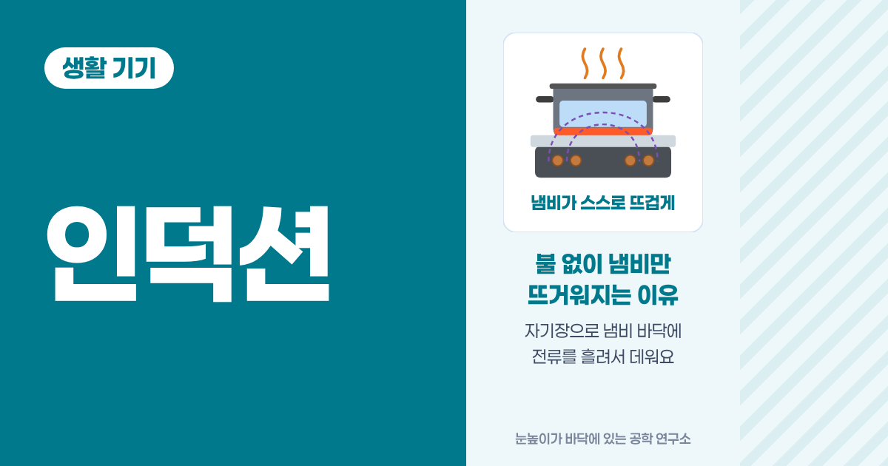
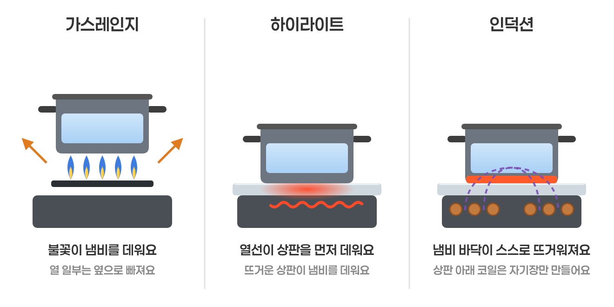
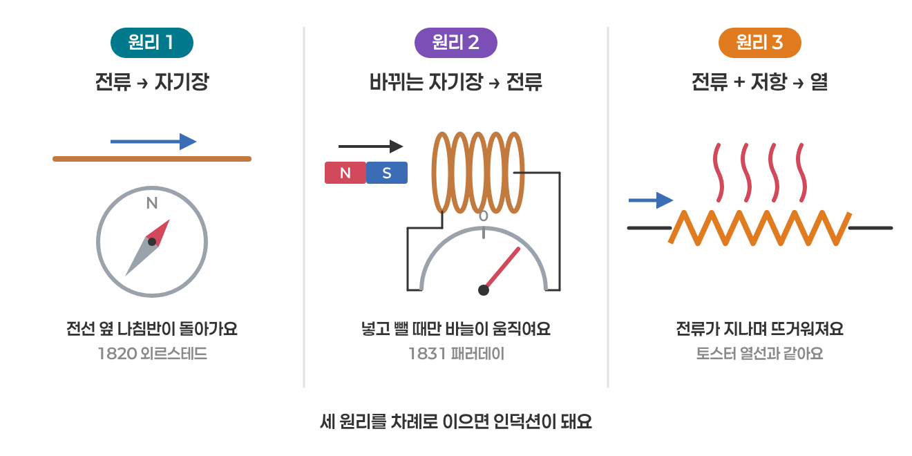
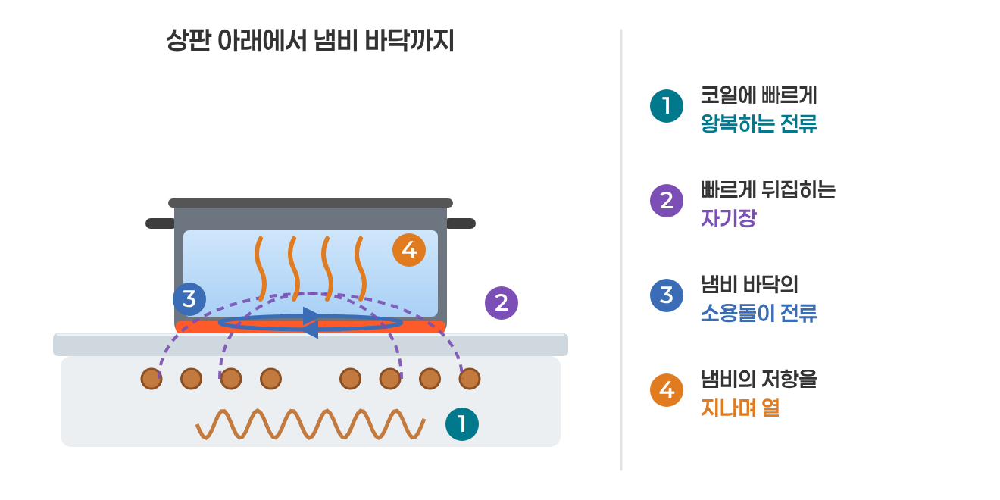
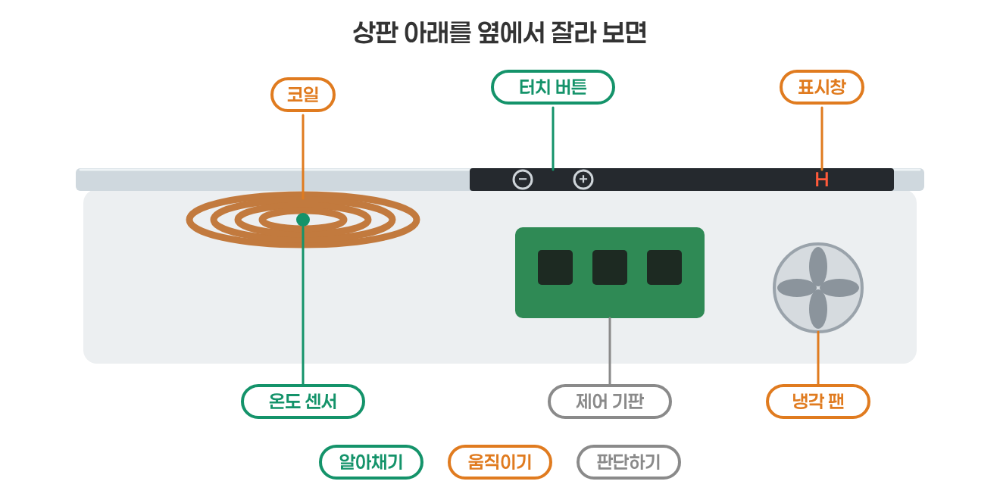
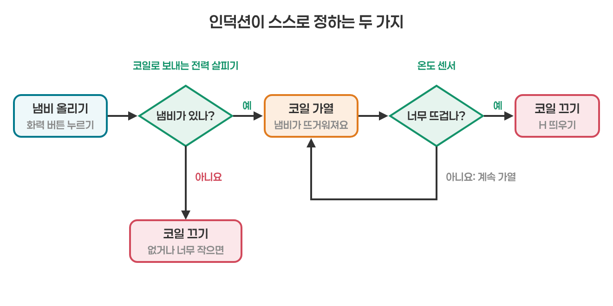

<!--
title: "인덕션: 불 없이 냄비만 뜨거워지는 이유"
field: 생활 기기
order: 120
level: 기초
tags: [생활 기기, 인덕션, 전자기 유도, 소용돌이 전류]
summary: "인덕션은 상판을 데우는 기계가 아니라, 자기장으로 냄비 바닥에 전류를 흘려서 냄비가 스스로 뜨거워지게 하는 기계예요."
-->

# 인덕션: 불 없이 냄비만 뜨거워지는 이유

<!-- 목차 -->

## 1. 먼저 한 줄로

인덕션은 상판을 데우는 기계가 아니라, 자기장으로 냄비 바닥에 전류를 흘려서 냄비가 스스로 뜨거워지게 하는 기계예요.

가스레인지는 불꽃이 냄비 바닥을 데워요.

하이라이트 같은 전기레인지는 상판 아래 열선이 상판을 데우고, 뜨거워진 상판이 냄비를 데워요.

인덕션은 둘 다 아니에요.

상판 아래 코일이 보이지 않는 자기장을 만들고, 그 자기장이 냄비 바닥 안에 전류를 흐르게 해요.

열은 냄비 바닥에서 생겨요.

그래서 불도 없고 빨갛게 달아오르는 곳도 없는데 냄비 속 물은 끓어요.

## 2. 예시로 먼저 감 잡기

인덕션을 쓰다 보면 고개를 갸웃하게 되는 순간이 있어요.

세 가지만 먼저 풀어 볼게요.

### 2-1. 양은 냄비는 왜 안 끓을까요?

라면을 끓이려고 노란 양은 냄비를 인덕션에 올리면 끓지 않아요.

인덕션 화면에 "사용 불가" 같은 표시가 뜨기도 해요.

그런데 무쇠 프라이팬은 금방 뜨거워져요.

지금 부엌에서 바로 해 볼 수 있는 실험이 있어요.

냉장고에 붙은 자석을 떼어 냄비 바닥에 대 보세요.

자석이 붙는 냄비와 안 붙는 냄비가 있을 거예요.

어느 쪽이 인덕션에서 끓을까요?

정답 보기

자석이 붙는 냄비예요.

인덕션은 바닥이 자석에 붙는 냄비에서만 제대로 가열돼요([삼성전자서비스: IH 가열 방식이란](https://www.samsungsvc.co.kr/solution/1025831)).

양은 냄비는 알루미늄이라 자석이 붙지 않아요.

왜 자석이 붙어야 하는지는 6장에서 풀어 볼게요.

### 2-2. 신문지를 깔고 요리한 시연

1950년대 중반, 미국 가전 회사 프리지데어가 새로 만든 인덕션 레인지를 사람들 앞에서 보여 주는 행사를 열었어요.

그런데 요리를 하기 전에 레인지 위에 신문지를 한 장 깔고, 그 위에 냄비를 올렸어요([Wikipedia: Induction cooking](https://en.wikipedia.org/wiki/Induction_cooking)).

가스불이나 뜨거운 상판이었다면 신문지가 금방 탔을 거예요.

그런데 냄비 속 음식은 익었는데 신문지는 멀쩡했어요.

어떻게 된 걸까요?

정답 보기

열이 레인지가 아니라 냄비 바닥에서 생기기 때문이에요.

자기장은 신문지를 그냥 지나가요.

종이는 전기가 통하지 않아서 자기장이 지나가도 그 안에 전류가 흐르지 않고, 그래서 열도 생기지 않아요.

다만 뜨거워진 냄비 바닥이 종이에 오래 닿아 있으면 종이가 그을릴 수 있어요.

집에서는 따라 하지 마세요.

### 2-3. 불도 안 났는데 "H"가 떠요

요리를 마치고 전원을 끄면 화구 자리에 "H"가 떠요.

인덕션은 상판을 데우지 않는다면서, 왜 뜨겁다고 알려 줄까요?

정답 보기

뜨거워진 냄비가 상판 위에 앉아 있었기 때문이에요.

냄비 바닥의 열이 맞닿은 상판으로 옮겨 가요.

"H"는 화구 자리가 아직 뜨겁다는 잔열 표시예요([LG전자: 똑똑한 기능 활용법](https://www.lge.co.kr/support/solutions-20152789859736)).

옆 화구를 쓰다가 열이 옮겨 온 자리에서도 "H"가 켜질 수 있어요([Whirlpool: H - Residual Heat](https://producthelp.whirlpool.com/Cooking/Cooktops/Induction_Cooktops/Error_Code_or_Indicator_Light/Other_Error_Codes/H_-_Residual_Heat_-_Error_Code_-_Induction_Cooktop)).

### 2-4. 세 가지에서 찾은 규칙

| 수수께끼 | 일어나는 일 | 알 수 있는 것 |
| --- | --- | --- |
| 양은 냄비 | 알루미늄 냄비는 안 데워져요 | 냄비 재질이 열을 만드는 데 끼어들어요 |
| 신문지 | 종이는 그대로예요 | 자기장은 전기가 안 통하는 물건을 데우지 않아요 |
| "H" 표시 | 끈 뒤에도 상판이 뜨거워요 | 열은 냄비에서 생기고 상판은 냄비에게서 열을 받아요 |

세 가지를 합치면 이렇게 돼요.

인덕션은 자기장으로 냄비 바닥에 열을 만들어요.

## 3. 인덕션을 움직이는 세 가지 원리

인덕션은 세 가지 원리만 알면 이해할 수 있어요.

| 원리 | 한 줄 설명 | 처음 밝힌 실험·예 |
| --- | --- | --- |
| 원리 1 | 전류가 흐르면 둘레에 자기장이 생겨요 | 1820년 외르스테드: 전류가 흐르는 전선 옆에서 나침반 바늘이 돌아갔어요 |
| 원리 2 | 자기장이 바뀌면 그 안의 금속에 전류가 생겨요 | 1831년 패러데이: 자석을 코일에 넣고 뺄 때만 전류가 흘렀어요 |
| 원리 3 | 전류가 저항을 지나면 열이 나요 | 줄의 법칙으로 정리됐어요. 토스터 열선이 뜨거워지는 원리예요 |

실험 내용은 [Wikipedia: Hans Christian Ørsted](https://en.wikipedia.org/wiki/Hans_Christian_%C3%98rsted)와 [Wikipedia: Electromagnetic induction](https://en.wikipedia.org/wiki/Electromagnetic_induction)을 참고했어요.

## 4. 세 원리로 냄비가 데워지는 순서

세 원리를 차례로 이으면 인덕션이 냄비를 데우는 순서가 돼요.

1. 상판 아래 코일에 방향이 아주 빠르게 바뀌는 전류를 흘려요.
2. 원리 1에 따라 코일 위에 자기장이 생기고, 전류를 따라 빠르게 뒤집혀요.
3. 원리 2에 따라 바뀌는 자기장이 냄비 바닥에 전류를 만들어요. 바닥 안에서 빙글빙글 돌아서 소용돌이 전류라고 불러요.
4. 원리 3에 따라 소용돌이 전류가 냄비 바닥의 저항을 지나며 열이 나요.

그래서 냄비 바닥이 스스로 뜨거워져요.

코일과 냄비는 전선으로 이어져 있지 않아요.

자기장이 유리 상판을 건너 냄비까지 에너지를 건네주는 거예요.

유리와 종이는 전기가 통하지 않아 전류가 생기지 않으니, 2-2의 신문지도 상판도 스스로는 데워지지 않아요.

아래 5장에서는 세 원리를 하나씩 인덕션에 필요한 만큼 더 들여다볼게요.

## 5. 원리 하나씩 더 들여다보기

### 5-1. 원리 1: 코일은 방향이 바뀌는 자석이 돼요

전선 한 가닥이 만드는 자기장은 약해요.

전선을 둥글게 여러 번 감으면, 바퀴마다 생기는 자기장이 고리 가운데서 같은 방향을 가리켜 차곡차곡 더해져요.

이렇게 감은 코일은 전류가 흐르는 동안 한쪽이 N극, 반대쪽이 S극인 자석이 돼요.

전류 방향을 반대로 하면 N극과 S극도 자리를 바꿔요.

인덕션은 코일 전류를 1초에 약 25,000번에서 50,000번 왕복시켜요([Wikipedia: Induction cooking](https://en.wikipedia.org/wiki/Induction_cooking)).

그래서 코일 위 자기장도 1초에 수만 번 뒤집혀요.

우리나라 콘센트 전기는 1초에 60번 왕복하니, 인덕션 안에는 이 전기를 수백 배 빠른 전류로 바꾸는 회로가 따로 들어 있어요([HowStuffWorks: How Induction Cooktops Work](https://home.howstuffworks.com/induction-cooktops3.htm)).

### 5-2. 원리 2: 자기장이 바뀌는 동안에만 전류가 생겨요

패러데이는 막대자석을 코일 속에 넣을 때와 뺄 때 코일에 전류가 흐르는 것을 봤어요([Wikipedia: Electromagnetic induction](https://en.wikipedia.org/wiki/Electromagnetic_induction)).

자석을 코일 속에 가만히 두면 아무리 센 자석이라도 전류는 흐르지 않았어요.

> 자석이 있다고 전류가 생기는 게 아니라, 자기장이 **바뀌는 동안에만** 전류가 생겨요.

게다가 자기장이 빨리 바뀔수록 생기는 전류가 세져요(같은 출처).

인덕션이 코일 전류를 1초에 수만 번이나 뒤집는 까닭이 이거예요.

한 방향으로만 흐르는 전류를 계속 흘리면 자기장이 바뀌지 않으니 냄비에 전류도 열도 생기지 않아요.

패러데이의 코일과 달리 냄비 바닥은 넓은 금속판이에요.

그래서 전류가 바뀌는 자기장을 빙 둘러싸며 바닥 안에서 둥글게 돌아요.

이것이 소용돌이 전류(와전류)이고, 코일 자기장이 뒤집힐 때마다 도는 방향도 함께 바뀌어요(같은 출처).

### 5-3. 원리 3: 저항이 클수록, 전류가 셀수록 열이 많이 나요

전류는 금속 속 전자들이 한쪽으로 몰려 움직이는 거예요.

움직이는 전자들은 금속 원자들과 계속 부딪히고, 부딪힐 때마다 원자들이 더 세게 떨려요.

이 떨림이 우리가 느끼는 열이에요([Wikipedia: Joule heating](https://en.wikipedia.org/wiki/Joule_heating)).

[저항: 색띠 읽고 고르고 합치기](<../전자 부품 120 저항/index.md>)에서 본 토스터 열선과 같아요.

열의 세기는 이렇게 정해져요(같은 출처).

$$
\text{열의 세기} = \text{전류} \times \text{전류} \times \text{저항}
$$

저항이 2배가 되면 열도 2배, 전류가 2배가 되면 열은 4배가 돼요.

인덕션은 둘 다 키워요.

5-2처럼 자기장을 빨리 바꿔 전류를 키우고, 6장에서 볼 철 냄비로 저항을 키워요.

## 6. 왜 자석이 붙는 냄비만 될까요?

2-1의 수수께끼는 5-3의 저항으로 풀려요.

빠르게 바뀌는 전류는 금속 두께 전체가 아니라 겉면 가까이로 몰려 흘러요.

이걸 표피 효과라고 하고, 전류가 빨리 바뀔수록 그리고 금속이 자석에 잘 붙을수록 전류가 흐르는 겉층이 얇아져요([Wikipedia: Skin effect](https://en.wikipedia.org/wiki/Skin_effect)).

자석이 붙는 탄소강 냄비는 인덕션의 빠른 전류에서 겉층이 약 0.1mm로 얇아져요([Wikipedia: Induction cooking](https://en.wikipedia.org/wiki/Induction_cooking)).

전류가 지나는 길이 좁아지니 저항이 커지고, 5-3의 식대로 열이 많이 나요.

[저항 강의](<../전자 부품 120 저항/index.md>)의 좁은 회전문과 같아요.

알루미늄과 구리는 자석이 붙지 않아 겉층이 약 0.4~0.6mm로 두껍고, 원래 전기가 아주 잘 통해요(같은 출처).

길이 넓고 잘 통하니 저항이 작아서 열이 잘 나지 않고, 그래서 보통 인덕션은 이런 냄비를 알아채고 가열하지 않아요(같은 출처).

| 냄비 바닥 재질 | 인덕션 | 까닭 |
| --- | --- | --- |
| 철, 주철(무쇠), 법랑 | 돼요 | 전류가 얇은 겉층에 몰려 저항이 커요 |
| 스테인리스 | 바닥에 자석이 붙으면 돼요 | 합금에 따라 자석이 안 붙는 것도 있어요 |
| 알루미늄(양은), 구리 | 안 돼요 | 저항이 너무 작아 열이 잘 안 나요 |
| 유리, 도자기, 뚝배기 | 안 돼요 | 전기가 안 통해 전류가 생기지 않아요 |

재질별 사용 여부는 [삼성전자서비스: IH 가열 방식이란](https://www.samsungsvc.co.kr/solution/1025831)과 [LG전자: 인덕션 용기 찾는 법](https://www.lge.co.kr/story/life/thinq-discover-kitchen-012)을 참고했어요.

"인덕션 전용" 표시가 있어도 바닥 일부만 자석이 붙으면 잘 데워지지 않을 수 있으니, 2-1의 자석 실험이 가장 확실해요(LG전자 같은 글).

## 7. 인덕션 들여다보기

| 동작 | 알아채기(센서·입력) | 움직이기(액추에이터) |
| --- | --- | --- |
| 화력 정하기 | 터치 버튼 | 코일(전류 세기 바꾸기) |
| 냄비 있는지 알아채기 | 코일로 보내는 전력 살피기 | 냄비가 없으면 코일 끄기 |
| 넘치거나 빈 냄비 과열 막기 | 온도 센서 | 코일 끄기 |
| 남은 열 알려 주기 | 온도 센서 | 표시창 "H" |
| 안쪽 부품 식히기 | 온도 | 냉각 팬 |

판단은 모두 인덕션 안의 제어 기판이 해요.

### 7-1. 냄비가 있는지 알아채요

인덕션은 코일로 보내는 전력을 살펴서 냄비가 올라와 있는지 알아채고, 냄비가 없거나 너무 작으면 그 화구의 코일을 꺼요([Wikipedia: Induction cooking](https://en.wikipedia.org/wiki/Induction_cooking)).

그래서 화구마다 쓸 수 있는 냄비 크기가 정해져 있어요(같은 출처).

### 7-2. 너무 뜨거워지면 스스로 멈춰요

빈 냄비를 올려 두거나 물이 다 졸면 냄비가 아주 뜨거워져요.

온도 센서가 이걸 알아채면 전력을 끊어요(같은 출처).

LG 인덕션은 이때 버너를 끄고 "H"를 띄워요([LG전자: 과열 방지 기능](https://www.lge.co.kr/support/solutions-20151941292106)).

## 8. 가스레인지·하이라이트와 비교

| 비교 | 가스레인지 | 하이라이트 | 인덕션 |
| --- | --- | --- | --- |
| 열이 생기는 곳 | 불꽃 | 상판 아래 열선 | 냄비 바닥 |
| 상판이 뜨거워지는 까닭 | 불꽃 | 열선이 상판을 데워요 | 냄비에게서 열을 받아요 |
| 냄비 재질 | 거의 다 돼요 | 거의 다 돼요 | 바닥에 자석이 붙어야 해요 |
| 냄비 없이 켜면 | 불꽃이 그대로 타요 | 열선이 그대로 달아요 | 코일이 꺼져요 |

하이라이트가 상판을 데운 열로 냄비를 데운다는 설명은 [LG전자: 과열 방지 시스템](https://www.lge.co.kr/support/solutions-20151166990489)을 참고했어요.

인덕션은 냄비 바닥에서 바로 열이 생기니, 불꽃이 공기를 거쳐 데우는 가스보다 냄비에 열을 더 많이 전해요.

미국 에너지스타는 인덕션 약 85%, 가스 약 32%로 안내하고([ENERGY STAR](https://www.energystar.gov/partner_resources/products_partner_resources/brand-owner/eta-consumers/res-induction-cooking-tops)), 다른 시험에서는 인덕션 70%대·가스 40% 안팎이 나와 숫자는 재는 방법마다 달라요([Wikipedia: Induction cooking](https://en.wikipedia.org/wiki/Induction_cooking)).

## 9. 자주 헷갈리는 점

### 9-1. 인덕션은 안 뜨거우니까 바로 만져도 되나요?

정답 보기

아니요.

뜨거운 냄비의 열이 상판으로 옮겨 가요.

LG전자는 "H"가 꺼진 뒤에도 상판이 뜨거울 수 있으니 손으로 만지지 말라고 안내해요([LG전자: 똑똑한 기능 활용법](https://www.lge.co.kr/support/solutions-20152789859736)).

### 9-2. 냄비 없이 켜 두면 자기장이 계속 나오나요?

정답 보기

보통은 아니에요.

7-1에서 본 것처럼 냄비가 없거나 너무 작으면 코일을 꺼요.

### 9-3. 인덕션 근처에서 조심할 사람이 있나요?

정답 보기

인공 심장박동기를 쓰는 사람은 보통 자기장이 나오는 곳을 피하라는 안내를 받아요([Wikipedia: Induction cooking](https://en.wikipedia.org/wiki/Induction_cooking)).

제품 설명서와 담당 의사의 안내를 따르세요.

## 10. 같은 원리를 쓰는 다른 기기

- IH 압력밥솥: IH는 유도 가열(Induction Heating)의 머리글자예요. 내솥을 둘러싼 코일이 내솥 자체를 데워요([에누리: 압력밥솥과 IH압력밥솥의 가열방식 차이점](https://www.enuri.com/knowbox/List.jsp?kbno=17569)).
- 무선 충전: 충전 패드 코일의 바뀌는 자기장이 휴대폰 안 코일에 전류를 만들어요. 원리 1·2는 같고, 원리 3 대신 그 전류로 배터리를 채워요([Canary Media: How do induction stoves actually work?](https://canarymedia.com/articles/electrification/how-do-induction-stoves-actually-work)).

## 11. 한 장 요약

> 인덕션: 냄비가 스스로 뜨거워지는 기계
>
> - 원리 1: 전류가 흐르면 자기장이 생긴다. 코일 전류를 1초에 수만 번 왕복시켜 자기장을 뒤집는다.
> - 원리 2: 자기장이 바뀌는 동안에만, 빨리 바뀔수록 세게 냄비 바닥에 소용돌이 전류가 생긴다.
> - 원리 3: 전류가 저항을 지나면 열이 난다. 열의 세기 = 전류 × 전류 × 저항.
> - 자석이 붙는 냄비는 전류가 얇은 겉층에 몰려 저항이 커서 잘 데워진다. 알루미늄·구리·유리는 보통 안 된다.
> - 인덕션은 전력을 살펴 냄비를 알아채고, 온도 센서로 과열을 막는다. "H"는 냄비에게서 받은 잔열 표시다.

## 12. 셀프 퀴즈

<b>Q1.</b> 인덕션에서 실제로 뜨거워지는 곳은 어디일까요?

정답 보기

냄비 바닥이에요.

코일의 자기장이 냄비 바닥에 소용돌이 전류를 만들고, 그 전류가 냄비의 저항을 지나며 열이 나요.

<b>Q2.</b> 친구가 새 냄비를 샀는데 인덕션에서 쓸 수 있는지 궁금해해요.

집에 있는 물건으로 바로 확인하는 방법은 무엇일까요?

정답 보기

냉장고 자석을 냄비 바닥에 대 봐요.

바닥에 자석이 잘 붙으면 인덕션에서 쓸 수 있어요.

<b>Q3.</b> 요리를 마치고 냄비를 내렸는데 화구 자리에 "H"가 떠 있어요.

인덕션은 상판을 데우지 않는데 왜 뜨거울까요?

정답 보기

뜨거운 냄비 바닥의 열이 맞닿은 상판으로 옮겨 갔기 때문이에요.

"H"가 사라질 때까지 만지지 않아요.

<b>Q4.</b> 코일에 건전지처럼 한 방향으로만 흐르는 전류를 계속 흘리면 냄비가 뜨거워질까요?

정답 보기

아니요.

자기장은 생기지만 바뀌지 않아요.

자기장이 바뀌는 동안에만 전류가 생기니, 냄비 바닥에 소용돌이 전류도 열도 생기지 않아요.

## 참고 자료

- [Wikipedia: Induction cooking](https://en.wikipedia.org/wiki/Induction_cooking)
- [Wikipedia: Electromagnetic induction](https://en.wikipedia.org/wiki/Electromagnetic_induction)
- [Wikipedia: Skin effect](https://en.wikipedia.org/wiki/Skin_effect)
- [Wikipedia: Joule heating](https://en.wikipedia.org/wiki/Joule_heating)
- [Wikipedia: Hans Christian Ørsted](https://en.wikipedia.org/wiki/Hans_Christian_%C3%98rsted)
- [HowStuffWorks: How Induction Cooktops Work](https://home.howstuffworks.com/induction-cooktops3.htm)
- [Canary Media: How do induction stoves actually work?](https://canarymedia.com/articles/electrification/how-do-induction-stoves-actually-work)
- [ENERGY STAR: Residential Induction Cooking Tops](https://www.energystar.gov/partner_resources/products_partner_resources/brand-owner/eta-consumers/res-induction-cooking-tops)
- [삼성전자서비스: IH(Induction Heating) 가열 방식이란](https://www.samsungsvc.co.kr/solution/1025831)
- [LG전자: '잘 끓는' 인덕션 용기 찾는 법](https://www.lge.co.kr/story/life/thinq-discover-kitchen-012)
- [LG전자: 똑똑한 기능 활용법(타이머, H 표시등, 잠금 기능)](https://www.lge.co.kr/support/solutions-20152789859736)

## 강좌 이동

- 이전 강좌: [냉장고와 에어컨: 차가움을 만드는 게 아니라 열을 옮겨요](<../생활 기기 110 냉장고와 에어컨/index.md>)
- 다음 강좌: 준비 중이에요.
