<!--
title: "인공지능 첫걸음: 처음 보는 열매로 배우는 AI의 원리"
field: 인공지능
order: 110
level: 기초
tags: [머신러닝]
summary: "인공지능은 데이터에서 규칙을 배워 처음 보는 상황에서도 판단하는 프로그램이에요. 판단할 때는 여러 답의 가능성을 따져 보고 보통 가장 그럴듯한 답을 골라요."
notion_id: 40910cbca0ae815b9cfdd4eb5bcab9a4
-->

# 인공지능 첫걸음: 처음 보는 열매로 배우는 AI의 원리

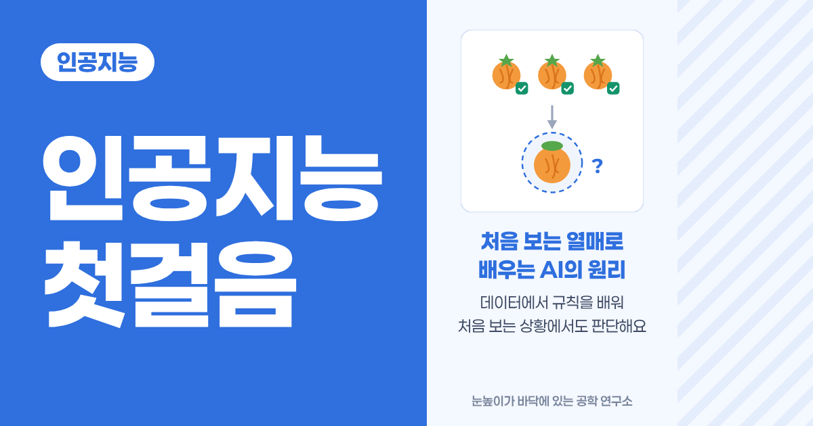

<!-- 목차 -->

## 1. 인공지능을 먼저 한 줄로

인공지능은 데이터에서 규칙을 배워 처음 보는 상황에서도 판단하는 프로그램이에요. 판단할 때는 여러 답의 가능성을 따져 보고 보통 가장 그럴듯한 답을 골라요.

어렵게 들려도 괜찮아요. 우리가 무언가를 처음 배울 때와 거의 같아요. 직접 해 보면 바로 느낌이 와요.

## 2. 처음 보는 열매로 시작하기

### 2-1. 이 열매를 알고 있나요?

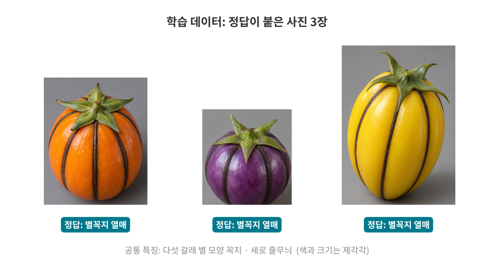

이 열매들은 "별꼭지 열매"예요. 처음 들어 보는 게 당연해요. 세상에 없는, 이 강좌를 위해 만든 열매거든요.

색도 크기도 제각각이지만 공통점이 두 가지 있어요.

- 꼭지가 다섯 갈래로 뾰족하게 펼쳐진 별 모양이에요.
- 몸통에 진한 세로 줄무늬가 있어요.

### 2-2. 그럼 이 열매는요?

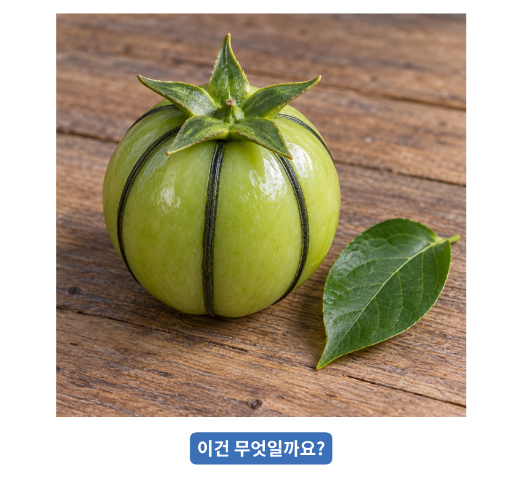

색도 처음 보는 연두색이고 회색 배경이 아니라 나무 탁자 위에 있어요. 이 열매는 무엇일까요?

정답 보기

별꼭지 열매예요. 색과 장소는 달라도 별 모양 꼭지와 세로 줄무늬가 그대로 있어요. 토마토와 조금 닮았지만 이 두 특징으로 구분할 수 있어요.

### 2-3. 이것도 별꼭지 열매일까요?

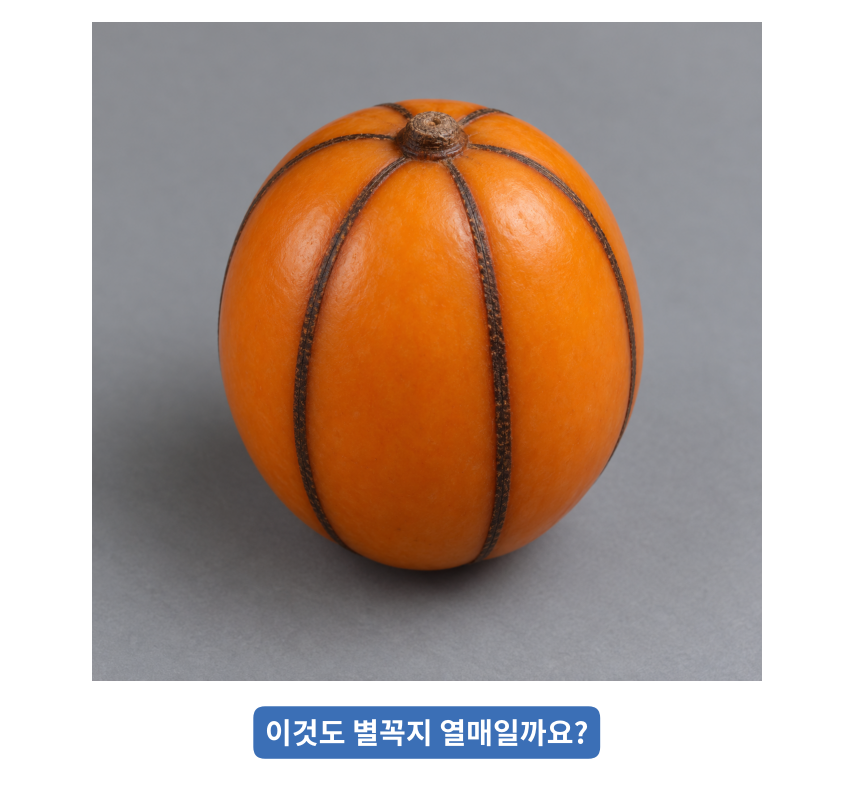

색도 주황색이고 줄무늬도 있어요. 2-1의 주황색 열매와 거의 똑같아 보여요.

정답 보기

아니에요. 꼭지가 별 모양이 아니라 작고 동그란 단추 모양이에요. 줄무늬와 색이 같아도 꼭지가 다르면 다른 열매로 봐야 해요.

### 2-4. 꼭지가 가려져 있다면요?

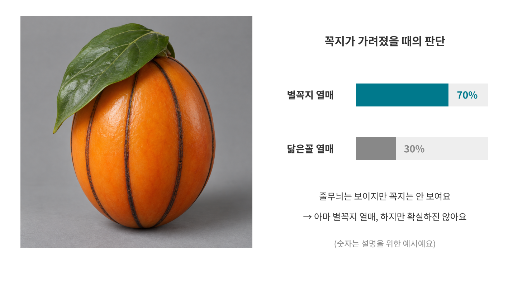

이번엔 잎이 꼭지를 덮고 있어서 줄무늬만 보여요. 아마 별꼭지 열매일 것 같지만 2-3의 닮은꼴일 수도 있어요. 이럴 때 우리는 "아마 별꼭지 열매일 거야. 하지만 확실하진 않아"라고 생각해요.

### 2-5. 방금 우리가 한 일이 인공지능의 원리예요

| 방금 우리가 한 일 | 인공지능에서는 |
| --- | --- |
| 정답이 붙은 열매 사진 3장을 봤어요 | 학습 데이터와 라벨 |
| 꼭지 모양과 줄무늬라는 공통점을 찾았어요 | 특징 찾기(학습) |
| 처음 보는 연두색 열매를 맞혔어요 | 예측 |
| 꼭지가 다른 닮은꼴을 걸러 냈어요 | 특징으로 구분하기 |
| 꼭지가 가려지자 "아마도"라고 판단했어요 | 확률로 판단하기 |

인공지능도 똑같이 해요. 사람이 정답이 붙은 예시를 많이 보여 주면 그 안에서 공통된 규칙을 찾고 처음 보는 데이터가 들어오면 배운 규칙과 비교해서 답을 골라요.

사실 사람은 늘 이렇게 판단해요. 하늘이 잔뜩 흐리고 습하면 "비 올 것 같다"며 우산을 챙기잖아요. 지금까지의 경험(데이터)으로 비가 올 가능성을 따져 본 거예요.

## 3. 보통 프로그램과 무엇이 다를까요?

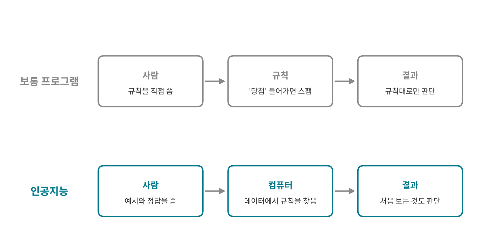

보통 프로그램은 사람이 규칙을 직접 써요. 스팸 메일을 거르는 프로그램이라면 "제목에 '당첨'이 들어가면 스팸"처럼 규칙을 하나하나 적어야 해요. 규칙에 없는 새로운 스팸은 걸러 내지 못해요.

인공지능은 규칙을 직접 쓰지 않아요. 대신 스팸 메일과 정상 메일을 잔뜩 모아서 정답을 붙여 보여 줘요. 그러면 컴퓨터가 스팸에서 자주 보이는 특징을 스스로 찾아내고 처음 보는 메일도 판단해요.

|  | 보통 프로그램 | 인공지능 |
| --- | --- | --- |
| 규칙은 누가 만드나요? | 사람이 직접 | 컴퓨터가 데이터에서 |
| 사람이 주는 것 | 규칙 | 예시와 정답 |
| 처음 보는 상황 | 규칙에 없으면 못 함 | 배운 것과 비교해 판단 |

## 4. 인공지능이 배우는 과정

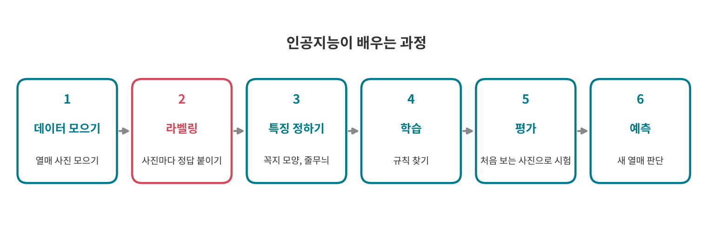

별꼭지 열매로 과정을 하나씩 따라가 볼게요.

1. 데이터 모으기: 열매 사진을 많이 모아요. 색, 크기, 찍은 장소가 다양할수록 좋아요.
2. 라벨링: 사진마다 "별꼭지 열매", "닮은꼴 열매"처럼 정답을 붙여요.
3. 특징 정하기: 무엇을 보고 구분할지 정해요. 꼭지 모양, 줄무늬, 색, 크기 같은 것들이에요. 요즘 인공지능은 특징까지 스스로 찾기도 해요.
4. 학습: 컴퓨터가 데이터와 정답을 보고 "꼭지가 별 모양이면 별꼭지 열매"라는 규칙을 찾아요.
5. 평가: 학습에 쓰지 않은 사진으로 시험을 봐요. 이미 본 문제로 시험을 보면 실력을 알 수 없으니까요.
6. 예측: 이제 처음 보는 열매가 들어오면 판단해요.

### 4-1. 라벨링: 정답을 붙이는 일

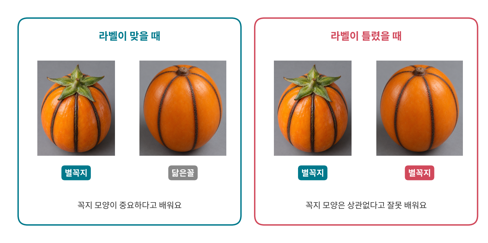

라벨링은 데이터에 정답을 붙이는 일이에요. 별꼭지 열매 사진에 "별꼭지 열매"라고 이름표를 다는 거예요. 이 일은 대부분 사람이 해요.

라벨이 틀리면 인공지능도 틀리게 배워요. 닮은꼴 열매에 실수로 "별꼭지 열매"라고 붙이면 인공지능은 "꼭지 모양은 상관없구나"라고 잘못 배워요. 그 뒤로는 닮은꼴도 별꼭지 열매라고 답하게 돼요.

그래서 인공지능을 만드는 곳에서는 라벨을 정확하게 붙이는 데 많은 시간과 사람을 들여요. 좋은 인공지능은 좋은 데이터와 정확한 라벨에서 나와요.

## 5. 인공지능은 확률로 골라요

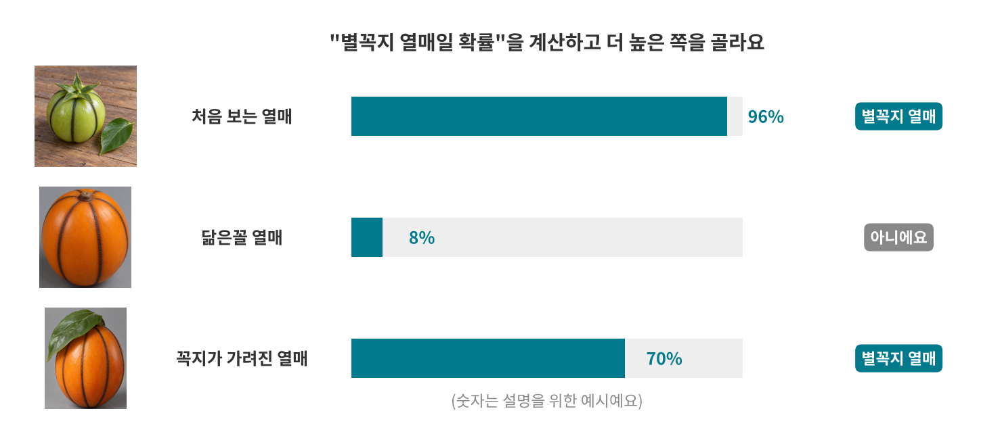

인공지능은 답을 하나만 딱 내놓는 게 아니라 답마다 가능성을 계산해요. 그리고 보통 가장 높은 쪽을 골라요.

- 처음 보는 연두색 열매: 별 꼭지와 줄무늬가 모두 보이니 별꼭지 열매일 확률이 아주 높아요.
- 닮은꼴 열매: 줄무늬는 같지만 꼭지가 다르니 확률이 낮아요.
- 꼭지가 가려진 열매: 줄무늬만 보이니 "아마 맞다" 정도예요. 70%라면 30%는 틀릴 수 있다는 뜻이에요.

모든 인공지능이 이렇게 "고르기"만 하는 건 아니에요.

- 집값이나 내일 기온처럼 숫자 하나를 맞히는 인공지능도 있어요.
- 챗봇 같은 생성형 인공지능은 다음에 올 단어의 확률을 계산하는데 늘 1등 단어만 고르지 않고 확률에 따라 섞어 고르기도 해요. 같은 질문에도 대답이 조금씩 달라지는 이유예요.

그래도 "데이터에서 배운 것으로 가능성을 따져 본다"는 바탕은 같아요.

## 6. 배우는 방식 세 가지

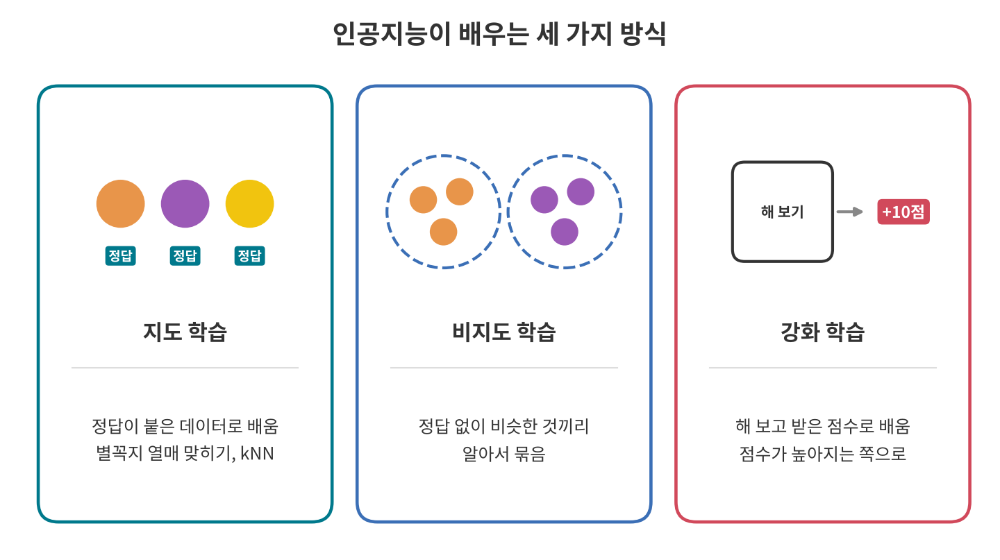

- 지도 학습: 정답(라벨)이 붙은 데이터로 배워요. 선생님이 정답을 알려 주며 가르치는 것과 같아요. 별꼭지 열매 맞히기와 다음 강좌의 kNN이 여기에 속해요.
- 비지도 학습: 정답 없이 데이터만 주면 비슷한 것끼리 알아서 묶어요. 라벨을 붙이지 않은 열매 사진을 주면 생김새가 비슷한 것끼리 나누는 식이에요.
- 강화 학습: 직접 해 보고 받은 점수로 배워요. 게임 캐릭터가 여러 번 해 보면서 점수가 높아지는 행동을 찾아가는 방식이에요.

## 7. 생활 속 인공지능

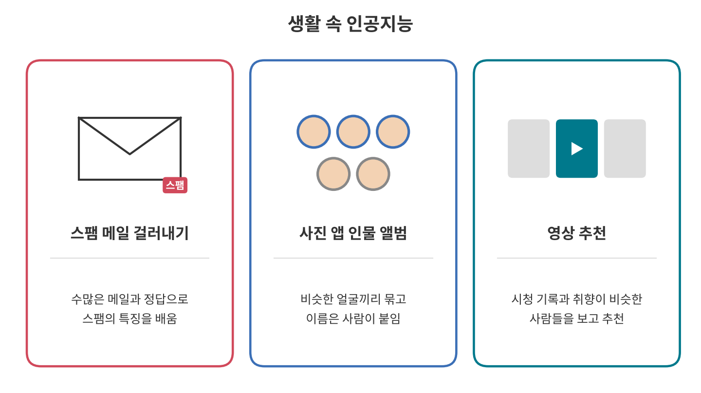

### 7-1. 스팸 메일 걸러내기

Gmail은 머신러닝으로 스팸과 피싱 메일을 걸러요. 구글은 2019년에 머신러닝 도구를 더해 하루에 스팸 메일 약 1억 통을 더 막게 됐다고 밝혔어요. 수많은 메일과 "스팸인지 아닌지"라는 정답으로 배우는 지도 학습의 예예요([출처: VentureBeat](https://venturebeat.com/ai/gmail-is-now-blocking-100-million-more-spam-emails-a-day-thanks-to-tensorflow)).

### 7-2. 사진 앱의 인물 앨범

구글 포토의 얼굴 그룹 기능은 같은 사람으로 보이는 얼굴이 담긴 사진을 알아서 한 그룹으로 묶어요. 이름은 사용자가 직접 붙여요. 비슷한 것끼리 묶는 부분이 비지도 학습과 닮았고 이름을 붙이는 부분은 라벨링이에요([출처: Google 포토 고객센터](https://support.google.com/photos/answer/6128838)).

### 7-3. 영상 추천

넷플릭스는 내가 본 작품과 평가, 나와 취향이 비슷한 회원들, 작품의 장르와 출연진 같은 정보로 내가 좋아할 만한 작품을 골라 보여 줘요. 내가 끝까지 본 작품이나 누른 평가가 다시 학습에 반영돼요([출처: Netflix 고객센터](https://help.netflix.com/en/node/100639)).

## 8. 자주 헷갈리는 점

### 8-1. 인공지능은 이해하는 게 아니라 패턴을 찾아요

인공지능은 별꼭지 열매가 어떤 맛인지, 왜 꼭지가 별 모양인지 몰라요. "별 모양 꼭지가 있으면 별꼭지 열매"라는 패턴을 찾았을 뿐이에요.

### 8-2. 데이터가 치우치면 답도 치우쳐요

학습 사진이 모두 회색 배경이었다면 인공지능은 "회색 배경이면 별꼭지 열매"라고 엉뚱하게 배울 수도 있어요. 그래서 2-2처럼 다른 장소에서 찍은 사진으로 시험해 보는 게 중요해요. 데이터를 모을 때부터 여러 상황을 골고루 담아야 해요.

### 8-3. 100%는 없어요

인공지능은 확률로 판단하니 틀릴 수 있어요. 96%라는 높은 확률도 4%만큼은 틀릴 가능성이 있다는 뜻이에요. 중요한 결정일수록 사람이 한 번 더 확인해요.

## 9. 앞으로 배울 알고리즘

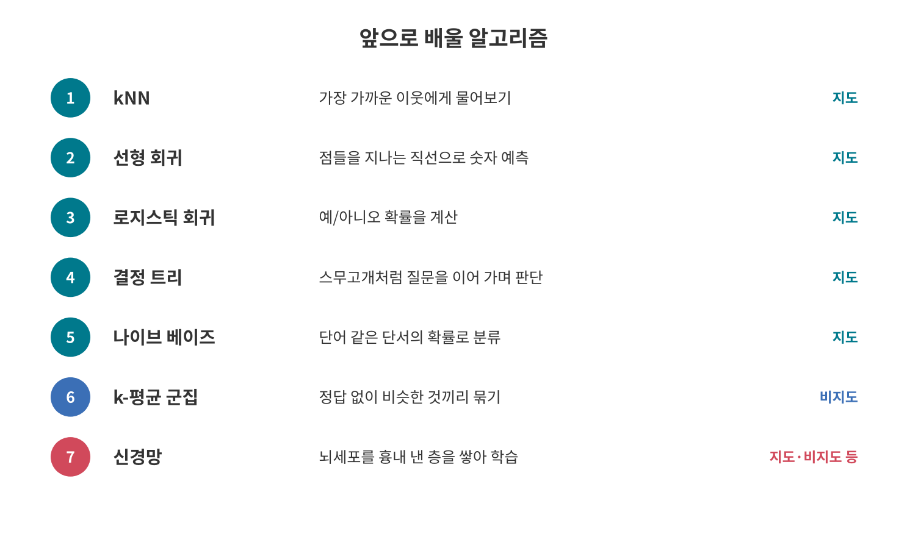

알고리즘은 인공지능이 데이터에서 규칙을 찾는 방법이에요. 앞으로 하나씩 쉬운 예시부터 차근차근 볼게요.

1. kNN: 새 데이터와 가장 가까운 이웃들을 보고 판단해요. [kNN 알고리즘: 가까운 이웃에게 물어보기](<../인공지능 120 kNN 알고리즘/index.md>)
2. 선형 회귀: 점들 사이를 지나는 직선을 그어 숫자를 예측해요.
3. 로지스틱 회귀: 예/아니오가 될 확률을 계산해요.
4. 결정 트리: 스무고개처럼 질문을 이어 가며 판단해요.
5. 나이브 베이즈: 단어 같은 단서들의 확률을 모아 분류해요.
6. k-평균 군집: 정답 없이 비슷한 것끼리 묶어요.
7. 신경망: 뇌세포를 흉내 낸 층을 여러 겹 쌓아 복잡한 패턴을 배워요.

## 10. 한 장 요약

> 인공지능: 데이터에서 규칙을 배워 처음 보는 것도 판단하는 프로그램
>
> - 사람은 예시와 정답을 주고 규칙은 컴퓨터가 데이터에서 찾는다.
> - 배우는 과정: 데이터 모으기 → 라벨링 → 특징 → 학습 → 평가 → 예측
> - 라벨이 틀리면 인공지능도 틀리게 배운다.
> - 답마다 가능성(확률)을 따져 보통 가장 높은 쪽을 고른다.
> - 배우는 방식: 지도 학습, 비지도 학습, 강화 학습
> - 이해가 아니라 패턴을 찾는 것이고 100%는 없다.

## 11. 셀프 퀴즈

<b>Q1.</b> 보통 프로그램과 인공지능의 가장 큰 차이는 무엇일까요?

정답 보기

규칙을 누가 만드느냐예요. 보통 프로그램은 사람이 규칙을 직접 쓰고 인공지능은 사람이 준 예시와 정답에서 컴퓨터가 규칙을 찾아요.

<b>Q2.</b> 닮은꼴 열매 사진에 실수로 "별꼭지 열매" 라벨을 붙여 학습시키면 어떻게 될까요?

정답 보기

인공지능이 꼭지 모양은 중요하지 않다고 잘못 배워요. 그 뒤로 닮은꼴 열매도 별꼭지 열매라고 답하게 돼요.

<b>Q3.</b> 인공지능이 "별꼭지 열매일 확률 70%"라고 답했어요. 이 말은 무슨 뜻일까요?

정답 보기

별꼭지 열매일 가능성이 더 높아서 그쪽을 고르지만 30%만큼은 틀릴 수 있다는 뜻이에요.

## 참고 자료

- [Google for Developers: What is Machine Learning?](https://developers.google.com/machine-learning/intro-to-ml/what-is-ml)
- [Google for Developers: Supervised Learning](https://developers.google.com/machine-learning/intro-to-ml/supervised)

## 강좌 이동

- 이전 강좌: 없어요. 인공지능 강좌의 첫 강좌예요.
- 다음 강좌: [kNN 알고리즘: 가까운 이웃에게 물어보기](<../인공지능 120 kNN 알고리즘/index.md>)
