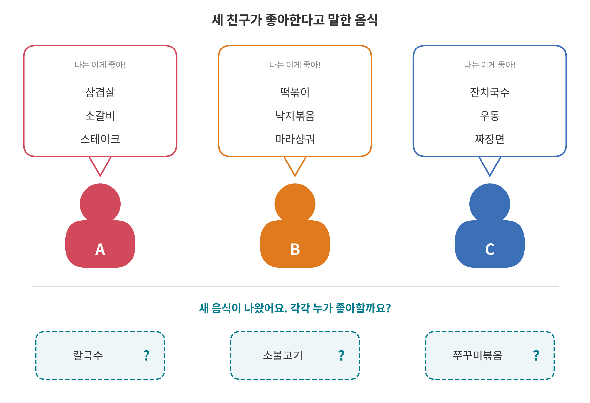
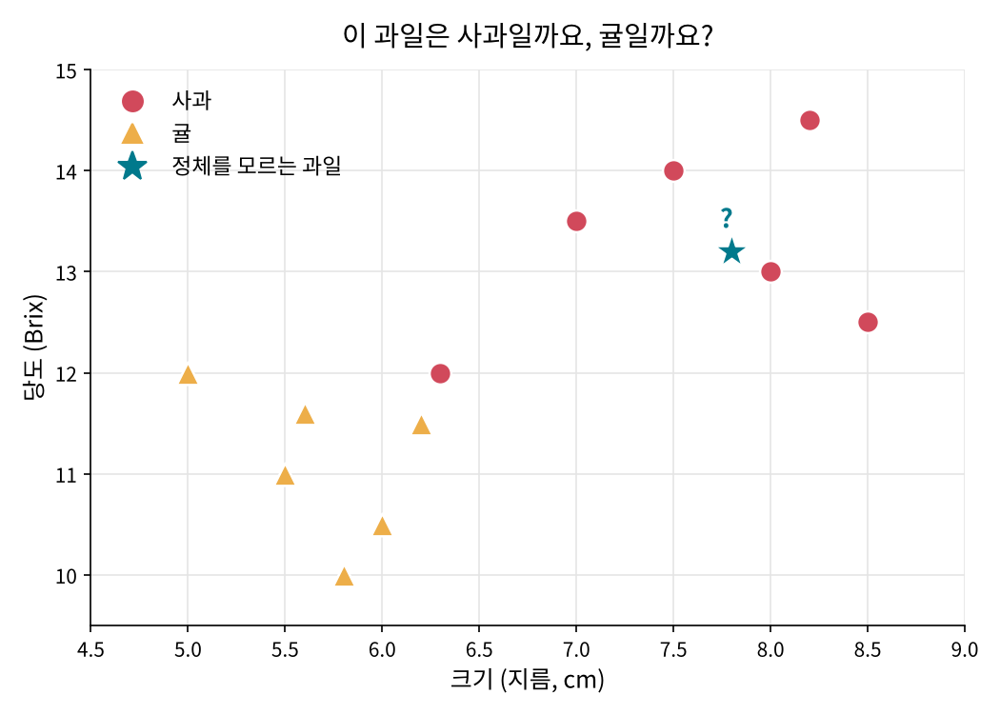
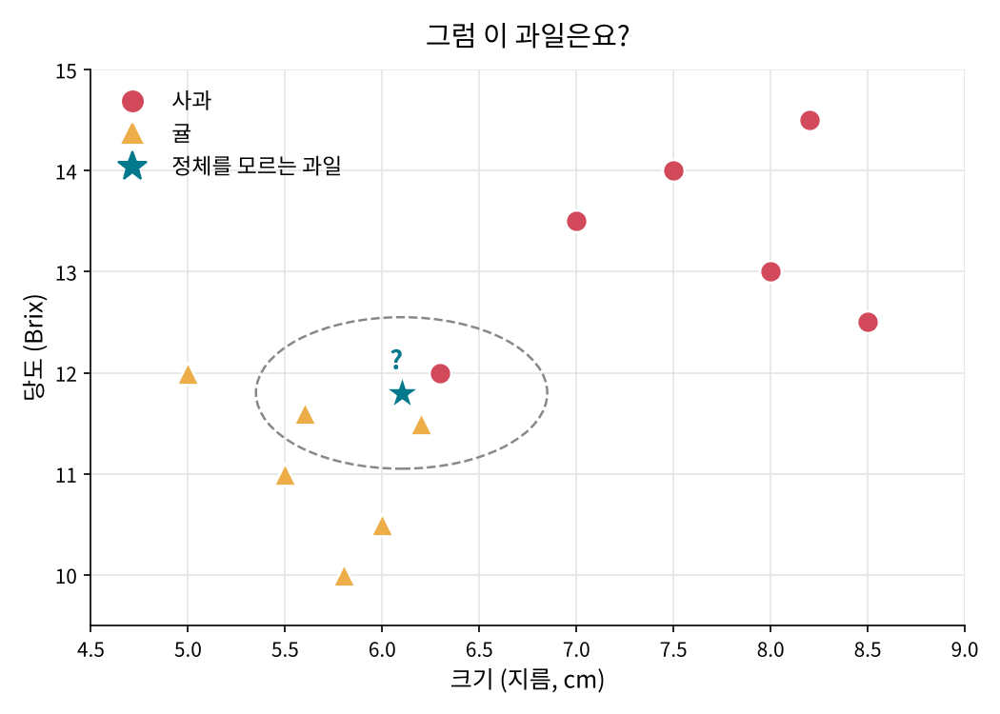
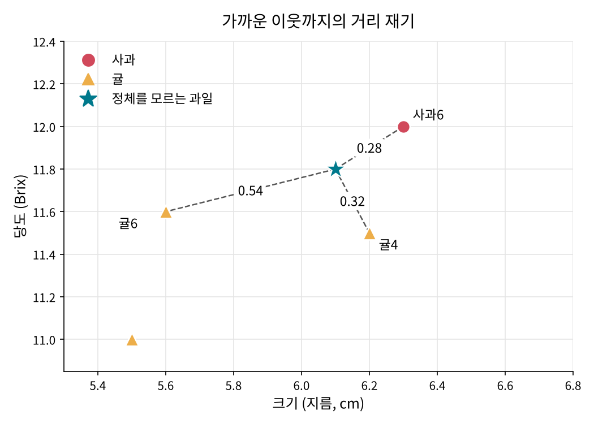
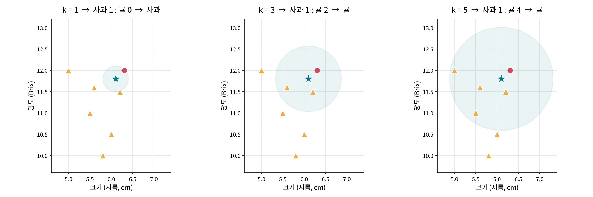
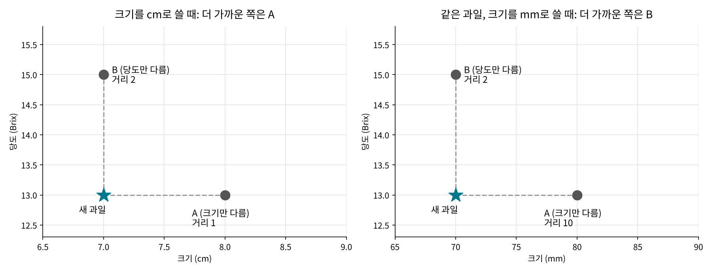
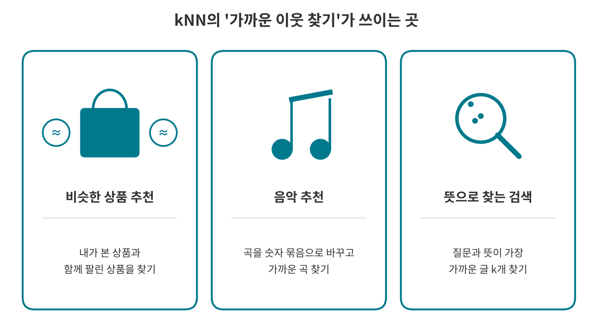

<!--
title: "kNN 알고리즘: 가까운 이웃에게 물어보기"
field: 인공지능
order: 120
level: 기초
tags: [머신러닝, 분류]
summary: "kNN(k-Nearest Neighbors, k-최근접 이웃)은 새로운 데이터가 들어왔을 때 정답을 이미 알고 있는 데이터 가운데 가장 가까운 k개를 찾고 그 이웃들이 가장 많이 속한 쪽으로 답을 정하는 방법이에요."
notion_id: 40710cbca0ae815a8ea6f9435fe393b5
-->

# kNN 알고리즘: 가까운 이웃에게 물어보기

<!-- 목차 -->

## 1. kNN이 뭔지 먼저 한 줄로

kNN(k-Nearest Neighbors, k-최근접 이웃)은 새로운 데이터가 들어왔을 때 정답을 이미 알고 있는 데이터 가운데 가장 가까운 k개를 찾고 그 이웃들이 가장 많이 속한 쪽으로 답을 정하는 방법이에요.

조금 더 쉽게 말하면 "나와 비슷한 이웃을 보면 내가 누군지 알 수 있다"는 생각을 계산으로 옮긴 거예요.

지금 이 문장이 다 와닿지 않아도 괜찮아요. 예시를 따라가다 보면 끝에서 이 한 줄이 다시 읽힐 거예요.

## 2. 몸풀기: 이 음식은 누가 좋아할까요?

친구 세 명에게 좋아하는 음식을 물어봤어요.

A는 고기 음식만, B는 매운 음식만, C는 면 요리만 이야기했네요.

그림 아래쪽의 칼국수, 소불고기, 쭈꾸미볶음은 처음 보는 음식이에요. 각각 누가 좋아할 것 같나요?

정답 보기

- 칼국수 → C (잔치국수·우동과 비슷한 면 요리)
- 소불고기 → A (삼겹살·소갈비와 비슷한 고기 음식)
- 쭈꾸미볶음 → B (낙지볶음과 비슷한 매운 음식)

어떻게 맞혔는지 한번 떠올려 보세요. 머릿속으로 새 음식과 비슷한 음식을 찾았고 그 음식을 말한 친구를 골랐을 거예요. 소불고기를 보고 "삼겹살이랑 비슷하네, 그럼 A"라고 생각한 거죠.

이게 kNN의 출발점이에요. 이미 답을 아는 것들 중에서 가장 비슷한 것을 찾아 판단해요.

그런데 짬뽕은 어떨까요? 맵기도 하고 면이기도 해요. B라고 해도 C라고 해도 그럴듯해요.

이렇게 애매할 때는 얼마나 비슷한지를 재는 기준이 필요해져요. 그 기준을 만들러 다음 예시로 가 볼게요.

## 3. 두 번째 예시: 점만 보고 과일 맞히기

이번에는 과일 12개의 크기(지름)와 당도를 재서 그래프에 점으로 찍었어요. 가로축이 크기, 세로축이 당도예요.

빨간 동그라미는 사과, 노란 세모는 귤이에요.

파란 별은 정체를 모르는 과일이에요. 사과일까요, 귤일까요?

대부분 바로 "사과"라고 답할 거예요. 별이 사과들 한가운데에 있으니까요.

과일을 직접 보지 않았는데도 숫자 두 개(크기와 당도)만으로 추측할 수 있었어요.

비슷한 과일끼리는 그래프에서도 가까이 모이기 때문이에요.

그럼 이 별은 어떨까요?

점선 안을 보면 사과도 하나 가깝고 귤도 몇 개 가까워요. 눈으로만 보면 판단하기 어려워요.

이럴 때는 거리를 숫자로 재 보면 돼요.

## 4. 거리를 숫자로 재 보기

두 점 사이의 거리는 중학교 때 배운 피타고라스 정리로 구할 수 있어요.

$$
\text{거리} = \sqrt{(\text{크기 차이})^2 + (\text{당도 차이})^2}
$$

이렇게 구한 거리를 유클리드 거리라고 불러요. 두 점을 자로 잰 직선 거리라고 생각하면 돼요.

애매했던 별은 크기 6.1cm, 당도 11.8이에요. 가까워 보이는 세 과일까지 거리를 직접 계산해 볼게요.

| 이웃 | 크기 | 당도 | 크기 차이 | 당도 차이 | 거리 |
| --- | --- | --- | --- | --- | --- |
| 사과6 | 6.3 | 12.0 | 0.2 | 0.2 | √(0.04 + 0.04) = √0.08 ≈ 0.28 |
| 귤4 | 6.2 | 11.5 | 0.1 | 0.3 | √(0.01 + 0.09) = √0.10 ≈ 0.32 |
| 귤6 | 5.6 | 11.6 | 0.5 | 0.2 | √(0.25 + 0.04) = √0.29 ≈ 0.54 |

같은 방식으로 12개 과일 모두와 거리를 구해 가까운 순서로 늘어놓으면 이렇게 돼요.

| 순위 | 과일 | 종류 | 거리 |
| --- | --- | --- | --- |
| 1 | 사과6 | 사과 | 0.28 |
| 2 | 귤4 | 귤 | 0.32 |
| 3 | 귤6 | 귤 | 0.54 |
| 4 | 귤1 | 귤 | 1.00 |
| 5 | 귤3 | 귤 | 1.12 |
| 6 | 귤2 | 귤 | 1.30 |
| 7 | 귤5 | 귤 | 1.82 |
| 8 | 사과4 | 사과 | 1.92 |
| 9 | 사과1 | 사과 | 2.25 |
| 10 | 사과3 | 사과 | 2.50 |
| 11 | 사과2 | 사과 | 2.61 |
| 12 | 사과5 | 사과 | 3.42 |

가장 가까운 3개만 보면 사과6, 귤4, 귤6이에요. 귤이 2표, 사과가 1표니까 이 과일은 귤이라고 판단해요.

## 5. 이제 이름을 붙여 볼게요

방금 한 일이 바로 kNN이에요. 순서를 정리하면 이래요.

1. 정답(사과인지 귤인지)을 이미 아는 데이터를 준비한다.
2. 새 데이터와 모든 데이터 사이의 거리를 잰다.
3. 가까운 순서로 줄 세워 앞에서 k개를 고른다.
4. 그 k개 중 가장 많은 종류를 답으로 정한다(다수결).

여기서 k는 이웃을 몇 개 볼지를 정하는 숫자예요. 4장에서는 k = 3을 쓴 셈이에요.

kNN에는 미리 공부하는 단계가 따로 없어요. 데이터를 저장해 두었다가 새 질문이 들어오는 순간에 거리를 계산해요. 그래서 인스턴스 기반 학습이라고 부르기도 해요.

이 방법은 1951년 Evelyn Fix와 Joseph Hodges가 처음 내놓았다고 알려져 있어요.

2장의 음식 예시도 같은 방식으로 계산할 수 있어요. 음식마다 "고기인가, 매운가, 면인가"를 1(예)과 0(아니오)으로 바꾸면 돼요. 짬뽕은 (고기 0, 매움 1, 면 1)이 돼요. 이렇게 하면 B의 음식들과도 거리가 1, C의 음식들과도 거리가 1로 똑같이 나와요. 아까 짬뽕이 애매하게 느껴졌던 이유가 숫자로도 확인되는 거죠.

## 6. k를 바꾸면 답이 달라질 수 있어요

같은 별을 두고 k만 1, 3, 5로 바꿔 봤어요. 파란 원 안에 들어온 과일이 투표에 참여하는 이웃이에요.

| k | 투표 결과 | 판단 |
| --- | --- | --- |
| 1 | 사과 1 : 귤 0 | 사과 |
| 3 | 사과 1 : 귤 2 | 귤 |
| 5 | 사과 1 : 귤 4 | 귤 |

사과6은 다른 사과들보다 유난히 작은 사과예요. k = 1이면 이 예외적인 사과 하나만 보고 "사과"라고 답해 버려요. k를 키우면 주변 귤들의 표가 함께 들어와서 이런 예외에 덜 흔들려요.

그렇다고 k를 무작정 키우는 게 좋지도 않아요. k가 커질수록 잡음에는 강해지지만 무리 사이의 경계가 흐려져요.

k를 데이터 전체 개수(여기서는 12)까지 키우면 별이 어디에 있든 투표 결과가 똑같아져서 거리를 잴 의미가 없어져요.

알맞은 k는 데이터마다 달라서 여러 값을 시험해 보고 고르는 경우가 많아요.

## 7. 자주 걸려 넘어지는 지점

### 7-1. 단위가 다르면 거리가 왜곡돼요

kNN은 거리로만 판단하기 때문에 숫자의 크기 범위가 결과를 좌우해요.

새 과일과 비교할 과일이 두 개 있어요. A는 크기만 1cm 다르고 B는 당도만 2 달라요.

- 크기를 cm로 적으면: A까지 거리 1, B까지 거리 2 → A가 더 가까워요.
- 크기를 mm로 적으면: A까지 거리 10, B까지 거리 2 → B가 더 가까워요.

과일은 그대로인데 단위만 바꿨더니 가까운 이웃이 바뀌었어요.

그래서 kNN을 쓰기 전에는 특징마다 값의 범위를 맞춰 주는 정규화를 하는 게 좋아요.

가장 간단한 방법은 최소-최대 정규화예요.

$$
\text{정규화 값} = \frac{\text{값} - \text{최솟값}}{\text{최댓값} - \text{최솟값}}
$$

이렇게 하면 모든 특징이 0에서 1 사이 값이 돼요.

예를 들어 우리 데이터의 크기는 5.0cm에서 8.5cm 사이니까, 7.0cm는 (7.0 − 5.0) ÷ (8.5 − 5.0) = 2 ÷ 3.5 ≈ 0.57이 돼요.

### 7-2. 동점이 나올 수 있어요

짬뽕처럼 거리가 똑같은 이웃이 생기거나 투표 수가 같아지는 경우가 있어요.

사과와 귤처럼 두 종류로 나누는 문제라면 k를 홀수로 정해 투표 동점을 피하는 방법을 많이 써요.

가까운 이웃의 표에 더 큰 무게를 주는 방법(거리 가중)도 있어요.

### 7-3. 데이터가 많으면 느려져요

새 데이터가 하나 들어올 때마다 저장된 모든 데이터와 거리를 계산해야 해요.

데이터가 수십만 개라면 그만큼 계산이 늘어나요.

그래서 실제로는 KD 트리 같은 자료구조나 근사 탐색 기법을 써서 계산을 줄여요.

### 7-4. 특징이 너무 많아도 문제예요

크기와 당도처럼 특징이 두세 개일 때는 거리가 잘 작동해요.

그런데 특징 종류가 아주 많아지면 점들 사이 거리 차이가 잘 드러나지 않아 성능이 떨어질 수 있어요.

이것을 차원의 저주라고 불러요.

## 8. 장점과 단점

지금까지 본 내용을 장점과 단점으로 나눠 정리해 볼게요. 오른쪽 칸은 이 강좌에서 그 내용이 나온 곳이에요.

### 장점

| 장점 | 이유 | 관련 부분 |
| --- | --- | --- |
| 원리가 단순해요 | 가까운 이웃을 찾아 다수결로 정해요. 손으로 계산해 볼 수 있을 만큼 단순하고 기본형은 구현도 쉬워요. | 4장 |
| 미리 학습하는 단계가 없어요 | 데이터를 저장해 두기만 하면 돼요. 새 데이터가 생기면 목록에 더하는 것으로 끝이에요. | 5장 |
| 판단 근거를 보여 주기 쉬워요 | "가까운 이웃 3개가 귤 2, 사과 1이라서 귤"처럼 어떤 이웃 때문에 그렇게 판단했는지 그대로 보여 줄 수 있어요. | 4장 |
| 종류가 세 개 이상이어도 방법이 같아요 | 다수결이라 음식 예시의 A·B·C처럼 종류가 늘어나도 그대로 써요. | 2장 |
| 숫자 예측에도 쓸 수 있어요 | 이웃들의 값을 평균 내면 당도 같은 숫자도 예측할 수 있어요. 이것을 kNN 회귀라고 해요. | - |

### 단점

| 단점 | 이유 | 관련 부분 |
| --- | --- | --- |
| 예측할 때 느리고 저장 공간이 많이 들어요 | 모든 데이터를 저장해 두고 새 데이터가 올 때마다 전부와 거리를 계산해요. | 7-3 |
| 단위와 범위에 민감해요 | cm를 mm로 바꾸기만 해도 가까운 이웃이 바뀌어요. 그래서 정규화를 함께 쓰는 경우가 많아요. | 7-1 |
| k를 직접 정해야 해요 | 알맞은 k가 데이터마다 달라요. 너무 작으면 예외 하나에 흔들리고 너무 크면 경계가 흐려져요. | 6장 |
| 잡음이나 상관없는 특징에 약해요 | 판단과 관계없는 특징이 섞이면 거리가 엉뚱하게 계산돼 정확도가 크게 떨어질 수 있어요. | - |
| 한쪽 종류가 훨씬 많으면 그쪽으로 쏠려요 | 귤이 100개, 사과가 10개라면 이웃 중에 귤이 들어올 가능성이 높아요. 가까운 이웃에 더 큰 표를 주는 거리 가중으로 어느 정도 보완해요. | 7-2 |
| 특징이 아주 많으면 성능이 떨어질 수 있어요 | 특징이 많아질수록 점들 사이 거리 차이가 잘 드러나지 않아요(차원의 저주). | 7-4 |

정리하면 kNN은 데이터 양이 아주 많지 않고 특징이 몇 개 안 될 때 먼저 시도해 보기 좋은 방법이에요.

반대로 데이터가 아주 많거나 특징이 많을 때는 속도와 정확도를 함께 따져 봐야 해요.

## 9. 실생활에서는 어디에 쓰이나요?

kNN의 핵심은 새것과 가장 가까운 것 k개를 찾는 거예요. 이 부분은 생활 곳곳에서 쓰여요.

실제 서비스에서는 다수결로 종류를 맞히기보다 가장 가까운 것들을 찾아서 보여 주는 데 많이 써요.

| 생활 속 장면 | 점(데이터)이 되는 것 | 가까움의 기준 | 보여 주는 결과 |
| --- | --- | --- | --- |
| 쇼핑몰의 관련 상품 추천 | 상품 | 함께 사는 고객이 얼마나 많은지 | 내가 본 상품과 가까운 상품 |
| 음악 앱의 비슷한 곡 추천 | 곡과 사용자 | 숫자 묶음(벡터) 사이의 거리 | 내 취향과 가까운 곡 |
| 뜻으로 찾는 검색 | 글과 질문 | 숫자 묶음 사이의 거리 | 질문과 가장 가까운 글 k개 |

### 9-1. 비슷한 상품 추천

아마존은 2003년 논문에서 상품끼리의 가까움을 계산해 추천하는 방법을 공개했어요.

상품 A를 산 사람들이 평소보다 유난히 많이 함께 산 상품 B가 있으면 A와 B를 가깝다고 봐요.

그리고 내가 산 상품들과 가까운 상품을 모아 보여 줘요.

과일 그래프에서 별과 가까운 점을 찾던 것과 같은 생각이에요.

가까움을 재는 기준만 크기와 당도 대신 함께 산 고객으로 바뀌었어요.

### 9-2. 음악 추천

곡과 사용자를 여러 개의 숫자로 이루어진 묶음(벡터)으로 바꾸면 과일처럼 점으로 찍을 수 있어요.

숫자가 수십 개라 그래프로 그릴 수는 없지만 거리를 재는 방법은 같아요.

스포티파이는 이렇게 만든 점들 사이에서 비슷한 곡을 빠르게 찾으려고 Annoy라는 도구를 만들어 공개했어요.

7-3에서 본 데이터가 많으면 느려지는 문제를 근사 탐색으로 푸는 실제 사례예요.

### 9-3. 뜻으로 찾는 검색

검색창에 "배터리가 빨리 닳아요"라고 써도 "전원이 금방 꺼져요"라는 글을 찾아 주는 검색이 있어요.

문장을 숫자 묶음으로 바꾸면 뜻이 비슷한 문장끼리 가까이 모이기 때문이에요.

검색 엔진 Elasticsearch는 질문과 가장 가까운 k개를 찾는 기능을 kNN 검색이라는 이름으로 제공해요.

이름부터 이 강좌에서 배운 kNN이에요.

## 10. 한 장 요약

> kNN = 새 데이터와 가장 가까운 k개의 이웃을 찾아 그 이웃들의 다수결로 답을 정하는 방법
>
> - 가까움은 보통 유클리드 거리(피타고라스 정리)로 잰다.
> - 미리 학습하는 단계 없이 질문이 올 때 저장된 데이터와 거리를 계산한다.
> - k가 작으면 예외 데이터에 흔들리고 너무 크면 경계가 흐려진다.
> - 단위가 다른 특징은 정규화해서 범위를 맞춘다.
> - 두 종류 분류에서는 홀수 k로 투표 동점을 피한다.
> - 데이터가 많거나 특징이 많으면 느려지거나 성능이 떨어질 수 있다.

## 11. 셀프 퀴즈

<b>Q1.</b> k = 3일 때 가장 가까운 이웃이 사과, 귤, 귤이었어요. kNN은 무엇이라고 답할까요?

정답 보기

귤이에요. 귤 2표, 사과 1표로 다수결에서 귤이 이겨요.

<b>Q2.</b> 키(cm)와 몸무게(kg)로 사람을 분류하다가 키 단위를 mm로 바꿨어요. 무슨 일이 생길까요?

정답 보기

키 차이가 숫자로 10배 커져서 거리 계산에서 키의 영향이 훨씬 커져요. 상대적으로 몸무게는 덜 반영되고요. 정규화로 범위를 맞춰 주면 이 문제를 막을 수 있어요.

<b>Q3.</b> k = 1로 정했을 때 생길 수 있는 약점은 무엇일까요?

정답 보기

가장 가까운 이웃 하나만 보기 때문에 그 이웃이 예외적인 데이터라면 답이 쉽게 틀려요. 6장에서 주변이 거의 귤인데도 작은 사과 하나 때문에 "사과"라고 답한 경우가 그 예예요.

## 참고 자료

- [scikit-learn 공식 문서: Nearest Neighbors](https://scikit-learn.org/stable/modules/neighbors.html)
- [Wikipedia: k-nearest neighbors algorithm](https://en.wikipedia.org/wiki/K-nearest_neighbors_algorithm)

## 강좌 이동

- 이전 강좌: [인공지능 첫걸음: 처음 보는 열매로 배우는 AI의 원리](<../인공지능 110 인공지능 첫걸음/index.md>)
- 다음 강좌: [선형 회귀: 점들 사이에 가장 잘 맞는 직선 긋기](<../인공지능 130 선형 회귀/index.md>)
