<!--
title: "선형 회귀 개념편: 점들 사이에 가장 잘 맞는 직선 긋기"
field: 인공지능
order: 130
level: 기초
tags: [머신러닝]
summary: "선형 회귀는 데이터 점들 사이를 가장 잘 지나는 직선을 찾고 그 직선으로 새 값의 숫자를 예측하는 방법이에요."
notion_id: 40910cbca0ae811e995bef41118bb84a
-->

# 선형 회귀 개념편: 점들 사이에 가장 잘 맞는 직선 긋기

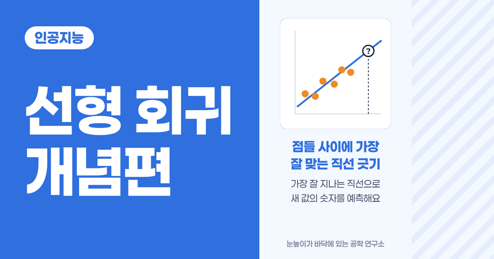

<!-- 목차 -->

## 1. 선형 회귀를 먼저 한 줄로

선형 회귀는 데이터 점들 사이를 가장 잘 지나는 직선을 찾고 그 직선으로 새 값의 숫자를 예측하는 방법이에요.

앞 강좌의 kNN이 "사과일까 귤일까"처럼 종류를 골랐다면 선형 회귀는 "몇 개 팔릴까", "몇 km 갈까"처럼 숫자를 맞혀요.

이 강좌는 개념편이에요. 왜 쓰는지, 어떻게 쓰는지, 어디에 쓰이는지를 그래프로 봐요. 직선을 수식으로 직접 계산하는 방법은 [선형 회귀 계산편: 최소제곱법으로 직선 직접 구하기](<../인공지능 135 선형 회귀 계산편/index.md>)에서 다뤄요.

## 2. 예시로 먼저 감 잡기

### 2-1. 자전거로 얼마나 갈까요?

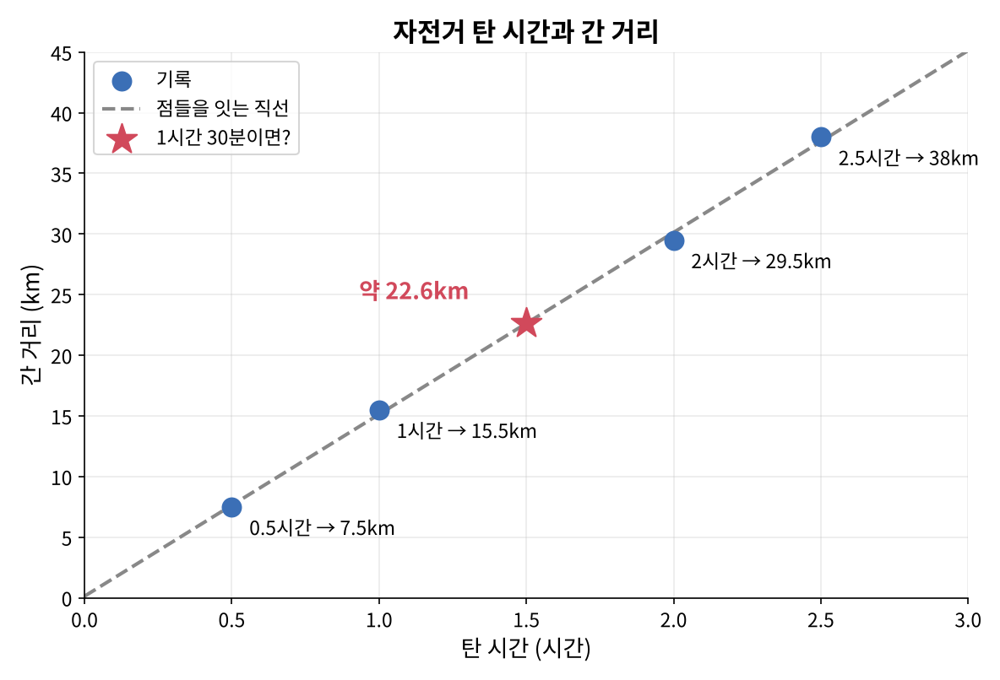

자전거를 탈 때마다 탄 시간과 간 거리를 적어 뒀어요. 30분에 7.5km, 1시간에 15.5km, 2시간에 29.5km, 2시간 30분에 38km였어요.

그럼 1시간 30분을 타면 몇 km를 갈까요?

정답 보기

약 22.6km예요. 점들이 거의 한 줄로 늘어서 있어서 점들을 잇는 직선을 긋고 1.5시간 자리를 읽으면 돼요. 이 직선은 "1시간에 15km씩"이라는 규칙과 같아요.

점이 거의 일직선이면 직선 하나로 처음 보는 값도 쉽게 예측할 수 있어요.

### 2-2. 아이스크림은 몇 개 팔릴까요?

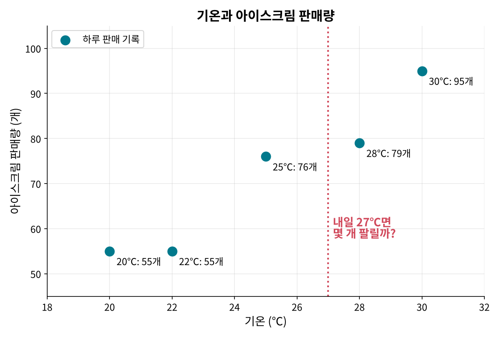

아이스크림 가게에서 닷새 동안 기온과 판매량을 적었어요. 더울수록 많이 팔리는 건 보이는데 점들이 한 줄로 딱 맞지는 않아요. 20℃와 22℃에는 똑같이 55개가 팔렸거든요.

내일이 27℃라면 몇 개쯤 팔릴까요? 자를 대고 직선을 그어 본다면 어디에 그어야 할까요?

이번엔 모든 점을 지나는 직선이 없어요. 그래서 "가장 그럴듯한 직선"을 고르는 기준이 필요해요. 그 기준은 5장에서 봐요.

## 3. kNN과 무엇이 다를까요?

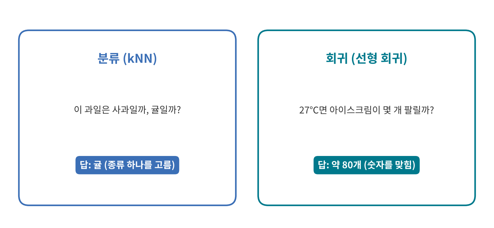

인공지능이 맞히는 답은 크게 두 가지예요.

|  | 분류 | 회귀 |
| --- | --- | --- |
| 맞히는 것 | 종류(사과/귤, 스팸/정상) | 숫자(판매량, 거리, 가격) |
| 대표 방법 | kNN | 선형 회귀 |
| 답의 예 | "귤" | "약 80개" |

[인공지능 첫걸음: 처음 보는 열매로 배우는 AI의 원리](<../인공지능 110 인공지능 첫걸음/index.md>) 5장에서 "숫자 하나를 맞히는 인공지능도 있다"고 했던 게 바로 회귀예요. 정답이 붙은 데이터로 배우니 선형 회귀도 지도 학습이에요.

## 4. 직선이 알려 주는 두 가지

직선은 두 가지만 알면 정해져요. 얼마나 기울었는지와 어디서 출발하는지예요.

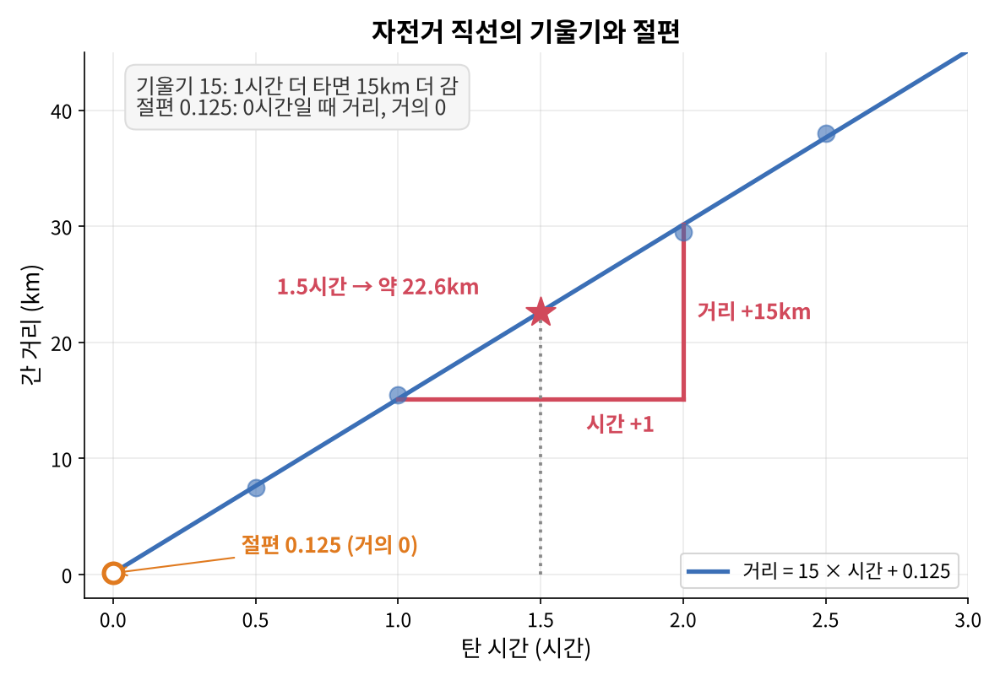

먼저 자전거 직선이에요.

- **기울기:** 1시간 더 탈 때마다 15km씩 더 가요. 직선이 얼마나 가파른지를 나타내요.
- **절편:** 0시간 탔을 때의 거리예요. 거의 0이라서 "안 타면 0km"라는 상식과 맞아요.

그래서 이 직선은 "탄 시간 × 15 + 거의 0"이에요. 1.5시간이면 약 22.6km예요.

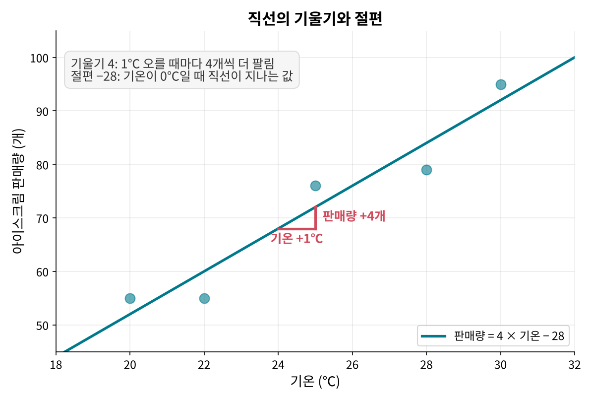

다음은 아이스크림 직선이에요.

- **기울기:** 기온이 1℃ 오를 때마다 4개씩 더 팔려요.
- **절편:** 기온이 0℃일 때 직선이 지나는 값으로 −28이에요. 실제로 −28개가 팔릴 수는 없어요. 이 이야기는 9-1에서 다시 할게요.

이 직선으로 27℃를 읽으면 약 80개가 팔린다고 예측해요. 4 × 27 − 28 = 80이에요.

선형 회귀는 데이터를 보고 이 기울기와 절편을 찾아요. 한번 찾으면 "1℃마다 4개"처럼 사람이 읽고 이해할 수 있는 규칙이 돼요.

## 5. 가장 잘 맞는 직선이란?

### 5-1. 직선과 점 사이의 거리를 재요

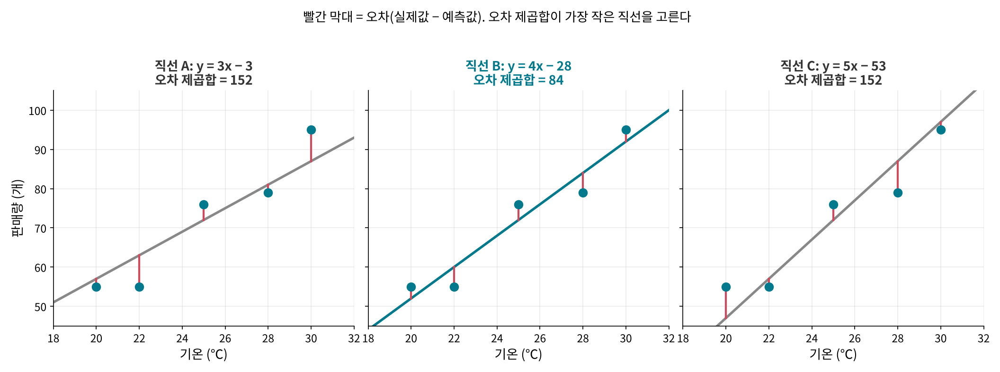

같은 데이터에 직선 세 개를 그어 봤어요. 빨간 막대는 점마다 실제 판매량과 직선이 예측한 판매량의 차이예요. 이 차이를 오차라고 불러요.

빨간 막대가 전체적으로 짧을수록 직선이 점들에 가깝게 지나가요. 셋 중에서는 가운데 직선 B의 막대가 가장 짧아요.

### 5-2. 오차를 제곱해서 더해요

막대 길이를 그냥 더하면 문제가 생겨요. 직선보다 위에 있는 점은 +, 아래에 있는 점은 −라서 서로 지워지거든요. 그래서 오차를 제곱해서 모두 양수로 만든 뒤 더해요. 이 값을 오차 제곱합이라고 해요.

가장 잘 맞는 직선은 오차 제곱합이 가장 작은 직선이에요. 이렇게 찾는 방법을 최소제곱법이라고 불러요. 그림에서는 A와 C가 152, B가 84라서 B가 가장 잘 맞아요. 이 숫자를 직접 계산하는 방법은 계산편에서 봐요.

### 5-3. 직선을 돌려 보며 찾아요

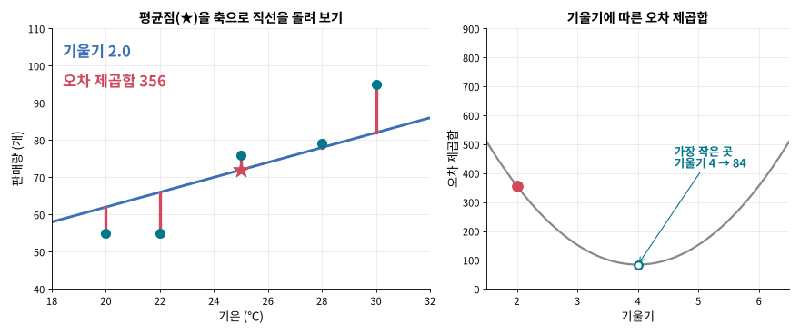

가장 잘 맞는 직선은 이렇게 찾을 수 있어요.

1. 기온 평균과 판매량 평균이 만나는 점(★, 평균점)에 직선을 핀으로 꽂아요.
2. 시소처럼 직선을 돌려 보며 오차 제곱합을 재요.
3. 너무 누우면 오른쪽 위 점과 멀어지고 너무 서면 왼쪽 아래 점과 멀어져요.
4. 오차 제곱합이 가장 작아지는 기울기에서 멈춰요.

오른쪽 그래프는 기울기마다 오차 제곱합을 이어 그린 거예요. 그릇 모양 곡선의 바닥이 우리가 찾는 직선이에요. 이 데이터에서는 기울기 4가 바닥이에요.

## 6. 컴퓨터는 어떻게 직선을 찾을까요?

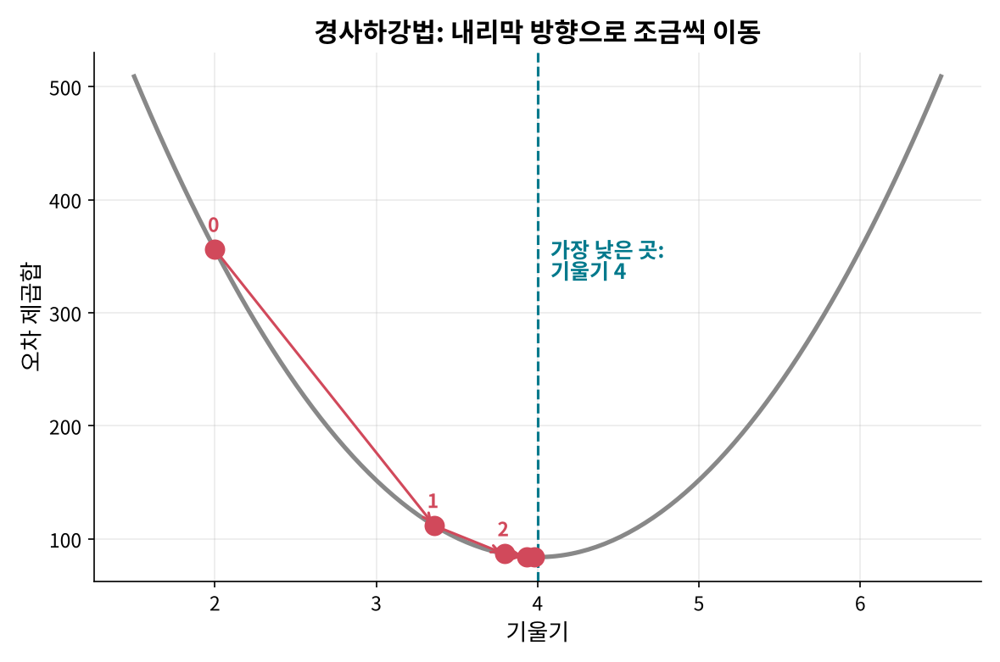

컴퓨터가 직선을 찾는 방법은 두 가지예요.

- **공식으로 한 번에:** 점들의 좌표를 정해진 공식에 넣으면 기울기와 절편이 바로 나와요. 계산편에서 손으로 따라 해 봐요.
- **조금씩 고쳐 가며:** 아무 기울기에서 출발해 그릇의 내리막 쪽으로 조금씩 움직이기를 반복해요. 이걸 경사하강법이라고 해요. 그림에서는 기울기가 2 → 3.36 → 3.80 → 3.93 → 3.98로 움직이며 바닥인 4에 다가가요.

데이터가 아주 많거나 모델이 복잡하면 경사하강법을 많이 써요. 다음 강좌들의 로지스틱 회귀와 신경망도 이 방법으로 배워요.

## 7. 입력이 여러 개라면

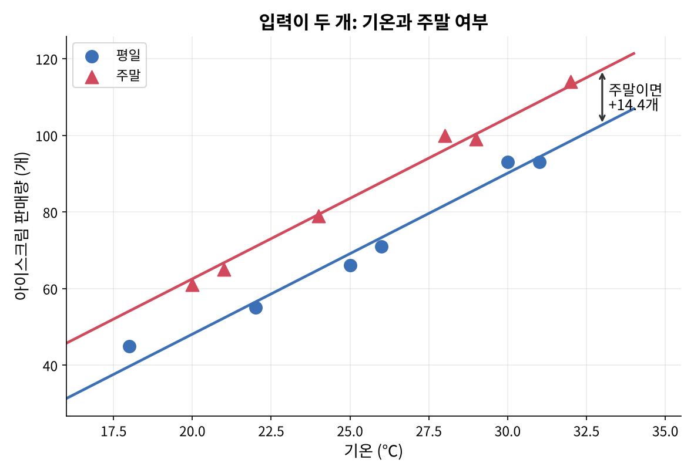

아이스크림 판매량이 기온에만 달려 있지는 않아요. 주말에는 사람이 많아 더 팔리겠죠. 열이틀 동안 기온과 주말 여부를 함께 기록해서 선형 회귀를 하면 이런 규칙이 나와요.

- 주말 여부가 같다면 기온이 1℃ 오를 때 4.2개 더 팔려요.
- 기온이 같다면 주말이 평일보다 14.4개 더 팔려요.

그래서 그림의 두 직선은 기울기가 같고 주말 직선만 위에 있어요. 27℃라면 평일은 약 78개, 주말은 약 92개로 예측해요.

입력이 늘어도 방법은 같아요. 오차 제곱합이 가장 작아지는 규칙을 찾아요. 다만 기온은 20~30, 주말은 0~1처럼 입력의 범위가 다르니 숫자 크기만 보고 어느 입력이 더 중요하다고 단정하면 안 돼요.

## 8. 얼마나 잘 맞는지도 숫자로 알려 줘요

직선을 구했으면 얼마나 믿을 만한지도 확인해요. 자주 쓰는 숫자는 두 가지예요.

- **RMSE:** 보통 얼마나 틀리는지예요. 아이스크림 직선은 약 4.1이라서 하루 판매량을 보통 4개 정도 차이로 맞혀요.
- **결정계수 R²:** 평균으로만 찍을 때보다 오차를 얼마나 줄였는지예요. 아이스크림 직선은 약 0.93이라서 평균으로 찍을 때 생기던 오차의 약 93%를 줄였어요. 1에 가까울수록 잘 맞아요.

두 숫자를 계산하는 방법은 계산편에서 봐요.

## 9. 자주 걸리는 지점

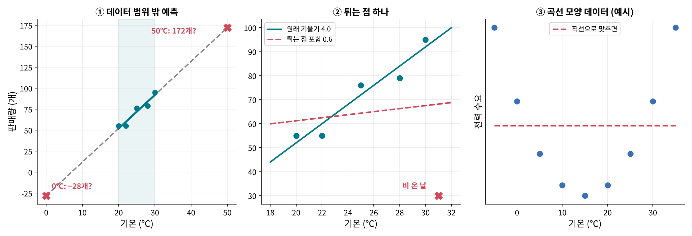

### 9-1. 데이터 범위 밖 예측은 위험해요

기록한 기온은 20~30℃뿐이에요. 직선을 그대로 늘리면 0℃에서는 −28개, 50℃에서는 172개라는 엉뚱한 답이 나와요. 직선은 데이터가 있는 범위 안에서만 믿을 만해요.

### 9-2. 튀는 점 하나가 직선을 크게 바꿔요

31℃인데 비가 와서 30개밖에 안 팔린 날을 하나 더하면 기울기가 4.0에서 0.6으로 확 줄어요. 오차를 제곱하기 때문에 크게 벗어난 점 하나가 직선을 강하게 끌어당겨요. 데이터를 넣기 전에 이런 점이 왜 생겼는지 먼저 살펴봐요.

### 9-3. 곡선 모양 데이터에는 직선이 안 맞아요

난방과 냉방이 모두 필요한 전력 수요는 너무 춥거나 너무 더울 때 늘어나요. 이런 U자 모양 데이터에 직선을 그으면 거의 평평한 직선이 나와 아무것도 설명하지 못해요. 이럴 때는 곡선을 쓰는 다른 모델이 필요해요(그림 ③은 모양을 보여 주려고 만든 예시예요).

### 9-4. 같이 움직인다고 원인은 아니에요

아이스크림 판매량과 물놀이 사고는 둘 다 더운 날 늘어나요. 그래서 판매량으로 사고 건수를 예측하는 직선도 꽤 잘 맞을 수 있어요. 그렇다고 아이스크림이 사고를 일으키지는 않아요. 진짜 원인은 둘 다에 영향을 주는 더위예요. 회귀는 함께 움직이는 관계를 찾을 뿐 원인까지 알려 주지는 않아요.

## 10. 장점과 단점

### 장점

| 장점 | 이유 | 관련 부분 |
| --- | --- | --- |
| 이해하기 쉬워요 | "1℃ 오르면 4개 더"처럼 규칙 하나하나에 뜻이 있어요. | 4장 |
| 계산이 빠르고 가벼워요 | 공식 한 번이면 답이 나오고 예측은 곱하고 더하기뿐이에요. | 6장 |
| 얼마나 잘 맞는지 숫자로 보여 줘요 | RMSE, R²로 성능을 바로 확인해요. | 8장 |
| 입력을 늘리기 쉬워요 | 입력마다 규칙을 하나씩 더하면 돼요. | 7장 |
| 다른 모델의 출발점이에요 | 오차 제곱합, 경사하강법 같은 생각이 다음 알고리즘에도 그대로 쓰여요. | 6장 |

### 단점

| 단점 | 이유 | 관련 부분 |
| --- | --- | --- |
| 직선 관계만 잡아요 | 곡선 모양 관계는 제대로 설명하지 못해요. | 9-3 |
| 튀는 점에 약해요 | 오차를 제곱해서 큰 오차 하나에 직선이 끌려가요. | 9-2 |
| 범위 밖 예측을 믿기 어려워요 | 직선은 끝없이 이어지지만 현실은 그렇지 않아요. | 9-1 |
| 원인을 알려 주지 않아요 | 함께 움직이는 관계와 원인은 달라요. | 9-4 |
| 입력끼리 겹치면 규칙이 흔들려요 | 비슷한 입력 두 개가 서로의 몫을 나눠 가져요. | 7장 |

## 11. 생활 속 선형 회귀

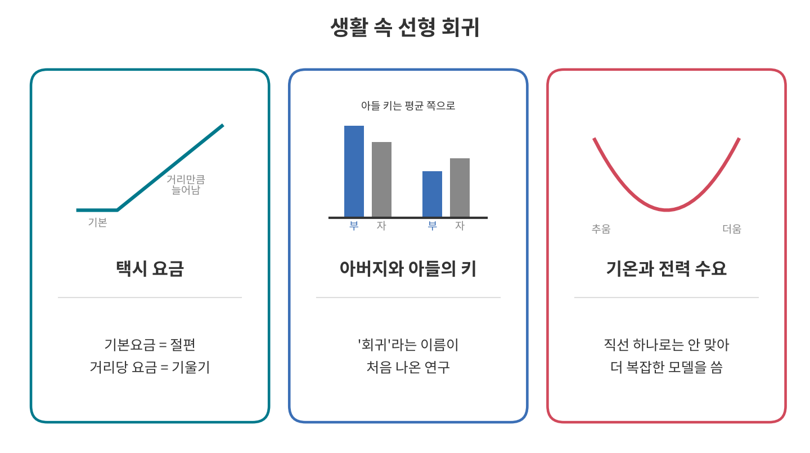

### 11-1. 택시 요금: 기울기와 절편이 보이는 직선

서울 중형택시는 기본요금 4,800원으로 1.6km까지 가고 그 뒤로는 131m마다 100원씩 올라요. 기본요금이 절편, 거리에 따라 오르는 요금이 기울기인 셈이에요. 1km로 바꾸면 약 763원씩 오르는 직선이에요. 차가 막혀 천천히 가면 시간요금이 붙어서 실제 요금은 이 직선보다 조금 올라가기도 해요([요금 기준: 서울시 미디어허브](https://mediahub.seoul.go.kr/archives/2006817)).

택시 요금은 규칙이 정해진 직선이지만 회귀는 반대로 기록만 보고 이런 규칙을 찾아내요. 택시 영수증 여러 장의 거리와 요금으로 선형 회귀를 하면 기본요금과 km당 요금을 거꾸로 알아낼 수 있어요.

### 11-2. 아버지와 아들의 키: "회귀"라는 이름의 시작

19세기 영국의 프랜시스 골턴은 아버지와 아들의 키를 비교했어요. 키 큰 아버지의 아들은 대체로 키가 컸지만 아버지만큼 크지는 않았어요. 반대로 키 작은 아버지의 아들은 아버지보다 조금 컸어요. 골턴은 아들의 키가 평균 쪽으로 돌아가는 이 현상을 평균으로의 회귀라고 불렀고 여기서 "회귀"라는 이름이 왔어요.

### 11-3. 기온과 전력 수요: 직선만으로는 부족한 예

기온이 전력 수요에 영향을 준다는 건 잘 알려져 있지만 관계가 직선은 아니에요. 국내 연구에서도 기온과 전력 수요의 관계가 복잡하고 비선형적이며 비대칭이라고 보고했어요. 그래서 전력 수요 예측에는 직선에 곡선 효과를 더한 모델을 써요. 선형 회귀의 한계를 알아야 하는 이유예요.

## 12. 한 장 요약

> 선형 회귀: 점들 사이를 가장 잘 지나는 직선으로 숫자를 예측하는 방법
>
> - 직선은 기울기(1만큼 늘 때 얼마나 느나)와 절편(0일 때 값)으로 정해진다.
> - 오차(점과 직선의 세로 차이)를 제곱해 더한 값이 가장 작은 직선이 가장 잘 맞는다(최소제곱법).
> - 컴퓨터는 공식으로 한 번에 구하거나 경사하강법으로 조금씩 고쳐 가며 찾는다.
> - 입력이 여러 개면 입력마다 규칙을 하나씩 더한다(다중 선형 회귀).
> - RMSE(보통 얼마나 틀리나)와 R²(평균보다 얼마나 잘 맞나)로 확인한다.
> - 범위 밖 예측, 튀는 점, 곡선 데이터, 원인 착각을 조심한다.

## 13. 셀프 퀴즈

<b>Q1.</b> 아이스크림 직선의 기울기가 4라는 건 무슨 뜻일까요?

정답 보기

기온이 1℃ 오를 때마다 판매량이 4개씩 늘어난다는 뜻이에요.

<b>Q2.</b> 오차를 그냥 더하지 않고 제곱해서 더하는 이유는 무엇일까요?

정답 보기

직선보다 위에 있는 점의 오차(+)와 아래에 있는 점의 오차(−)가 서로 지워지기 때문이에요. 제곱하면 모두 양수가 돼서 얼마나 떨어져 있는지를 제대로 모을 수 있어요.

<b>Q3.</b> 기록이 20~30℃뿐인데 직선으로 0℃의 판매량을 예측하면 어떤 문제가 생길까요?

정답 보기

−28개처럼 있을 수 없는 답이 나와요. 직선은 데이터가 있는 범위 안에서만 믿을 만해요.

## 참고 자료

- [Wikipedia: Least squares](https://en.wikipedia.org/wiki/Least_squares)
- [Utah State University: History of Correlation and Regression](https://www.usu.edu/math/schneit/StatsHistory/StatisticsTopics/CorrelationRegression)
- [Wikipedia: Simple linear regression](https://en.wikipedia.org/wiki/Simple_linear_regression)

## 강좌 이동

- 이전 강좌: [kNN 알고리즘: 가까운 이웃에게 물어보기](<../인공지능 120 kNN 알고리즘/index.md>)
- 다음 강좌: [선형 회귀 계산편: 최소제곱법으로 직선 직접 구하기](<../인공지능 135 선형 회귀 계산편/index.md>)
