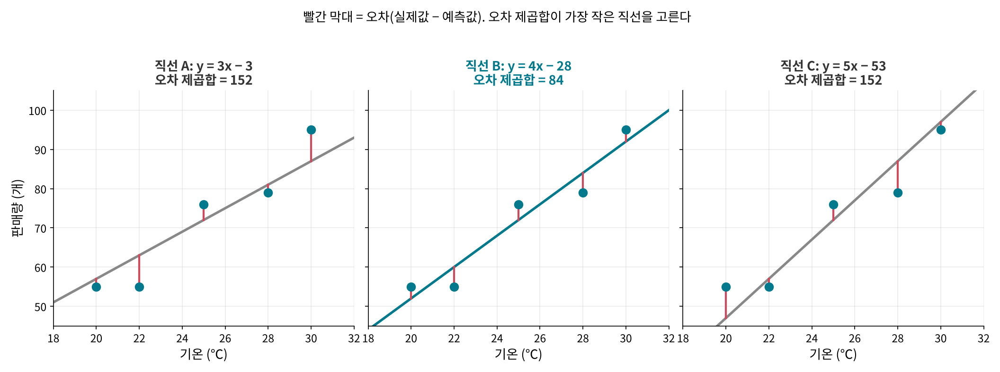
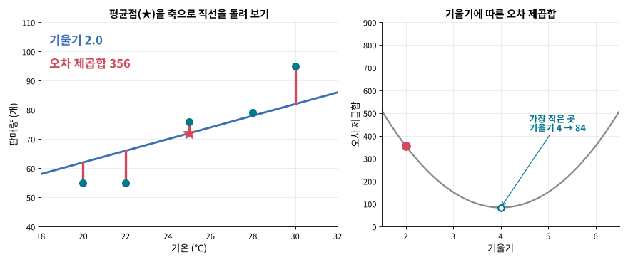
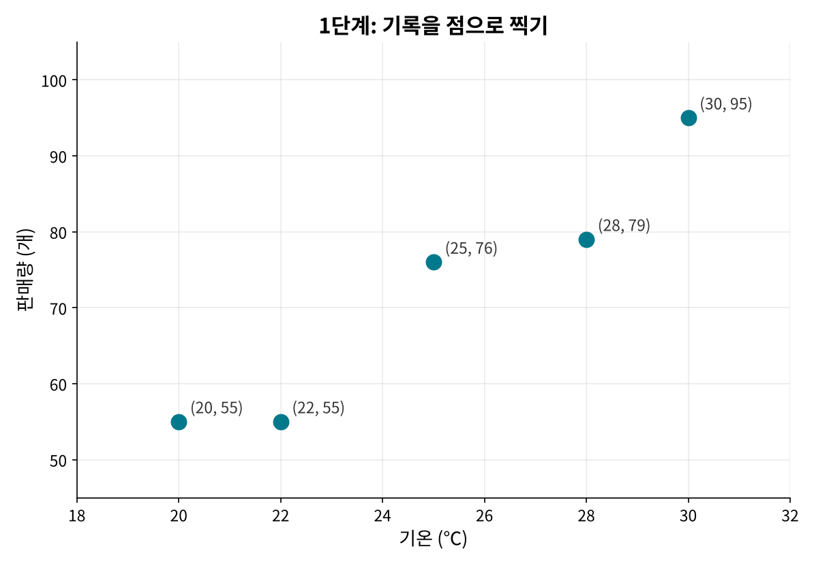
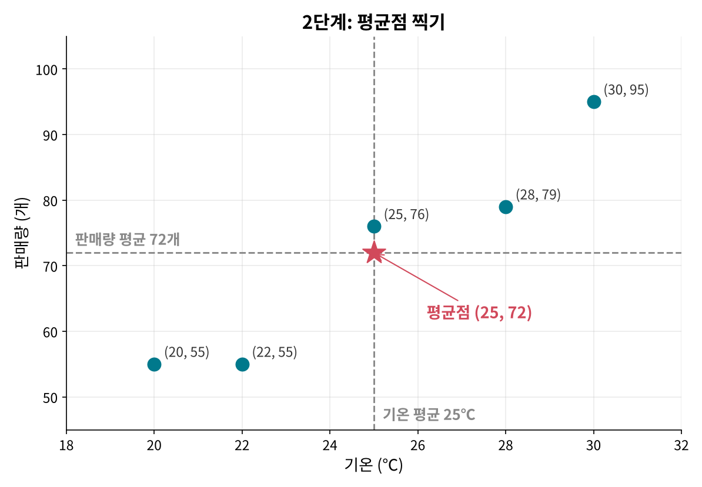
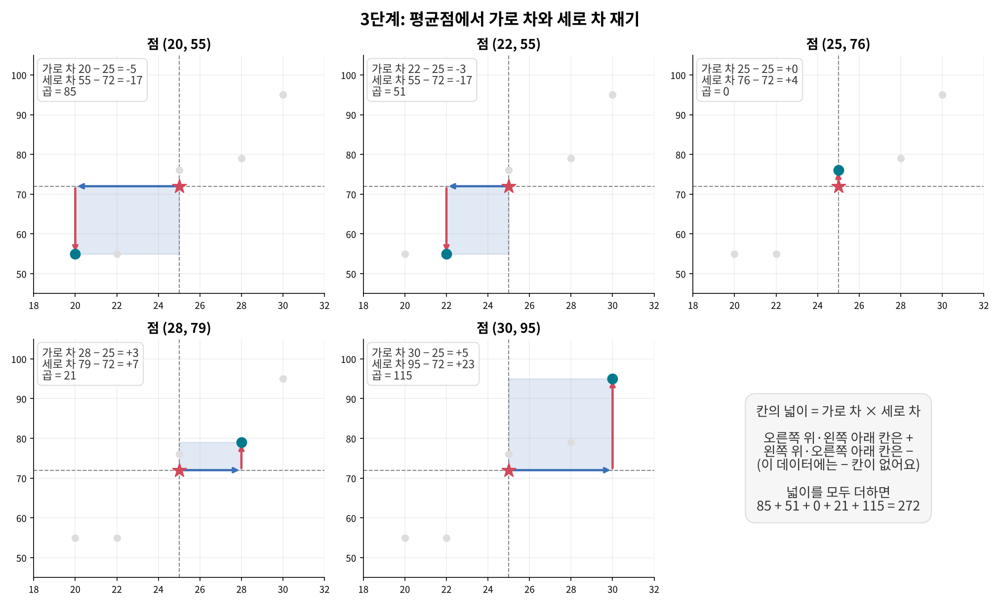
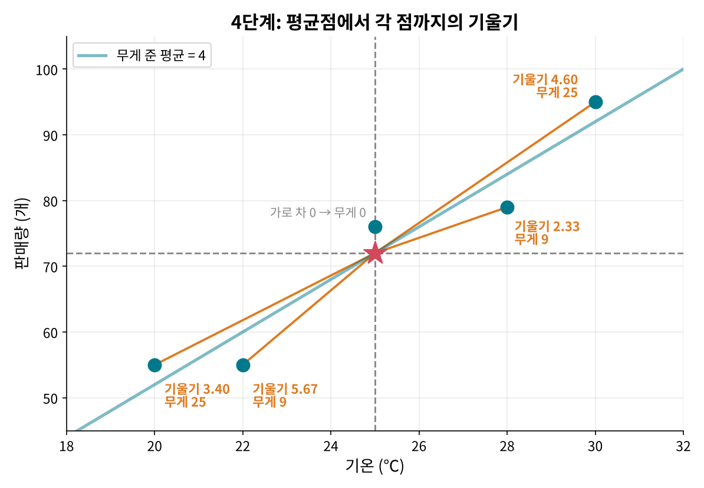
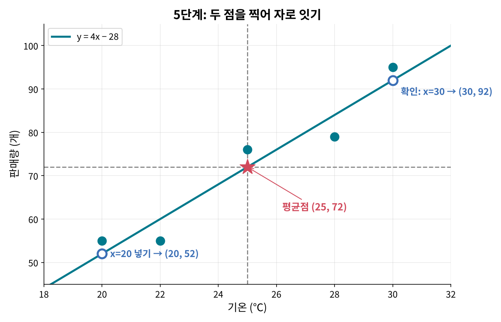
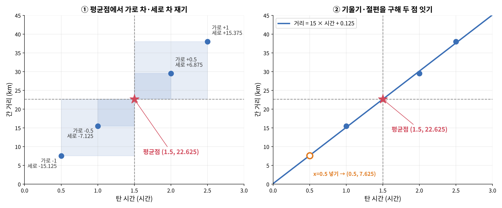
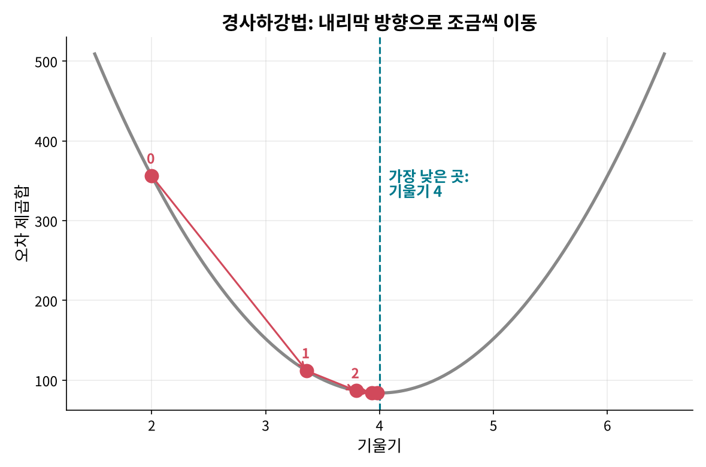
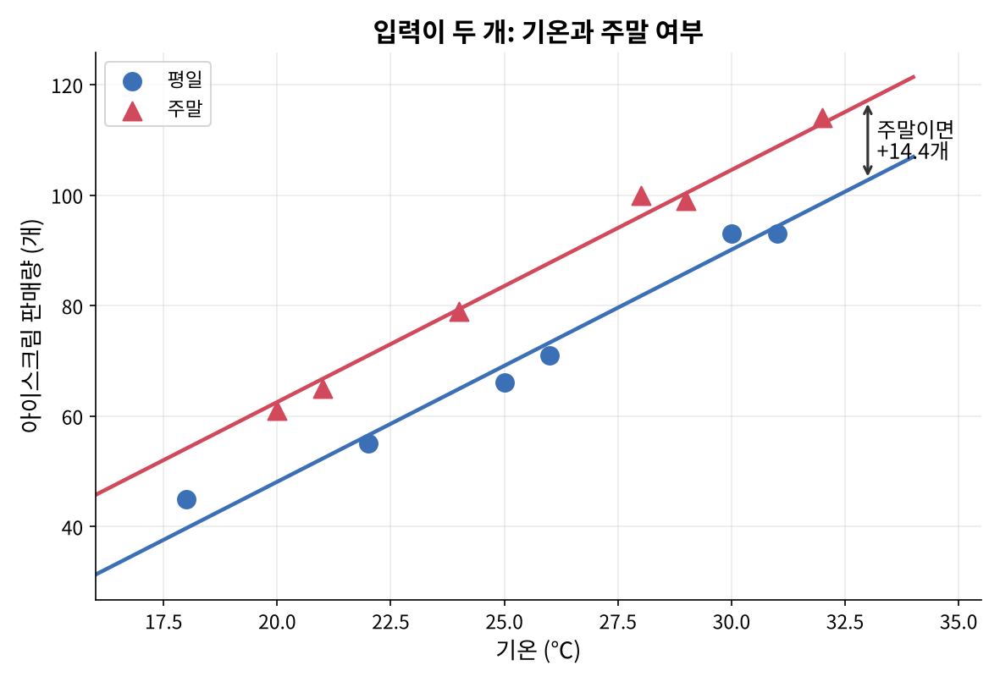

<!--
title: "선형 회귀 계산편: 최소제곱법으로 직선 직접 구하기"
field: 인공지능
order: 135
level: 기초
tags: [머신러닝]
summary: "선형 회귀 계산편은 아이스크림 기록 다섯 개로 오차 제곱합을 계산하고 최소제곱법 공식으로 가장 잘 맞는 직선을 손으로 직접 구해 보는 강좌예요."
-->

# 선형 회귀 계산편: 최소제곱법으로 직선 직접 구하기

<!-- 목차 -->

## 1. 이 강좌에서 할 일

선형 회귀 계산편은 아이스크림 기록 다섯 개로 오차 제곱합을 계산하고 최소제곱법 공식으로 가장 잘 맞는 직선을 손으로 직접 구해 보는 강좌예요.

선형 회귀가 무엇이고 왜 쓰는지는 [선형 회귀 개념편: 점들 사이에 가장 잘 맞는 직선 긋기](<../인공지능 130 선형 회귀 개념편/index.md>)에서 봤어요. 개념편을 먼저 보고 오면 훨씬 쉬워요.

여기서는 개념편의 아이스크림 기록을 그대로 써요. 표를 하나씩 채워 가면 공식이 왜 그렇게 생겼는지도 보여요.

| 날 | 기온 (x) | 판매량 (y) |
| --- | --- | --- |
| ① | 20 | 55 |
| ② | 22 | 55 |
| ③ | 25 | 76 |
| ④ | 28 | 79 |
| ⑤ | 30 | 95 |

## 2. 직선을 식으로 쓰기

직선은 두 숫자로 정해져요.

$$
y = a \times x + b
$$

- x는 입력(기온), y는 예측값(판매량)이에요.
- a는 기울기예요. x가 1 늘 때 y가 얼마나 느는지를 뜻해요.
- b는 절편이에요. x가 0일 때 직선이 지나는 y값이에요.

개념편에서 본 아이스크림 직선은 판매량 = 4 × 기온 − 28이었어요. 27℃를 넣으면 4 × 27 − 28 = 80이에요. 이 강좌의 목표는 4와 −28을 직접 구하는 거예요.

## 3. 오차 제곱합 계산하기

### 3-1. 오차를 재요

$$
\text{오차} = \text{실제값} - \text{예측값}
$$

직선 B(y = 4x − 28)의 예측값으로 오차를 계산해 볼게요.

| 기온 | 실제 판매량 | 예측(4x − 28) | 오차 | 오차² |
| --- | --- | --- | --- | --- |
| 20 | 55 | 52 | 3 | 9 |
| 22 | 55 | 60 | −5 | 25 |
| 25 | 76 | 72 | 4 | 16 |
| 28 | 79 | 84 | −5 | 25 |
| 30 | 95 | 92 | 3 | 9 |
| 합 |  |  | 0 | 84 |

### 3-2. 왜 제곱해서 더할까요?

오차를 그냥 더하면 +3과 −5처럼 부호가 다른 값끼리 지워져요. 위 표에서도 오차의 합은 0이에요. 그래서 오차를 제곱해서 모두 양수로 만든 뒤 더해요. 이 값이 오차 제곱합이에요. 제곱을 하면 큰 오차가 더 크게 반영되는 효과도 있어요.

| 직선 | 식 | 오차 제곱합 |
| --- | --- | --- |
| A | y = 3x − 3 | 152 |
| B | y = 4x − 28 | 84 |
| C | y = 5x − 53 | 152 |

오차 제곱합이 가장 작은 직선 B가 이 데이터에 가장 잘 맞아요. 오차 제곱합이 가장 작아지는 직선을 찾는 방법을 최소제곱법이라고 해요. 1805년 르장드르가 처음 정리해 발표했고 가우스도 같은 방법을 썼다고 밝혀 누가 먼저인지 다툼이 있었어요.

### 3-3. 직선을 돌려 보며 찾기

직선을 평균점(★)에 핀으로 꽂아 두고 시소처럼 돌리면서 오차 제곱합을 재면 이래요. 평균점은 기온 평균 25℃와 판매량 평균 72개가 만나는 점이에요(4-2에서 직접 구해요).

- 기울기 3: 오차 제곱합 152. 직선이 너무 누워서 오른쪽 위 점과 멀어요.
- 기울기를 올릴수록 빨간 막대가 짧아지고 오차 제곱합이 줄어요.
- 기울기 4: 오차 제곱합 84. 가장 작아요.
- 기울기 5: 오차 제곱합 152. 이번엔 직선이 너무 서서 다시 커져요.

왜 하필 평균점에 꽂아 두나요?

- 가장 잘 맞는 직선은 항상 평균점을 지나요. 평균점에서 위나 아래로 옮기면 모든 점의 오차가 한쪽으로 쏠려서 오차 제곱합이 늘어나거든요.
- 예를 들어 기울기 4인 채로 직선을 10만큼 올리면 점 다섯 개의 오차가 모두 10씩 작아져요. 오차 제곱합은 84 + 5 × 10² = 584로 커져요.
- 그래서 위아래 위치는 평균점으로 먼저 정하고 기울기만 찾으면 돼요.
- 참고로 오차를 그냥 더한 값은 평균점을 지나는 직선이면 기울기와 상관없이 모두 0이에요. 3-1 표에서 오차 합이 0이었던 것도 그 때문이에요. 그래서 그냥 더한 값으로는 직선을 고를 수 없고 제곱해서 더해요.

## 4. 직접 계산해서 직선 긋기

3장에서는 직선을 돌려 보며 찾았어요. 실제로는 돌려 볼 필요 없이 점들의 좌표만으로 계산해서 바로 그을 수 있어요. 순서는 다섯 단계예요.

1. 기록을 점으로 찍어요.
2. 평균점을 찍어요.
3. 평균점에서 점마다 가로 차와 세로 차를 재요.
4. 기울기를 구해요.
5. 절편을 구하고 두 점을 이어 직선을 그어요.

### 4-1. 1단계: 기록을 점으로 찍기

하루가 점 하나예요. 1장의 표대로 가로축에 기온, 세로축에 판매량을 놓고 찍어요.

### 4-2. 2단계: 평균점 찍기

기온과 판매량의 평균을 따로 구해요.

- 기온 평균 x̄ = (20 + 22 + 25 + 28 + 30) ÷ 5 = 125 ÷ 5 = 25
- 판매량 평균 ȳ = (55 + 55 + 76 + 79 + 95) ÷ 5 = 360 ÷ 5 = 72

x̄(엑스 바)는 x의 평균, ȳ(와이 바)는 y의 평균을 뜻하는 기호예요.

두 평균이 만나는 (25, 72)에 별을 찍어요. 이 점이 평균점이에요. 3-3에서 본 것처럼 가장 잘 맞는 직선은 반드시 이 점을 지나요. 직선이 지나갈 한 점이 벌써 정해진 셈이에요.

### 4-3. 3단계: 평균점에서 가로 차와 세로 차 재기

점마다 평균점에서 옆으로 얼마나, 위아래로 얼마나 떨어져 있는지 재요.

- 가로 차 = 그 점의 기온 − 기온 평균(25)
- 세로 차 = 그 점의 판매량 − 판매량 평균(72)

| 날 | 가로 차 (x − x̄) | 세로 차 (y − ȳ) | 가로 차 × 세로 차 | 가로 차² |
| --- | --- | --- | --- | --- |
| ① (20, 55) | 20 − 25 = −5 | 55 − 72 = −17 | 85 | 25 |
| ② (22, 55) | 22 − 25 = −3 | 55 − 72 = −17 | 51 | 9 |
| ③ (25, 76) | 25 − 25 = 0 | 76 − 72 = +4 | 0 | 0 |
| ④ (28, 79) | 28 − 25 = +3 | 79 − 72 = +7 | 21 | 9 |
| ⑤ (30, 95) | 30 − 25 = +5 | 95 − 72 = +23 | 115 | 25 |
| 합 |  |  | 272 | 68 |

> ⚠️ 부호를 꼭 살려요. 평균보다 왼쪽이나 아래에 있으면 −, 오른쪽이나 위에 있으면 +예요. 거리처럼 양수로 바꾸면 기울기가 올라가는지 내려가는지를 알 수 없게 돼요.

표의 두 칸이 무엇을 뜻하는지 그림으로 보면 이래요.

- 가로 차 × 세로 차는 평균점과 그 점 사이에 생기는 칸의 넓이예요. 오른쪽 위나 왼쪽 아래 칸은 +, 왼쪽 위나 오른쪽 아래 칸은 −예요. + 칸이 많을수록 "기온이 오르면 판매량도 오른다"는 증거가 쌓여요. 이 데이터는 − 칸이 하나도 없고 넓이 합이 272예요.
- 가로 차²는 점이 평균점에서 옆으로 얼마나 멀리 퍼져 있는지를 나타내요. 합은 68이에요.

### 4-4. 4단계: 기울기 구하기

기울기 공식은 이래요.

$$
a = \frac{\sum (x - \bar{x})(y - \bar{y})}{\sum (x - \bar{x})^2}
$$

Σ(시그마)는 모두 더하라는 기호예요. 말로 바꾸면 이렇게 돼요.

- 기울기 = (가로 차 × 세로 차의 합) ÷ (가로 차²의 합)
- 기울기 = 272 ÷ 68 = 4

3단계 표의 맨 아래 합 두 개를 나누기만 하면 돼요. 그런데 왜 이 계산이 기울기가 될까요? 그림으로 보면 쉬워요.

평균점에서 각 점까지 선을 그으면 선마다 기울기가 달라요. 공식은 이 기울기들을 평균 내는데, 평균점에서 가로로 멀리 있는 점에 더 큰 무게(가로 차²)를 줘요.

| 날 | 평균점 → 점 기울기 (세로 차 ÷ 가로 차) | 무게 (가로 차²) | 기울기 × 무게 |
| --- | --- | --- | --- |
| ① | −17 ÷ −5 = 3.4 | 25 | 85 |
| ② | −17 ÷ −3 ≈ 5.67 | 9 | 51 |
| ③ | 가로 차가 0이라 계산하지 않아요 | 0 | 0 |
| ④ | 7 ÷ 3 ≈ 2.33 | 9 | 21 |
| ⑤ | 23 ÷ 5 = 4.6 | 25 | 115 |
| 합 |  | 68 | 272 |

기울기 × 무게를 더하면 272, 무게를 더하면 68이에요. 272 ÷ 68 = 4로 공식과 같은 값이 나와요.

멀리 있는 점에 무게를 더 주는 건 멀리 있는 점이 기울기를 더 믿을 만하게 알려 주기 때문이에요. 평균점 바로 옆의 점은 조금만 흔들려도 기울기가 크게 바뀌어요. 그래서 ①과 ⑤가 25씩, ②와 ④는 9씩만 영향을 줘요.

### 4-5. 5단계: 절편 구하고 직선 긋기

절편 공식은 이래요.

$$
b = \bar{y} - a \times \bar{x}
$$

- 절편 b = 72 − 4 × 25 = 72 − 100 = −28
- 직선: 판매량 = 4 × 기온 − 28

이제 자를 대고 그어요. 직선은 두 점만 있으면 그을 수 있어요.

1. 첫 번째 점은 2단계에서 찍은 평균점 (25, 72)예요.
2. 두 번째 점은 식에 데이터 범위 안의 기온을 하나 넣어 구해요. 20을 넣으면 4 × 20 − 28 = 52라서 (20, 52)예요.
3. 두 점을 자로 이어요.
4. 확인해 봐요. 30을 넣으면 4 × 30 − 28 = 92예요. (30, 92)도 선 위에 있으면 맞게 그은 거예요.

절편 −28은 기온 0℃일 때의 값이라 20~30℃만 보이는 그래프에는 나타나지 않아요. 그래서 절편 점 대신 평균점과 범위 안의 점을 쓰는 게 편해요.

3장에서 오차 제곱합이 가장 작았던 직선 B와 똑같이 나왔어요.

### 4-6. 같은 순서로 자전거 직선도 구해 보기

1단계: 기록은 (0.5시간, 7.5km), (1, 15.5), (2, 29.5), (2.5, 38)이에요.

2단계: 평균점을 구해요.

- 시간 평균 = (0.5 + 1 + 2 + 2.5) ÷ 4 = 6 ÷ 4 = 1.5
- 거리 평균 = (7.5 + 15.5 + 29.5 + 38) ÷ 4 = 90.5 ÷ 4 = 22.625

3단계: 평균점 (1.5, 22.625)에서 가로 차와 세로 차를 재요.

| 기록 | 가로 차 | 세로 차 | 가로 차 × 세로 차 | 가로 차² |
| --- | --- | --- | --- | --- |
| (0.5, 7.5) | −1 | −15.125 | 15.125 | 1 |
| (1, 15.5) | −0.5 | −7.125 | 3.5625 | 0.25 |
| (2, 29.5) | +0.5 | +6.875 | 3.4375 | 0.25 |
| (2.5, 38) | +1 | +15.375 | 15.375 | 1 |
| 합 |  |  | 37.5 | 2.5 |

4단계: 기울기 = 37.5 ÷ 2.5 = 15

5단계: 절편 = 22.625 − 15 × 1.5 = 0.125이에요. 평균점 (1.5, 22.625)과, 0.5를 넣어 얻은 (0.5, 7.625)를 이으면 거리 = 15 × 시간 + 0.125 직선이 그려져요.

이 데이터는 평균점이 마침 1.5시간이에요. 그래서 개념편 2-1 문제의 답 약 22.6km가 평균점에서 바로 나와요.

### 4-7. 식이 왜 이렇게 생겼을까요?

조금 더 알아보기

- 분자 Σ(x − x̄)(y − ȳ)는 x가 평균보다 클 때 y도 평균보다 큰지를 모은 값이에요. 같이 커지면 양수, 반대로 움직이면 음수가 돼요.
- 분모 Σ(x − x̄)²는 x가 평균에서 얼마나 퍼져 있는지예요.
- 그래서 기울기는 "x가 퍼진 정도에 비해 y가 얼마나 같이 움직이나"를 뜻해요.
- 절편 식 b = ȳ − a × x̄는 최소제곱 직선이 늘 평균점(x̄, ȳ) = (25, 72)를 지난다는 뜻이에요. 실제로 4 × 25 − 28 = 72예요.
- 이 식은 오차 제곱합을 a와 b로 미분해서 0이 되는 곳을 찾으면 나와요. 미분을 몰라도 위 표만 채우면 같은 답을 얻어요.

## 5. 얼마나 잘 맞는지 계산하기

### 5-1. 평균 오차 크기: RMSE

오차 제곱합을 데이터 개수로 나누고 제곱근을 씌우면 "보통 몇 개쯤 틀리나"가 나와요.

- 평균 제곱 오차(MSE) = 84 ÷ 5 = 16.8
- RMSE = √16.8 ≈ 4.1

이 직선은 하루 판매량을 보통 4개 정도 차이로 맞혀요.

### 5-2. 설명력: 결정계수 R²

$$
R^2 = 1 - \frac{\text{오차 제곱합}}{\sum (y - \bar{y})^2}
$$

분모는 직선 없이 평균(72개)으로만 예측했을 때의 오차 제곱합이에요. 4-3 표의 세로 차(y − ȳ)를 제곱해 더하면 289 + 289 + 16 + 49 + 529 = 1,172예요.

R² = 1 − 84 ÷ 1,172 ≈ 0.93

평균으로만 찍을 때 생기던 오차의 약 93%를 직선이 줄여 줬다는 뜻이에요. 1에 가까울수록 잘 맞고 0에 가까우면 평균으로 찍는 것과 별 차이가 없어요.

## 6. 컴퓨터는 어떻게 계산할까요?

### 6-1. 공식으로 한 번에

4장처럼 공식에 넣으면 한 번에 답이 나와요. 입력이 여러 개일 때도 같은 원리의 행렬 공식(정규방정식)이 있어요.

### 6-2. 경사하강법으로 조금씩

데이터가 아주 많거나 모델이 복잡하면 공식 대신 조금씩 고쳐 가는 방법을 많이 써요. 이걸 경사하강법이라고 해요.

1. 기울기를 아무 값으로 정해요(그림의 0번, 기울기 2).
2. 지금 위치에서 오차 제곱합이 줄어드는 방향(내리막)을 계산해요.
3. 그 방향으로 조금 이동해요. 얼마나 크게 움직일지는 학습률이 정해요.
4. 더 이상 내려가지 않을 때까지 반복해요.

그림에서는 기울기가 2 → 3.36 → 3.80 → 3.93 → 3.98로 움직이며 4에 다가가요. 이해를 돕기 위해 직선이 평균점을 지나게 고정하고 기울기만 움직였어요. 실제로는 기울기와 절편을 함께 움직여요. 이 방법은 나중에 배울 신경망에서도 똑같이 써요.

## 7. 입력이 여러 개일 때의 식

개념편 7장의 기온과 주말 예시를 식으로 써 볼게요. 열이틀 동안 기온과 주말 여부를 기록했고 주말은 1, 평일은 0으로 적었어요.

입력이 두 개가 되면 식은 이렇게 늘어나요.

$$
y = a_1 x_1 + a_2 x_2 + b
$$

이 데이터에 최소제곱법을 쓰면 이런 식이 나와요.

$$
\text{판매량} = 4.2 \times \text{기온} + 14.4 \times \text{주말} - 36.0
$$

- 4.2: 주말 여부가 같다면 기온이 1℃ 오를 때 4.2개 더 팔려요.
- 14.4: 기온이 같다면 주말이 평일보다 14.4개 더 팔려요.
- 그림에서 두 직선이 나란한 이유예요. 기울기(4.2)는 같고 주말 직선만 14.4만큼 위에 있어요.

27℃로 예측해 볼게요.

- 평일: 4.2 × 27 + 14.4 × 0 − 36.0 ≈ 77.5, 약 78개
- 주말: 4.2 × 27 + 14.4 × 1 − 36.0 ≈ 91.9, 약 92개

입력이 하나일 때는 직선, 둘이면 평면, 그 이상이면 눈으로 그릴 수는 없지만 계산 방법은 같아요. 오차 제곱합이 가장 작은 계수들을 찾아요. 계수가 많아지면 손으로 풀기 어려워서 6장의 행렬 공식이나 경사하강법으로 컴퓨터가 계산해요.

입력이 여러 개일 때 주의할 점도 있어요.

- 계수 크기만 보고 어떤 입력이 더 중요하다고 단정하면 안 돼요. 기온은 20~30, 주말은 0~1이라 단위가 달라요. 비교하려면 kNN 강좌에서 본 정규화처럼 범위를 맞춘 뒤 봐야 해요.
- 입력끼리 너무 비슷하면(예: 섭씨온도와 화씨온도를 둘 다 넣기) 계수가 불안정해져요.

## 8. 한 장 요약

> 선형 회귀 계산: 오차 제곱합이 가장 작은 기울기와 절편을 공식으로 구하기
>
> - 식: y = a × x + b (a 기울기, b 절편)
> - 오차 = 실제값 − 예측값, 제곱해서 더한 값이 가장 작은 직선을 고른다(최소제곱법).
> - a = Σ(x − x̄)(y − ȳ) ÷ Σ(x − x̄)², b = ȳ − a × x̄
> - 순서: 점 찍기 → 평균점 → 가로 차·세로 차 표 → 기울기 → 절편
> - 평가: RMSE = √(오차 제곱합 ÷ 개수), R² = 1 − 오차 제곱합 ÷ Σ(y − ȳ)²
> - 컴퓨터는 공식(정규방정식)이나 경사하강법으로 찾는다.
> - 입력이 여러 개면 y = a₁x₁ + a₂x₂ + … + b

## 9. 셀프 퀴즈

<b>Q1.</b> 판매량 = 4 × 기온 − 28일 때 23℃에는 몇 개가 팔린다고 예측할까요?

정답 보기

64개예요. 4 × 23 − 28 = 92 − 28 = 64

<b>Q2.</b> 점 세 개 (1, 3), (2, 5), (3, 7)에 가장 잘 맞는 직선의 기울기와 절편을 4장의 공식으로 구해 보세요.

정답 보기

기울기 2, 절편 1이에요.

- x̄ = 2, ȳ = 5
- Σ(x − x̄)(y − ȳ) = (−1)(−2) + 0 × 0 + 1 × 2 = 4
- Σ(x − x̄)² = 1 + 0 + 1 = 2
- a = 4 ÷ 2 = 2, b = 5 − 2 × 2 = 1

세 점이 모두 y = 2x + 1 위에 있어서 오차 제곱합은 0이에요.

<b>Q3.</b> 판매량 = 4.2 × 기온 + 14.4 × 주말 − 36.0일 때 30℃인 일요일에는 몇 개가 팔린다고 예측할까요?

정답 보기

약 104개예요. 4.2 × 30 + 14.4 × 1 − 36.0 = 126 + 14.4 − 36.0 = 104.4

## 참고 자료

- [Wikipedia: Least squares](https://en.wikipedia.org/wiki/Least_squares)
- [Wikipedia: Simple linear regression](https://en.wikipedia.org/wiki/Simple_linear_regression)

## 강좌 이동

- 이전 강좌: [선형 회귀 개념편: 점들 사이에 가장 잘 맞는 직선 긋기](<../인공지능 130 선형 회귀 개념편/index.md>)
- 다음 강좌: [로지스틱 회귀 개념편: 확률 곡선으로 예/아니오 맞히기](<../인공지능 140 로지스틱 회귀 개념편/index.md>)
