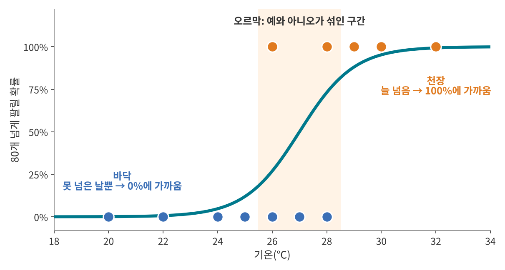
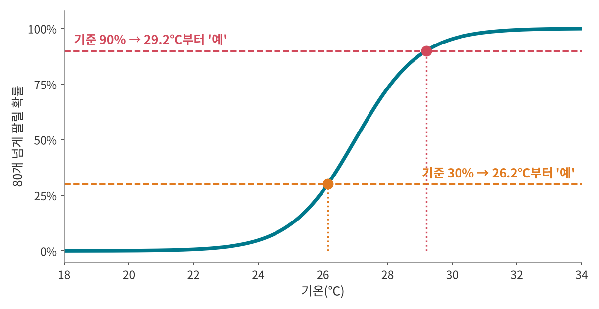
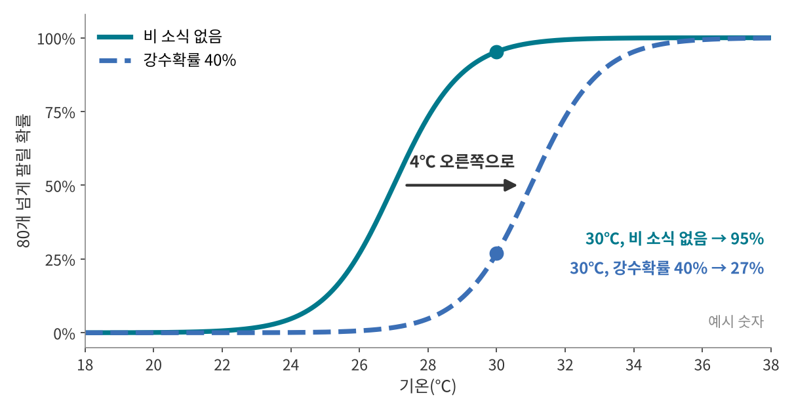
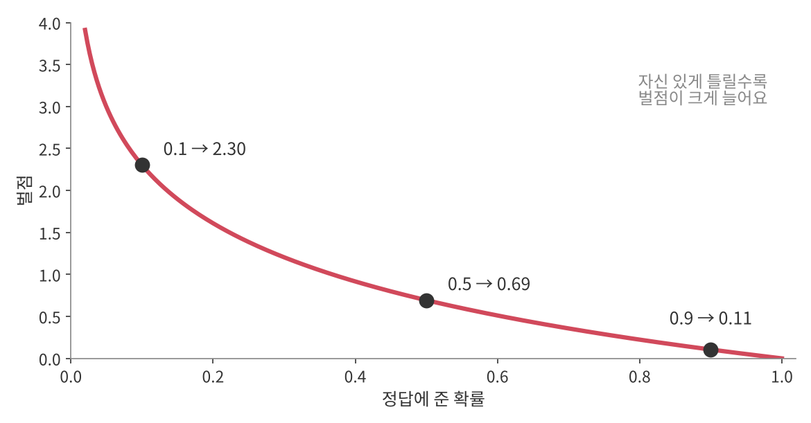

<!--
title: "로지스틱 회귀: 예/아니오가 될 확률 계산하기"
field: 인공지능
order: 140
level: 기초
tags: [머신러닝, 분류]
summary: "로지스틱 회귀는 입력으로 '예'일 확률을 0과 1 사이로 계산하고 그 확률이 기준을 넘으면 '예'로 판단하는 방법이에요."
-->

# 로지스틱 회귀: 예/아니오가 될 확률 계산하기

<!-- 목차 -->

## 1. 로지스틱 회귀를 먼저 한 줄로

로지스틱 회귀는 입력으로 '예'일 확률을 0과 1 사이로 계산하고 그 확률이 기준을 넘으면 '예'로 판단하는 방법이에요.

앞 강좌의 선형 회귀는 "몇 개 팔릴까"를 맞혔어요. 이번엔 "80개 넘게 팔릴까"를 맞혀요. 다만 바로 예/아니오를 말하지 않고 "넘을 확률 88%"처럼 확률부터 내놓아요.

본문은 그래프를 읽을 줄만 알면 따라올 수 있게 썼어요. 숫자로 계산하는 방법은 13장 "더 알고 싶다면"에 따로 모아 뒀어요.

## 2. 예시로 먼저 감 잡기

### 2-1. 우산을 챙길까요?

오늘 강수확률이 70%래요. A는 30%만 넘어도 우산을 챙기고 B는 80%는 넘어야 챙겨요.

두 사람은 우산을 챙길까요?

정답 보기

A는 챙기고 B는 안 챙겨요. 확률은 70%로 같지만 "몇 %를 넘으면 챙긴다"는 기준이 달라서 판단이 갈려요.

예/아니오를 정할 때는 두 단계를 거쳐요. 먼저 확률을 알고 그다음 기준과 비교해요. 로지스틱 회귀도 같아요. 다른 점은 확률을 일기예보에서 받지 않고 기록을 보고 직접 구한다는 거예요.

### 2-2. 아이스크림이 80개 넘게 팔릴까요?

앞 강좌의 아이스크림 가게예요. 사장님이 12일 동안 기온과 "그날 80개 넘게 팔렸나?"를 적었어요. 넘은 날은 주황 점(예), 못 넘은 날은 파란 점(아니오)이에요.

내일이 23℃라면 80개 넘게 팔릴까요? 28℃라면요?

정답 보기

23℃는 "아니오"라고 자신 있게 말할 수 있어요. 25℃ 이하였던 날은 한 번도 80개를 넘지 못했거든요.

28℃는 딱 잘라 말하기 어려워요. 28℃였던 이틀 중 하루는 넘었고 하루는 못 넘었어요. 그래도 "넘을 가능성이 반보다 조금 더 크다" 정도는 말할 수 있어요. 4장에서 곡선으로 읽으면 약 73%가 나와요.

이렇게 예와 아니오가 섞이는 기온에서는 "예"나 "아니오"보다 "넘을 확률 73%"가 더 정직한 답이에요. 이 확률을 구하는 방법이 로지스틱 회귀예요.

## 3. 기록을 확률로 읽어 보기

12일 기록을 기온 순서로 보면 세 구간으로 나뉘어요.

### 3-1. 바닥: 추운 날은 0%에 가까워요

25℃ 이하였던 4일은 모두 80개를 넘지 못했어요. 그래서 이 구간에서 넘을 확률은 0%에 가까워요.

### 3-2. 천장: 더운 날은 100%에 가까워요

29℃ 이상이었던 3일은 모두 80개를 넘었어요. 그래서 이 구간에서 넘을 확률은 100%에 가까워요.

### 3-3. 오르막: 섞인 구간은 그 사이예요

26~28℃였던 5일은 넘은 날이 2일, 못 넘은 날이 3일이에요. 예와 아니오가 섞여 있어서 확률도 0%와 100% 사이에 있어요. 기온이 오를수록 넘은 날이 늘어나니 확률도 조금씩 올라가요.

바닥, 오르막, 천장을 부드럽게 이으면 그림의 S자 곡선이 돼요. 이 곡선이 로지스틱 회귀가 그리는 선이에요. 곡선이 굽으면서 올라가는 오르막이 예와 아니오가 섞인 구간이에요. 확률도 여기서 빠르게 바뀌어요.

## 4. 곡선에서 확률 읽기

곡선을 그려 두면 처음 보는 기온도 확률을 바로 읽을 수 있어요.

1. 가로축에서 기온을 찾아요.
2. 위로 올라가다 곡선을 만나는 높이를 읽어요.
3. 그 높이가 80개 넘게 팔릴 확률이에요.

이 곡선에서 읽은 값이에요.

| 기온 | 25℃ | 26℃ | 27℃ | 28℃ | 29℃ | 30℃ |
| --- | --- | --- | --- | --- | --- | --- |
| 80개 넘게 팔릴 확률 | 12% | 27% | 50% | 73% | 88% | 95% |

29℃면 88%예요. 2-2에서 물었던 28℃는 73%예요. 27℃는 딱 50%라서 넘을지 못 넘을지 반반이에요.

곡선의 높이는 판매 개수가 아니라 확률이에요. 그래서 세로축이 0%부터 100%까지예요. 이 점은 10-1에서 다시 짚을게요.

## 5. 왜 하필 S자일까요?

### 5-1. 스위치가 아니라 밝기 조절 다이얼이에요

가장 쉬운 방법은 "28℃부터 무조건 예"처럼 기준 하나로 딱 자르는 거예요. 전등 스위치처럼 켜짐과 꺼짐만 있어요.

이렇게 하면 문제가 두 가지 생겨요.

- 기록과 안 맞는 날이 생겨요. 28℃에서 자르면 26℃에 넘은 날과 28℃에 못 넘은 날, 두 날이 틀려요. 26℃나 27℃에서 잘라도 세 날이 틀려요. 섞인 구간이 있으니 어디서 잘라도 틀리는 날이 생겨요.
- 27.9℃는 "아니오"인데 28.0℃는 "예"가 돼요. 0.1℃ 차이로 답이 정반대가 돼요.

S자 곡선은 밝기 조절 다이얼과 비슷해요. 추울 땐 거의 꺼져 있다가 27℃ 근처에서 서서히 밝아지고 더우면 완전히 켜져요. 섞인 구간에서는 확률이 조금씩 올라가서 기록과 자연스럽게 맞아요.

### 5-2. 직선으로 그으면 안 될까요?

앞 강좌의 직선을 그어 볼 수도 있어요. 예를 1, 아니오를 0으로 바꾸고 선형 회귀로 직선을 그으면 약 0.103 × 기온 − 2.31이 나와요.

그런데 직선은 끝없이 올라가고 내려가요. 18℃에서는 약 −0.45, 34℃에서는 약 1.20이 나와요. 확률이 0%보다 작거나 100%보다 클 수는 없어요. S자 곡선은 바닥과 천장에서 눕기 때문에 0%와 100% 사이를 벗어나지 않아요.

## 6. 확률을 예/아니오로 바꾸기

곡선이 확률을 알려 주면 마지막으로 기준과 비교해요. 가장 흔한 기준은 50%예요. 50%를 넘으면 "예", 아니면 "아니오"예요. 이 곡선에서는 27℃가 50%라서 27℃보다 더우면 "예"가 돼요.

기준 50%는 꼭 지켜야 하는 규칙이 아니라 출발점이에요. 2-1의 우산처럼 틀렸을 때 어느 쪽 손해가 더 큰지에 따라 기준을 옮겨요.

- 가게 주인이 "80개 넘게 팔릴 것 같으면 재고를 더 들인다"고 정했다고 해 볼게요. 남은 아이스크림은 냉동고에 두면 다음 날 팔 수 있지만 다 떨어져서 못 산 손님의 매출은 돌아오지 않아요. 그래서 기준을 30%로 낮춰요. 그림에서 곡선이 30%를 지나는 기온은 약 26.2℃예요. 26.2℃부터 재고를 더 들여요.
- 스팸 메일을 스팸함으로 옮기는 경우는 반대예요. 진짜 메일이 스팸함으로 가면 중요한 연락을 놓쳐요. 그래서 기준을 90%처럼 높여서 확실할 때만 옮길 수 있어요. 아이스크림 곡선이라면 90%를 지나는 약 29.2℃부터 "예"가 돼요.

곡선은 하나여도 기준에 따라 판단이 달라져요.

## 7. 컴퓨터는 곡선을 어떻게 그릴까요?

S자 곡선에는 손잡이가 두 개 있어요.

- **반반 기온:** 확률이 딱 50%가 되는 기온이에요. 이 손잡이를 돌리면 곡선이 왼쪽이나 오른쪽으로 움직여요.
- **가파름:** 오르막이 얼마나 가파른지예요. 크면 짧은 구간에서 확 오르고 작으면 천천히 올라요. 아주 크면 5-1의 스위치처럼 계단에 가까워져요.

컴퓨터는 12일 기록에 가장 잘 맞도록 이 두 손잡이를 맞춰요. 잘 맞는지는 이렇게 채점해요.

- 실제로 넘은 날에 높은 확률을 줬으면 잘 맞힌 거예요.
- 넘은 날에 낮은 확률을 줬으면 틀린 거예요. "거의 안 넘는다"고 자신 있게 틀릴수록 크게 깎여요.

컴퓨터는 손잡이를 조금씩 돌려 보며 깎이는 점수가 가장 적은 곡선을 찾아요. 앞 강좌 8-2의 경사하강법과 같은 방식이에요. 12일 기록으로 찾으면 반반 기온은 약 27.4℃가 나와요. 이 강좌의 그림은 보기 쉽게 27℃로 그렸어요. 채점을 숫자로 하는 방법은 13-4에 있어요.

## 8. 입력이 여러 개라면

비가 오면 아이스크림이 덜 팔리겠죠. 기온과 함께 강수확률도 넣을 수 있어요. 여기 숫자는 설명을 위한 예시 숫자예요.

강수확률 10%마다 기온이 1℃ 낮은 날처럼 덜 팔린다고 해 볼게요. 그러면 강수확률 40%인 날은 4℃ 낮은 날과 같아서 곡선이 오른쪽으로 4℃ 밀려요.

- 30℃, 비 소식 없음: 95%
- 30℃, 강수확률 40%: 27%

같은 30℃여도 비 소식이 있으면 확률이 크게 떨어져요. 입력이 늘어도 방법은 같아요. 곡선이 어디에 놓일지를 입력들이 함께 정하고 거기서 확률을 읽어요. 두 입력을 한 그림에 놓는 방법은 13-5에 있어요.

## 9. 이름 붙이기

S자 곡선의 이름은 시그모이드(sigmoid) 또는 로지스틱 함수예요. "로지스틱"이라는 이름은 벨기에 수학자 피에르 프랑수아 베르휠스트가 1830~1840년대에 인구가 늘어나는 모양을 설명하면서 붙였어요.

로지스틱 회귀 자체는 확률을 계산하는 모델이고 기준을 정해야 비로소 예/아니오를 가르는 분류기가 돼요. 이름에는 "회귀"가 붙어 있지만 기준과 함께 분류에 널리 쓰여요. 1944년 조지프 버크슨은 이 모델에 쓰이는 로짓(logit)이라는 이름을 지었어요. 로짓은 13-3에서 볼 수 있어요.

## 10. 자주 헷갈리는 점

### 10-1. 곡선의 높이는 개수가 아니라 확률이에요

앞 강좌의 직선은 높이가 판매 개수였어요. 27℃면 약 80개처럼요. 이번 곡선은 높이가 "80개 넘게 팔릴 확률"이에요. 27℃의 50%는 "50개가 팔린다"가 아니라 "넘을지 못 넘을지 반반"이라는 뜻이에요.

### 10-2. 확률 88%는 '틀림없다'가 아니에요

29℃의 88%는 곡선이 맞다면 29℃인 날 100번 중 12번쯤은 80개를 넘지 못한다는 뜻이기도 해요. 실제로 12일 기록에서도 26℃와 28℃는 결과가 갈렸어요. 확률이 높아도 '아니오'가 나올 수 있어요.

### 10-3. 오르막이 한 곳뿐이에요

산책하기 좋은 날을 맞힌다고 해 볼게요. 너무 추워도, 너무 더워도 '아니오'예요. S자 곡선 하나는 한 방향으로만 오르거나 내려가서 "가운데만 예"를 나타내지 못해요.

이럴 때는 "적당한 기온에서 얼마나 떨어졌는지"처럼 입력을 바꿔 넣거나 다른 방법을 써요. 다음에 배울 결정 트리는 "10℃보다 높은가?", "26℃보다 낮은가?"처럼 질문을 이어 가서 이런 경우를 다룰 수 있어요.

### 10-4. 기록 범위 밖은 조심해요

12일 기록은 20~32℃뿐이에요. 곡선은 40℃에서도 거의 100%라고 말하지만 그렇게 더운 날은 사람들이 밖에 나오지 않아 오히려 덜 팔릴 수도 있어요. 선형 회귀 때처럼 기록 밖의 예측은 믿기 어려워요.

## 11. 장점과 단점

### 장점

| 장점 | 이유 | 관련 부분 |
| --- | --- | --- |
| 확률로 답해요 | "넘을 확률 88%"처럼 얼마나 확실한지까지 알려 줘요. | 4장 |
| 기준을 상황에 맞게 정할 수 있어요 | 같은 곡선으로도 손해에 맞춰 판단을 바꿀 수 있어요. | 6장 |
| 계산이 가볍고 빨라요 | 점수를 구해 환산표에서 읽으면 끝이에요. | 13-1 |
| 입력이 미치는 방향을 읽을 수 있어요 | 기온은 확률을 올리고 비 소식은 확률을 내려요. | 8장 |

### 단점

| 단점 | 이유 | 관련 부분 |
| --- | --- | --- |
| 오르막이 한 곳뿐이에요 | 가운데만 '예'인 데이터는 곡선 하나로 나타내지 못해요. | 10-3 |
| 범위 밖 예측을 믿기 어려워요 | 기록에 없는 기온에서도 확률을 내놓아요. | 10-4 |
| 확률이 확신은 아니에요 | 높은 확률도 틀릴 수 있어요. | 10-2 |
| 기본형은 두 가지로만 나눠요 | 셋 이상으로 나누려면 방법을 넓혀야 해요. | - |

## 12. 생활 속 로지스틱 회귀

### 12-1. 스팸 메일 걸러내기

스팸인지 아닌지처럼 답이 두 가지인 분류는 로지스틱 회귀의 대표적인 쓰임이에요([Wikipedia: Logistic regression](https://en.wikipedia.org/wiki/Logistic_regression)). 메일의 특징을 넣으면 스팸일 확률이 나오고 기준을 넘으면 스팸으로 분류해요. 6장에서 본 것처럼 기준을 높이면 진짜 메일이 스팸함으로 가는 일을 줄일 수 있어요.

### 12-2. 다친 환자의 생존 확률

응급의학에서 쓰는 TRISS(Trauma and Injury Severity Score)는 다친 환자가 살아날 확률을 계산해요. 처음부터 로지스틱 회귀로 만든 점수예요([Wikipedia: Logistic regression](https://en.wikipedia.org/wiki/Logistic_regression)). 입력은 둔상인지 관통상인지, 나이, 생체 징후를 반영한 점수(RTS), 다친 부위와 정도를 반영한 점수(ISS)예요([traumar 문서](https://rdrr.io/cran/traumar/man/probability_of_survival.html)).

### 12-3. 주택 대출을 갚지 못할 가능성

금융에서는 집을 사려고 대출받은 사람이 돈을 갚지 못할 가능성을 예측하는 데 로지스틱 회귀를 써요([Wikipedia: Logistic regression](https://en.wikipedia.org/wiki/Logistic_regression)). 결과가 '갚는다/못 갚는다' 두 가지라서 로지스틱 회귀와 잘 맞아요.

## 13. 더 알고 싶다면: 숫자로 계산하기

여기부터는 곡선을 숫자로 계산하는 방법이에요. 본문만으로도 로지스틱 회귀를 이해하는 데는 충분하니 궁금할 때 읽어 보세요.

### 13-1. 세 단계: 점수 → 확률 → 판단

컴퓨터는 곡선을 그림으로 읽지 않고 세 단계로 계산해요.

1. **점수 만들기:** 이 강좌에서 점수는 "27℃보다 몇 도 더운지"예요. 29℃면 29 − 27 = 2예요.
2. **점수를 확률로 바꾸기:** 13-2의 환산표에서 점수 2는 88%예요.
3. **기준과 비교하기:** 88%는 50%보다 크니 "예"예요.

| 기온 | 24℃ | 26℃ | 27℃ | 28℃ | 29℃ | 30℃ |
| --- | --- | --- | --- | --- | --- | --- |
| 점수(기온 − 27) | −3 | −1 | 0 | 1 | 2 | 3 |

### 13-2. 점수를 확률로 바꾸는 환산표

| 점수 | −4 | −3 | −2 | −1 | 0 | 1 | 2 | 3 | 4 |
| --- | --- | --- | --- | --- | --- | --- | --- | --- | --- |
| 확률 | 2% | 5% | 12% | 27% | 50% | 73% | 88% | 95% | 98% |

- 점수 0이면 딱 50%예요.
- 점수가 커질수록 덜 올라요. 0에서 1로 갈 때는 23%p가 오르지만 3에서 4로 갈 때는 3%p만 올라요. 그래서 100%를 넘지 않아요.
- 양쪽이 마주 봐요. 점수 1은 73%, 점수 −1은 27%라서 합이 100%예요.

환산표 뒤에 있는 식 보기

$$
\text{확률} = \frac{1}{1 + e^{-\text{점수}}}
$$

e는 약 2.718인 수학 상수예요. 계산기의 eˣ 버튼으로 구할 수 있어요. 점수 2를 넣어 볼게요.

1. e⁻² ≈ 0.135
2. 1 + 0.135 = 1.135
3. 1 ÷ 1.135 ≈ 0.88, 곧 88%

점수가 아주 크면 e⁻점수가 0에 가까워져서 확률이 100%에 다가가요. 점수가 아주 작으면 e⁻점수가 아주 커져서 확률이 0%에 다가가요.

### 13-3. 거꾸로: 확률 90%가 되려면 몇 ℃일까요?

환산표를 거꾸로 읽으면 돼요.

1. 90%는 88%(점수 2)와 95%(점수 3) 사이에서 88% 쪽에 가까워요.
2. 그래서 점수는 약 2.2예요.
3. 점수는 27℃보다 몇 도 더운지니까 기온 = 27 + 2.2 = 29.2℃예요.

6장의 29.2℃가 이렇게 나와요. 30%도 같은 방법으로 읽으면 27%(점수 −1)와 50%(점수 0) 사이에서 27% 쪽에 가까운 약 −0.85라서 기온 = 27 − 0.85 ≈ 26.2℃예요.

계산으로 정확히 구하기

$$
\text{점수} = \ln\frac{\text{확률}}{1 - \text{확률}}
$$

1. 오즈 구하기: 0.9 ÷ (1 − 0.9) = 9. 오즈는 '예'일 확률이 '아니오'일 확률의 몇 배인지예요. "9 대 1로 예"라는 뜻이에요.
2. 점수 구하기: ln 9 ≈ 2.2. ln은 e를 몇 제곱해야 그 수가 되는지 알려 주는 계산기 버튼이에요.
3. 기온 구하기: 27 + 2.2 = 29.2℃

이 ln(오즈)를 로그 오즈 또는 로짓(logit)이라고 불러요. 이 강좌의 "점수"가 바로 로짓이에요.

### 13-4. 채점을 숫자로 하기

7장의 채점은 벌점으로 해요. 날마다 실제 정답에 준 확률이 높으면 벌점이 작고 낮으면 벌점이 커요. 90%를 줬으면 0.11, 50%면 0.69, 10%면 2.30이에요. 이 벌점을 로그 손실(log loss)이라고 불러요.

곡선 세 개의 12일 벌점 합이에요. 작을수록 기록에 잘 맞아요.

| 곡선 | 반반 기온 | 가파름 | 12일 벌점 합 |
| --- | --- | --- | --- |
| A | 27℃ | 1 | 약 4.31 |
| B | 31℃ | 1 | 약 11.89 |
| C | 27℃ | 0.3 | 약 5.59 |

B는 반반 기온이 너무 오른쪽이라 26℃의 '예'에 1%도 안 되는 확률을 줘서 큰 벌점을 받았어요. C는 위치는 맞지만 너무 완만해서 '아니오'였던 25℃에도 35%쯤을 줘요. 컴퓨터가 두 손잡이를 끝까지 맞추면 반반 기온 약 27.4℃, 가파름 약 0.99에서 벌점 합이 약 4.22로 가장 작아져요.

벌점 식과 날짜별 벌점 보기

벌점 = −ln(정답에 준 확률)

| 날 | 실제 | A가 정답에 준 확률 | A 벌점 | B가 정답에 준 확률 | B 벌점 |
| --- | --- | --- | --- | --- | --- |
| 26℃ | 예 | 0.269 | 1.31 | 0.007 | 5.01 |
| 27℃ | 아니오 | 0.500 | 0.69 | 0.982 | 0.02 |
| 30℃ | 예 | 0.953 | 0.05 | 0.269 | 1.31 |

### 13-5. 입력이 둘일 때

8장의 예시를 점수로 쓰면 이래요.

점수 = (기온 − 27) − 강수확률 ÷ 10

- 30℃, 강수확률 0%: 점수 3 → 95%
- 30℃, 강수확률 40%: 점수 −1 → 27%

그림의 검은 선은 점수가 딱 0, 곧 확률이 50%인 곳을 이은 선이에요. 이 선을 경계로 오른쪽 아래는 '예', 왼쪽 위는 '아니오'예요. 입력이 둘이면 경계는 직선이고 셋이면 평면이에요.

## 14. 한 장 요약

> 로지스틱 회귀: 기록에 맞는 S자 곡선을 그려 '예'일 확률을 읽고 기준과 비교해 예/아니오를 정하는 방법
>
> - 곡선의 높이는 개수가 아니라 확률이다(0%~100%).
> - 바닥(늘 아니오) → 오르막(섞인 구간) → 천장(늘 예)을 부드럽게 이은 모양이다.
> - 딱 잘라 정하는 스위치가 아니라 서서히 바뀌는 밝기 조절 다이얼이다.
> - 기준은 50%가 출발점이고 틀렸을 때의 손해에 따라 옮긴다.
> - 컴퓨터는 반반 기온과 가파름, 두 손잡이를 기록에 가장 잘 맞게 맞춘다.
> - 입력이 늘면 입력들이 함께 곡선의 위치를 정한다.
> - 높은 확률도 틀릴 수 있다. 오르막이 한 곳뿐이고 범위 밖 예측은 믿기 어렵다.

## 15. 셀프 퀴즈

<b>Q1.</b> 이 강좌의 S자 곡선이 알려 주는 것은 판매 개수일까요, 80개 넘게 팔릴 확률일까요?

정답 보기

80개 넘게 팔릴 확률이에요. 그래서 세로축이 0%부터 100%까지예요.

<b>Q2.</b> 20℃ 근처에서 확률이 0%에 가까운 이유는 무엇일까요?

정답 보기

기록에서 25℃ 이하였던 날은 한 번도 80개를 넘지 못했기 때문이에요. 곡선은 기록에 맞춰 그 구간을 바닥에 붙여 그려요.

<b>Q3.</b> 어떤 날 80개 넘게 팔릴 확률이 73%예요. 기준이 50%일 때와 90%일 때 판단은 어떻게 될까요?

정답 보기

기준 50%면 "예", 기준 90%면 "아니오"예요. 확률은 같아도 기준에 따라 판단이 달라져요.

## 참고 자료

- [Wikipedia: Logistic regression](https://en.wikipedia.org/wiki/Logistic_regression)
- [traumar: Calculate Probability of Survival Using TRISS Method](https://rdrr.io/cran/traumar/man/probability_of_survival.html)

## 강좌 이동

- 이전 강좌: [선형 회귀: 점들 사이에 가장 잘 맞는 직선 긋기](<../인공지능 130 선형 회귀/index.md>)
- 다음 강좌: 준비 중이에요.
