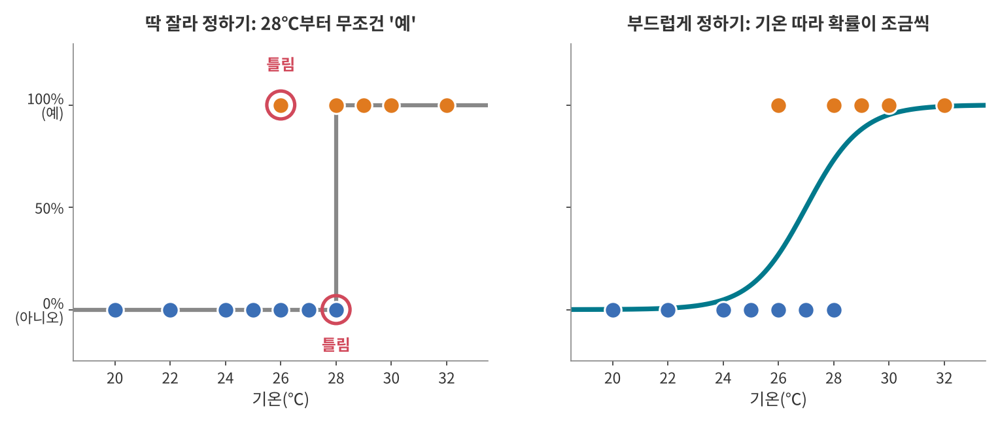
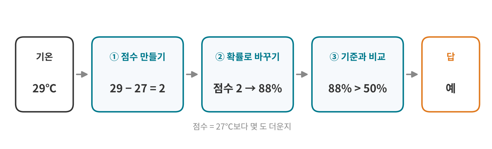
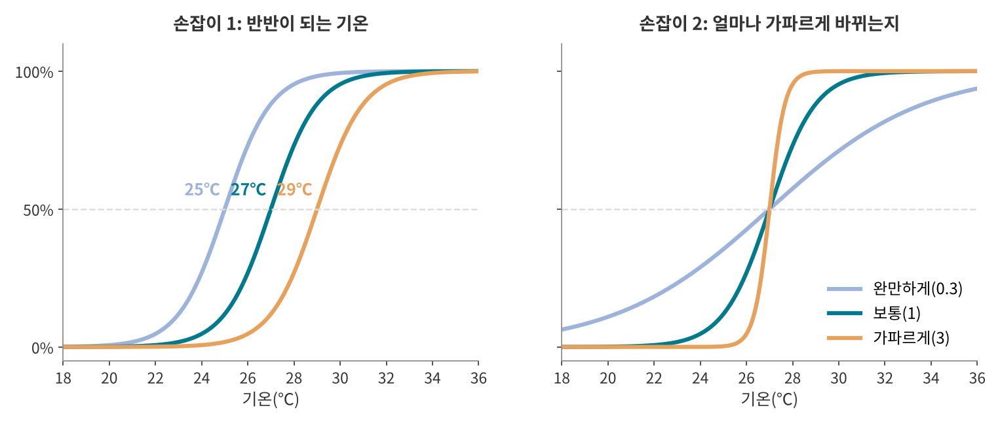

<!--
title: "로지스틱 회귀: 예/아니오가 될 확률 계산하기"
field: 인공지능
order: 140
level: 기초
tags: [머신러닝, 분류]
summary: "로지스틱 회귀는 입력으로 '예'일 확률을 0과 1 사이로 계산하고 그 확률이 기준을 넘으면 '예'로 판단하는 방법이에요."
-->

# 로지스틱 회귀: 예/아니오가 될 확률 계산하기

<!-- 목차 -->

## 1. 로지스틱 회귀를 먼저 한 줄로

로지스틱 회귀는 입력으로 '예'일 확률을 0과 1 사이로 계산하고 그 확률이 기준을 넘으면 '예'로 판단하는 방법이에요.

앞 강좌의 선형 회귀는 "몇 개 팔릴까"처럼 숫자를 맞혔어요. 로지스틱 회귀는 "80개 넘게 팔릴까"처럼 예/아니오를 맞혀요. 다만 바로 예/아니오를 말하지 않고 "예일 확률 88%"처럼 확률부터 내놓아요.

이름도 식도 어려워 보이지만 로지스틱 회귀는 세 단계면 끝나요. 점수를 만들고 그 점수를 확률로 바꾼 다음 기준과 비교해요. 확률로 바꾸는 단계는 환산표만 읽을 줄 알면 돼요. 식으로 계산하는 방법은 접어 둔 칸에 따로 넣었으니 궁금할 때만 펼쳐 보세요.

## 2. 예시로 먼저 감 잡기

### 2-1. 우산을 챙길까요?

오늘 강수확률이 70%래요. A는 30%만 넘어도 우산을 챙기고 B는 80%는 넘어야 챙겨요.

두 사람은 우산을 챙길까요?

정답 보기

A는 챙기고 B는 안 챙겨요. 확률은 70%로 같지만 "몇 %를 넘으면 챙긴다"는 기준이 달라서 판단이 갈려요.

예/아니오를 정할 때는 두 단계를 거쳐요. 먼저 확률을 알고 그다음 기준과 비교해요. 로지스틱 회귀도 같아요. 다른 점은 확률을 일기예보에서 받지 않고 데이터로 직접 계산한다는 거예요.

### 2-2. 아이스크림이 80개 넘게 팔릴까요?

앞 강좌의 아이스크림 가게예요. 선형 회귀는 27℃에 약 80개가 팔린다고 예측했어요. 이번엔 질문을 바꿔서 "오늘 80개 넘게 팔릴까?"를 예/아니오로 맞혀 볼게요.

앞 강좌의 닷새에 이레를 더 기록해서 12일 치가 됐어요. 80개 넘게 팔린 날은 주황 점(예), 아닌 날은 파란 점(아니오)이에요.

내일이 23℃라면 80개 넘게 팔릴까요? 28℃라면요?

정답 보기

23℃는 "아니오"라고 자신 있게 말할 수 있어요. 24℃ 아래로는 80개를 넘은 날이 한 번도 없거든요.

28℃는 딱 잘라 말하기 어려워요. 28℃였던 이틀 중 하루는 넘었고 하루는 못 넘었어요. 26℃도 마찬가지예요. 그래도 28℃ 근처를 보면 넘은 날이 조금 더 많아서 "넘을 가능성이 좀 더 크다" 정도는 말할 수 있어요. 6장에서 계산하면 약 73%가 나와요.

예와 아니오가 섞이는 구간에서는 그냥 "예"보다 "예일 확률 73%"가 더 정직한 답이에요. 이 확률을 계산하는 방법이 로지스틱 회귀예요.

## 3. 딱 잘라 정하면 생기는 문제

가장 쉬운 방법부터 해 볼게요. "28℃부터는 무조건 예, 그 아래는 무조건 아니오"라고 기준 하나로 자르는 거예요.

12일 기록에 대 보면 두 날이 틀려요. 26℃에 80개를 넘은 날과 28℃에 못 넘은 날이에요. 기준을 26℃나 27℃로 옮겨도 세 날이 틀려요. 예와 아니오가 섞인 구간이 있어서 어디서 잘라도 틀리는 날이 생겨요.

더 이상한 점도 있어요. 27.9℃는 "아니오"인데 28.0℃는 "예"가 돼요. 0.1℃ 차이로 답이 정반대가 되는 거예요. 실제로는 26℃, 27℃, 28℃로 갈수록 넘을 가능성이 조금씩 커진다고 보는 게 자연스러워요.

그래서 오른쪽 그림처럼 계단 대신 부드러운 S자 곡선으로 "기온이 오를수록 확률이 조금씩 오른다"를 나타내요. 이 S자 곡선을 만드는 방법이 로지스틱 회귀예요.

## 4. 직선으로 그으면 안 될까요?

앞 강좌에서 배운 직선을 그어 보면 어떨까요? 예를 1, 아니오를 0으로 바꾸면 숫자가 되니까 선형 회귀로 직선을 그을 수 있어요. 12일 기록에 가장 잘 맞는 직선은 약 0.103 × 기온 − 2.31이에요.

이 직선의 값을 확률로 읽으면 문제가 생겨요.

- 18℃를 넣으면 약 −0.45가 나와요. 확률은 0보다 작을 수 없어요.
- 34℃를 넣으면 약 1.20이 나와요. 확률은 1보다 클 수 없어요.

직선은 끝없이 올라가고 내려가지만 확률은 0%와 100% 사이에 있어야 해요. 그래서 끝으로 갈수록 휘어지면서 0%와 100%를 넘지 않는 S자 곡선이 필요해요.

## 5. 로지스틱 회귀는 세 단계예요

29℃인 날을 예로 세 단계를 차례로 볼게요.

### 5-1. ① 점수 만들기

먼저 기온을 점수로 바꿔요. 이 강좌에서 점수는 "27℃보다 몇 도 더운지"예요.

| 기온 | 24℃ | 26℃ | 27℃ | 28℃ | 29℃ | 30℃ |
| --- | --- | --- | --- | --- | --- | --- |
| 점수(기온 − 27) | −3 | −1 | 0 | 1 | 2 | 3 |

27℃가 기준점인 이유는 12일 기록에서 예와 아니오가 반반으로 갈리는 기온이 27℃ 근처라서예요. 이 27을 컴퓨터가 어떻게 찾는지는 8장에서 볼게요. 29℃는 27℃보다 2도 더우니 점수가 2예요.

### 5-2. ② 점수를 확률로 바꾸기

점수를 확률로 바꿀 때는 위 S자 곡선을 써요. 가로축에서 점수를 찾고 곡선이 지나는 높이를 읽으면 그게 확률이에요. 곡선을 표로 옮기면 이래요.

| 점수 | −4 | −3 | −2 | −1 | 0 | 1 | 2 | 3 | 4 |
| --- | --- | --- | --- | --- | --- | --- | --- | --- | --- |
| 확률 | 2% | 5% | 12% | 27% | 50% | 73% | 88% | 95% | 98% |

이 환산표 하나면 이 강좌의 계산을 모두 할 수 있어요. 29℃는 점수 2라서 확률이 88%예요.

표에서 세 가지를 보면 S자 곡선이 손에 잡혀요.

- **점수 0이면 딱 50%예요.** 27℃는 넘을지 못 넘을지 반반이에요.
- **점수가 커질수록 덜 올라요.** 0에서 1로 갈 때는 23%p가 오르지만(50% → 73%) 3에서 4로 갈 때는 3%p만 올라요(95% → 98%). 그래서 아무리 더워도 100%를 넘지 않아요.
- **양쪽이 마주 봐요.** 점수 1은 73%이고 점수 −1은 27%예요. 73 + 27 = 100이에요. 점수 2와 −2도 88% + 12% = 100%예요.

이 S자 곡선의 이름이 시그모이드(sigmoid)예요. 로지스틱 함수라고도 불러요.

환산표 뒤에 있는 식 보기

환산표는 아래 식으로 계산한 거예요. 외우지 않아도 괜찮아요.

$$
\text{확률} = \frac{1}{1 + e^{-\text{점수}}}
$$

e는 약 2.718인 수학 상수예요. 계산기의 eˣ 버튼으로 구할 수 있어요. 점수 2를 넣어 볼게요.

1. e⁻² ≈ 0.135
2. 1 + 0.135 = 1.135
3. 1 ÷ 1.135 ≈ 0.88, 곧 88%

점수가 아주 크면 e⁻점수가 0에 가까워져서 확률이 1 ÷ 1 = 100%에 다가가요. 점수가 아주 작으면 e⁻점수가 아주 커져서 확률이 0%에 다가가요. 그래서 어떤 점수를 넣어도 0%와 100% 사이에 머물러요.

### 5-3. ③ 기준과 비교하기

마지막으로 확률을 기준과 비교해요. 가장 흔한 기준은 50%예요. 29℃는 88%라서 50%보다 크니 "예, 80개 넘게 팔릴 거예요"라고 판단해요.

세 단계를 한 줄로 쓰면 이래요.

29℃ → 점수 2 → 확률 88% → 50%보다 크니 "예"

## 6. 직접 해 보기

### 6-1. 여러 기온으로 계산하기

같은 방법으로 여러 기온을 계산했어요. 점수를 구하고 환산표에서 확률을 읽기만 하면 돼요.

| 기온 | 점수 | 확률 | 기준 50%로 판단 |
| --- | --- | --- | --- |
| 24℃ | −3 | 5% | 아니오 |
| 26℃ | −1 | 27% | 아니오 |
| 27℃ | 0 | 50% | 경계 |
| 28℃ | 1 | 73% | 예 |
| 29℃ | 2 | 88% | 예 |
| 30℃ | 3 | 95% | 예 |

2-2에서 물었던 28℃는 73%예요. 넘을 가능성이 좀 더 크다는 느낌이 73%라는 숫자로 나왔어요.

### 6-2. 거꾸로: 확률 90%가 되려면 몇 ℃일까요?

이번엔 확률을 정해 두고 기온을 구해 볼게요. 환산표를 거꾸로 읽으면 돼요.

1. 90%를 표에서 찾아요. 88%(점수 2)와 95%(점수 3) 사이에 있고 88% 쪽에 더 가까워요.
2. 그래서 점수는 2보다 조금 큰 약 2.2예요.
3. 점수는 "27℃보다 몇 도 더운지"니까 기온 = 27 + 2.2 = 29.2℃예요.

29.2℃ 이상이면 80개 넘게 팔릴 확률이 90% 이상이에요. 이 거꾸로 읽기는 7장에서 기준을 기온으로 바꿀 때 다시 써요.

계산으로 정확히 구하기

환산표 식을 거꾸로 풀면 이래요.

$$
\text{점수} = \ln\frac{\text{확률}}{1 - \text{확률}}
$$

1. 오즈 구하기: 0.9 ÷ (1 − 0.9) = 0.9 ÷ 0.1 = 9. 오즈는 '예'일 확률이 '아니오'일 확률의 몇 배인지예요. 9는 "9 대 1로 예"라는 뜻이에요.
2. 점수 구하기: ln 9 ≈ 2.2. ln은 e를 몇 제곱해야 그 수가 되는지 알려 주는 계산기 버튼이에요.
3. 기온 구하기: 27 + 2.2 = 29.2℃

## 7. 기준은 상황에 따라 정해요

기준 50%는 꼭 지켜야 하는 규칙이 아니라 가장 흔히 쓰는 출발점이에요. 틀렸을 때 어느 쪽 손해가 더 큰지에 따라 기준을 옮겨요.

- 가게 주인이 "80개 넘게 팔릴 것 같으면 재고를 더 들인다"고 정했다고 해 볼게요. 남은 아이스크림은 냉동고에 두면 다음 날 팔 수 있지만 다 떨어져서 못 산 손님의 매출은 돌아오지 않아요. 그래서 기준을 30%로 낮춰요.
- 스팸 메일을 스팸함으로 옮기는 경우는 반대예요. 진짜 메일이 스팸함으로 가면 중요한 연락을 놓쳐요. 그래서 기준을 90%처럼 높여서 확실할 때만 옮길 수 있어요.

기준을 기온으로 바꿀 때는 6-2처럼 환산표를 거꾸로 읽어요.

- 30%: 27%(점수 −1)와 50%(점수 0) 사이에서 27% 쪽에 가까워요. 점수는 약 −0.85라서 기온 = 27 − 0.85 ≈ 26.2℃예요. 26.2℃부터 재고를 더 들여요.
- 90%: 6-2에서 구한 대로 29.2℃예요.

2-1의 우산과 같은 이야기예요. 확률은 하나여도 기준에 따라 판단이 달라져요.

## 8. 컴퓨터는 27을 어떻게 찾을까요?

### 8-1. 곡선에는 손잡이가 두 개 있어요

5장의 점수는 사실 이렇게 생겼어요.

점수 = 가파름 × (기온 − 반반 기온)

지금까지는 반반 기온을 27, 가파름을 1로 써서 "기온 − 27"만 보였던 거예요. 이 두 숫자가 곡선을 정하는 손잡이예요.

- **반반 기온:** 확률이 딱 50%가 되는 기온이에요. 이 손잡이를 돌리면 곡선이 왼쪽이나 오른쪽으로 움직여요.
- **가파름:** 기온이 1℃ 오를 때 점수가 얼마나 오르는지예요. 크면 확률이 짧은 구간에서 확 바뀌고 작으면 천천히 바뀌어요. 가파름이 아주 크면 3장의 계단과 거의 같아져요.

컴퓨터는 12일 기록에 가장 잘 맞도록 이 두 손잡이를 맞춰요.

### 8-2. 잘 맞는지 채점하기

선형 회귀는 오차 제곱합으로 직선을 채점했어요. 로지스틱 회귀는 날마다 "실제 정답에 확률을 얼마나 줬는지"로 채점해요.

- 실제로 80개를 넘은 날에 90%를 줬다면 잘 맞힌 거라 벌점이 작아요(0.11).
- 50%를 줬다면 반반이라 벌점이 중간이에요(0.69).
- 10%만 줬다면 자신 있게 틀린 거라 벌점이 커요(2.30).

자신 있게 틀릴수록 벌점이 빠르게 커져요. 이 벌점을 로그 손실(log loss)이라고 불러요.

곡선 세 개를 채점해 볼게요. 12일 벌점을 모두 더한 값이 작을수록 기록에 잘 맞아요.

| 곡선 | 반반 기온 | 가파름 | 12일 벌점 합 |
| --- | --- | --- | --- |
| A | 27℃ | 1 | 약 4.31 |
| B | 31℃ | 1 | 약 11.89 |
| C | 27℃ | 0.3 | 약 5.59 |

B는 반반 기온이 너무 오른쪽이라 26℃의 '예'에 1%도 안 되는 확률을 줘서 큰 벌점을 받았어요. C는 위치는 맞지만 너무 완만해서 '아니오'였던 25℃에도 35%쯤을 줘요. A가 셋 중 가장 잘 맞아요.

벌점 식과 날짜별 벌점 보기

벌점 = −ln(정답에 준 확률)

A와 B가 세 날에 받은 벌점이에요.

| 날 | 실제 | A가 정답에 준 확률 | A 벌점 | B가 정답에 준 확률 | B 벌점 |
| --- | --- | --- | --- | --- | --- |
| 26℃ | 예 | 0.269 | 1.31 | 0.007 | 5.01 |
| 27℃ | 아니오 | 0.500 | 0.69 | 0.982 | 0.02 |
| 30℃ | 예 | 0.953 | 0.05 | 0.269 | 1.31 |

B는 27℃에서는 A보다 잘 맞혔지만 26℃에서 크게 틀려서 합이 커졌어요.

### 8-3. 손잡이를 조금씩 돌려 맞춰요

컴퓨터는 앞 강좌 8-2의 경사하강법처럼 두 손잡이를 조금씩 돌려 가며 벌점 합이 줄어드는 쪽으로 움직여요. 12일 기록으로 찾으면 반반 기온은 약 27.4℃, 가파름은 약 0.99가 나오고 벌점 합은 약 4.22예요. 이 강좌에서는 계산하기 쉽게 27과 1로 썼어요.

## 9. 입력이 여러 개라면

비가 오면 아이스크림이 덜 팔리겠죠. 이번엔 기온과 강수확률을 함께 넣어 볼게요. 점수 만드는 단계만 바뀌고 확률로 바꾸는 단계와 기준과 비교하는 단계는 그대로예요. 식의 숫자는 설명을 위한 예시 숫자예요.

점수 = (기온 − 27) − 강수확률 ÷ 10

강수확률 10%마다 점수가 1씩 깎여요. 비 소식 10%가 기온 1℃를 깎는 셈이에요.

- 30℃, 강수확률 0%: 점수 = 3 − 0 = 3이라서 환산표로 95%
- 30℃, 강수확률 40%: 점수 = 3 − 4 = −1이라서 환산표로 27%

같은 30℃여도 비 소식이 있으면 확률이 크게 떨어져요.

그림의 검은 선은 점수가 딱 0, 곧 확률이 50%인 곳을 이은 선이에요. 이 선을 경계로 오른쪽 아래는 '예', 왼쪽 위는 '아니오'로 나뉘어요. 입력이 둘이면 경계는 직선이고 셋이면 평면이에요. 경계가 늘 곧은 모양이라는 점은 11-2에서 다시 볼게요.

## 10. 이름 붙이기

S자 곡선의 이름 "로지스틱"은 벨기에 수학자 피에르 프랑수아 베르휠스트가 붙였어요. 1830~1840년대에 인구가 늘어나는 모양을 설명하려고 이 곡선을 썼어요.

로지스틱 회귀가 직접 계산하는 것은 확률이라는 숫자예요. 더 정확히는 6-2에서 접어 둔 칸의 ln(오즈), 곧 로그 오즈를 입력의 직선으로 나타내요. 이 강좌의 "점수"가 바로 로그 오즈예요. 로그 오즈는 로짓(logit)이라고도 하는데 이 이름은 1944년 조지프 버크슨이 지었어요.

그래서 로지스틱 회귀 자체는 확률을 계산하는 모델이고 기준을 정해야 비로소 예/아니오를 가르는 분류기가 돼요. 이름에는 "회귀"가 붙어 있지만 기준과 함께 분류에 널리 쓰여요.

## 11. 자주 헷갈리는 점

### 11-1. 확률 88%는 '틀림없다'가 아니에요

29℃의 88%는 모델이 맞다면 29℃인 날 100번 중 12번쯤은 80개를 넘지 못한다는 뜻이기도 해요. 실제로 12일 기록에서도 26℃와 28℃는 결과가 갈렸어요. 확률이 높아도 '아니오'가 나올 수 있어요.

### 11-2. 경계가 한 곳뿐이에요

산책하기 좋은 날을 맞힌다고 해 볼게요. 너무 추워도, 너무 더워도 '아니오'예요. S자 곡선 하나는 한 방향으로만 오르거나 내려가서 "가운데만 예"를 나타내지 못해요.

이럴 때는 "적당한 기온에서 얼마나 떨어졌는지"처럼 입력을 바꿔 넣거나 다른 방법을 써요. 다음에 배울 결정 트리는 "10℃보다 높은가?", "26℃보다 낮은가?"처럼 질문을 이어 가서 이런 경우를 다룰 수 있어요.

### 11-3. 기록 범위 밖은 조심해요

12일 기록은 20~32℃뿐이에요. 곡선은 40℃에서도 거의 100%라고 말하지만 그렇게 더운 날은 사람들이 밖에 나오지 않아 오히려 덜 팔릴 수도 있어요. 선형 회귀 때처럼 기록 밖의 예측은 믿기 어려워요.

## 12. 장점과 단점

### 장점

| 장점 | 이유 | 관련 부분 |
| --- | --- | --- |
| 확률로 답해요 | "예일 확률 88%"처럼 얼마나 확실한지까지 알려 줘요. | 6장 |
| 기준을 상황에 맞게 정할 수 있어요 | 같은 확률로도 손해에 맞춰 판단을 바꿀 수 있어요. | 7장 |
| 계산이 가볍고 빨라요 | 점수를 구해 환산표에서 읽으면 끝이에요. | 5장 |
| 입력이 미치는 방향을 읽을 수 있어요 | 기온은 점수를 올리고 강수확률은 점수를 깎아요. | 9장 |

### 단점

| 단점 | 이유 | 관련 부분 |
| --- | --- | --- |
| 경계가 곧은 모양뿐이에요 | 가운데만 '예'인 데이터처럼 휘어진 경계는 그리지 못해요. | 11-2 |
| 범위 밖 예측을 믿기 어려워요 | 기록에 없는 기온에서도 확률을 내놓아요. | 11-3 |
| 확률이 확신은 아니에요 | 높은 확률도 틀릴 수 있어요. | 11-1 |
| 기본형은 두 가지로만 나눠요 | 셋 이상으로 나누려면 방법을 넓혀야 해요. | - |

## 13. 생활 속 로지스틱 회귀

### 13-1. 스팸 메일 걸러내기

스팸인지 아닌지처럼 답이 두 가지인 분류는 로지스틱 회귀의 대표적인 쓰임이에요([Wikipedia: Logistic regression](https://en.wikipedia.org/wiki/Logistic_regression)). 메일의 특징으로 점수를 만들면 스팸일 확률이 나오고 기준을 넘으면 스팸으로 분류해요. 7장에서 본 것처럼 기준을 높이면 진짜 메일이 스팸함으로 가는 일을 줄일 수 있어요.

### 13-2. 다친 환자의 생존 확률

응급의학에서 쓰는 TRISS(Trauma and Injury Severity Score)는 다친 환자가 살아날 확률을 계산해요. 처음부터 로지스틱 회귀로 만든 점수예요([Wikipedia: Logistic regression](https://en.wikipedia.org/wiki/Logistic_regression)). 입력은 둔상인지 관통상인지, 나이, 생체 징후를 반영한 점수(RTS), 다친 부위와 정도를 반영한 점수(ISS)예요([traumar 문서](https://rdrr.io/cran/traumar/man/probability_of_survival.html)).

### 13-3. 주택 대출을 갚지 못할 가능성

금융에서는 집을 사려고 대출받은 사람이 돈을 갚지 못할 가능성을 예측하는 데 로지스틱 회귀를 써요([Wikipedia: Logistic regression](https://en.wikipedia.org/wiki/Logistic_regression)). 결과가 '갚는다/못 갚는다' 두 가지라서 로지스틱 회귀와 잘 맞아요.

## 14. 한 장 요약

> 로지스틱 회귀: 점수를 S자 곡선으로 확률로 바꾸고 기준과 비교해 예/아니오를 정하는 방법
>
> - ① 점수 = 가파름 × (기온 − 반반 기온). 이 강좌에서는 기온 − 27
> - ② 확률: S자 곡선(시그모이드) 환산표로 읽는다. 점수 0 → 50%, 1 → 73%, 2 → 88%, 3 → 95%
> - ③ 기준: 50%가 출발점이고 틀렸을 때의 손해에 따라 옮긴다.
> - 거꾸로 읽으면 "몇 ℃부터 확률이 90%인지"도 구할 수 있다.
> - 컴퓨터는 정답에 준 확률로 채점해서 벌점 합이 가장 작은 두 손잡이(반반 기온, 가파름)를 찾는다.
> - 입력이 여러 개면 점수에 더하고 빼기만 하면 된다. 경계는 곧은 선(면)이다.
> - 높은 확률도 틀릴 수 있다. 휘어진 경계와 범위 밖 예측을 조심한다.

## 15. 셀프 퀴즈

<b>Q1.</b> 점수 = 기온 − 27일 때 25℃에 80개 넘게 팔릴 확률은 얼마일까요? 기준 50%로 판단하면요?

정답 보기

약 12%이고 "아니오"예요. 점수 = 25 − 27 = −2이고 환산표에서 −2는 12%예요.

<b>Q2.</b> 어떤 날 80개 넘게 팔릴 확률이 73%예요. 기준이 50%일 때와 90%일 때 판단은 어떻게 될까요?

정답 보기

기준 50%면 "예", 기준 90%면 "아니오"예요. 확률은 같아도 기준에 따라 판단이 달라져요.

<b>Q3.</b> 점수 = (기온 − 27) − 강수확률 ÷ 10일 때 32℃, 강수확률 50%인 날의 확률은 얼마일까요?

정답 보기

50%예요. 점수 = (32 − 27) − 50 ÷ 10 = 5 − 5 = 0이라서 딱 경계에 있어요.

## 참고 자료

- [Wikipedia: Logistic regression](https://en.wikipedia.org/wiki/Logistic_regression)
- [traumar: Calculate Probability of Survival Using TRISS Method](https://rdrr.io/cran/traumar/man/probability_of_survival.html)

## 강좌 이동

- 이전 강좌: [선형 회귀: 점들 사이에 가장 잘 맞는 직선 긋기](<../인공지능 130 선형 회귀/index.md>)
- 다음 강좌: 준비 중이에요.
