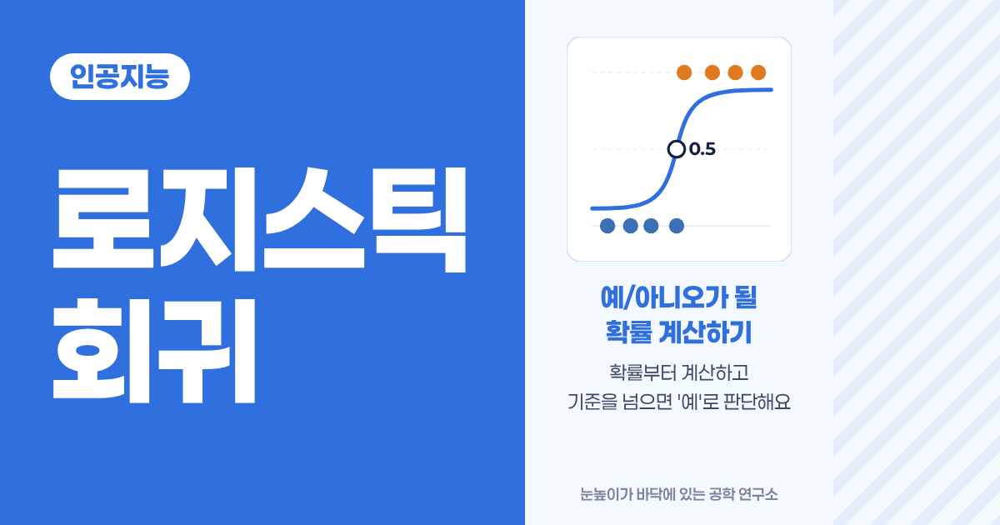
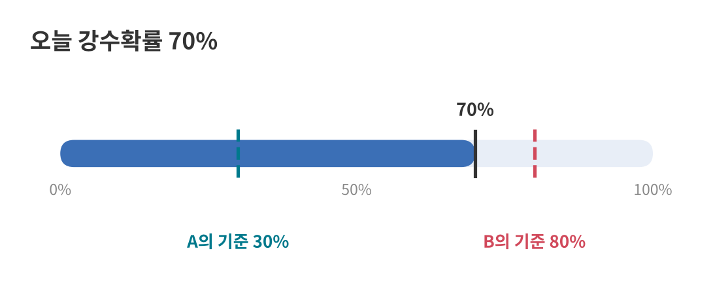
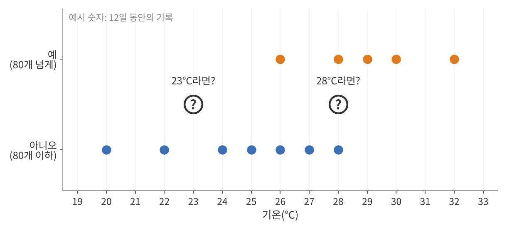
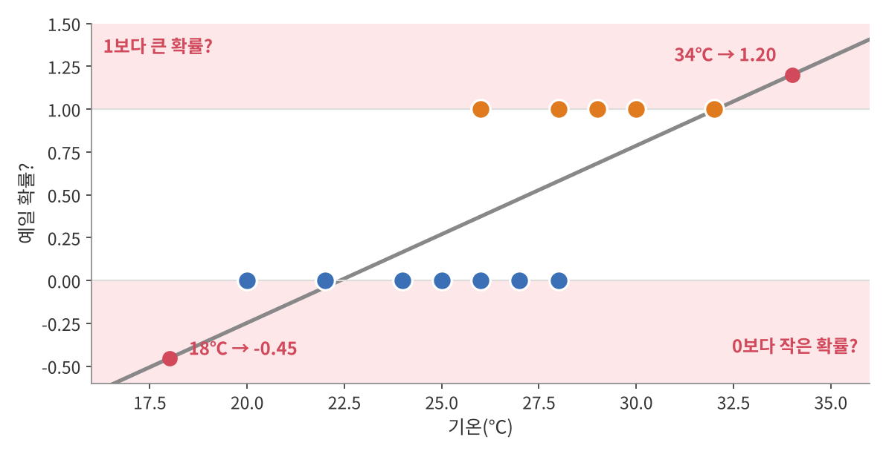
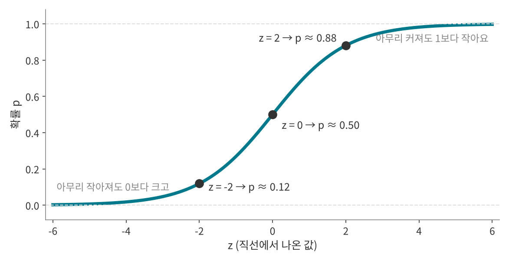
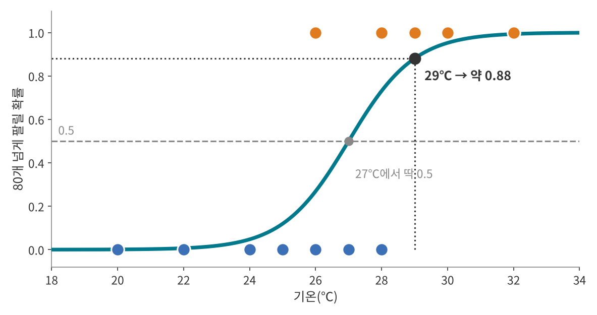
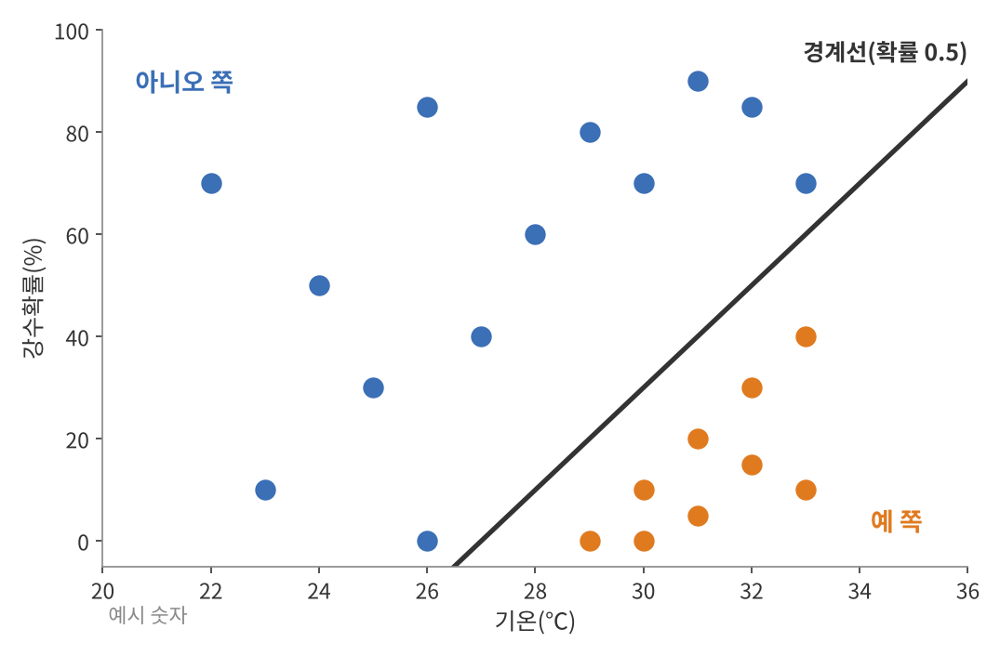
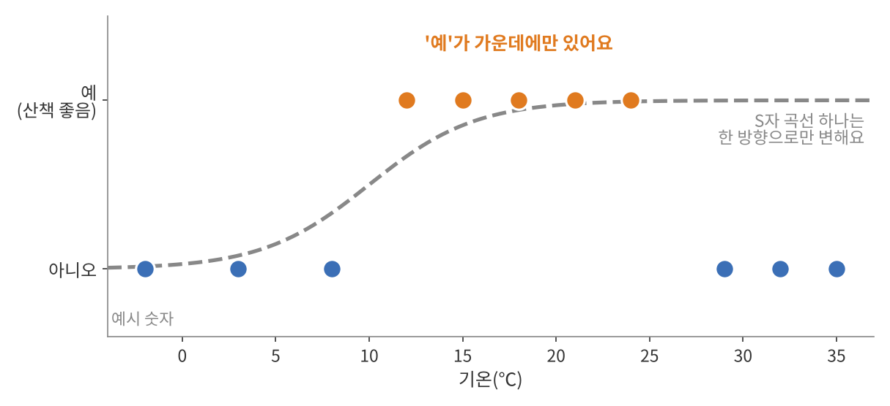
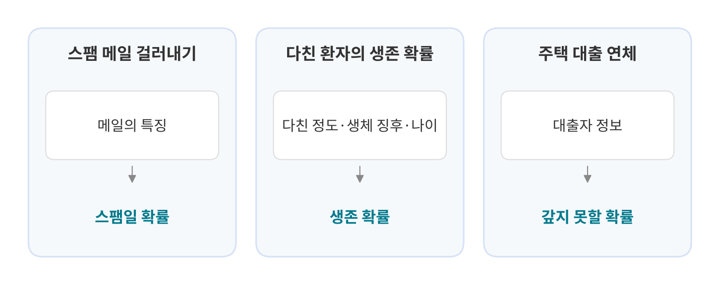

<!--
title: "로지스틱 회귀: 예/아니오가 될 확률 계산하기"
field: 인공지능
order: 140
level: 기초
tags: [머신러닝, 분류]
summary: "로지스틱 회귀는 입력으로 '예'일 확률을 0과 1 사이로 계산하고 그 확률이 기준을 넘으면 '예'로 판단하는 방법이에요."
-->

# 로지스틱 회귀: 예/아니오가 될 확률 계산하기

<!-- 목차 -->

## 1. 로지스틱 회귀를 먼저 한 줄로

로지스틱 회귀는 입력으로 '예'일 확률을 0과 1 사이로 계산하고 그 확률이 기준을 넘으면 '예'로 판단하는 방법이에요.

앞 강좌의 선형 회귀는 "몇 개 팔릴까"처럼 숫자를 맞혔어요. 로지스틱 회귀는 "80개 넘게 팔릴까"처럼 예/아니오를 맞혀요. 다만 바로 예/아니오를 말하지 않고 "예일 확률 88%"처럼 확률부터 내놓아요.

## 2. 예시로 먼저 감 잡기

### 2-1. 우산을 챙길까요?

오늘 강수확률이 70%래요. A는 30%만 넘어도 우산을 챙기고 B는 80%는 넘어야 챙겨요.

두 사람은 우산을 챙길까요?

정답 보기

A는 챙기고 B는 안 챙겨요. 확률은 70%로 같지만 "몇 %를 넘으면 챙긴다"는 기준이 달라서 판단이 갈려요.

예/아니오를 정할 때는 두 단계를 거쳐요. 먼저 확률을 알고 그다음 기준과 비교해요. 로지스틱 회귀도 같아요. 다른 점은 확률을 일기예보에서 받지 않고 데이터로 직접 계산한다는 거예요.

### 2-2. 아이스크림이 80개 넘게 팔릴까요?

앞 강좌의 아이스크림 가게예요. 선형 회귀는 27℃에 약 80개가 팔린다고 예측했어요. 이번엔 질문을 바꿔서 "오늘 80개 넘게 팔릴까?"를 예/아니오로 맞혀 볼게요.

앞 강좌의 닷새에 이레를 더 기록해서 12일 치가 됐어요. 80개 넘게 팔린 날은 주황 점(예), 아닌 날은 파란 점(아니오)이에요.

내일이 23℃라면 80개 넘게 팔릴까요? 28℃라면요?

정답 보기

23℃는 "아니오"라고 자신 있게 말할 수 있어요. 24℃ 아래로는 80개를 넘은 날이 한 번도 없거든요.

28℃는 딱 잘라 말하기 어려워요. 28℃였던 이틀 중 하루는 넘었고 하루는 못 넘었어요. 26℃도 마찬가지예요. 그래도 28℃ 근처를 보면 넘은 날이 조금 더 많아서 "넘을 가능성이 좀 더 크다" 정도는 말할 수 있어요. 5장에서 계산하면 약 73%가 나와요.

예와 아니오가 섞이는 구간에서는 그냥 "예"보다 "예일 확률 73%"가 더 정직한 답이에요. 이 확률을 계산하는 방법이 로지스틱 회귀예요.

## 3. 선형 회귀로 풀면 생기는 문제

예를 1, 아니오를 0으로 바꾸면 숫자가 되니까 앞 강좌의 선형 회귀로 직선을 그어 볼 수 있어요. 12일 기록에 가장 잘 맞는 직선은 약 0.103 × 기온 − 2.31이에요.

이 직선의 값을 확률로 읽으면 문제가 생겨요.

- 18℃를 넣으면 약 −0.45가 나와요. 확률은 0보다 작을 수 없어요.
- 34℃를 넣으면 약 1.20이 나와요. 확률은 1보다 클 수 없어요.

직선은 끝없이 올라가고 내려가지만 확률은 0과 1 사이에 있어야 해요. 그래서 직선에서 나온 값을 0과 1 사이로 눌러 담는 장치가 필요해요.

## 4. S자 곡선으로 확률 만들기

그 장치가 시그모이드(sigmoid)라는 S자 곡선이에요. 로지스틱 함수라고도 불러요.

$$
p = \frac{1}{1 + e^{-z}}
$$

- z는 직선에서 나온 값이에요. 앞 강좌의 a × x + b가 그대로 들어가요.
- e는 약 2.718인 수학 상수예요. 계산기의 eˣ 버튼으로 구할 수 있어요.
- p는 결과로 나오는 확률이에요.

z에 몇 가지 값을 넣어 볼게요.

| z | e⁻ᶻ | 1 + e⁻ᶻ | p |
| --- | --- | --- | --- |
| −4 | 54.598 | 55.598 | 0.018 |
| −2 | 7.389 | 8.389 | 0.119 |
| 0 | 1 | 2 | 0.500 |
| 2 | 0.135 | 1.135 | 0.881 |
| 4 | 0.018 | 1.018 | 0.982 |

표에서 세 가지가 보여요.

- z가 0이면 p는 정확히 0.5예요.
- z가 커질수록 p는 1에 가까워지지만 1을 넘지 않아요.
- z가 작아질수록 p는 0에 가까워지지만 0 아래로 내려가지 않아요.

직선이 어떤 값을 내놓아도 S자 곡선을 지나면 0과 1 사이의 확률이 돼요. 직선을 긋고 S자 곡선에 넣는 것, 이 두 단계가 로지스틱 회귀의 뼈대예요.

## 5. 직접 계산해 보기

12일 기록에 가장 잘 맞는 곡선을 컴퓨터로 찾으면 직선 부분이 약 0.99 × 기온 − 27.1이에요. 손으로 계산하기 쉽게 1 × 기온 − 27로 쓸게요. 컴퓨터가 이 곡선을 찾는 방법은 7장에서 볼게요.

$$
z = \text{기온} - 27, \quad p = \frac{1}{1 + e^{-z}}
$$

### 5-1. 기온으로 확률 구하기

29℃인 날 80개 넘게 팔릴 확률을 차례로 구해 볼게요.

1. 직선 값: z = 29 − 27 = 2
2. e⁻ᶻ = e⁻² ≈ 0.135
3. p = 1 ÷ (1 + 0.135) = 1 ÷ 1.135 ≈ 0.88

80개 넘게 팔릴 확률은 약 88%예요. 기준을 0.5로 잡으면 0.88이 0.5보다 크니 "예"라고 판단해요.

같은 방법으로 여러 기온을 계산했어요.

| 기온 | z | e⁻ᶻ | p | 기준 0.5로 판단 |
| --- | --- | --- | --- | --- |
| 24℃ | −3 | 20.086 | 0.047 | 아니오 |
| 26℃ | −1 | 2.718 | 0.269 | 아니오 |
| 27℃ | 0 | 1 | 0.500 | 경계 |
| 28℃ | 1 | 0.368 | 0.731 | 예 |
| 30℃ | 3 | 0.050 | 0.953 | 예 |

2-2에서 물었던 28℃는 약 73%예요. 27℃는 정확히 50%라서 예와 아니오의 경계예요.

### 5-2. 거꾸로: 확률 90%가 되려면 몇 ℃일까요?

이번엔 확률을 정해 두고 기온을 구해 볼게요. 식을 거꾸로 풀면 돼요.

$$
z = \ln\frac{p}{1 - p}
$$

1. 오즈 구하기: 0.9 ÷ (1 − 0.9) = 0.9 ÷ 0.1 = 9. 오즈는 '예'일 확률이 '아니오'일 확률의 몇 배인지를 뜻해요.
2. z 구하기: z = ln 9 ≈ 2.2. ln은 e를 몇 제곱해야 그 수가 되는지 알려 주는 계산기 버튼이에요.
3. 기온 구하기: z = 기온 − 27이니까 기온 = 27 + 2.2 = 29.2℃

29.2℃ 이상이면 80개 넘게 팔릴 확률이 90% 이상이에요. 이 거꾸로 계산은 6장에서 기준값을 기온으로 바꿀 때 그대로 써요.

## 6. 기준값은 상황에 따라 정해요

기준 0.5는 꼭 지켜야 하는 규칙이 아니라 가장 흔히 쓰는 출발점이에요. 틀렸을 때 어느 쪽 손해가 더 큰지에 따라 기준을 옮겨요.

- 가게 주인이 "80개 넘게 팔릴 것 같으면 재고를 더 들인다"고 정했다고 해 볼게요. 남은 아이스크림은 냉동고에 두면 다음 날 팔 수 있지만 다 떨어져서 못 산 손님의 매출은 돌아오지 않아요. 그래서 기준을 0.3으로 낮춰요. 그러면 26.2℃부터 재고를 더 들여요.
- 스팸 메일을 스팸함으로 옮기는 경우는 반대예요. 진짜 메일이 스팸함으로 가면 중요한 연락을 놓쳐요. 그래서 기준을 0.9처럼 높여서 확실할 때만 옮길 수 있어요.

기준값을 기온으로 바꿀 때는 5-2의 거꾸로 계산을 써요. 0.3이면 z = ln(0.3 ÷ 0.7) ≈ −0.85라서 기온 = 27 − 0.85 ≈ 26.2℃이고 0.9면 29.2℃예요.

2-1의 우산과 같은 이야기예요. 확률은 하나여도 기준에 따라 판단이 달라져요.

## 7. 컴퓨터는 곡선을 어떻게 찾을까요?

선형 회귀는 오차 제곱합이 가장 작은 직선을 골랐어요. 로지스틱 회귀는 날마다 실제 정답에 확률을 얼마나 줬는지 보고 벌점을 매겨요.

- 실제로 80개를 넘은 날에 0.9를 줬다면 잘 맞힌 거라 벌점이 작아요.
- 같은 날에 0.1을 줬다면 자신 있게 틀린 거라 벌점이 커요.

벌점은 −ln(정답에 준 확률)로 매겨요. 0.9를 주면 0.11, 0.5면 0.69, 0.1이면 2.30이에요. 자신 있게 틀릴수록 벌점이 빠르게 커져요. 이 벌점을 로그 손실(log loss)이라고 불러요.

두 곡선의 벌점을 비교해 볼게요. 곡선 A는 z = 기온 − 27, 곡선 B는 경계를 오른쪽으로 옮긴 z = 기온 − 31이에요.

| 날 | 실제 | A가 정답에 준 확률 | A 벌점 | B가 정답에 준 확률 | B 벌점 |
| --- | --- | --- | --- | --- | --- |
| 26℃ | 예 | 0.269 | 1.31 | 0.007 | 5.01 |
| 27℃ | 아니오 | 0.500 | 0.69 | 0.982 | 0.02 |
| 30℃ | 예 | 0.953 | 0.05 | 0.269 | 1.31 |

B는 27℃에서 A보다 잘 맞혔지만 26℃의 '예'를 거의 0으로 봐서 큰 벌점을 받았어요. 12일 벌점을 모두 더하면 A는 약 4.31, B는 약 11.89예요. 벌점 합이 작은 A가 기록을 더 잘 설명해요.

컴퓨터는 앞 강좌 8-2의 경사하강법처럼 기울기와 절편을 조금씩 바꿔 가며 벌점 합이 가장 작은 곡선을 찾아요. 그렇게 찾은 값이 5장의 0.99와 −27.1이고 벌점 합은 약 4.22예요.

## 8. 입력이 여러 개라면

비가 오면 아이스크림이 덜 팔리겠죠. 이번엔 기온과 강수확률을 함께 넣어 볼게요. 식의 숫자는 설명을 위한 예시 숫자예요.

$$
z = \text{기온} - 0.1 \times \text{강수확률} - 27
$$

- 30℃, 강수확률 0%: z = 30 − 0 − 27 = 3이라서 p ≈ 0.95
- 30℃, 강수확률 40%: z = 30 − 4 − 27 = −1이라서 p ≈ 0.27

같은 30℃여도 비 소식이 있으면 확률이 크게 떨어져요.

그림의 검은 선은 z = 0, 곧 확률이 딱 0.5인 곳을 이은 선이에요. 이 선을 경계로 오른쪽 아래는 '예', 왼쪽 위는 '아니오'로 나뉘어요. 입력이 둘이면 경계는 직선이고 셋이면 평면이에요. 경계가 늘 곧은 모양이라는 점은 10-2에서 다시 볼게요.

## 9. 이름 붙이기

S자 곡선의 이름 "로지스틱"은 벨기에 수학자 피에르 프랑수아 베르휠스트가 붙였어요. 1830~1840년대에 인구가 늘어나는 모양을 설명하려고 이 곡선을 썼어요.

로지스틱 회귀가 직접 계산하는 것은 확률이라는 숫자예요. 더 정확히는 5-2의 ln(오즈), 곧 로그 오즈를 입력의 직선으로 나타내요. 로그 오즈는 로짓(logit)이라고도 하는데 이 이름은 1944년 조지프 버크슨이 지었어요.

그래서 로지스틱 회귀 자체는 확률을 계산하는 모델이고 기준값을 정해야 비로소 예/아니오를 가르는 분류기가 돼요. 이름에는 "회귀"가 붙어 있지만 기준값과 함께 분류에 널리 쓰여요.

## 10. 자주 헷갈리는 점

### 10-1. 확률 88%는 '틀림없다'가 아니에요

29℃의 88%는 모델이 맞다면 29℃인 날 100번 중 12번쯤은 80개를 넘지 못한다는 뜻이기도 해요. 실제로 12일 기록에서도 26℃와 28℃는 결과가 갈렸어요. 확률이 높아도 '아니오'가 나올 수 있어요.

### 10-2. 경계가 한 곳뿐이에요

산책하기 좋은 날을 맞힌다고 해 볼게요. 너무 추워도, 너무 더워도 '아니오'예요. S자 곡선 하나는 한 방향으로만 오르거나 내려가서 "가운데만 예"를 나타내지 못해요.

이럴 때는 "적당한 기온에서 얼마나 떨어졌는지"처럼 입력을 바꿔 넣거나 다른 방법을 써요. 다음에 배울 결정 트리는 "10℃보다 높은가?", "26℃보다 낮은가?"처럼 질문을 이어 가서 이런 경우를 다룰 수 있어요.

### 10-3. 기록 범위 밖은 조심해요

12일 기록은 20~32℃뿐이에요. 곡선은 40℃에서도 거의 100%라고 말하지만 그렇게 더운 날은 사람들이 밖에 나오지 않아 오히려 덜 팔릴 수도 있어요. 선형 회귀 때처럼 기록 밖의 예측은 믿기 어려워요.

## 11. 장점과 단점

### 장점

| 장점 | 이유 | 관련 부분 |
| --- | --- | --- |
| 확률로 답해요 | "예일 확률 88%"처럼 얼마나 확실한지까지 알려 줘요. | 5장 |
| 기준을 상황에 맞게 정할 수 있어요 | 같은 확률로도 손해에 맞춰 판단을 바꿀 수 있어요. | 6장 |
| 계산이 가볍고 빨라요 | 직선 값을 구해 S자 곡선에 넣으면 끝이에요. | 4장 |
| 입력이 미치는 방향을 읽을 수 있어요 | 기온 계수는 +, 강수확률 계수는 −라서 더우면 오르고 비 소식이 있으면 내려가요. | 8장 |

### 단점

| 단점 | 이유 | 관련 부분 |
| --- | --- | --- |
| 경계가 곧은 모양뿐이에요 | 가운데만 '예'인 데이터처럼 휘어진 경계는 그리지 못해요. | 10-2 |
| 범위 밖 예측을 믿기 어려워요 | 기록에 없는 기온에서도 확률을 내놓아요. | 10-3 |
| 확률이 확신은 아니에요 | 높은 확률도 틀릴 수 있어요. | 10-1 |
| 기본형은 두 가지로만 나눠요 | 셋 이상으로 나누려면 방법을 넓혀야 해요. | - |

## 12. 생활 속 로지스틱 회귀

### 12-1. 스팸 메일 걸러내기

스팸인지 아닌지처럼 답이 두 가지인 분류는 로지스틱 회귀의 대표적인 쓰임이에요([Wikipedia: Logistic regression](https://en.wikipedia.org/wiki/Logistic_regression)). 메일의 특징을 입력으로 넣으면 스팸일 확률이 나오고 기준을 넘으면 스팸으로 분류해요. 6장에서 본 것처럼 기준을 높이면 진짜 메일이 스팸함으로 가는 일을 줄일 수 있어요.

### 12-2. 다친 환자의 생존 확률

응급의학에서 쓰는 TRISS(Trauma and Injury Severity Score)는 다친 환자가 살아날 확률을 계산해요. 처음부터 로지스틱 회귀로 만든 점수예요([Wikipedia: Logistic regression](https://en.wikipedia.org/wiki/Logistic_regression)). 입력은 둔상인지 관통상인지, 나이, 생체 징후를 반영한 점수(RTS), 다친 부위와 정도를 반영한 점수(ISS)예요([traumar 문서](https://rdrr.io/cran/traumar/man/probability_of_survival.html)).

### 12-3. 주택 대출을 갚지 못할 가능성

금융에서는 집을 사려고 대출받은 사람이 돈을 갚지 못할 가능성을 예측하는 데 로지스틱 회귀를 써요([Wikipedia: Logistic regression](https://en.wikipedia.org/wiki/Logistic_regression)). 결과가 '갚는다/못 갚는다' 두 가지라서 로지스틱 회귀와 잘 맞아요.

## 13. 한 장 요약

> 로지스틱 회귀: 직선 값을 S자 곡선에 넣어 '예'일 확률을 구하고 기준과 비교해 예/아니오를 정하는 방법
>
> - 직선: z = a × x + b
> - S자 곡선(시그모이드): p = 1 ÷ (1 + e⁻ᶻ), 항상 0과 1 사이
> - z = 0이면 p = 0.5, 거꾸로는 z = ln(p ÷ (1 − p))
> - 기준값은 0.5가 출발점이고 틀렸을 때의 손해에 따라 옮긴다.
> - 컴퓨터는 벌점 −ln(정답에 준 확률)의 합이 가장 작은 곡선을 찾는다.
> - 입력이 여러 개면 z = a₁x₁ + a₂x₂ + … + b, 경계는 곧은 선(면)
> - 높은 확률도 틀릴 수 있다. 휘어진 경계와 범위 밖 예측을 조심한다.

## 14. 셀프 퀴즈

<b>Q1.</b> z = 기온 − 27일 때 25℃에 80개 넘게 팔릴 확률은 얼마일까요? 기준 0.5로 판단하면요?

정답 보기

약 12%이고 "아니오"예요.

- z = 25 − 27 = −2
- e⁻ᶻ = e² ≈ 7.389
- p = 1 ÷ (1 + 7.389) = 1 ÷ 8.389 ≈ 0.119

<b>Q2.</b> 어떤 날 80개 넘게 팔릴 확률이 0.73이에요. 기준이 0.5일 때와 0.9일 때 판단은 어떻게 될까요?

정답 보기

기준 0.5면 "예", 기준 0.9면 "아니오"예요. 확률은 같아도 기준에 따라 판단이 달라져요.

<b>Q3.</b> z = 기온 − 0.1 × 강수확률 − 27일 때 32℃, 강수확률 50%인 날의 확률은 얼마일까요?

정답 보기

0.5예요. z = 32 − 0.1 × 50 − 27 = 32 − 5 − 27 = 0이라서 딱 경계에 있어요.

## 참고 자료

- [Wikipedia: Logistic regression](https://en.wikipedia.org/wiki/Logistic_regression)
- [traumar: Calculate Probability of Survival Using TRISS Method](https://rdrr.io/cran/traumar/man/probability_of_survival.html)

## 강좌 이동

- 이전 강좌: [선형 회귀: 점들 사이에 가장 잘 맞는 직선 긋기](<../인공지능 130 선형 회귀/index.md>)
- 다음 강좌: 준비 중이에요.
