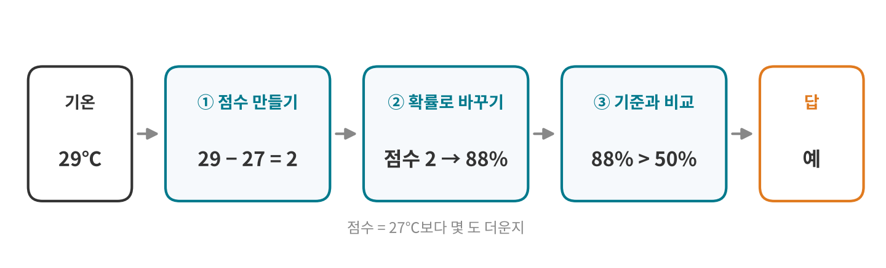
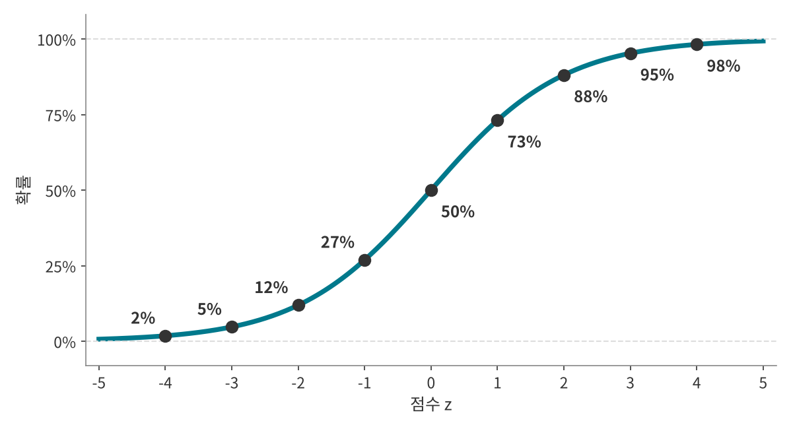
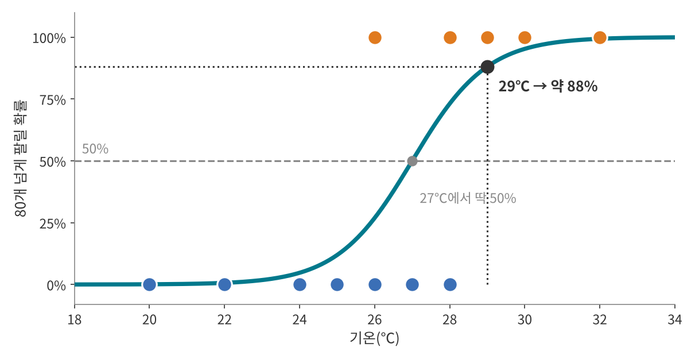
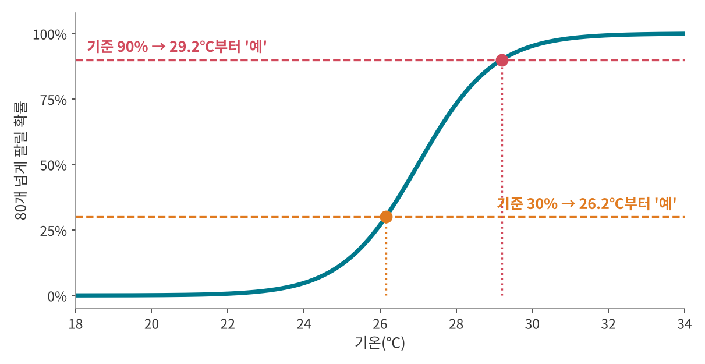
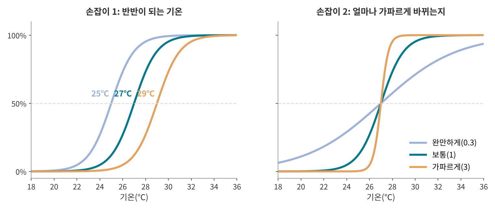
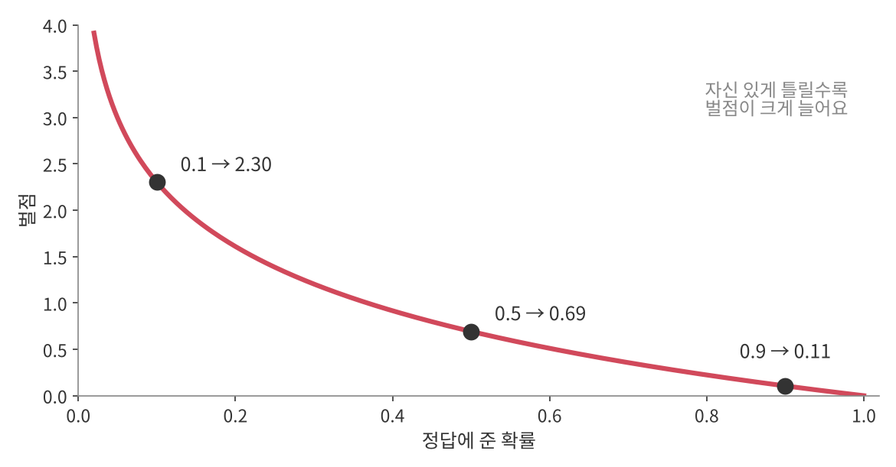
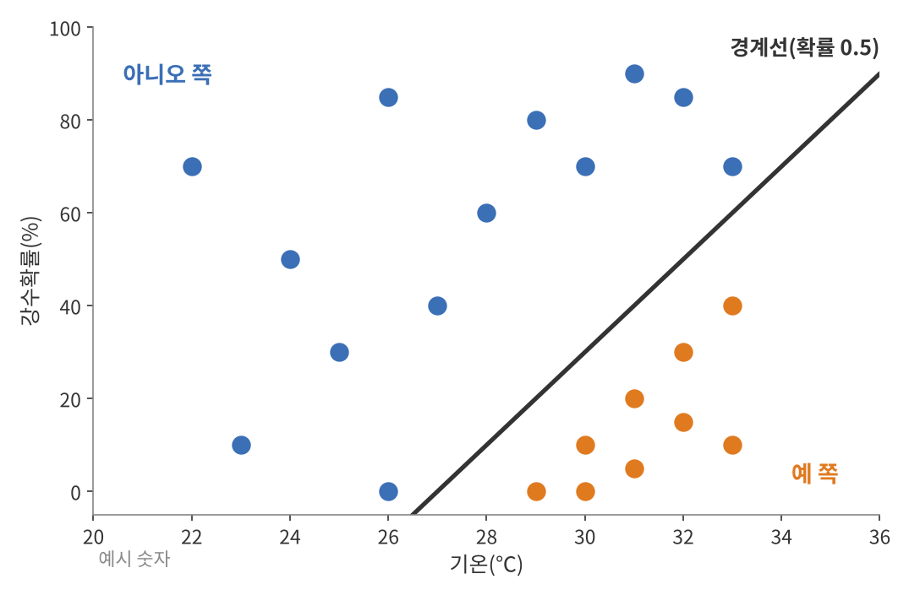

<!--
title: "로지스틱 회귀 계산편: 점수와 S자 곡선으로 확률 계산하기"
field: 인공지능
order: 145
level: 기초
tags: [머신러닝, 분류]
summary: "로지스틱 회귀 계산편에서는 개념편의 S자 곡선을 식으로 바꿔서 확률을 직접 계산해요. 거꾸로 기온을 구하는 법과 곡선이 기록에 얼마나 맞는지 채점하는 법도 봐요."
-->

# 로지스틱 회귀 계산편: 점수와 S자 곡선으로 확률 계산하기

<!-- 목차 -->

## 1. 이 강좌에서 할 일

로지스틱 회귀 계산편에서는 개념편의 S자 곡선을 식으로 바꿔서 확률을 직접 계산해요. 거꾸로 기온을 구하는 법과 곡선이 기록에 얼마나 맞는지 채점하는 법도 봐요.

로지스틱 회귀가 무엇이고 왜 쓰는지는 [로지스틱 회귀 개념편: 확률 곡선으로 예/아니오 맞히기](<../인공지능 140 로지스틱 회귀 개념편/index.md>)에서 봤어요. 개념편을 먼저 보고 오면 훨씬 쉬워요.

여기서도 개념편의 아이스크림 기록 12일 치를 그대로 써요. 예시 숫자예요.

| 기온(℃) | 80개 넘게 팔렸나? |
| --- | --- |
| 20, 22, 24, 25 | 아니오 |
| 26 | 예 1일, 아니오 1일 |
| 27 | 아니오 |
| 28 | 예 1일, 아니오 1일 |
| 29, 30, 32 | 예 |

개념편에서는 곡선을 그림으로 읽었어요. 컴퓨터는 곡선을 그림으로 읽지 않고 숫자로 계산해요. 그 방법을 한 단계씩 볼게요.

## 2. 세 단계: 점수 → 확률 → 판단

1. **점수 만들기:** 기온을 점수로 바꿔요. 이 강좌에서 점수는 "27℃보다 몇 도 더운지"예요.
2. **점수를 확률로 바꾸기:** S자 곡선의 식에 점수를 넣어요.
3. **기준과 비교하기:** 확률이 기준(보통 50%)을 넘으면 "예"예요.

점수는 이렇게 바뀌어요.

| 기온 | 24℃ | 26℃ | 27℃ | 28℃ | 29℃ | 30℃ |
| --- | --- | --- | --- | --- | --- | --- |
| 점수(기온 − 27) | −3 | −1 | 0 | 1 | 2 | 3 |

27℃를 빼는 이유는 27℃가 예와 아니오가 반반이 되는 기온이기 때문이에요. 이 27을 어떻게 찾는지는 6장과 7장에서 봐요.

## 3. 점수를 확률로 바꾸기

### 3-1. S자 곡선의 식

점수를 확률로 바꾸는 식은 이래요. 이 식을 시그모이드 또는 로지스틱 함수라고 불러요.

$$
\text{확률} = \frac{1}{1 + e^{-\text{점수}}}
$$

e는 약 2.718인 수학 상수예요. 계산기의 eˣ 버튼으로 구할 수 있어요.

29℃(점수 2)를 넣어 볼게요.

1. e⁻² ≈ 0.135
2. 1 + 0.135 = 1.135
3. 1 ÷ 1.135 ≈ 0.88, 곧 88%

### 3-2. 왜 항상 0%와 100% 사이일까요?

- 점수가 아주 크면 e⁻점수가 0에 가까워져요. 그러면 확률은 1 ÷ (1 + 0) = 1, 곧 100%에 다가가요.
- 점수가 아주 작으면 e⁻점수가 아주 커져요. 그러면 분모가 커져서 확률이 0%에 다가가요.
- 점수가 0이면 e⁰ = 1이라서 확률은 1 ÷ 2 = 50%예요.

그래서 어떤 점수를 넣어도 0%와 100% 사이에 머물러요. 개념편 5-2에서 직선이 −0.45나 1.20처럼 벗어났던 문제가 이렇게 풀려요.

### 3-3. 점수 → 확률 환산표

식에 점수를 차례로 넣으면 이런 표가 돼요.

| 점수 | −4 | −3 | −2 | −1 | 0 | 1 | 2 | 3 | 4 |
| --- | --- | --- | --- | --- | --- | --- | --- | --- | --- |
| 확률 | 2% | 5% | 12% | 27% | 50% | 73% | 88% | 95% | 98% |

- 점수가 커질수록 덜 올라요. 0에서 1로 갈 때는 23%p가 오르지만 3에서 4로 갈 때는 3%p만 올라요.
- 양쪽이 마주 봐요. 점수 1은 73%, 점수 −1은 27%라서 합이 100%예요. 식으로 보면 점수 z의 확률과 −z의 확률을 더하면 항상 1이 돼요.

## 4. 직접 계산해 보기

기온마다 점수를 구하고 식에 넣었어요.

| 기온 | 점수 z | e⁻ᶻ | 확률 | 기준 50%로 판단 |
| --- | --- | --- | --- | --- |
| 24℃ | −3 | 20.086 | 0.047 | 아니오 |
| 25℃ | −2 | 7.389 | 0.119 | 아니오 |
| 26℃ | −1 | 2.718 | 0.269 | 아니오 |
| 27℃ | 0 | 1 | 0.500 | 경계 |
| 28℃ | 1 | 0.368 | 0.731 | 예 |
| 29℃ | 2 | 0.135 | 0.881 | 예 |
| 30℃ | 3 | 0.050 | 0.953 | 예 |

개념편 4장의 그래프에서 읽은 값(25℃ 12%, 28℃ 73%, 29℃ 88% 등)이 이렇게 계산돼요.

## 5. 거꾸로 계산하기: 오즈와 로짓

### 5-1. 식을 거꾸로 풀기

"확률이 90%가 되려면 몇 ℃일까?"처럼 확률에서 기온을 구할 때는 식을 거꾸로 풀어요.

$$
\text{점수} = \ln\frac{\text{확률}}{1 - \text{확률}}
$$

90%로 해 볼게요.

1. **오즈 구하기:** 0.9 ÷ (1 − 0.9) = 0.9 ÷ 0.1 = 9. 오즈는 '예'일 확률이 '아니오'일 확률의 몇 배인지예요. "9 대 1로 예"라는 뜻이에요.
2. **점수 구하기:** ln 9 ≈ 2.2. ln은 e를 몇 제곱해야 그 수가 되는지 알려 주는 계산기 버튼이에요. e^2.2 ≈ 9예요.
3. **기온 구하기:** 점수 = 기온 − 27이니까 기온 = 27 + 2.2 = 29.2℃

### 5-2. 기준을 기온으로 바꾸기

개념편 6장의 기준 30%와 90%가 몇 ℃인지도 같은 방법으로 구해요.

| 기준 | 오즈 | 점수 = ln(오즈) | 기온 |
| --- | --- | --- | --- |
| 30% | 0.3 ÷ 0.7 ≈ 0.43 | ≈ −0.85 | 27 − 0.85 ≈ 26.2℃ |
| 50% | 0.5 ÷ 0.5 = 1 | 0 | 27℃ |
| 90% | 0.9 ÷ 0.1 = 9 | ≈ 2.2 | 27 + 2.2 ≈ 29.2℃ |

### 5-3. 로짓: 점수의 진짜 이름

이 ln(오즈)를 로그 오즈 또는 로짓(logit)이라고 불러요. 1944년 조지프 버크슨이 지은 이름이에요. 이 강좌의 "점수"가 바로 로짓이에요.

그래서 로지스틱 회귀를 한 줄로 쓰면 "로짓을 입력의 직선으로 나타내는 방법"이에요. 선형 회귀가 판매량을 직선으로 나타냈다면 로지스틱 회귀는 로짓을 직선으로 나타내요.

## 6. 두 손잡이를 식으로 쓰기

개념편 7장의 두 손잡이를 식에 넣으면 점수는 이렇게 생겼어요.

$$
\text{점수} = \text{가파름} \times (\text{기온} - \text{반반 기온})
$$

- 반반 기온은 확률이 50%가 되는 기온이에요. 점수가 0이 되는 곳이에요.
- 가파름은 기온이 1℃ 오를 때 점수가 얼마나 오르는지예요.

지금까지 쓴 "기온 − 27"은 반반 기온 27, 가파름 1인 경우예요. 괄호를 풀면 선형 회귀와 같은 직선 모양이 돼요.

$$
\text{점수} = a \times \text{기온} + b
$$

a는 가파름, b는 −(가파름 × 반반 기온)이에요. 컴퓨터로 12일 기록에 맞추면 a ≈ 0.992, b ≈ −27.145가 나와요. 반반 기온은 27.145 ÷ 0.992 ≈ 27.4℃예요. 이 강좌에서는 계산하기 쉽게 a = 1, b = −27로 썼어요.

## 7. 채점하기: 로그 손실

### 7-1. 정답에 준 확률로 벌점 매기기

선형 회귀는 오차 제곱합으로 직선을 채점했어요. 로지스틱 회귀는 날마다 실제 정답에 준 확률로 벌점을 매겨요.

$$
\text{벌점} = -\ln(\text{정답에 준 확률})
$$

- 실제로 넘은 날이면 정답에 준 확률은 "넘을 확률"이에요.
- 실제로 못 넘은 날이면 정답에 준 확률은 1 − "넘을 확률"이에요.

| 정답에 준 확률 | 90% | 50% | 10% |
| --- | --- | --- | --- |
| 벌점 | 0.11 | 0.69 | 2.30 |

자신 있게 틀릴수록 벌점이 빠르게 커져요. 이 벌점을 로그 손실(log loss)이라고 불러요.

### 7-2. 날짜별 벌점 계산하기

곡선 A(반반 27℃, 가파름 1)와 곡선 B(반반 31℃, 가파름 1)가 세 날에 받은 벌점이에요.

| 날 | 실제 | A가 정답에 준 확률 | A 벌점 | B가 정답에 준 확률 | B 벌점 |
| --- | --- | --- | --- | --- | --- |
| 26℃ | 예 | 0.269 | 1.31 | 0.007 | 5.01 |
| 27℃ | 아니오 | 0.500 | 0.69 | 0.982 | 0.02 |
| 30℃ | 예 | 0.953 | 0.05 | 0.269 | 1.31 |

27℃ 줄을 볼게요. 실제로 못 넘은 날이라 정답에 준 확률은 1 − 넘을 확률이에요. A는 넘을 확률이 0.5라서 1 − 0.5 = 0.5, B는 넘을 확률이 σ(27 − 31) = σ(−4) ≈ 0.018이라서 1 − 0.018 = 0.982예요. σ는 3장의 S자 곡선 식을 짧게 쓴 기호예요.

### 7-3. 12일 벌점 합 비교하기

| 곡선 | 반반 기온 | 가파름 | 12일 벌점 합 |
| --- | --- | --- | --- |
| A | 27℃ | 1 | 약 4.31 |
| B | 31℃ | 1 | 약 11.89 |
| C | 27℃ | 0.3 | 약 5.59 |
| 컴퓨터가 찾은 곡선 | 약 27.4℃ | 약 0.99 | 약 4.22 |

B는 반반 기온이 너무 오른쪽이라 26℃의 '예'에 1%도 안 되는 확률을 줘서 큰 벌점을 받았어요. C는 위치는 맞지만 너무 완만해서 '아니오'였던 25℃에도 35%쯤을 줘요. 컴퓨터는 선형 회귀 강좌에서 본 경사하강법처럼 a와 b를 조금씩 바꿔 가며 벌점 합이 가장 작은 곳(약 4.22)을 찾아요.

선형 회귀와 달리 로지스틱 회귀에는 한 번에 답을 내는 공식이 없어서 이렇게 조금씩 고쳐 가는 방법으로 찾아요.

## 8. 입력이 둘일 때

개념편 8장의 기온과 강수확률 예시를 점수로 쓰면 이래요. 예시 숫자예요.

$$
\text{점수} = (\text{기온} - 27) - \text{강수확률} \div 10
$$

- 30℃, 강수확률 0%: 점수 = 3 − 0 = 3 → 95%
- 30℃, 강수확률 40%: 점수 = 3 − 4 = −1 → 27%
- 32℃, 강수확률 50%: 점수 = 5 − 5 = 0 → 50%

그림의 검은 선은 점수가 딱 0, 곧 확률이 50%인 곳을 이은 선이에요. 기온 = 27 + 강수확률 ÷ 10인 곳이에요. 이 선을 경계로 오른쪽 아래는 '예', 왼쪽 위는 '아니오'예요. 입력이 둘이면 경계는 직선이고 셋이면 평면이에요.

입력이 여러 개여도 점수는 입력마다 가중치를 곱해 더한 값이에요.

$$
\text{점수} = a_1 x_1 + a_2 x_2 + \dots + b
$$

이 예시에서는 a₁ = 1(기온), a₂ = −0.1(강수확률), b = −27이에요.

## 9. 한 장 요약

> 로지스틱 회귀 계산: 점수(로짓)를 직선으로 만들고 S자 곡선 식으로 확률을 계산하기
>
> - 점수 = a × 기온 + b = 가파름 × (기온 − 반반 기온)
> - 확률 = 1 ÷ (1 + e⁻점수), 점수 0 → 50%, 항상 0과 1 사이
> - 거꾸로: 점수 = ln(확률 ÷ (1 − 확률)), 확률 ÷ (1 − 확률)이 오즈
> - 벌점(로그 손실) = −ln(정답에 준 확률), 12일 합이 가장 작은 a와 b를 경사하강법으로 찾는다.
> - 입력이 여러 개면 점수 = a₁x₁ + a₂x₂ + … + b, 경계(점수 = 0)는 곧은 선(면)

## 10. 셀프 퀴즈

<b>Q1.</b> 점수 = 기온 − 27일 때 25℃에 80개 넘게 팔릴 확률을 식으로 계산해 보세요.

정답 보기

약 12%예요.

- 점수 = 25 − 27 = −2
- e⁻⁽⁻²⁾ = e² ≈ 7.389
- 확률 = 1 ÷ (1 + 7.389) = 1 ÷ 8.389 ≈ 0.119

<b>Q2.</b> 확률이 80%가 되는 기온은 몇 ℃일까요? 점수 = 기온 − 27이에요.

정답 보기

약 28.4℃예요.

- 오즈 = 0.8 ÷ 0.2 = 4
- 점수 = ln 4 ≈ 1.39
- 기온 = 27 + 1.39 ≈ 28.4℃

<b>Q3.</b> 실제로 80개를 넘은 날에 곡선이 넘을 확률을 27%로 줬어요. 이날의 벌점은 얼마일까요?

정답 보기

약 1.31이에요. 넘은 날이라 정답에 준 확률은 0.27이고 −ln 0.27 ≈ 1.31이에요.

## 참고 자료

- [Wikipedia: Logistic regression](https://en.wikipedia.org/wiki/Logistic_regression)

## 강좌 이동

- 이전 강좌: [로지스틱 회귀 개념편: 확률 곡선으로 예/아니오 맞히기](<../인공지능 140 로지스틱 회귀 개념편/index.md>)
- 다음 강좌: 준비 중이에요.
