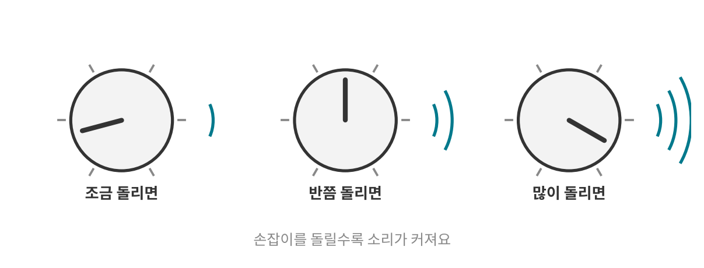
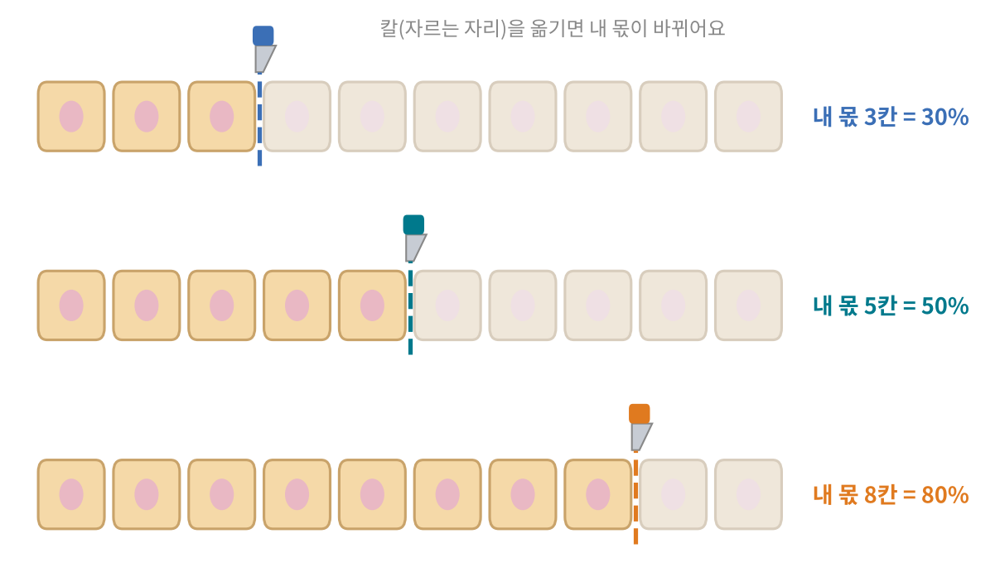
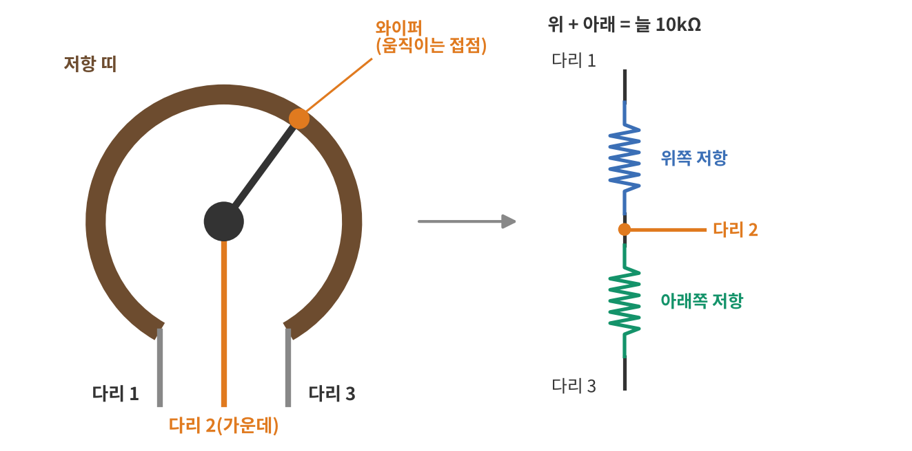
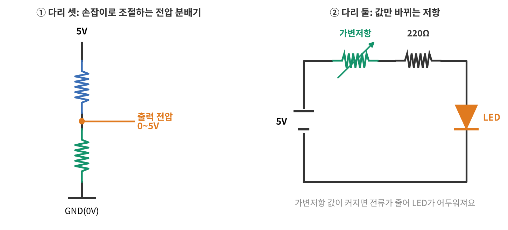
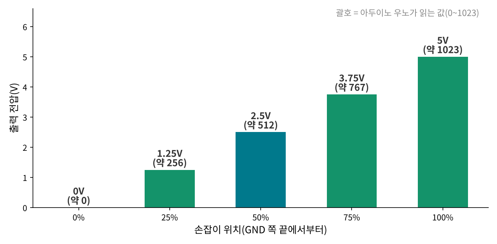
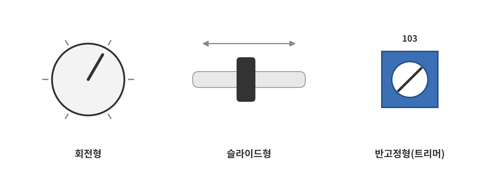
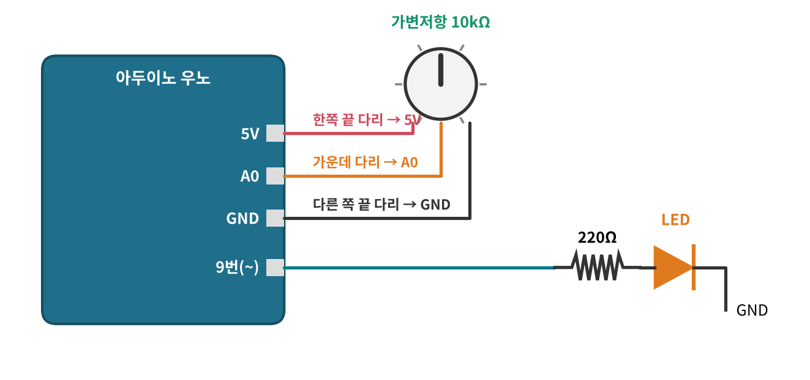
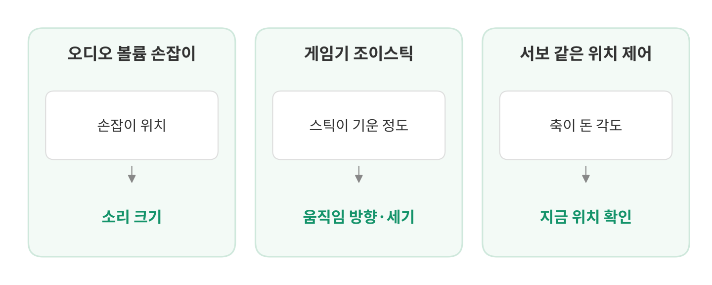
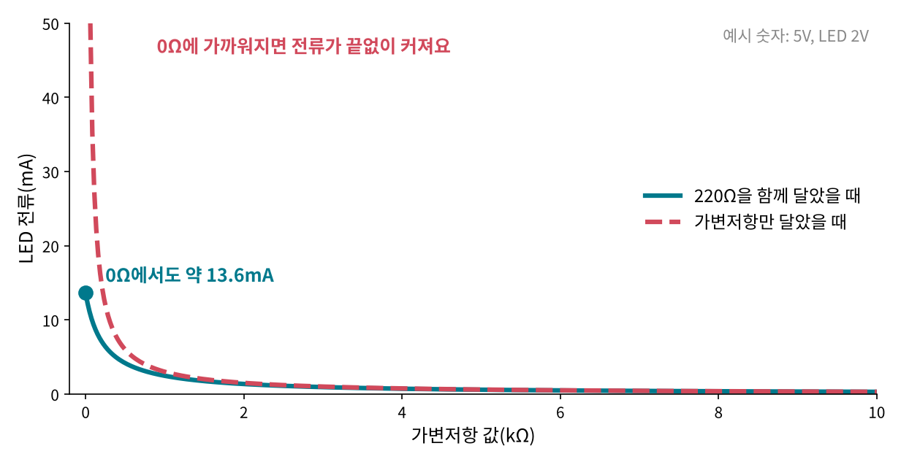

<!--
title: "가변저항: 손잡이로 조절하는 전압 분배"
field: 전자 부품
order: 130
level: 기초
tags: [전자 부품, 가변저항, 전압 분배]
summary: "가변저항은 손잡이를 돌리거나 밀어서 저항값을 바꿀 수 있는 저항이에요. 다리가 세 개라서 손잡이로 조절하는 전압 분배기로 가장 많이 써요."
-->

# 가변저항: 손잡이로 조절하는 전압 분배


<!-- 목차 -->

## 1. 가변저항을 먼저 한 줄로

가변저항은 손잡이를 돌리거나 밀어서 저항값을 바꿀 수 있는 저항이에요. 다리가 세 개라서 손잡이로 조절하는 전압 분배기로 가장 많이 써요.

앞 강좌의 저항은 값이 정해져 있었어요. 가변저항은 같은 부품 하나로 값을 바꿀 수 있어요. 원리는 전자공학 갈래의 [전압 분배: 직렬 저항은 전압을 나눠 가져요](<../전자공학 140 전압 분배/index.md>)와 같아요. 전압 분배를 먼저 보고 오면 훨씬 쉬워요.

## 2. 예시로 먼저 감 잡기

### 2-1. 볼륨 손잡이



스피커의 볼륨 손잡이를 돌리면 소리가 커지거나 작아져요. 손잡이를 반쯤 돌리면 소리도 그만큼 바뀌어요.

손잡이 안에서는 무엇이 바뀌고 있을까요?

<details>
<summary>정답 보기</summary>

손잡이에 붙은 작은 접점이 저항 띠 위를 미끄러지며 위치가 바뀌어요. 접점 위치에 따라 저항이 나뉘는 비율이 바뀌어요. 그래서 다음 회로로 넘어가는 전압이 바뀌어요. 3장에서 안을 열어 볼게요.

</details>

### 2-2. 롤케이크 자르기



전압 분배 강좌에서는 피자 한 판을 1 : 2로 나눴어요. 이번엔 10칸짜리 긴 롤케이크를 나눠 볼게요. 칼은 칸 사이 어디에든 댈 수 있어요. 칼 왼쪽이 내 몫이에요.

칼을 왼쪽에서 3칸째 자리에 대면 내 몫은 전체의 몇 %일까요? 5칸째, 8칸째 자리라면요?

<details>
<summary>정답 보기</summary>

30%, 50%, 80%예요. 케이크는 그대로인데 칼 자리만 옮겨서 내 몫을 0%부터 100%까지 고를 수 있어요.

</details>

### 2-3. 두 예시에서 찾은 규칙

1. 전체(케이크 한 줄, 저항 띠)는 그대로예요.
2. 움직이는 칼(손잡이의 접점)이 전체를 두 부분으로 나눠요.
3. 칼 자리를 옮기면 내 몫의 비율이 바뀌어요.

가변저항은 칼 자리를 손잡이로 옮기는 부품이에요. 전압 분배 강좌에서 피자 한 판 × 내 몫의 비율이 내 피자였던 것처럼, 가변저항에서는 전원 전압 × 내 몫의 비율이 출력 전압이 돼요.

## 3. 안을 열어 보면



가변저항 안에는 세 가지가 있어요([Wikipedia: Potentiometer](https://en.wikipedia.org/wiki/Potentiometer)).

- **저항 띠:** 전체 저항값을 가진 띠예요. 10kΩ짜리 가변저항이면 띠 끝에서 끝까지가 10kΩ이에요.
- **와이퍼:** 손잡이를 따라 띠 위를 미끄러지는 접점이에요.
- **다리 세 개:** 다리 1과 다리 3은 띠의 양 끝에, 가운데 다리 2는 와이퍼에 이어져 있어요.

와이퍼가 띠를 두 부분으로 나눠요. 그래서 가변저항은 오른쪽 그림처럼 저항 두 개를 한 줄로 이은 것과 같아요. 손잡이를 돌리면 위쪽 저항과 아래쪽 저항의 크기가 바뀌지만 둘을 더하면 늘 10kΩ이에요.

2-2의 롤케이크에 대 보면 이래요.

| 롤케이크 | 가변저항 |
| --- | --- |
| 케이크 한 줄(10칸) | 저항 띠 전체(10kΩ) |
| 칼 | 와이퍼(다리 2) |
| 내 몫(칼 왼쪽) | 아래쪽 저항(다리 2 ~ 다리 3) |
| 나머지(칼 오른쪽) | 위쪽 저항(다리 1 ~ 다리 2) |
| 내 몫의 비율 | 출력 전압 ÷ 전원 전압 |

## 4. 쓰는 방법 두 가지



### 4-1. 다리 셋: 손잡이로 조절하는 전압 분배기

양 끝 다리에 전원(5V)과 GND를 잇고 가운데 다리에서 전압을 꺼내요. 손잡이 위치에 따라 0V부터 5V 사이의 전압이 나와요. 가변저항을 가장 많이 쓰는 방법이에요([Wikipedia: Potentiometer](https://en.wikipedia.org/wiki/Potentiometer)).

### 4-2. 다리 둘: 값만 바뀌는 저항

한쪽 끝 다리와 가운데 다리, 두 개만 쓰면 손잡이로 값을 바꾸는 저항 하나가 돼요. 이렇게 쓸 때는 레오스탯이라고도 불러요([Wikipedia: Potentiometer](https://en.wikipedia.org/wiki/Potentiometer)). 오른쪽 그림처럼 LED와 한 줄로 이으면 손잡이로 LED에 흐르는 전류를 바꿀 수 있어요.

## 5. 계산해 보기

### 5-1. 손잡이 위치로 출력 전압 구하기



4-1의 연결은 전압 분배 회로 그대로예요. 전압 분배 식을 그대로 써요.

$$
V_{\text{출력}} = V_{\text{전원}} \times \frac{R_{\text{아래}}}{R_{\text{위}} + R_{\text{아래}}}
$$

가변저항은 위쪽과 아래쪽을 더하면 늘 전체 저항이라서 식이 더 간단해져요.

$$
V_{\text{출력}} = V_{\text{전원}} \times \frac{R_{\text{아래}}}{\text{전체 저항}}
$$

10kΩ 가변저항에 5V를 걸었을 때예요.

| 손잡이 위치 | 위쪽 저항 | 아래쪽 저항 | 출력 전압 |
| --- | --- | --- | --- |
| 0% | 10kΩ | 0kΩ | 5 × 0 ÷ 10 = 0V |
| 25% | 7.5kΩ | 2.5kΩ | 5 × 2.5 ÷ 10 = 1.25V |
| 50% | 5kΩ | 5kΩ | 5 × 5 ÷ 10 = 2.5V |
| 75% | 2.5kΩ | 7.5kΩ | 5 × 7.5 ÷ 10 = 3.75V |
| 100% | 0kΩ | 10kΩ | 5 × 10 ÷ 10 = 5V |

손잡이 위치 비율이 그대로 전압 비율이 돼요. 50%면 2.5V, 75%면 3.75V예요. 손잡이 위치는 GND 쪽 끝에서부터 센 값이에요.

### 5-2. 거꾸로: 2V를 만들려면 어디로 돌려야 할까요?

1. 2V는 5V의 2 ÷ 5 = 0.4, 곧 40%예요.
2. 아래쪽 저항이 전체의 40%가 되면 돼요. 10kΩ × 0.4 = 4kΩ이에요.
3. 손잡이를 GND 쪽 끝에서 40% 지점으로 돌려요.

### 5-3. 전체 저항값은 무엇을 바꿀까요?

출력 전압은 위치 비율로만 정해져요. 1kΩ짜리든 100kΩ짜리든 가운데에 두면 2.5V예요.

대신 전체 저항값은 가변저항에 늘 흐르는 전류를 바꿔요. 양 끝 사이에 5V가 걸려 있으니 옴의 법칙으로 1kΩ이면 5 ÷ 1,000 = 5mA, 10kΩ이면 0.5mA가 흘러요. 손잡이 위치와 상관없이 이 전류는 같아요.

## 6. 종류와 고르는 법

### 6-1. 모양에 따라



- **회전형:** 손잡이를 돌려요. 볼륨 손잡이가 대표적이에요.
- **슬라이드형:** 손잡이를 밀어요. 음향 장비에서는 페이더라고도 불러요.
- **반고정형(트리머):** 작은 몸체에 홈이 있어서 드라이버로 돌려요. 회로를 맞출 때 한 번 정해 두고 자주 돌리지 않는 곳에 써요.

모양과 이름은 [Wikipedia: Potentiometer](https://en.wikipedia.org/wiki/Potentiometer)를 참고했어요.

### 6-2. 저항값 읽기: 숫자 세 개

작은 가변저항에는 "103"처럼 숫자 세 개가 적힌 경우가 많아요. 앞의 두 자리가 숫자이고 마지막 자리는 뒤에 붙는 0의 개수예요([Nidec Components: 트리머 표기](https://www.nidec-components.com/e/catalog/trimmer/marking_trimmer.pdf)).

| 표기 | 계산 | 값 |
| --- | --- | --- |
| 103 | 10 뒤에 0 세 개 = 10,000Ω | 10kΩ |
| 503 | 50 뒤에 0 세 개 = 50,000Ω | 50kΩ |
| 104 | 10 뒤에 0 네 개 = 100,000Ω | 100kΩ |

앞 강좌의 색띠와 같은 생각이에요. 숫자 두 개와 곱할 자리 수 하나예요.

### 6-3. 바뀌는 방식: 직선형과 로그형

손잡이를 돌릴 때 저항이 바뀌는 방식도 두 가지가 있어요.

- **직선형:** 돌린 만큼 저항이 고르게 바뀌어요. 5장의 계산은 직선형 기준이에요. 아두이노에서 손잡이 위치를 읽을 때는 보통 이걸 써요.
- **로그형:** 처음엔 천천히, 나중엔 빠르게 바뀌어요. 사람 귀가 소리 크기를 로그에 가깝게 느끼기 때문에 볼륨 손잡이에 써요.

표기는 나라와 제조사마다 달라요. 아시아와 미국에서는 보통 A가 로그형, B가 직선형이지만 유럽에서는 A가 직선형이에요([Wikipedia: Potentiometer](https://en.wikipedia.org/wiki/Potentiometer)). 그래서 글자만 보고 판단하지 말고 사양서를 확인해요.

## 7. 아두이노에서 쓰기



### 7-1. 손잡이 위치 읽기

가변저항의 양 끝 다리를 5V와 GND에, 가운데 다리를 아날로그 핀 A0에 이어요. 4-1의 전압 분배기 연결 그대로예요.

아두이노 우노는 아날로그 핀의 0~5V를 0~1023 사이의 숫자로 읽어요([Arduino: analogRead](https://docs.arduino.cc/language-reference/en/functions/analog-io/analogRead/)). 그래서 5-1의 표는 이렇게 읽혀요.

| 손잡이 위치 | 출력 전압 | 읽는 값(약) |
| --- | --- | --- |
| 0% | 0V | 0 |
| 25% | 1.25V | 256 |
| 50% | 2.5V | 512 |
| 75% | 3.75V | 767 |
| 100% | 5V | 1023 |

### 7-2. 읽은 값으로 LED 밝기 바꾸기

읽은 값을 LED 밝기로 바꿔 볼게요. 9번 핀처럼 ~ 표시가 있는 핀은 0~255 사이의 값으로 밝기를 조절할 수 있어요. 그래서 0~1023을 0~255로 바꿔서 넘겨요. 손잡이를 돌리면 LED가 서서히 밝아져요.

LED 앞의 220Ω은 앞 강좌에서 본 것처럼 LED에 흐르는 전류를 줄여 주는 저항이에요.

<details>
<summary>코드 보기</summary>

```cpp
void setup() {
  pinMode(9, OUTPUT);
}

void loop() {
  int value = analogRead(A0);                // 손잡이 위치: 0~1023
  int bright = map(value, 0, 1023, 0, 255);  // 0~255로 바꾸기
  analogWrite(9, bright);                    // LED 밝기
}
```

</details>

## 8. 생활 속 가변저항



### 8-1. 오디오 볼륨 손잡이

볼륨 손잡이는 가변저항의 대표적인 쓰임이에요. 6-3에서 본 것처럼 사람이 소리를 느끼는 방식에 맞춰 로그형을 써요([Wikipedia: Potentiometer](https://en.wikipedia.org/wiki/Potentiometer)).

### 8-2. 게임기 조이스틱

조이스틱도 위치를 재는 데 가변저항을 써요([Wikipedia: Potentiometer](https://en.wikipedia.org/wiki/Potentiometer)). 스틱이 기운 정도가 와이퍼 위치가 되고 그 위치가 전압으로 바뀌어요. 7장에서 손잡이 위치를 읽은 것과 같은 원리예요.

### 8-3. 서보 같은 위치 제어 장치

정해진 각도로 움직이는 서보 같은 장치는 지금 축이 얼마나 돌았는지 알아야 해요. 이때 축에 가변저항을 달아 각도를 전압으로 바꿔 되돌려 주는 방식을 써요([Wikipedia: Potentiometer](https://en.wikipedia.org/wiki/Potentiometer)). 목표 각도와 지금 각도를 비교해서 남은 만큼 더 돌려요.

## 9. 자주 헷갈리는 점

### 9-1. 출력은 가운데 다리예요

전압을 꺼내는 곳은 가운데 다리(와이퍼)예요. 양 끝 다리 사이에서는 손잡이를 아무리 돌려도 늘 전체 저항(10kΩ)만 재져요.

### 9-2. 양 끝 다리를 바꾸면 방향이 반대예요

5V와 GND를 서로 바꿔 이으면 손잡이를 같은 쪽으로 돌려도 전압이 내려가요. 고장이 아니에요. 원하는 방향이 되도록 양 끝 다리를 바꿔 이으면 돼요.

### 9-3. 끝까지 돌리면 0Ω이 될 수 있어요



4-2처럼 다리 둘로 LED 전류를 조절할 때 손잡이를 끝까지 돌리면 가변저항이 0Ω에 가까워져요. 그러면 전류를 줄여 줄 저항이 없어져서 전류가 크게 늘어나고 LED가 망가질 수 있어요.

그래서 고정 저항(220Ω)을 하나 함께 달아요. 5V, LED 2V라고 하면(예시 숫자) 0Ω까지 돌려도 전류는 (5 − 2) ÷ 220 ≈ 13.6mA를 넘지 않아요. 10kΩ까지 돌리면 3 ÷ 10,220 ≈ 0.29mA로 거의 꺼져요.

### 9-4. 큰 전류를 직접 조절하는 부품이 아니에요

작은 가변저항은 신호나 작은 전류를 다루는 부품이에요. 모터처럼 전류가 큰 부품을 가변저항으로 직접 조절하면 가변저항이 뜨거워질 수 있어요. 견딜 수 있는 전력은 사양서에서 확인해요. 큰 부품은 7장처럼 아두이노가 위치를 읽은 뒤 다른 부품으로 조절해요.

## 10. 한 장 요약

> 가변저항: 와이퍼가 저항 띠를 둘로 나눠서 손잡이로 전압 분배 비율을 바꾸는 부품
>
> - 다리 셋: 양 끝 = 저항 띠 끝, 가운데 = 와이퍼(출력)
> - 다리 셋을 쓰면 전압 분배기: V출력 = V전원 × (아래쪽 저항 ÷ 전체 저항) = V전원 × 손잡이 위치 비율
> - 다리 둘을 쓰면 값만 바뀌는 저항(레오스탯)
> - 종류: 회전형, 슬라이드형, 반고정형(트리머). 표기 103 = 10kΩ
> - 직선형과 로그형이 있고 A·B 글자 뜻은 지역마다 달라 사양서로 확인한다.
> - 아두이노 우노는 가운데 다리 전압을 0~1023으로 읽는다.
> - LED를 다리 둘로 조절할 때는 고정 저항을 함께 단다.

## 11. 셀프 퀴즈

<b>Q1.</b> 10kΩ 가변저항 양 끝에 5V를 걸었어요. 아래쪽 저항이 3kΩ이면 가운데 다리의 전압은 몇 V일까요?

<details>
<summary>정답 보기</summary>

1.5V예요. 5 × 3 ÷ 10 = 1.5V

</details>

<b>Q2.</b> 손잡이를 한가운데 두면 아두이노 우노는 대략 어떤 값을 읽을까요?

<details>
<summary>정답 보기</summary>

약 512예요. 출력이 2.5V라서 0~1023의 절반쯤이에요.

</details>

<b>Q3.</b> 가변저항에 "104"라고 적혀 있어요. 전체 저항은 얼마일까요?

<details>
<summary>정답 보기</summary>

100kΩ이에요. 10 뒤에 0을 네 개 붙이면 100,000Ω이에요.

</details>

## 참고 자료

- [Wikipedia: Potentiometer](https://en.wikipedia.org/wiki/Potentiometer)
- [Arduino: analogRead()](https://docs.arduino.cc/language-reference/en/functions/analog-io/analogRead/)
- [Nidec Components: 트리머 저항값 표기](https://www.nidec-components.com/e/catalog/trimmer/marking_trimmer.pdf)

## 강좌 이동

- 이전 강좌: [저항: 색띠 읽고 고르고 합치기](<../전자 부품 120 저항/index.md>)
- 다음 강좌: [다이오드: 한쪽으로만 열리는 문](<../전자 부품 140 다이오드/index.md>)
