<!--
title: "다이오드: 한쪽으로만 열리는 문"
field: 전자 부품
order: 140
level: 기초
tags: [전자 부품, 다이오드, 반도체]
summary: "다이오드는 전류를 한쪽으로만 흘리는 부품이에요. 반대쪽으로는 거의 흐르지 않아요."
-->

# 다이오드: 한쪽으로만 열리는 문

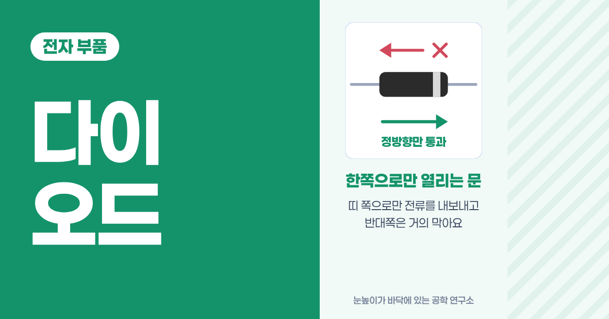

<!-- 목차 -->

## 1. 다이오드를 먼저 한 줄로

다이오드는 전류를 한쪽으로만 흘리는 부품이에요. 반대쪽으로는 거의 흐르지 않아요.

앞 강좌의 [저항](<../전자 부품 120 저항/index.md>)과 [가변저항](<../전자 부품 130 가변저항/index.md>)은 어느 쪽으로 꽂아도 똑같이 일했어요. 다이오드는 방향이 있어요. 그래서 거꾸로 꽂으면 회로가 아예 꺼진 것처럼 보이기도 해요. 계산은 [옴의 법칙](<../전자공학 120 옴의 법칙/index.md>)을 그대로 써요.

## 2. 예시로 먼저 감 잡기

### 2-1. 자전거 타이어 공기 주입구

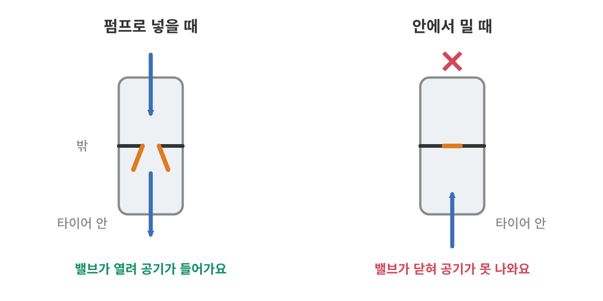

자전거 타이어에 펌프로 공기를 넣어요. 다 넣고 펌프를 빼도 바람이 새지 않아요.

공기는 들어가는데 왜 나오지는 않을까요?

정답 보기

주입구 안에 한쪽으로만 열리는 작은 밸브가 있어서예요. 밖에서 공기를 밀어 넣으면 밸브가 열리고 안에서 밀면 밸브가 더 꽉 닫혀요.

### 2-2. 용수철 달린 한쪽 문

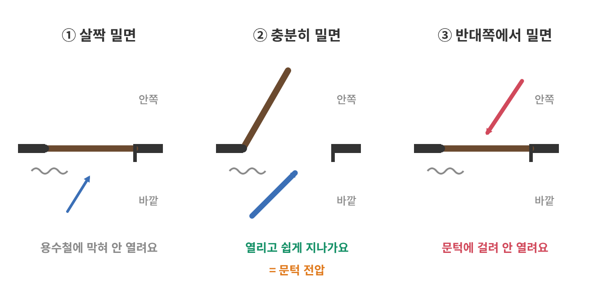

용수철이 달린 문이 있어요. 이 문은 한쪽에서만 열려요.

- 바깥에서 살짝 밀면 용수철 때문에 안 열려요.
- 힘을 어느 정도 주면 열리고 그다음부터는 쉽게 지나가요.
- 안쪽에서는 아무리 밀어도 문틀에 걸려서 안 열려요.

그런데 안쪽에서 정말 세게 밀면 어떻게 될까요?

정답 보기

문이 부서져요. 막는 데도 한계가 있어요. 다이오드도 반대 방향으로 너무 큰 전압을 걸면 망가져요. 4-5에서 다시 볼게요.

### 2-3. 두 예시에서 찾은 규칙

1. 정해진 한 방향으로만 통과해요.
2. 열리려면 최소한의 힘(문턱)이 필요해요.
3. 반대쪽은 막지만 한계를 넘으면 망가져요.

다이오드는 전기에 이 문을 단 부품이에요. 전기에서 「미는 힘」은 전압이에요([전압·전류·저항](<../전자공학 110 전압·전류·저항/index.md>)).

## 3. 생김새와 다리

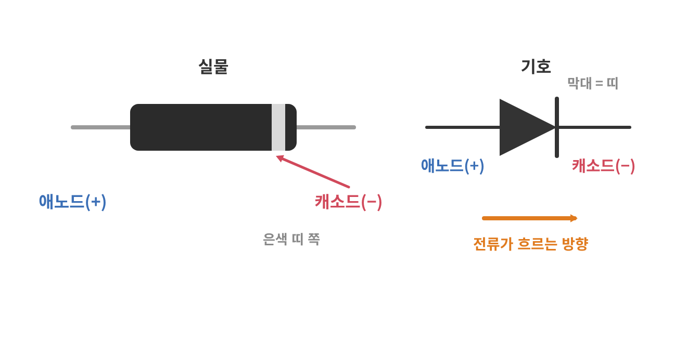

흔히 보는 다이오드는 검은 원통 양쪽에 다리가 하나씩 달려 있어요. 몸통 한쪽 끝에 은색 띠가 있어요.

- **띠 쪽 다리: 캐소드(−)** 전류가 나가는 쪽이에요.
- **반대쪽 다리: 애노드(+)** 전류가 들어오는 쪽이에요.

회로 기호는 삼각형과 막대예요. 삼각형이 가리키는 방향이 전류가 흐르는 방향이고 막대가 몸통의 띠예요. 띠와 막대만 기억하면 실물과 기호를 같이 읽을 수 있어요.

## 4. 안을 열어 보면: N과 P

다이오드가 왜 한쪽으로만 흘리는지 안을 열어 볼게요. 어려운 식 없이 버스와 좌석으로 볼 거예요.

### 4-1. 출발점: 손을 꽉 잡은 실리콘

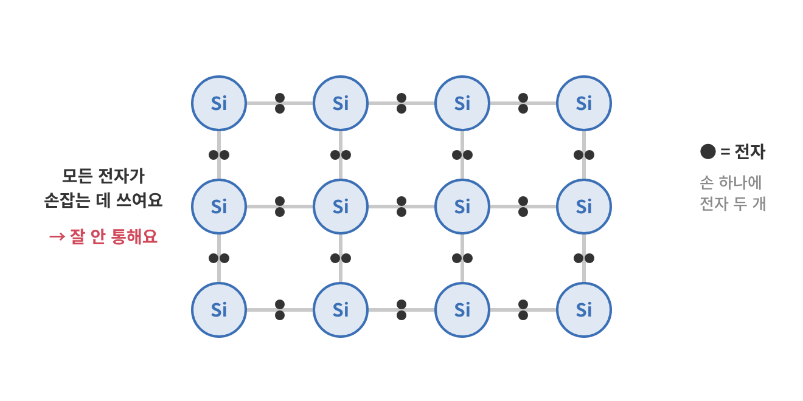

다이오드는 대부분 실리콘으로 만들어요. 실리콘 원자는 바깥쪽 전자가 4개예요. 이 4개로 이웃 원자 4개와 하나씩 손을 맞잡고 있어요([Wikipedia: Doping](https://en.wikipedia.org/wiki/Doping_(semiconductor))).

전자가 모두 손잡는 데 쓰여서 자유롭게 돌아다닐 전자가 거의 없어요. 그래서 순수한 실리콘은 전기가 잘 통하지 않아요. 여기에 다른 원자를 아주 조금 섞어서 성질을 바꿔요.

### 4-2. N형: 전자가 하나 남는 쪽

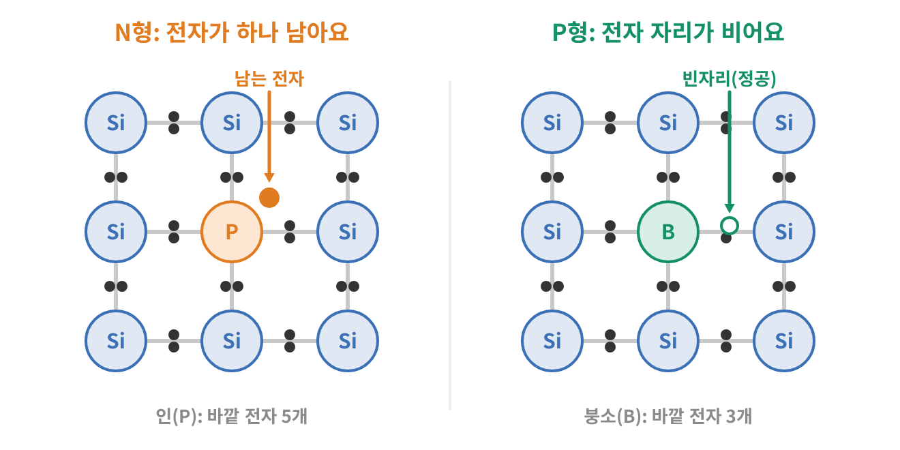

실리콘에 바깥 전자가 5개인 원자(인)를 아주 조금 섞어요. 손잡는 데는 4개만 쓰이니 전자가 하나씩 남아요. 남은 전자는 손이 묶여 있지 않아서 자유롭게 돌아다녀요.

돌아다니는 주인공이 음(−)전기를 가진 전자라서 **N형(Negative)**이라고 불러요.

좌석이 꽉 찬 버스에 승객이 몇 명 더 타서 통로에 서 있는 모습이에요. 서 있는 사람은 쉽게 움직일 수 있어요.

### 4-3. P형: 전자 자리가 하나 비는 쪽

이번엔 바깥 전자가 3개인 원자(붕소)를 섞어요. 손 하나가 비어서 전자가 들어갈 수 있는 빈자리가 생겨요. 이 빈자리를 **정공**이라고 해요.

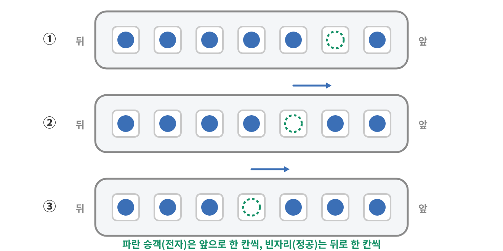

빈 좌석이 하나 있는 버스를 떠올려 보세요. 빈자리 바로 뒤 승객이 앞으로 옮겨 앉으면, 빈자리는 뒤로 한 칸 옮겨 가요. 다시 뒤 승객이 옮겨 앉으면 빈자리는 또 한 칸 뒤로 가요.

실제로 움직인 건 승객(전자)인데, 보기에는 빈자리가 반대쪽으로 움직여요. 전자가 음(−)이니 반대로 움직이는 빈자리는 양(+)의 알갱이처럼 볼 수 있어요. 그래서 이쪽은 **P형(Positive)**이에요.

> ⚠️ N형이 음전기를 띤 덩어리는 아니에요. 섞은 원자도 그만큼 양전하를 가지고 있어서 전체로는 중성이에요. P형도 마찬가지예요. N과 P는 「돌아다니는 주인공이 전자냐 빈자리냐」를 붙인 이름이에요.

### 4-4. N과 P를 맞붙이면: 경계에 생기는 벽

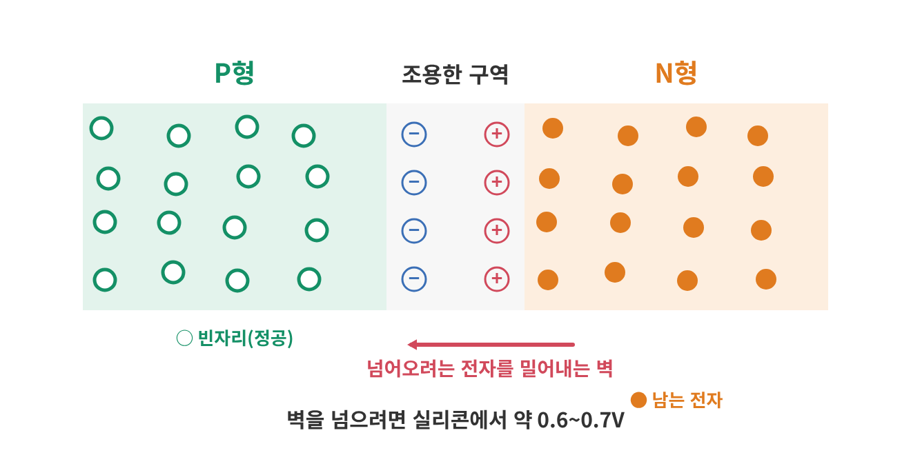

다이오드는 P형과 N형을 맞붙인 것이에요([Wikipedia: p–n junction](https://en.wikipedia.org/wiki/P%E2%80%93n_junction)).

맞붙이는 순간 경계 근처에서 일이 하나 생겨요. N쪽에서 서 있던 전자가 바로 옆 P쪽 빈자리로 넘어가 앉아요. 그래서 경계 근처에는 서 있는 사람도 빈 좌석도 없는 **조용한 구역**이 생겨요. 이 구역의 정식 이름은 공핍층이에요.

전자가 떠난 N쪽 경계에는 양전하가, 전자를 받은 P쪽 경계에는 음전하가 남아요. 이 전하들이 더 넘어오려는 전자를 밀어내요. 경계에 **벽**이 생긴 거예요.

실리콘에서 이 벽을 넘으려면 약 0.6~0.7V가 필요해요. 2-2 용수철 문의 「문턱」이 바로 이 벽이에요.

### 4-5. 전압을 걸면: 정방향과 역방향

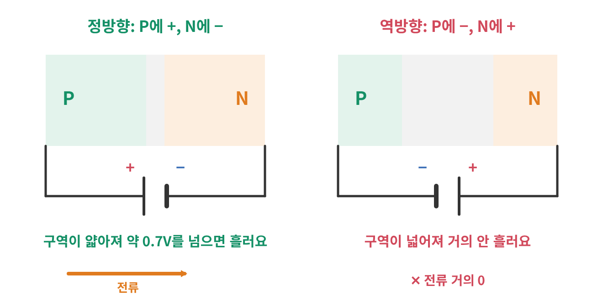

**정방향(P쪽에 +, N쪽에 −)**

전원의 +가 P쪽 빈자리를, −가 N쪽 전자를 경계 쪽으로 밀어요. 조용한 구역이 얇아지다가 전압이 약 0.7V를 넘으면 전자와 빈자리가 경계를 건너 만나면서 전류가 흘러요. 문이 열린 거예요.

**역방향(P쪽에 −, N쪽에 +)**

이번엔 전원이 빈자리와 전자를 경계에서 멀리 끌어가요. 조용한 구역이 넓어지고 벽이 더 높아져요. 전류는 거의 흐르지 않아요. 정확히는 아주 작은 전류가 새는데 보통 회로에서는 0으로 봐도 돼요.

**너무 큰 역방향**

역방향 전압을 계속 키우면 어느 순간 벽이 버티지 못하고 전류가 갑자기 흘러요. 이걸 항복이라고 해요. 보통 다이오드에서는 고장이에요. 2-2에서 문이 부서진 것과 같아요. 그런데 이 현상을 정해진 전압에서 일부러 일어나게 만든 다이오드도 있어요. 6장의 제너 다이오드예요.

### 4-6. 다리 이름과 이어 보기

| 안쪽 | 다리 | 표시 |
| --- | --- | --- |
| P형 | 애노드(+) | 띠 없는 쪽, 기호의 삼각형 쪽 |
| N형 | 캐소드(−) | 띠 있는 쪽, 기호의 막대 쪽 |

기호의 삼각형은 P에서 N 쪽을 가리켜요. 정방향 전류가 흐르는 방향이에요.

외우는 법은 한 줄이면 돼요. **띠 = N = 마이너스 = 막대.**

## 5. 계산해 보기

다이오드가 들어간 회로는 이렇게 계산해요. 정방향이면 다이오드에서 약 0.7V를 빼고 남은 전압으로 옴의 법칙을 써요. 역방향이면 전류를 0으로 봐요.

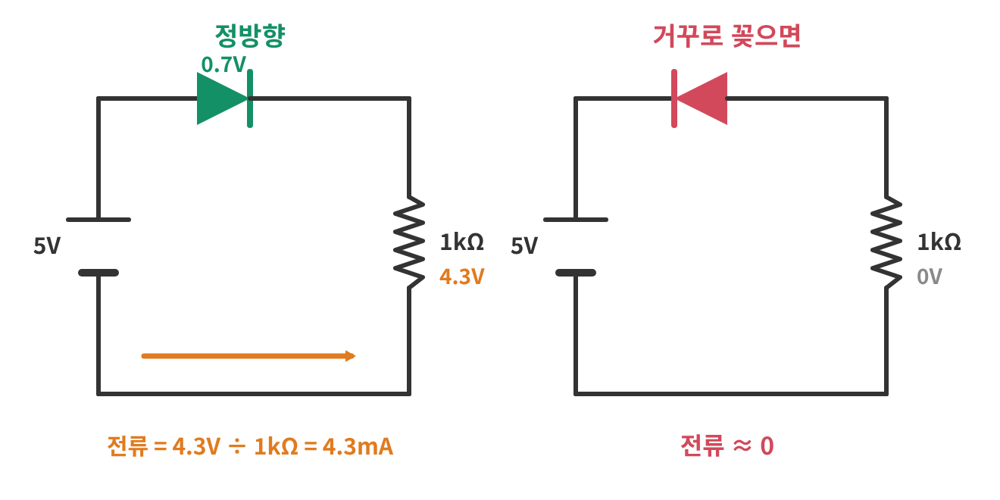

### 5-1. 다이오드와 1kΩ에 5V

5V 전원에 다이오드와 1kΩ 저항을 한 줄로 이었어요. 다이오드는 정방향이에요.

- 다이오드가 가져가는 전압: 약 0.7V
- 저항에 걸리는 전압: 5 − 0.7 = 4.3V
- 전류: 4.3V ÷ 1kΩ = 4.3mA

$$I = \frac{5 - 0.7}{1000} = 0.0043\,\text{A} = 4.3\,\text{mA}$$

### 5-2. 거꾸로 꽂으면

같은 회로에서 다이오드 방향만 바꿨어요. 역방향이라 전류는 거의 0이에요. 저항에도 전압이 걸리지 않아요. 회로가 끊어진 것과 같아 보여요.

부품이 고장 난 게 아니라 방향이 바뀐 거예요. 회로가 안 될 때 다이오드 방향부터 확인하는 이유예요.

### 5-3. 지키는 대신 내주는 0.7V

9V 건전지와 회로 사이에 다이오드를 하나 달면 건전지를 거꾸로 끼워도 전류가 흐르지 않아서 회로가 안전해요. 대신 바르게 끼웠을 때 회로에는 9 − 0.7 = 약 8.3V만 가요.

회로를 지키는 대가로 0.7V를 내주는 셈이에요. 이 손해가 아까운 곳에서는 문턱이 더 낮은 쇼트키 다이오드를 써요.

## 6. 종류와 고르는 법

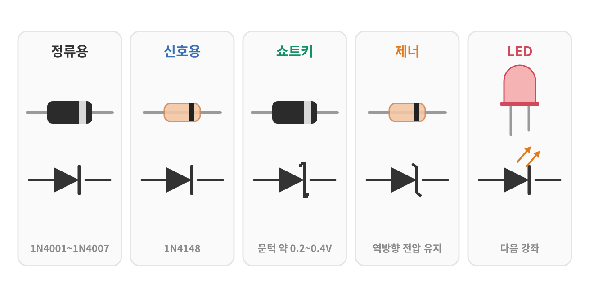

| 종류 | 생김새 | 특징 | 자주 쓰는 곳 |
| --- | --- | --- | --- |
| 정류용(1N4001~1N4007) | 검은 몸통 | 1A까지 흘려요. 번호가 클수록 견디는 역전압이 커요(50V~1000V) | 전원 회로, 거꾸로 연결 막기 |
| 신호용(1N4148) | 작은 유리 몸통 | 작은 전류용이고 빠르게 켜지고 꺼져요 | 신호 회로 |
| 쇼트키 | 정류용과 비슷 | 문턱이 낮아요(약 0.2~0.4V) | 전압을 덜 잃어야 하는 곳 |
| 제너 | 작은 유리 몸통 | 역방향으로 정해진 전압(예: 5.1V)을 지켜요 | 간단한 전압 기준 |
| LED | 색 있는 렌즈 | 빛을 내는 다이오드예요 | 다음 강좌 |

1N4001~1N4007의 값은 제조사 사양서 기준이에요([onsemi: 1N4001 사양서](https://www.onsemi.com/pdf/datasheet/1n4001-d.pdf)).

고를 때는 네 가지를 봐요.

1. **흘릴 수 있는 전류:** 회로에 흐를 전류보다 넉넉해야 해요.
2. **견디는 역전압:** 거꾸로 걸릴 수 있는 전압보다 커야 해요.
3. **문턱 전압:** 전압을 아껴야 하면 낮은 것(쇼트키)을 골라요.
4. **속도:** 빠르게 켜고 끄는 신호에는 신호용을 써요.

## 7. 아두이노에서 쓰기

### 7-1. 거꾸로 연결 막기

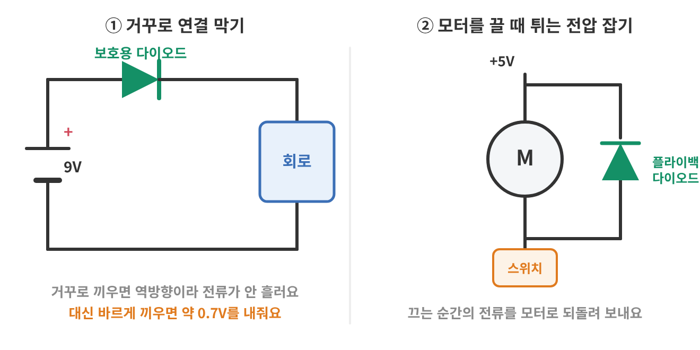

아두이노 우노의 DC 잭(어댑터 꽂는 둥근 구멍)에도 다이오드가 하나 들어 있어요. 1N4007과 같은 성질의 작은 표면 실장 다이오드예요. 어댑터의 +와 −가 반대로 된 것을 꽂아도 전류가 흐르지 않아 보드가 지켜져요([All About Circuits: Arduino Uno 하드웨어 설계](https://www.allaboutcircuits.com/technical-articles/understanding-arduino-uno-hardware-design/)).

건전지로 움직이는 작품을 만들 때도 같은 방법을 쓸 수 있어요. 건전지 + 쪽에 다이오드를 정방향으로 하나 달면 돼요. 5-3처럼 0.7V를 내준다는 점만 기억해요.

### 7-2. 모터를 끌 때 튀는 전압 잡기

모터나 릴레이 안에는 전선을 둘둘 감은 코일이 있어요. 코일은 흐르던 전류를 갑자기 끊으면 순간적으로 큰 전압을 만들어요. 이 전압이 옆 부품을 망가뜨리거나 아두이노를 다시 시작하게 만들 수 있어요.

그래서 코일 양 끝에 다이오드를 거꾸로(평소에는 역방향이 되게) 달아요. 평소에는 아무 일도 안 하다가, 끄는 순간 튀는 전압이 생기면 그 전류를 코일로 되돌려 보내 사라지게 해요. 이 다이오드를 플라이백 다이오드라고 불러요. 모터를 켜고 끄는 트랜지스터와 함께 쓰는 경우가 많아서 트랜지스터 강좌에서 다시 볼게요.

### 7-3. 멀티미터로 방향 찾기

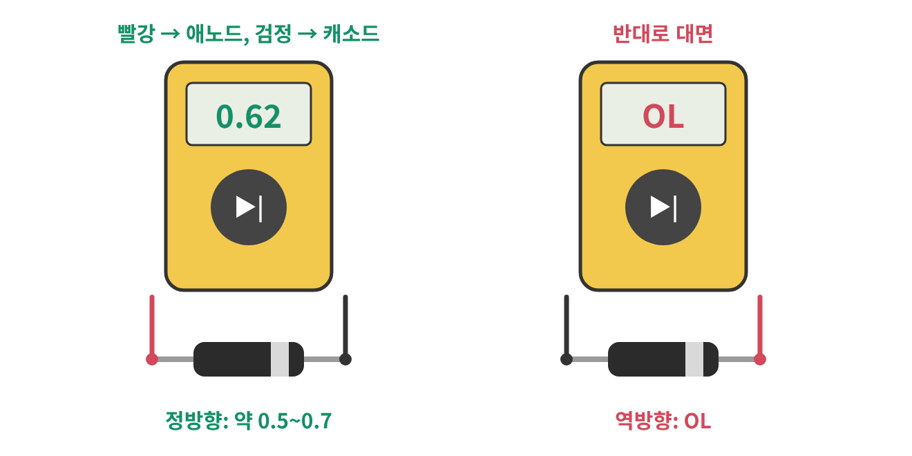

띠가 지워져서 방향을 모를 때는 멀티미터를 써요. 다이얼을 다이오드 기호(▶|)에 맞추고 두 다리에 침을 대요.

- 빨간 침이 애노드, 검은 침이 캐소드면(정방향) 약 0.5~0.7 사이의 숫자가 나와요.
- 반대로 대면(역방향) OL이 나와요. 너무 커서 못 잰다는 뜻이에요.

숫자가 나온 쪽에서 검은 침이 닿은 다리가 캐소드예요. 멀티미터마다 단위 표시(V나 mV)는 조금씩 달라요.

## 8. 생활 속 다이오드

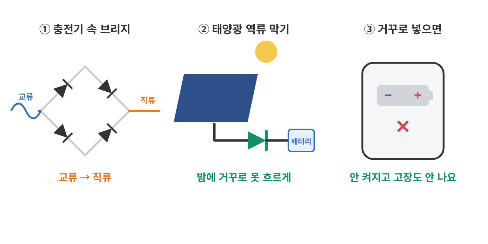

### 8-1. 휴대폰 충전기

콘센트의 전기는 방향이 계속 바뀌는 교류예요. 휴대폰은 한 방향으로 흐르는 직류가 필요해요. 충전기 안에는 다이오드 네 개를 마름모로 이은 회로(브리지)가 있어서 방향이 바뀌는 전류를 한 방향으로 정리해요([Wikipedia: Rectifier](https://en.wikipedia.org/wiki/Rectifier)).

### 8-2. 태양광 패널

밤에는 패널이 전기를 만들지 못해요. 이때 배터리의 전기가 거꾸로 패널 쪽으로 흘러 나가지 않게 다이오드로 막아요.

### 8-3. 건전지를 거꾸로 넣어도 괜찮은 기기

어떤 기기는 건전지를 거꾸로 넣으면 그냥 안 켜지고 고장은 나지 않아요. 7-1처럼 보호용 다이오드가 들어 있는 경우가 많아요. 모든 기기가 그런 것은 아니니 건전지 방향은 늘 확인해요.

## 9. 자주 헷갈리는 점

### 9-1. 띠 쪽이 마이너스예요

띠 쪽 다리가 캐소드(−)예요. 띠를 「끝」이라고 생각하면 쉬워요. 전류가 그쪽으로 나가요.

### 9-2. N형·P형은 전기를 띠지 않아요

N형이 음전기 덩어리, P형이 양전기 덩어리인 게 아니에요. 둘 다 전체로는 중성이고 돌아다니는 주인공만 달라요.

### 9-3. 0.7V는 저항이 아니에요

저항은 전류가 늘면 걸리는 전압도 늘어요. 다이오드는 정방향으로 열린 뒤에는 전류가 늘어도 전압이 0.7V 근처에서 크게 변하지 않아요. 그래서 계산할 때는 0.7V를 「빼는 값」으로 써요.

### 9-4. 다이오드만 전원에 이으면 안 돼요

다이오드 하나만 5V에 바로 이으면 0.7V를 넘는 나머지 전압을 받아 줄 곳이 없어요. 전류가 크게 흘러서 다이오드나 전원이 망가질 수 있어요. 5-1처럼 저항을 같이 달아요.

### 9-5. 역방향 전류가 정확히 0은 아니에요

역방향에서도 아주 작은 전류가 새요. 보통 회로에서는 무시해도 될 만큼 작아서 0으로 계산해요.

## 10. 한 장 요약

> 다이오드: P형과 N형을 맞붙여 경계에 벽을 만든, 한쪽으로만 열리는 문
>
> - 띠 쪽 = 캐소드(N, −), 반대쪽 = 애노드(P, +), 기호의 삼각형이 전류 방향
> - N형은 남는 전자가, P형은 빈자리(정공)가 돌아다닌다. 둘 다 전체로는 중성이다.
> - 정방향은 약 0.7V를 넘으면 흐르고 역방향은 거의 흐르지 않는다. 너무 큰 역방향은 항복.
> - 계산: 전원에서 0.7V를 빼고 옴의 법칙. 역방향이면 전류 0.
> - 종류: 정류용, 신호용, 쇼트키(문턱 낮음), 제너(역방향 전압 유지), LED
> - 쓰임: 거꾸로 연결 막기, 교류를 직류로, 모터를 끌 때 튀는 전압 잡기

## 11. 셀프 퀴즈

<b>Q1.</b> 다이오드 몸통에 띠가 있는 쪽 다리의 이름은 무엇일까요?

정답 보기

캐소드(−)예요. 안쪽으로는 N형 쪽이에요.

<b>Q2.</b> N형 반도체는 전체로 음전기를 띨까요?

정답 보기

아니에요. 섞은 원자가 그만큼 양전하를 가지고 있어서 전체로는 중성이에요. 돌아다니는 주인공이 전자라서 N형이라고 불러요.

<b>Q3.</b> P형에서 돌아다니는 「빈자리」를 무엇이라고 부를까요?

정답 보기

정공이에요. 실제로는 옆 전자가 옮겨 앉는 건데, 빈자리가 반대쪽으로 움직이는 것처럼 보여요.

<b>Q4.</b> 다이오드에 역방향으로 전압을 걸면 경계의 조용한 구역은 넓어질까요, 좁아질까요?

정답 보기

넓어져요. 전원이 전자와 빈자리를 경계에서 멀리 끌어가서 벽이 더 두꺼워져요. 그래서 전류가 거의 흐르지 않아요.

<b>Q5.</b> 5V 전원에 다이오드(정방향)와 2kΩ 저항을 한 줄로 이었어요. 전류는 얼마일까요?

정답 보기

2.15mA예요. (5 − 0.7) ÷ 2000 = 0.00215A

<b>Q6.</b> 거꾸로 연결을 막는 다이오드 때문에 잃는 전압을 줄이고 싶어요. 어떤 다이오드를 쓰면 좋을까요?

정답 보기

쇼트키 다이오드예요. 문턱이 약 0.2~0.4V라서 일반 다이오드보다 전압을 덜 잃어요.

## 참고 자료

- [Wikipedia: Diode](https://en.wikipedia.org/wiki/Diode)
- [Wikipedia: p–n junction](https://en.wikipedia.org/wiki/P%E2%80%93n_junction)
- [Wikipedia: Doping (semiconductor)](https://en.wikipedia.org/wiki/Doping_(semiconductor))
- [Wikipedia: Rectifier](https://en.wikipedia.org/wiki/Rectifier)
- [onsemi: 1N4001~1N4007 사양서](https://www.onsemi.com/pdf/datasheet/1n4001-d.pdf)
- [All About Circuits: Understanding Arduino UNO Hardware Design](https://www.allaboutcircuits.com/technical-articles/understanding-arduino-uno-hardware-design/)

## 강좌 이동

- 이전 강좌: [가변저항: 손잡이로 조절하는 전압 분배](<../전자 부품 130 가변저항/index.md>)
- 다음 강좌: 준비 중이에요.
