<!--
title: "LED: 전기를 빛으로 바꾸는 다이오드"
field: 전자 부품
order: 150
level: 기초
tags: [전자 부품, LED, 다이오드, 반도체]
summary: "LED는 전류가 흐를 때 빛을 내는 다이오드예요. 다이오드처럼 한쪽으로만 흐르고, 저항과 함께 달아서 전류를 정해 줘야 해요."
-->

# LED: 전기를 빛으로 바꾸는 다이오드

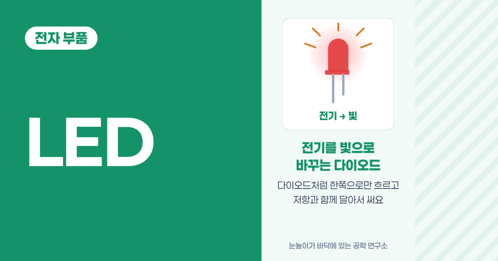

<!-- 목차 -->

## 1. LED를 먼저 한 줄로

LED는 전류가 흐를 때 빛을 내는 다이오드예요. 다이오드처럼 한쪽으로만 흐르고, 저항과 함께 달아서 전류를 정해 줘야 해요.

LED는 Light Emitting Diode의 줄임말이에요. 우리말로는 「빛을 내는 다이오드」, 발광 다이오드예요. 앞 강좌 [다이오드](<../전자 부품 140 다이오드/index.md>)에서 본 한쪽 문, N과 P, 문턱 전압이 그대로 나와요. 저항 계산은 [옴의 법칙](<../전자공학 120 옴의 법칙/index.md>)을 써요.

## 2. 예시로 먼저 감 잡기

### 2-1. 리모컨 앞을 휴대폰 카메라로 보면

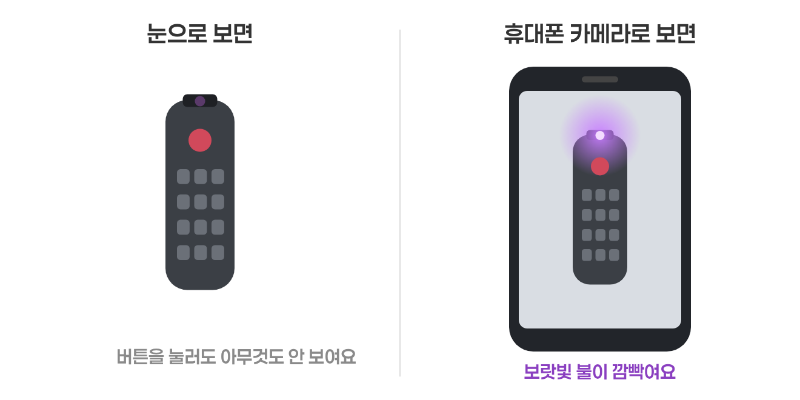

지금 TV 리모컨을 하나 들어 보세요. 앞쪽 끝에 작은 창이 있어요. 버튼을 눌러도 눈에는 아무것도 안 보여요.

이번엔 휴대폰 카메라를 켜고 그 창을 비춘 채 버튼을 눌러 보세요. 화면 속 리모컨 끝에서 보랏빛 불이 깜빡여요. 눈에는 안 보이던 불이 카메라에는 왜 보일까요?

<details>
<summary>정답 보기</summary>

리모컨 안에 사람 눈에는 안 보이는 빛(적외선)을 내는 LED가 있어서예요. 눈으로는 꺼진 것처럼 보여요. 많은 휴대폰 카메라는 적외선을 조금 잡아서 화면에 보랏빛으로 보여 줘요. 기종에 따라 앞쪽 카메라가 더 잘 보여요.

LED는 저마다 내는 빛이 하나로 정해져 있어요. 빨강, 파랑처럼 눈에 보이는 빛도 있고 적외선처럼 안 보이는 빛도 있어요. 그 빛이 어떻게 정해지는지는 4장에서 볼게요.

</details>

### 2-2. 신호등에 쌓인 눈

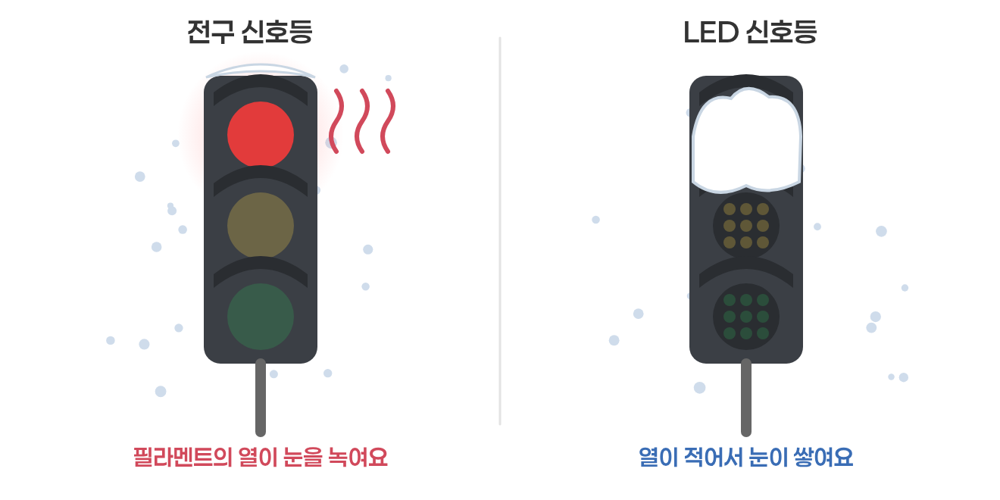

2009년 겨울, 미국 위스콘신과 일리노이 같은 곳에서 이상한 일이 생겼어요. 눈보라가 치자 신호등이 눈에 덮여서 빨간불인지 초록불인지 안 보이게 된 거예요. 사고까지 났어요.

신호등은 예전부터 있었는데 그전에는 이런 일이 드물었어요. 그해에 신호등이 무엇으로 바뀌었길래 눈이 쌓였을까요?

<details>
<summary>정답 보기</summary>

전구 신호등이 LED 신호등으로 바뀌었어요. 옛 신호등의 백열전구는 가는 선(필라멘트)을 아주 뜨겁게 달궈서 빛을 내요. 그 열이 신호등 앞에 붙은 눈을 녹여 줬어요. LED는 달구지 않고 반도체 안에서 바로 빛을 만들어서 열이 적게 나요. 그래서 눈이 녹지 않고 쌓였어요.

열을 적게 낸다는 건 전기를 빛으로 더 많이 바꾼다는 뜻이에요. LED로 바꾼 도시들은 신호등 전기 요금을 80~90%까지 줄였다고 해요. 대신 눈 가리개를 달거나 사람이 눈을 털어 주는 일이 새로 생겼어요([ABC News, 2010](https://abcnews.com/amp/GMA/ConsumerNews/led-traffic-lights-unusual-potentially-deadly-winter-problem/story?id=9506449)).

</details>

### 2-3. 건전지 한 개로 LED를 켤 수 있을까요?

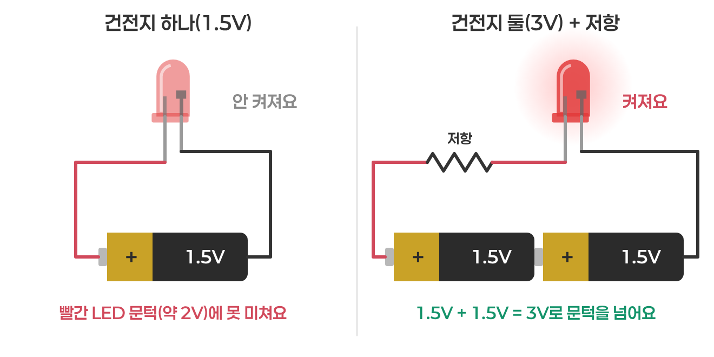

AA 건전지(1.5V) 하나에 빨간 LED 다리를 대 봐요. 방향을 바꿔 봐도 불이 안 켜져요. LED가 고장 난 걸까요?

<details>
<summary>정답 보기</summary>

고장이 아니에요. LED도 다이오드라서 문턱 전압을 넘어야 켜져요. 빨간 LED는 약 2V, 파란 LED는 약 3V가 문턱이라 1.5V로는 문이 안 열려요. 건전지 두 개를 한 줄로 이으면 1.5 + 1.5 = 3V가 돼서 빨간 LED가 켜져요. 이때도 5장에서 볼 저항을 같이 달아요. 그래서 리모컨이나 LED 손전등은 건전지를 두세 개 이어서 써요. 건전지 한 개로 켜는 작은 손전등도 있는데, 그 안에는 전압을 높여 주는 회로가 들어 있어요.

색마다 문턱이 왜 다른지도 4장에서 볼게요. 색과 전압은 사실 한 가지 이야기예요.

</details>

### 2-4. 세 예시에서 찾은 규칙

1. LED는 정해진 빛을 하나 내요. 눈에 안 보이는 빛도 있어요.
2. 달구지 않고 반도체 안에서 바로 빛을 만들어서 열이 적어요.
3. 다이오드라서 문턱 전압을 넘어야 켜져요. 문턱은 색마다 달라요.

## 3. 생김새와 다리

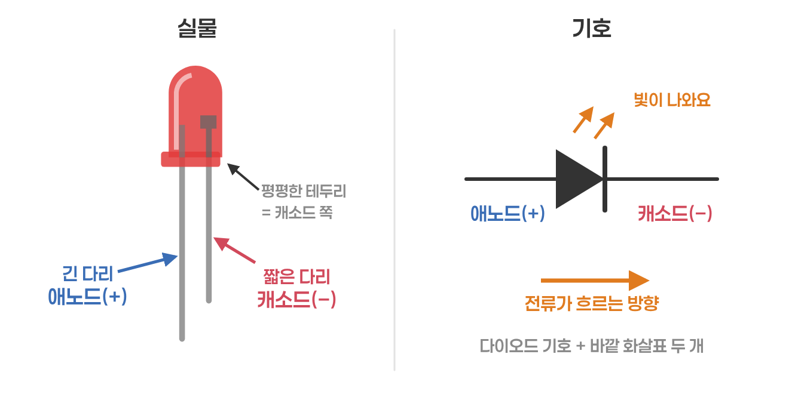

흔히 보는 LED는 색 있는 둥근 렌즈 아래로 다리가 두 개 나와 있어요. 다리 길이가 달라요.

- **긴 다리: 애노드(+)** 전류가 들어오는 쪽이에요.
- **짧은 다리: 캐소드(−)** 전류가 나가는 쪽이에요. 렌즈 아래 테두리도 이쪽이 평평하게 깎여 있어요.

회로 기호는 다이오드 기호에 바깥으로 나가는 화살표 두 개를 더한 모양이에요. 화살표가 「빛이 나온다」는 뜻이에요. 삼각형이 가리키는 방향이 전류가 흐르는 방향인 건 다이오드와 같아요.

다리를 잘라서 길이가 같아졌다면 평평한 테두리를 봐요. 평평한 쪽이 캐소드예요.

## 4. 빛이 나오는 원리

### 4-1. 전자가 빈자리에 앉을 때 빛이 나와요

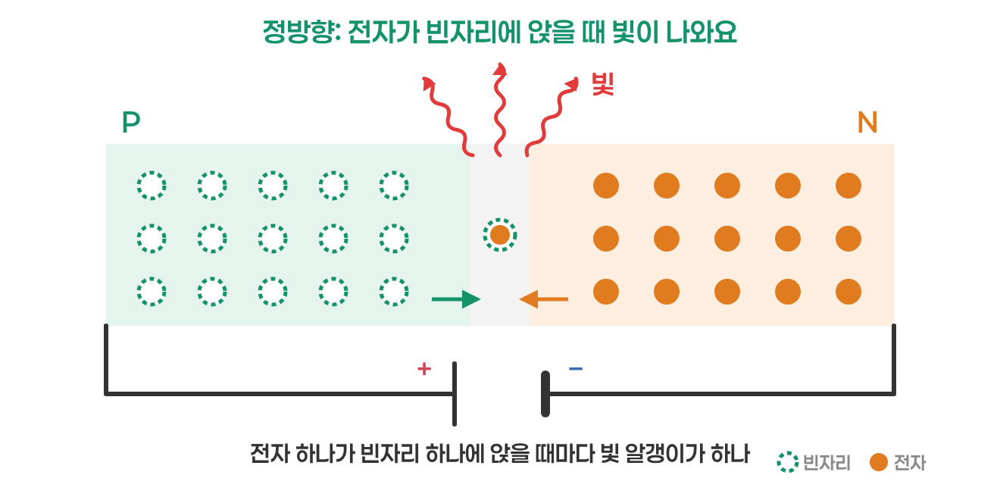

다이오드 강좌 4장에서 N쪽에는 남는 전자가, P쪽에는 빈자리(정공)가 있다고 했어요. 그림의 주황 동그라미가 남는 전자, 점선 동그라미가 빈자리예요. 다이오드 강좌 그림과 같은 모양이에요.

정방향으로 전압을 걸면 전자와 빈자리가 경계로 모여서 만나요. 이때 전자가 빈자리에 들어가 앉으면서 가지고 있던 에너지를 내놓아요. LED는 이 에너지가 빛으로 나오게 만든 다이오드예요.

전자 하나가 빈자리 하나에 앉을 때마다 빛 알갱이가 하나씩 나와요. 그래서 전류가 많이 흐를수록 앉는 전자가 많아지고 LED가 더 밝아져요.

보통 다이오드도 같은 일이 일어나지만, 실리콘으로 만든 다이오드는 이 에너지를 거의 열로 내보내요. 그래서 LED는 실리콘 대신 갈륨 같은 원소가 들어간 다른 반도체로 만들어요([Wikipedia: Light-emitting diode](https://en.wikipedia.org/wiki/Light-emitting_diode)).

### 4-2. 색은 떨어지는 높이로 정해져요

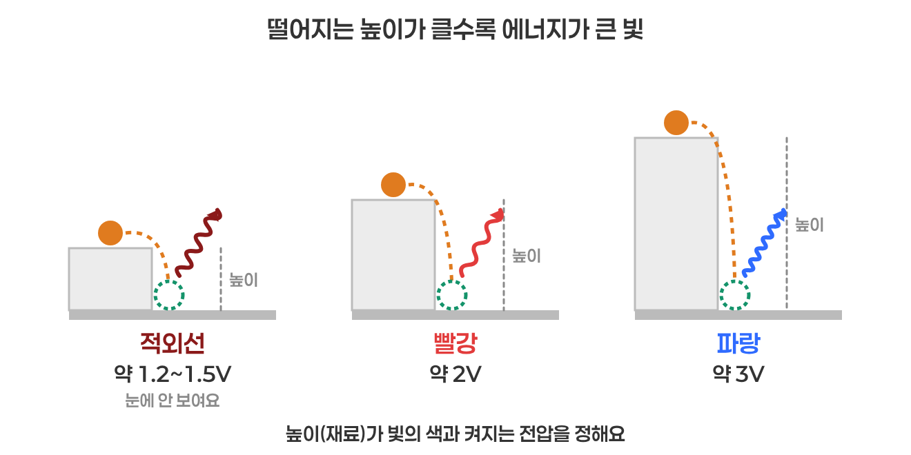

계단에서 공을 떨어뜨리면 높은 데서 떨어진 공이 더 세게 튀어요. 전자도 비슷해요. 전자가 빈자리에 앉을 때 「떨어지는 높이」가 반도체 재료마다 정해져 있어요.

- 높이가 낮으면 에너지가 작은 빛이 나와요. 빨간빛, 더 낮으면 눈에 안 보이는 적외선이에요.
- 높이가 높으면 에너지가 큰 빛이 나와요. 초록을 지나 파란빛이에요.

여기서 「높이」는 실제로 위아래가 있는 게 아니라 에너지 차이예요. 반도체 안에는 전자가 머물 수 있는 층이 두 개 있어요. 돌아다니는 전자가 있는 위층과, 빈자리가 있는 아래층이에요. 두 층 사이에는 전자가 머물 수 없는 틈이 있는데, 이 틈을 **띠틈(밴드갭)**이라고 불러요. 전자가 위층에서 아래층 빈자리로 내려앉으면 띠틈만큼의 에너지가 빛 알갱이 하나로 나와요.

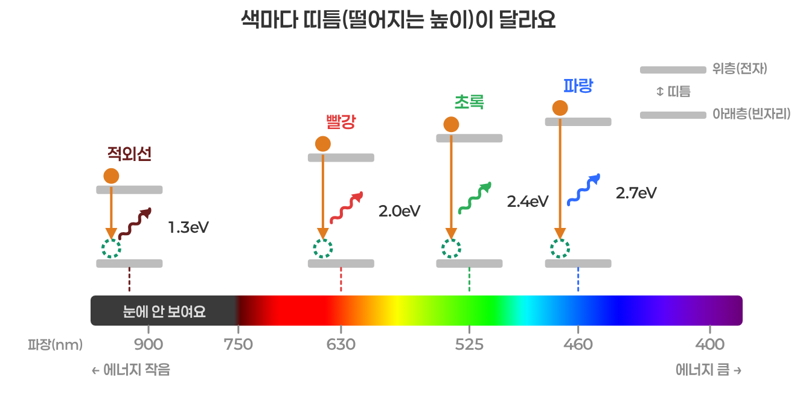

빛 알갱이 하나의 에너지가 클수록 빛의 파장이 짧아지고, 눈에는 빨강에서 초록, 파랑 쪽으로 보여요. 에너지는 eV(전자볼트)라는 단위로 재는데, 파장(nm)은 대략 1240 ÷ 에너지(eV)로 구할 수 있어요. 빨간빛(약 630nm)은 약 2.0eV, 파란빛(약 460nm)은 약 2.7eV예요. 파란빛 알갱이가 빨간빛보다 에너지가 1.4배쯤 커요. 그래서 파란 LED는 띠틈이 큰 재료로, 빨간 LED는 띠틈이 작은 재료로 만들어요([Wikipedia: Light-emitting diode](https://en.wikipedia.org/wiki/Light-emitting_diode)).

그래서 LED의 색은 렌즈 색이 아니라 안쪽 반도체 재료가 정해요. 렌즈 색은 꺼져 있을 때 무슨 색 LED인지 알아보게 해 주는 정도예요. 투명한 렌즈인데 켜면 파랗게 빛나는 LED도 있어요.

이제 2-3의 수수께끼가 풀려요. 떨어지는 높이만큼 전자를 먼저 올려 줘야 빛이 나와요. 그 「올려 주는 힘」이 전압이에요. 1eV는 전자 하나를 1V로 밀어 올릴 때 얻는 에너지라서, 2.0eV 높이를 넘기려면 대략 2V, 2.7eV를 넘기려면 대략 3V가 필요해요(재료 안의 저항 때문에 띠틈보다 조금 더 걸어 줘요). 높이가 큰 파란 LED는 빨간 LED보다 켜지는 데 전압이 더 필요하고, 1.5V는 빨간 LED의 높이에도 못 미쳐요. 색과 문턱 전압이 한 가지 이야기라는 게 이 뜻이에요.

| 색 | 켜질 때 쓰는 전압(대략) |
| --- | --- |
| 적외선 | 약 1.2~1.5V |
| 빨강·주황·노랑 | 약 2V |
| 파랑·흰색, 밝은 초록 | 약 3V |

정확한 값은 제품마다 달라서 사양서를 봐요. 예를 들어 어떤 5mm 파란 LED의 사양서는 20mA에서 3.3V라고 적고 있어요([Digi-Key: Kingbright WP7113QBC/D](https://www.digikey.ca/en/products/detail/kingbright/WP7113QBC-D/2261460)). 이 강좌의 계산은 빨강 2V, 파랑 3V로 할게요.

### 4-3. 흰색 LED는 안쪽이 파랑이에요

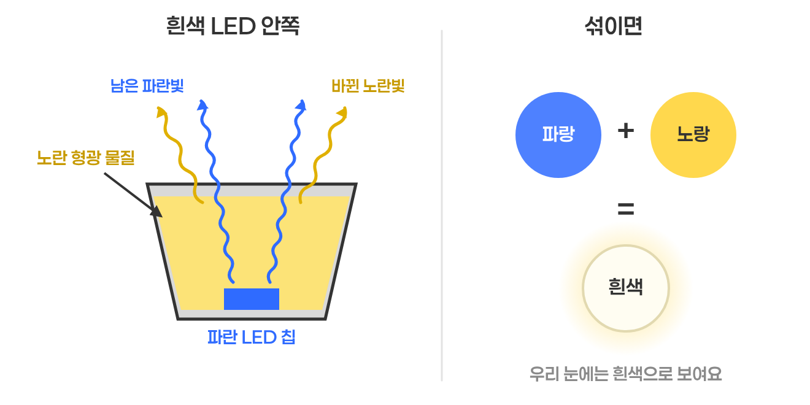

LED 하나는 색 하나만 내요. 그런데 조명용 LED는 흰색이에요. 어떻게 만들었을까요?

가장 흔한 방법은 파란 LED 위에 노란빛을 내는 형광 물질을 덮는 거예요. 파란빛 일부가 형광 물질에 닿아 노란빛으로 바뀌고, 남은 파란빛과 노란빛이 섞여서 우리 눈에 흰색으로 보여요. 빨강·초록·파랑 LED 세 개를 함께 켜서 섞는 방법도 있어요([Digi-Key: Whiter, Brighter LEDs](https://www.digikey.kr/ko/articles/whiter-brighter-leds)).

그래서 흰색 LED를 만들려면 밝은 파란 LED가 먼저 있어야 했어요. 빨간 LED는 1962년 닉 홀로니악이 처음 보여 줬어요([IEEE Photonics Society](https://ieeephotonics.org/news/the-birth-of-the-visible-led-nick-holonyak-jr-and-a-turning-point-in-photonics/)). 빨간 LED에 이어 초록 LED도 나왔어요. 그런데 파란 LED는 30년 가까이 아무도 밝게 만들지 못했어요. 파랑은 떨어지는 높이가 가장 커서 알맞은 재료를 찾기도, 깨끗하게 키우기도 어려웠거든요.

1990년대 초에 드디어 밝은 파란 LED가 나왔어요. 나고야 대학의 아카사키 이사무와 아마노 히로시, 그리고 일본 도쿠시마의 회사 니치아에서 일하던 나카무라 슈지예요. 세 사람은 2014년 노벨 물리학상을 받았어요. 상의 이유가 「밝고 전기를 아끼는 흰색 조명을 가능하게 한 파란 LED」였어요([스웨덴 왕립과학원](https://kva.se/en/news/nobelpriset-i-fysik-2014-2)).

> 2만 엔짜리 발명?
>
> 나카무라 슈지는 자기 발명에 대해 회사에서 받은 돈이 2만 엔뿐이었다며 회사를 상대로 소송을 걸었어요. 1심 법원은 회사가 200억 엔을 줘야 한다고 판결했고, 2005년 두 쪽은 약 8억 4천만 엔에 합의했어요. 회사는 그동안 승진과 보너스로 충분히 보상했다고 맞섰어요. 이 일로 일본에서는 회사 안 발명가의 보상을 두고 큰 논쟁이 벌어졌어요([The Japan Times](https://japantimes.co.jp/news/2005/01/13/national/inventor-of-blue-led-angry-with-settlement), [Wikipedia: Shuji Nakamura](https://en.wikipedia.org/wiki/Shuji_Nakamura)).

### 4-4. 다른 색은 어떻게 만들까요?

주황, 노랑, 청록, 보라 LED도 있어요. 자동차 방향지시등의 호박색, 살균기의 자외선도 LED예요. 띠틈은 재료가 정하는데, 재료를 물감처럼 섞는 비율을 바꾸면 띠틈을 조금씩 옮길 수 있어요.

- 알루미늄·갈륨·인듐·인을 섞은 재료: 빨강, 주황, 노랑을 맡아요.
- 질화갈륨에 인듐을 섞은 재료: 보라, 파랑, 초록을 맡아요. 인듐을 많이 넣을수록 띠틈이 작아져 초록 쪽으로 가요.

그런데 두 재료 사이, 초록에서 노랑 구간은 LED가 유난히 어두워요. 질화갈륨 쪽은 초록으로 가려고 인듐을 많이 넣을수록 전자와 빈자리가 서로 잘 못 만나고, 반대쪽 재료는 노랑에서 초록으로 갈수록 전자가 엉뚱한 곳으로 새어 나가요. 이 구간을 「초록 틈(그린 갭)」이라고 부르고, 지금도 연구 중이에요([Compound Semiconductor](https://compoundsemiconductor.net/article/101325/Getting_to_grips_with_the_green_gap)).

### 4-5. 화면에 물 한 방울을 떨어뜨리면

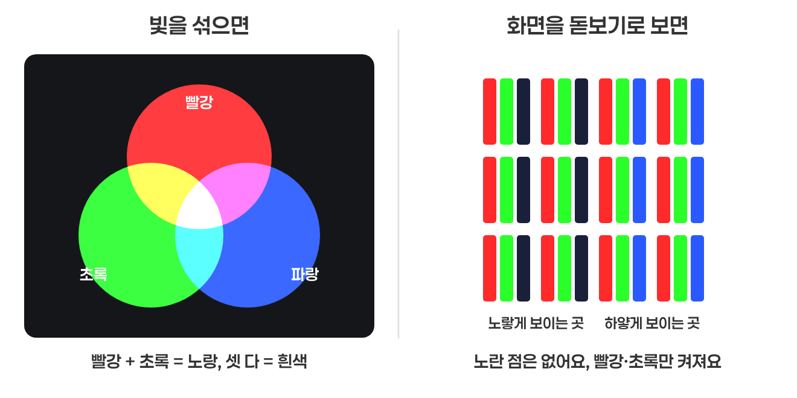

휴대폰 화면에 노란 바나나 사진을 띄우고, 화면 위에 물을 아주 작게 한 방울 떨어뜨려 보세요. 동그란 물방울이 작은 돋보기처럼 화면을 크게 보여 줘요([MyTutor: 물방울 돋보기](https://mytutor.co.uk/answers/58674/GCSE/Physics/why-is-it-that-When-there-is-a-small-droplet-on-a-phone-the-pixels-of-the-screen-can-be-seen)).

물방울 속 바나나는 무슨 색 점들로 이루어져 있을까요?

<details>
<summary>정답 보기</summary>

노란 점은 없고 빨간 점과 초록 점이 나란히 켜져 있는 경우가 많아요. 하얀 부분을 보면 빨강·초록·파랑 셋이 모두 켜져 있어요. 화면마다 점의 모양과 배열은 조금씩 달라요.

TV, 휴대폰, 모니터, 전광판은 빨강·초록·파랑(RGB) 세 가지 빛만으로 노랑, 분홍, 하늘색, 흰색까지 보여 줘요. 노란빛을 따로 내지 않는데 어떻게 노랗게 보일까요? 비밀은 화면이 아니라 우리 눈에 있어요.

</details>

### 4-6. 눈 속의 세 가지 색 세포

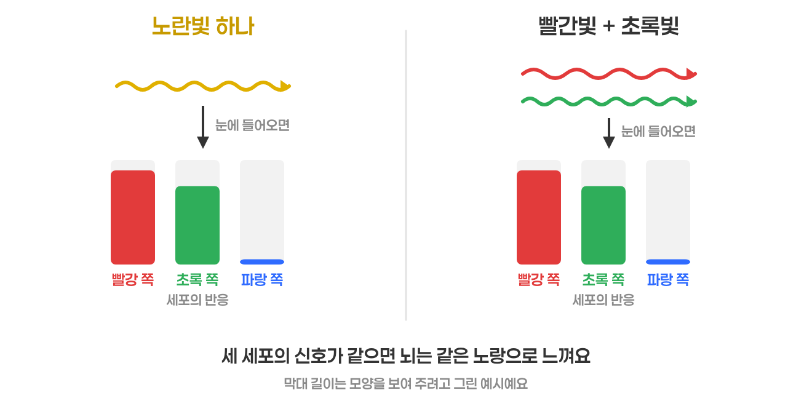

눈 안쪽에는 색을 느끼는 세포가 세 종류 있어요. 하나는 긴 파장(빨강 쪽), 하나는 중간 파장(초록 쪽), 하나는 짧은 파장(파랑 쪽)에 가장 잘 반응해요. 세 세포가 반응하는 범위는 서로 조금씩 겹쳐 있어요. 뇌는 빛의 파장을 직접 재지 못하고, 이 세 세포가 각각 얼마나 반응했는지만 비교해서 색을 정해요([Wikipedia: Cone cell](https://en.wikipedia.org/wiki/Cone_cell)).

진짜 노란빛이 눈에 들어오면 빨강 쪽 세포와 초록 쪽 세포가 함께 반응하고, 파랑 쪽 세포는 거의 반응하지 않아요. 그런데 빨간빛과 초록빛을 알맞은 세기로 같이 비춰도 세 세포가 똑같은 모양으로 반응해요. 신호가 같으니 뇌는 둘을 구별하지 못하고 둘 다 노랑으로 느껴요.

**눈이 받는 신호가 같으면 같은 색으로 보여요.** 화면은 이 점을 이용해서 세 가지 빛의 세기만 바꿔 수많은 색을 만들어 내요.

- 빨강 + 초록 = 노랑
- 초록 + 파랑 = 청록
- 파랑 + 빨강 = 자홍(분홍빛 보라)
- 셋 다 = 흰색

### 4-7. 하필 빨강·초록·파랑인 이유

세 가지를 고를 때는 세 빛이 눈의 세 세포를 서로 최대한 다르게 자극해야 해요. 빨강은 주로 빨강 쪽 세포를, 초록은 주로 초록 쪽 세포를, 파랑은 주로 파랑 쪽 세포를 건드려요. 그래야 세 빛의 세기를 따로 조절해서 세 세포의 반응을 따로따로 움직일 수 있어요.

세 빛이 서로 멀리 떨어진 색일수록 섞어서 만들 수 있는 색의 범위도 넓어져요. 노랑·청록·보라처럼 가까운 색끼리 고르면 만들 수 있는 색이 확 줄어요. 대신 빨강·초록·파랑으로도 범위 밖의 아주 진한 색은 똑같이 보여 줄 수 없어서, 화면에 따라 표현할 수 있는 색 범위가 달라요([Wikipedia: RGB color model](https://en.wikipedia.org/wiki/RGB_color_model)).

LED 쪽 사정도 맞아떨어져요. 4-4에서 본 것처럼 연두·노랑 LED는 어두운데, 빨강·초록·파랑은 밝게 잘 만들 수 있어요. 어려운 색을 직접 만들 필요 없이 잘 만드는 세 가지만 섞으면 되는 거예요.

> 미술 시간의 삼원색은 왜 다를까요?
>
> 물감은 빛을 더하는 게 아니라 빛을 빨아들여서 색을 내요. 그래서 섞을수록 빼는 빛이 많아져 어두워지고, 다 섞으면 검정에 가까워져요. 빛은 반대로 더할수록 밝아져 흰색이 돼요. 그래서 프린터 잉크는 빛의 삼원색을 하나씩 빼 주는 청록·자홍·노랑을 써요.

**다른 동물이 보면?** 개는 색 세포가 두 종류라서 빨강과 주황을 잘 구별하지 못하고, 많은 새는 네 종류라서 사람에게 안 보이는 자외선까지 봐요([Wikipedia: Color vision](https://en.wikipedia.org/wiki/Color_vision)). 사람 눈에 맞춘 RGB 화면이 새에게는 우리와 다르게 보일 수 있어요.

## 5. 저항은 꼭 같이 달아요

### 5-1. LED만 전원에 이으면

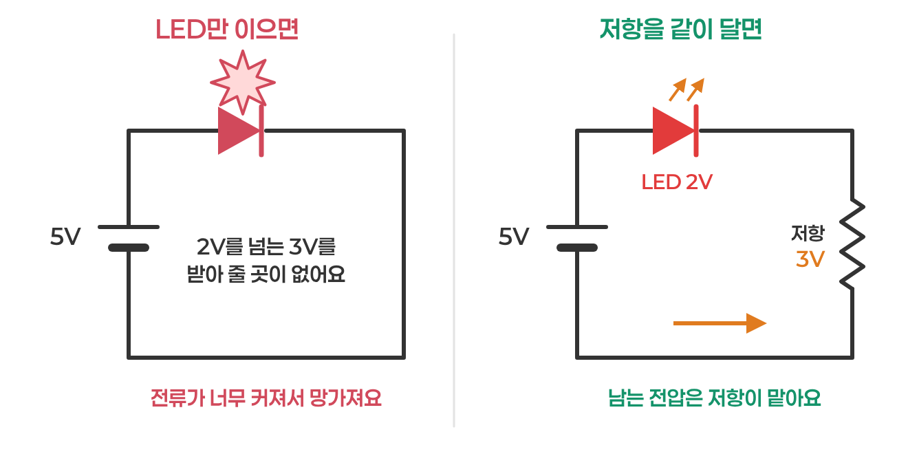

다이오드 강좌 9-3에서 본 것처럼 LED는 문턱을 넘은 뒤에는 전압이 조금만 올라도 전류가 크게 늘어요. 빨간 LED를 5V에 바로 이으면 2V를 넘는 나머지 3V를 받아 줄 곳이 없어요. 전류가 한없이 커지려고 해서 LED가 뜨거워지고 금방 망가져요.

그래서 LED에는 저항을 한 줄로 같이 달아요. 저항이 남는 전압을 맡고, 흐르는 전류를 정해 줘요. 이 저항을 전류 제한 저항이라고 불러요.

### 5-2. 저항 값 정하기

순서는 세 단계예요. 옴의 법칙 강좌 7-1과 같은 계산이에요.

1. 저항이 맡을 전압 = 전원 전압 − LED 전압
2. 저항 = 저항이 맡을 전압 ÷ 원하는 전류
3. 계산값보다 조금 큰 흔한 저항을 골라요. 그러면 전류가 원하는 값보다 조금 작아져서 안전해요.

$$
R = \frac{V_{\text{전원}} - V_{\text{LED}}}{I}
$$

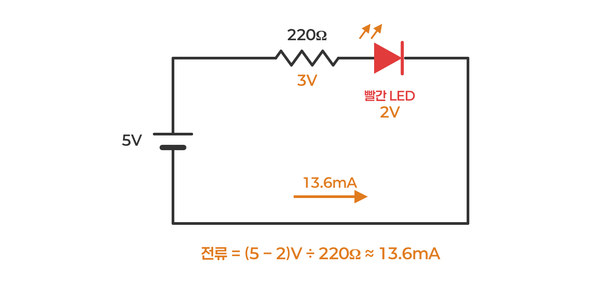

**5V에 빨간 LED 하나**

흔한 5mm LED는 20mA까지 쓰도록 안내돼 있어요. 여유를 두고 15mA쯤 흘려 볼게요([SparkFun: LED - Basic Red 5mm](https://www.sparkfun.com/led-basic-red-5mm.html)).

- 저항이 맡을 전압: 5 − 2 = 3V
- 저항: 3V ÷ 0.015A = 200Ω
- 흔한 저항 220Ω을 골라요. 실제 전류는 3V ÷ 220Ω ≈ 13.6mA예요.

**5V에 파란 LED 하나**

파란 LED는 3V를 쓰니 저항이 맡을 전압이 5 − 3 = 2V로 줄어요.

- 같은 220Ω을 달면 2V ÷ 220Ω ≈ 9.1mA라서 빨간 LED보다 조금 어둡게 켜져요.
- 빨간 LED와 비슷한 전류를 원하면 2V ÷ 0.015A ≈ 133Ω, 흔한 150Ω을 골라요. 전류는 2V ÷ 150Ω ≈ 13.3mA예요.

**9V 건전지에 빨간 LED 하나**

- 저항이 맡을 전압: 9 − 2 = 7V
- 저항: 7V ÷ 0.015A ≈ 467Ω, 흔한 470Ω을 골라요.
- 실제 전류는 7V ÷ 470Ω ≈ 14.9mA예요.

전원 전압이 높을수록 저항이 맡는 몫이 커져요. LED 색이 바뀌면 LED 전압이 바뀌니 저항도 다시 계산해요.

### 5-3. LED 여러 개 달기

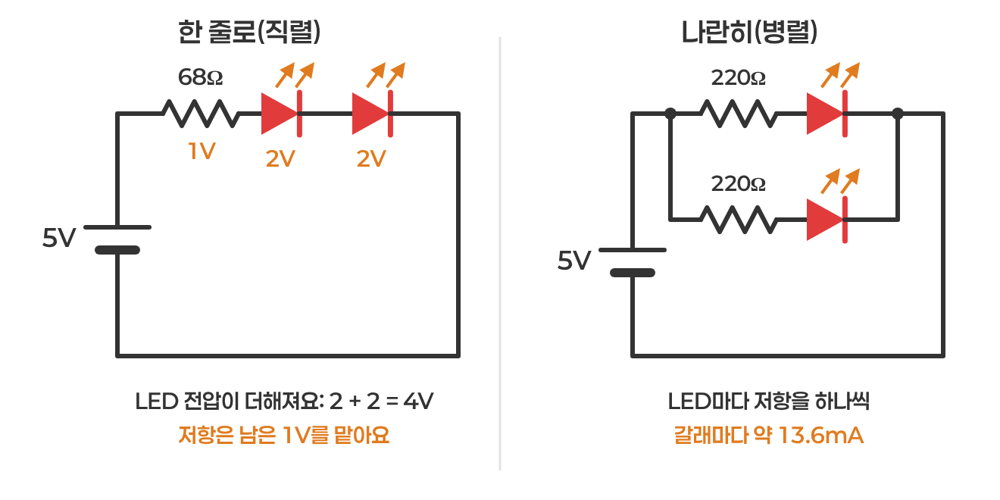

**한 줄로 이으면(직렬)** LED 전압이 더해져요. [키르히호프의 법칙](<../전자공학 130 키르히호프의 법칙/index.md>)에서 한 바퀴 돌면 전압의 합이 같다고 했죠.

- 5V에 빨간 LED 두 개: LED가 2 + 2 = 4V를 쓰고 저항은 5 − 4 = 1V를 맡아요. 15mA를 원하면 1V ÷ 0.015A ≈ 67Ω이라 흔한 68Ω을 골라요. 전류는 1V ÷ 68Ω ≈ 14.7mA예요.
- 5V에 파란 LED 두 개: LED만 3 + 3 = 6V가 필요해서 5V로는 문턱을 넘지 못해요. 둘 다 안 켜져요.

**나란히 이으면(병렬)** LED마다 저항을 하나씩 따로 달아요. 같은 색 LED라도 켜지는 전압이 조금씩 달라요. 저항 하나를 같이 쓰면 문턱이 조금 낮은 LED로 전류가 몰려서 그 LED만 밝고 먼저 망가질 수 있어요.

### 5-4. 밝기는 전류가 정해요

LED의 밝기는 흐르는 전류로 정해져요. 저항을 크게 하면 전류가 줄어서 어두워지고, 작게 하면 밝아져요. 단, 사양서에 적힌 최대 전류를 넘지 않게 해요.

전압을 조금 올려서 밝기를 조절하려고 하면 위험해요. 문턱을 넘은 뒤에는 전압이 조금만 올라도 전류가 크게 늘어나서 조절하기 어렵거든요. 그래서 밝기는 저항으로 전류를 정하거나, 7-2처럼 빠르게 켰다 껐다 하는 방법으로 조절해요.

## 6. 종류

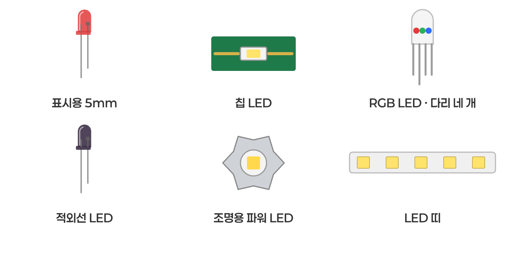

| 종류 | 생김새 | 특징 | 자주 쓰는 곳 |
| --- | --- | --- | --- |
| 표시용 3mm·5mm | 둥근 렌즈, 다리 두 개 | 10~20mA 정도로 켜는 작은 LED | 전원 표시등, 실습 |
| 칩 LED | 아주 작은 네모, 다리 없음 | 기판 위에 바로 붙여요(표면 실장) | 휴대폰, 아두이노 보드 위 표시등 |
| RGB LED | 다리 네 개 | 빨강·초록·파랑이 한 몸에 들어 있어 섞어서 여러 색을 내요 | 무드등, 색이 바뀌는 표시 |
| 적외선 LED | 투명하거나 거무스름한 렌즈 | 눈에 안 보이는 빛을 내요 | 리모컨, 센서 |
| 조명용 파워 LED | 넓은 판 위의 노란 칩 | 큰 전류로 밝게 켜요. 열을 빼는 판이 필요해요 | LED 전구, 손전등 |
| LED 띠 | 길쭉한 띠에 칩 LED가 줄지어 | 저항이 이미 들어 있는 제품이 많아요 | 실내 장식, 간접 조명 |

RGB LED의 다리 네 개 중 가장 긴 하나는 세 색이 함께 쓰는 다리예요. 공통 다리가 +인 제품(공통 애노드)과 −인 제품(공통 캐소드)이 있어서 사양서를 보고 연결해요.

## 7. 아두이노에서 쓰기

### 7-1. 깜빡이기

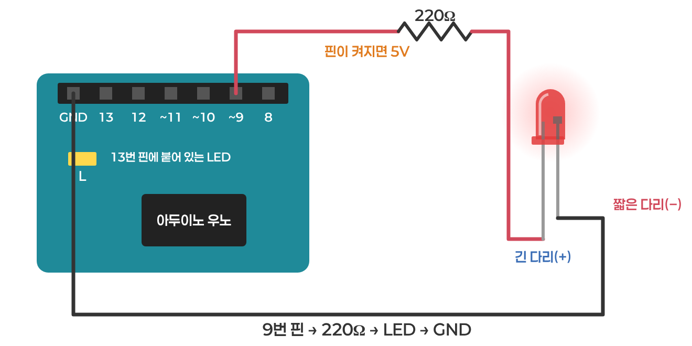

아두이노 우노 보드에는 13번 핀에 이어진 LED가 하나 붙어 있어요. 13번 핀을 켜면 이 LED가 켜져요([Wikipedia: Arduino Uno](https://en.wikipedia.org/wiki/Arduino_Uno)).

LED를 따로 달 때는 핀 → 220Ω → LED 긴 다리, LED 짧은 다리 → GND 순서로 이어요. 핀이 켜지면 5V가 나와서 5-2의 첫 번째 계산과 똑같아져요. 전류는 약 13.6mA예요.

우노는 핀 하나에 20mA 정도를 권장하고 40mA를 넘으면 칩이 망가질 수 있다고 안내해요. 그래서 저항 없이 LED를 핀에 바로 꽂으면 LED뿐 아니라 아두이노도 위험해요.

<details>
<summary>코드 보기</summary>

```cpp
void setup() {
  pinMode(9, OUTPUT);
}

void loop() {
  digitalWrite(9, HIGH);  // 켜기: 핀에서 5V
  delay(500);             // 0.5초 기다리기
  digitalWrite(9, LOW);   // 끄기: 핀이 0V
  delay(500);
}
```

</details>

### 7-2. 밝기 조절하기

[가변저항](<../전자 부품 130 가변저항/index.md>) 강좌 7-2에서 9번 핀에 `analogWrite`로 0~255 값을 넣어 LED 밝기를 바꿨어요. 이건 핀의 전압을 낮추는 게 아니에요. 아주 빠르게 켰다 껐다 하면서 켜져 있는 시간의 비율을 바꾸는 거예요.

- 255: 계속 켜짐
- 128: 절반쯤 켜짐
- 0: 계속 꺼짐

깜빡임이 너무 빨라서 눈에는 깜빡이는 대신 밝기가 바뀌는 것처럼 보여요. 이 방법을 PWM이라고 불러요. 저항은 그대로 두고 켜져 있는 시간만 바꾸니 LED에 무리가 없어요.

### 7-3. 멀티미터로 확인하기

다이오드 강좌 7-3의 다이오드 모드로 LED도 확인할 수 있어요. 빨간 침을 긴 다리, 검은 침을 짧은 다리에 대면 LED가 아주 희미하게 켜지면서 숫자가 나와요. 반대로 대면 OL이 나와요. 파란 LED처럼 켜지는 전압이 높은 LED는 멀티미터에 따라 희미하게도 안 켜질 수 있어요.

## 8. 생활 속 LED

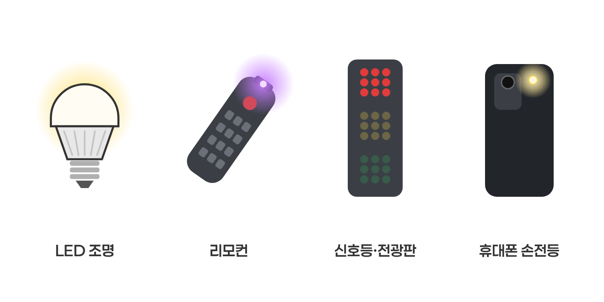

### 8-1. LED 조명

스웨덴 왕립과학원 자료에 따르면 1와트로 내는 빛의 양이 백열전구는 약 16루멘, 형광등은 70루멘 가까이예요. 흰색 LED는 최고 기록이 300루멘을 조금 넘어요. 수명도 백열전구 약 1,000시간, 형광등 약 10,000시간인데 LED는 길게는 100,000시간까지 가요([스웨덴 왕립과학원](https://kva.se/en/news/nobelpriset-i-fysik-2014-2)). 실제 판매되는 LED 전구는 제품마다 값이 달라요.

### 8-2. 리모컨과 센서

2-1의 리모컨은 적외선 LED를 빠르게 깜빡여서 신호를 보내요. TV 쪽 수신기가 깜빡이는 순서를 읽고 어떤 버튼인지 알아내요.

### 8-3. 화면과 전광판

신호등, 버스 행선지 전광판, 경기장 전광판은 LED를 줄지어 세워 만든 거예요. TV와 모니터 중에는 화면 뒤에서 흰색 LED가 빛을 비춰 주는 제품이 많아요.

### 8-4. 휴대폰 손전등

휴대폰 뒷면의 손전등도 흰색 LED예요. 4-3처럼 안쪽은 파란 LED와 노란 형광 물질이에요.

### 8-5. 거꾸로 써 보기: 빛을 비추면 전기가 나와요

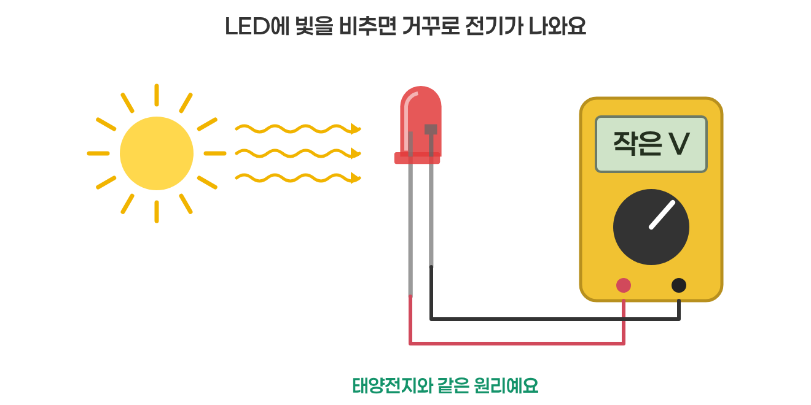

LED는 전기를 빛으로 바꿔요. 그럼 거꾸로 빛을 비추면 어떻게 될까요?

LED 두 다리에 멀티미터를 대고 햇빛이나 밝은 손전등 쪽으로 향하면 아주 작은 전기가 잡혀요. 4-1에서 전자가 빈자리에 앉으며 빛을 냈던 일이 거꾸로 일어나는 거예요. 빛이 들어와 전자를 높은 곳으로 올려 주면 그 전자가 회로로 흘러나와요. 태양전지가 빛으로 전기를 만드는 원리와 같아요.

LED는 주로 자기 색과 비슷하거나 에너지가 조금 더 큰 빛에 반응해요. 그래서 빨간 LED는 빨간빛이나 주황빛에 잘 반응해요. 실제로 LED를 햇빛 센서로 쓴 실험도 있어요([Make: How to Use LEDs to Detect Light](https://makezine.com/projects/how-to-use-leds-to-detect-light)). 나오는 전기의 양은 LED마다 차이가 커서, 어떤 LED는 거의 반응하지 않기도 해요([Hackaday](https://hackaday.com/2024/07/23/you-can-use-leds-as-sensors-too/)).

## 9. 자주 헷갈리는 점

### 9-1. 거꾸로 꽂으면 안 켜져요

LED를 거꾸로 꽂으면 역방향이라 전류가 거의 흐르지 않아서 안 켜져요. 고장 난 게 아니니 방향부터 바꿔 봐요. 다만 LED는 역방향으로 견디는 전압이 낮아서 사양서에 보통 5V 정도로 적혀 있어요. 거꾸로 높은 전압을 걸면 망가질 수 있어요.

### 9-2. 저항은 앞에 달든 뒤에 달든 같아요

저항을 LED의 긴 다리 쪽에 달든 짧은 다리 쪽에 달든 한 줄로 이어져 있으면 같은 전류가 흘러요. 한 줄로 이은 회로에서는 어디서나 전류가 같기 때문이에요.

### 9-3. 밝기는 전압이 아니라 전류예요

LED에 걸리는 전압은 켜진 뒤에는 거의 그대로예요. 밝기를 바꾸는 건 흐르는 전류예요. 그래서 저항 값이나 PWM으로 밝기를 조절해요.

### 9-4. 렌즈 색이 빛의 색을 정하는 게 아니에요

빛의 색은 안쪽 반도체 재료가 정해요. 투명 렌즈 LED도 켜 보면 빨강, 파랑, 흰색처럼 저마다 색이 있어요.

### 9-5. 흰색 LED에 흰색 반도체가 들어 있는 게 아니에요

흔한 흰색 LED는 파란 LED에 노란 형광 물질을 덮은 거예요. 흰색 LED가 파란 LED처럼 약 3V를 쓰는 것도 그래서예요.

## 10. 한 장 요약

> LED: 전자가 빈자리에 앉을 때 나오는 에너지를 빛으로 내는 다이오드
>
> - 긴 다리 = 애노드(+), 짧은 다리·평평한 테두리 = 캐소드(−), 기호는 다이오드 + 바깥 화살표 두 개
> - 색은 반도체 재료의 띠틈(떨어지는 에너지 높이)이 정한다. 띠틈이 클수록 파란 쪽이고 켜지는 전압도 높다(빨강 약 2V, 파랑·흰색 약 3V).
> - 흰색 LED는 파란 LED + 노란 형광 물질. 화면은 빨강·초록·파랑 세 빛을 섞어 눈의 세 가지 색 세포를 속인다.
> - 저항을 꼭 같이 단다. R = (전원 전압 − LED 전압) ÷ 전류
> - 직렬이면 LED 전압이 더해지고, 병렬이면 LED마다 저항을 따로 단다.
> - 밝기는 전류로 정한다. 아두이노에서는 PWM으로 켜진 시간의 비율을 바꾼다.

## 11. 셀프 퀴즈

<b>Q1.</b> LED의 두 다리 중 긴 다리의 이름은 무엇일까요?

<details>
<summary>정답 보기</summary>

애노드(+)예요. 전류가 들어오는 쪽이에요. 짧은 다리가 캐소드(−)이고 렌즈 테두리가 평평하게 깎인 쪽이에요.

</details>

<b>Q2.</b> 빨간 LED와 파란 LED 중 켜지는 데 전압이 더 필요한 것은 어느 쪽일까요?

<details>
<summary>정답 보기</summary>

파란 LED예요. 파란빛은 에너지가 큰 빛이라 전자를 더 높이 올려 줘야 해서 약 3V가 필요해요. 빨간 LED는 약 2V예요.

</details>

<b>Q3.</b> 5V 전원에 빨간 LED(2V)를 달고 약 10mA를 흘리고 싶어요. 저항은 몇 Ω이 필요할까요?

<details>
<summary>정답 보기</summary>

300Ω이에요. (5 − 2) ÷ 0.01 = 300. 흔한 저항 중에서는 330Ω을 고르면 전류가 약 9.1mA로 조금 작아져서 안전해요.

</details>

<b>Q4.</b> 5V 전원에 파란 LED(3V) 두 개를 한 줄로 이으면 켜질까요?

<details>
<summary>정답 보기</summary>

안 켜져요. LED 두 개가 3 + 3 = 6V를 써야 켜지는데 전원이 5V라서 문턱을 넘지 못해요.

</details>

<b>Q5.</b> 흰색 LED 안에는 어떤 색 LED가 들어 있을까요?

<details>
<summary>정답 보기</summary>

파란 LED예요. 그 위에 노란빛을 내는 형광 물질을 덮어서 파란빛과 노란빛이 섞여 흰색으로 보여요.

</details>

<b>Q6.</b> 아두이노 `analogWrite(9, 128)`은 9번 핀에 2.5V를 내보내는 걸까요?

<details>
<summary>정답 보기</summary>

아니에요. 5V와 0V를 아주 빠르게 번갈아 내보내면서 켜져 있는 시간을 절반쯤으로 만드는 거예요(PWM). 눈에는 LED가 절반쯤 밝기로 보여요.

</details>

<b>Q7.</b> LED 신호등에는 왜 전구 신호등보다 눈이 잘 쌓일까요?

<details>
<summary>정답 보기</summary>

LED는 달구지 않고 빛을 만들어서 열이 적게 나기 때문이에요. 전구 신호등은 필라멘트의 열이 눈을 녹여 줬어요. 열이 적다는 건 그만큼 전기를 빛으로 많이 바꾼다는 뜻이기도 해요.

</details>

<b>Q8.</b> 휴대폰 화면의 노란 부분에는 어떤 색 점들이 켜져 있을까요? 왜 그렇게 해도 노랗게 보일까요?

<details>
<summary>정답 보기</summary>

빨간 점과 초록 점이에요. 빨간빛과 초록빛을 함께 받으면 눈의 빨강 쪽 세포와 초록 쪽 세포가 노란빛을 볼 때와 같은 모양으로 반응해요. 뇌는 세 세포의 신호만 보고 색을 정하니 노랑으로 느껴요.

</details>

## 참고 자료

- [Wikipedia: Light-emitting diode](https://en.wikipedia.org/wiki/Light-emitting_diode)
- [Wikipedia: Cone cell](https://en.wikipedia.org/wiki/Cone_cell)
- [Wikipedia: RGB color model](https://en.wikipedia.org/wiki/RGB_color_model)
- [Wikipedia: Color vision](https://en.wikipedia.org/wiki/Color_vision)
- [Compound Semiconductor: Getting to grips with the green gap](https://compoundsemiconductor.net/article/101325/Getting_to_grips_with_the_green_gap)
- [스웨덴 왕립과학원: 2014 노벨 물리학상](https://kva.se/en/news/nobelpriset-i-fysik-2014-2)
- [IEEE Photonics Society: The Birth of the Visible LED](https://ieeephotonics.org/news/the-birth-of-the-visible-led-nick-holonyak-jr-and-a-turning-point-in-photonics/)
- [Digi-Key: Whiter, Brighter LEDs](https://www.digikey.kr/ko/articles/whiter-brighter-leds)
- [Digi-Key: Kingbright WP7113QBC/D 파란 LED](https://www.digikey.ca/en/products/detail/kingbright/WP7113QBC-D/2261460)
- [SparkFun: LED - Basic Red 5mm](https://www.sparkfun.com/led-basic-red-5mm.html)
- [Wikipedia: Arduino Uno](https://en.wikipedia.org/wiki/Arduino_Uno)
- [ABC News: LED 신호등과 눈(2010)](https://abcnews.com/amp/GMA/ConsumerNews/led-traffic-lights-unusual-potentially-deadly-winter-problem/story?id=9506449)
- [The Japan Times: 나카무라 슈지 합의(2005)](https://japantimes.co.jp/news/2005/01/13/national/inventor-of-blue-led-angry-with-settlement)
- [Make: How to Use LEDs to Detect Light](https://makezine.com/projects/how-to-use-leds-to-detect-light)

## 강좌 이동

- 이전 강좌: [다이오드: 한쪽으로만 열리는 문](<../전자 부품 140 다이오드/index.md>)
- 다음 강좌: 준비 중이에요.
