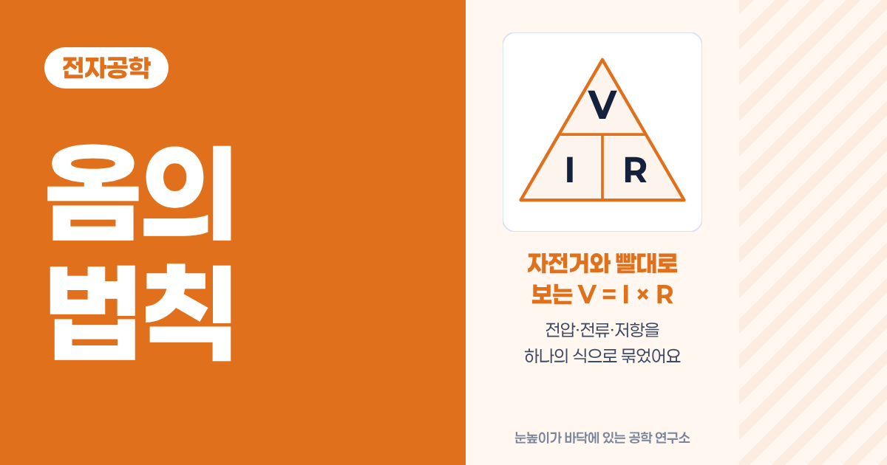
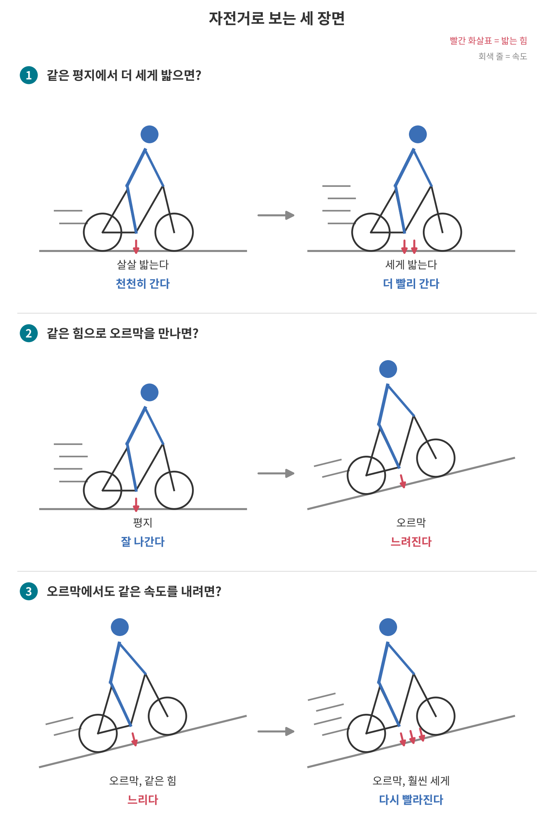
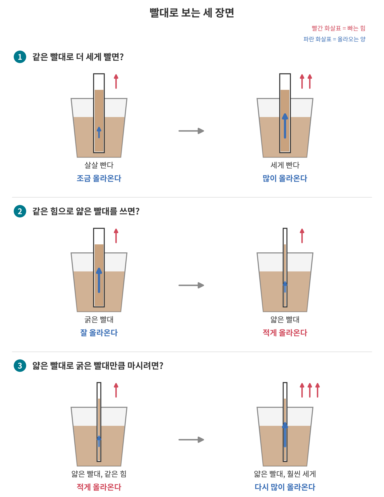
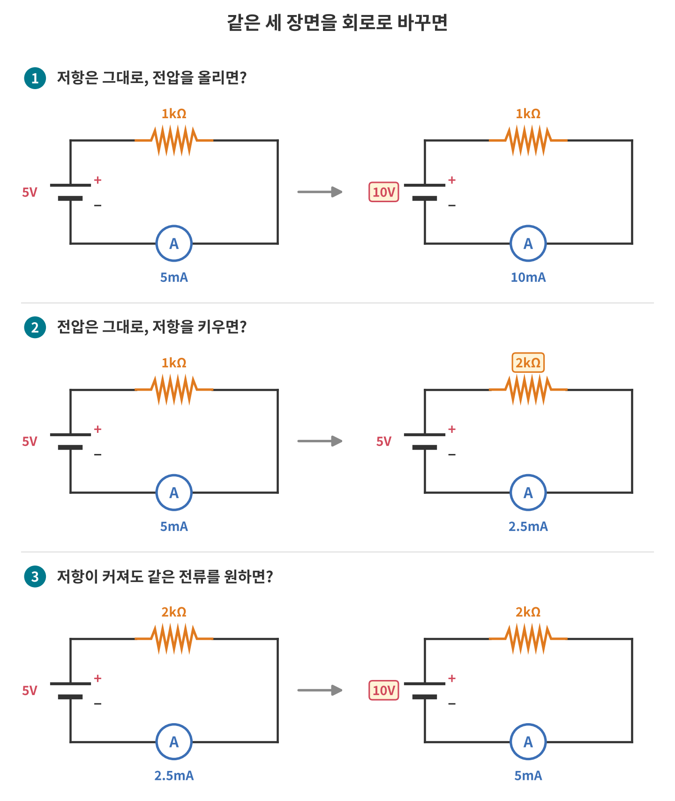
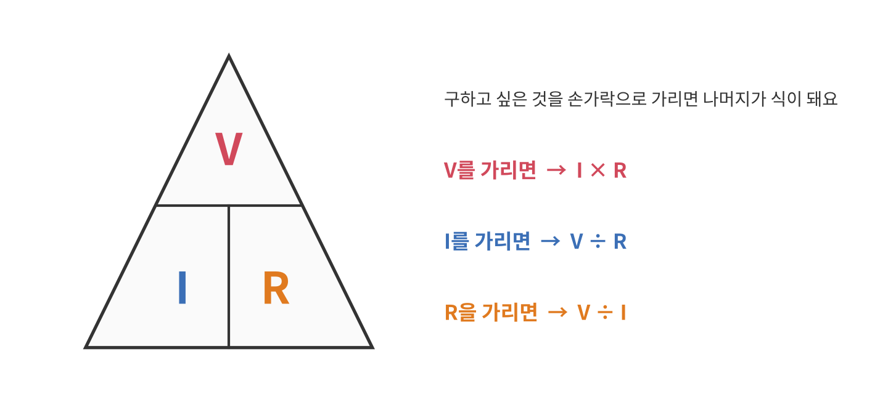
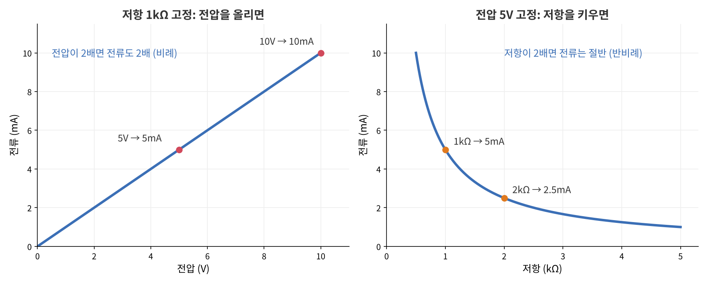
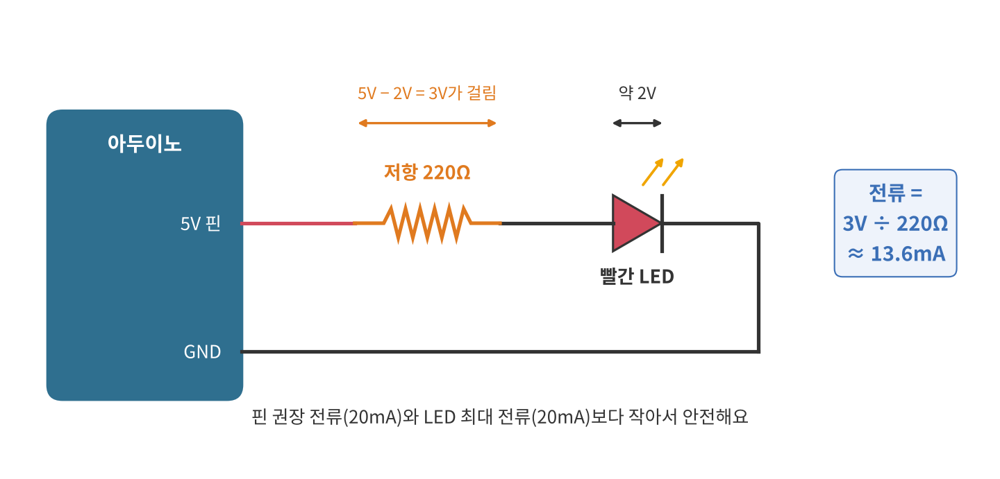
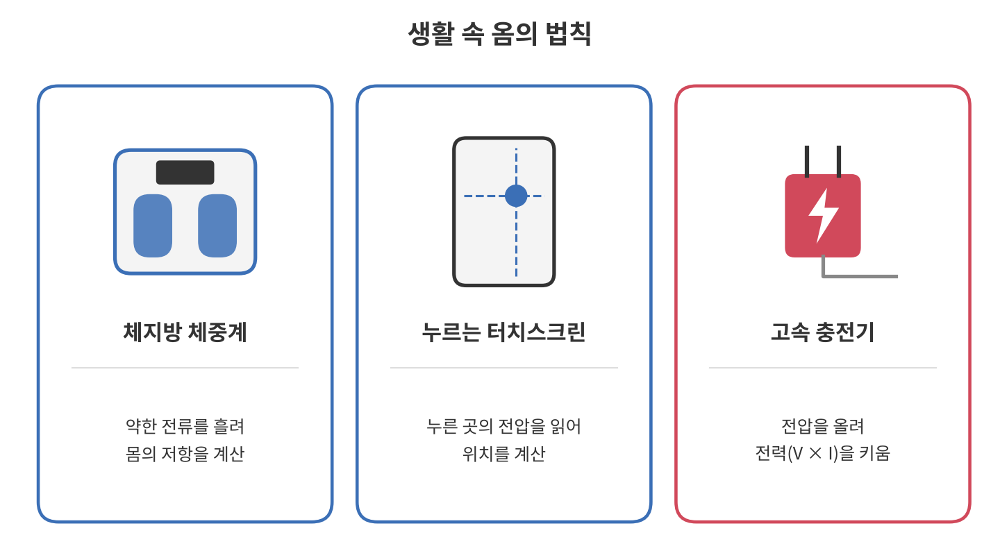
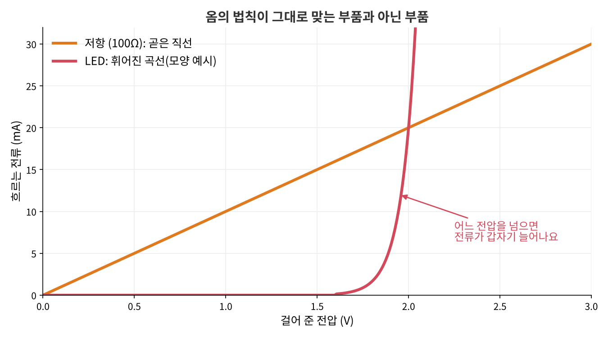

<!--
title: "옴의 법칙: 자전거와 빨대로 보는 V = I × R"
field: 전자공학
order: 120
level: 기초
tags: [전자 기초, 옴의 법칙, 아두이노]
summary: "옴의 법칙은 전압, 전류, 저항 세 가지가 서로 어떻게 움직이는지 하나의 식으로 묶은 거예요."
notion_id: 40710cbca0ae81ffb803e0dd4145e939
-->

# 옴의 법칙: 자전거와 빨대로 보는 V = I × R

<!-- 목차 -->

## 1. 옴의 법칙을 먼저 한 줄로

옴의 법칙은 전압, 전류, 저항 세 가지가 서로 어떻게 움직이는지 하나의 식으로 묶은 거예요.

$$
V = I \times R
$$

전압(V)은 전류(I)와 저항(R)을 곱한 값과 같다는 뜻이에요. 지금 식이 와닿지 않아도 괜찮아요. 세 단어가 아직 낯설다면 앞 강좌 [전압·전류·저항: 전기를 이해하는 세 단어](<../전자공학 110 전압·전류·저항/index.md>)부터 보고 오면 훨씬 쉬워요.

## 2. 예시로 먼저 감 잡기

식보다 장면이 먼저예요. 자전거와 빨대로 같은 세 장면을 볼게요.

### 2-1. 자전거

1. 같은 평지에서 살살 밟다가 세게 밟으면 더 빨리 가요.
2. 같은 힘으로 밟는데 평지가 오르막으로 바뀌면 느려져요.
3. 오르막에서도 평지와 같은 속도를 내려면 더 세게 밟아야 해요.

### 2-2. 빨대

1. 같은 빨대로 살살 빨다가 세게 빨면 음료가 더 많이 올라와요.
2. 같은 힘으로 빠는데 굵은 빨대를 얇은 빨대로 바꾸면 적게 올라와요.
3. 얇은 빨대로 굵은 빨대만큼 마시려면 훨씬 세게 빨아야 해요.

### 2-3. 두 예시에서 찾은 세 가지 규칙

두 예시는 상황만 다르고 흐름이 똑같아요. 정리하면 이래요.

1. 미는 힘이 세지면 흐름이 커진다.
2. 방해가 커지면 흐름이 줄어든다.
3. 방해가 커져도 같은 흐름을 원하면 힘을 더 줘야 한다.

잠깐 퀴즈: 자전거에서 오르막에 맞바람까지 불면 같은 속도를 내기 위해 어떻게 해야 할까요?

방해(오르막 + 맞바람)가 더 커졌으니 페달을 더 세게 밟아야 해요. 규칙 3과 같아요.

## 3. 같은 장면을 전압·전류·저항으로 바꾸기

### 3-1. 이름 바꾸기

| 자전거 | 빨대 | 전기 |
| --- | --- | --- |
| 페달 밟는 힘 | 빠는 힘 | 전압 (V) |
| 달리는 속도 | 올라오는 양 | 전류 (I) |
| 오르막 | 얇은 빨대 | 저항 (R) |

### 3-2. 같은 세 장면을 회로로

이번에는 전원, 저항, 전류계(A)로 이루어진 간단한 회로에서 같은 세 장면을 만들어 볼게요.

| 장면 | 회로에서 바뀐 것 | 결과 |
| --- | --- | --- |
| 1 세게 밟기 | 저항 1kΩ 그대로, 전압 5V → 10V | 전류 5mA → 10mA |
| 2 오르막 | 전압 5V 그대로, 저항 1kΩ → 2kΩ | 전류 5mA → 2.5mA |
| 3 오르막에서 같은 속도 | 저항 2kΩ에서 전류를 5mA로 되돌리고 싶음 | 전압을 10V로 올려야 함 |

자전거와 빨대에서 찾은 세 규칙이 회로에서도 그대로 보여요. 그런데 이번엔 숫자가 붙었어요. 이 숫자들에는 공통된 규칙이 하나 숨어 있어요.

## 4. 숫자 속 규칙 찾기: V = I × R

표의 숫자를 전류 × 저항으로 계산해 보면 전부 전압과 같아요. 단위를 A와 Ω로 맞춰서 계산해요.

| 전류 | 저항 | 전류 × 저항 | 실제 전압 |
| --- | --- | --- | --- |
| 5mA = 0.005A | 1kΩ = 1,000Ω | 0.005 × 1,000 = 5 | 5V |
| 10mA = 0.01A | 1,000Ω | 0.01 × 1,000 = 10 | 10V |
| 2.5mA = 0.0025A | 2,000Ω | 0.0025 × 2,000 = 5 | 5V |
| 5mA = 0.005A | 2,000Ω | 0.005 × 2,000 = 10 | 10V |

이 관계가 바로 옴의 법칙이에요. 같은 식을 세 가지 모양으로 쓸 수 있어요.

$$
V = I \times R \qquad I = \frac{V}{R} \qquad R = \frac{V}{I}
$$

헷갈릴 때는 아래 삼각형을 떠올리면 돼요.

### 4-1. 직접 계산해 보기

| 문제 | 계산 | 답 |
| --- | --- | --- |
| 5V에 250Ω을 연결하면 전류는? | 5 ÷ 250 = 0.02A | 20mA |
| 3.3V에 330Ω을 연결하면 전류는? | 3.3 ÷ 330 = 0.01A | 10mA |
| 9V에 3kΩ을 연결하면 전류는? | 9 ÷ 3,000 = 0.003A | 3mA |
| 5V에서 25mA를 흘리려면 저항은? | 5 ÷ 0.025 | 200Ω |
| 1kΩ에 2mA가 흐르면 저항 양 끝 전압은? | 0.002 × 1,000 | 2V |

계산할 때 가장 많이 틀리는 곳은 단위예요. mA는 A로, kΩ은 Ω로 바꾼 다음 계산하면 실수가 줄어요.

## 5. 이름 붙이기: 옴의 법칙

이 관계는 독일의 물리학자 게오르크 옴(Georg Simon Ohm)이 1827년에 펴낸 책 『Die galvanische Kette, mathematisch bearbeitet』에서 정리했어요. 저항의 단위 Ω(옴)도 그의 이름에서 왔어요([출처: Wikipedia Georg Ohm](https://en.wikipedia.org/wiki/Georg_Ohm)).

정리하면 옴의 법칙은 이런 순서로 쓰여요.

1. 전압, 전류, 저항 중 두 가지를 안다.
2. 삼각형에서 모르는 하나를 가린다.
3. 단위를 V, A, Ω로 맞춘 뒤 계산한다.

## 6. 그래프로 보기

- 왼쪽: 저항을 1kΩ으로 고정하고 전압을 올리면 전류가 똑같은 비율로 늘어요. 전압이 2배면 전류도 2배인 곧은 직선이에요(비례).
- 오른쪽: 전압을 5V로 고정하고 저항을 키우면 전류가 줄어요. 저항이 2배면 전류는 절반이에요(반비례).

## 7. 옴의 법칙은 언제 쓰나요?

전자 회로를 만들다 보면 거의 모든 곳에서 써요. 많이 쓰는 상황을 모아 봤어요.

| 상황 | 아는 것 | 구하는 것 |
| --- | --- | --- |
| LED에 달 저항 고르기 | 전원 전압, LED 전압, 원하는 전류 | 저항값 |
| 아두이노 핀이 감당할 전류인지 확인 | 핀 전압, 연결한 저항 | 흐르는 전류 |
| 조도 센서·가변저항 값을 아두이노로 읽기 | 전원 전압, 두 저항 | 아날로그 핀에 걸리는 전압 |
| 전류계 없이 전류 구하기 | 저항 양 끝 전압, 저항값 | 전류 |
| 회로 고장 찾기 | 측정한 전압·저항 | 계산값과 다르면 끊김·합선 의심 |

### 7-1. LED에 달 저항 고르기

가장 자주 만나는 상황이에요.

아두이노 5V 핀에 빨간 LED를 연결한다고 해 볼게요. 흔한 5mm 빨간 LED는 켜질 때 약 2V를 쓰고 최대 20mA까지 쓰도록 안내돼 있어요. 아두이노 우노는 핀 하나에 20mA 정도를 권장해요([LED 사양: SparkFun](https://www.sparkfun.com/led-basic-red-5mm.html), [우노 사양: Pimoroni](https://shop.pimoroni.com/en-eu/products/arduino-uno-rev3)).

1. 저항에 걸리는 전압 = 5V − 2V = 3V
2. 15mA 정도 흘리고 싶다면 저항 = 3V ÷ 0.015A = 200Ω
3. 키트에 흔히 들어 있는 220Ω처럼 계산값보다 조금 큰 저항을 고른다.
4. 확인: 3V ÷ 220Ω ≈ 0.0136A, 약 13.6mA로 20mA보다 작아요.

LED 예제에 220Ω이 자주 나오는 이유도 이 계산에 있어요.

### 7-2. 조도 센서 값을 읽는 전압 분배

저항 두 개를 이어 놓으면 전압이 저항 크기에 비례해서 나눠져요. 아두이노는 이 나눠진 전압을 아날로그 핀으로 읽어요.

$$
V_{\text{출력}} = V_{\text{전원}} \times \frac{R_2}{R_1 + R_2}
$$

예를 들어 5V에 10kΩ 저항(R1)과 조도 센서(R2)를 이어 놓았다고 해 볼게요. 조도 센서는 빛을 받으면 저항이 작아지는 부품이에요.

- 조도 센서가 10kΩ일 때: 5 × 10 ÷ (10 + 10) = 2.5V
- 조도 센서가 1kΩ일 때: 5 × 1 ÷ (10 + 1) ≈ 0.45V

빛에 따라 읽히는 전압이 달라지니 아두이노가 밝기를 알 수 있어요. 여기 나온 조도 센서 저항값은 계산을 보여 주려고 정한 예시예요. 실제 값은 제품 사양서를 확인해요.

## 8. 생활 속 옴의 법칙

### 8-1. 체지방 체중계

체지방을 알려 주는 체중계는 발판을 통해 몸에 아주 약한 전류를 흘려요. 그리고 몸이 그 전류를 얼마나 막는지, 곧 몸의 저항을 재요.

근육은 물을 많이 머금어서 전기가 잘 통하고 지방은 물이 적어서 전기를 더 많이 막아요. 그래서 저항이 크게 나올수록 체지방이 많다고 추정해요. 옴의 법칙으로 보면 흘린 전류와 걸린 전압을 알면 R = V ÷ I로 저항이 나와요.

몸속 수분량에 따라 값이 달라지기 때문에 같은 시간대, 같은 조건에서 재야 비교가 돼요.

### 8-2. 꾹 눌러야 반응하는 터치스크린

저항막 방식 터치스크린은 얇은 막 두 장이 살짝 떨어져 있어요. 누르면 두 막이 닿고 한쪽 막의 끝에서 끝까지 걸어 둔 전압 중 닿은 곳의 전압을 읽어요.

7-2의 전압 분배처럼 누른 위치에 따라 읽히는 전압이 달라져요. 이 값으로 가로 위치를 계산하고 방향을 바꿔 세로 위치도 계산해요.

### 8-3. 고속 충전기

고속 충전은 같은 시간에 더 많은 전력을 보내는 거예요. 10장에서 볼 P = V × I처럼 전력은 전압과 전류를 곱한 값이라 둘 중 하나를 키우면 돼요.

USB PD 충전기는 기기와 약속해서 전압을 5V에서 9V, 15V, 20V로 올려요. 예를 들어 9V로 3A를 보내면 9 × 3 = 27W가 돼요.

## 9. 자주 걸리는 지점

### 9-1. 단위를 맞추지 않은 계산

5V ÷ 220Ω을 계산하고 답을 "0.0227A"가 아니라 "22.7A"로 쓰는 식의 실수가 많아요. 계산 전에 V, A, Ω로 맞추고 마지막에 mA로 바꾸면 안전해요.

### 9-2. 옴의 법칙이 그대로 맞지 않는 부품

저항은 전압을 올린 만큼 전류가 늘어서 그래프가 곧은 직선이에요. LED나 다이오드는 다르게 움직여요. 어느 전압까지는 전류가 거의 흐르지 않다가 그 전압을 넘으면 전류가 갑자기 늘어요. 그래서 LED 전류를 "전압 ÷ LED 저항"으로 바로 계산할 수 없고 7-1처럼 저항을 따로 달아서 전류를 정해요. 그래프의 LED 곡선은 모양을 보여 주려고 그린 예시라 실제 값은 LED마다 달라요.

### 9-3. 비유는 감 잡기용이에요

자전거와 빨대는 세 규칙을 느끼게 해 주지만 숫자까지 맞지는 않아요. 자전거는 빨라질수록 바람 저항이 커져서 힘을 2배로 준다고 속도가 정확히 2배가 되지 않아요. 정확한 계산은 늘 V = I × R로 해요.

## 10. 더 나아가기: 저항이 뜨거워지는 이유

저항은 전류를 막는 대신 그 에너지를 열로 바꿔요. 1초 동안 쓰는 에너지를 전력이라고 하고 단위는 W(와트)예요.

$$
P = V \times I
$$

7-1의 LED 회로에서 저항이 쓰는 전력은 3V × 0.0136A ≈ 0.041W예요. 흔히 쓰는 1/4W(0.25W) 저항이 감당하는 범위보다 훨씬 작아서 걱정할 필요가 없어요. 큰 전류가 흐르는 회로라면 저항의 전력 한도도 함께 확인해요.

## 11. 한 장 요약

> 옴의 법칙: 전압 = 전류 × 저항 (V = I × R)
>
> - 저항이 그대로면 전압을 올린 만큼 전류도 늘어난다(비례).
> - 전압이 그대로면 저항을 키운 만큼 전류가 줄어든다(반비례).
> - 저항이 커져도 같은 전류를 원하면 전압을 올려야 한다.
> - 두 값을 알면 나머지 하나를 구한다: I = V ÷ R, R = V ÷ I.
> - 계산 전에 단위를 V, A, Ω로 맞춘다.
> - LED처럼 직선으로 움직이지 않는 부품은 저항을 따로 달아 전류를 정한다.

## 12. 셀프 퀴즈

<b>Q1.</b> 12V 전원에 4Ω 저항을 연결하면 전류는 몇 A일까요?

정답 보기

3A예요. 12 ÷ 4 = 3A

<b>Q2.</b> 저항은 그대로 두고 전압만 2배로 올리면 전류는 어떻게 될까요?

정답 보기

2배가 돼요. 저항이 그대로면 전류는 전압에 비례해요.

<b>Q3.</b> 아두이노 5V 핀에 약 2V를 쓰는 LED를 달고 10mA 정도 흘리고 싶어요. 저항은 몇 Ω이 알맞을까요?

정답 보기

계산하면 (5 − 2) ÷ 0.01 = 300Ω이에요. 300Ω 저항이 없으면 조금 큰 330Ω을 써도 돼요. 그러면 전류는 3 ÷ 330 ≈ 9.1mA가 돼요.

## 참고 자료

- [Wikipedia: Ohm's law](https://en.wikipedia.org/wiki/Ohm%27s_law)
- [SparkFun: Voltage, Current, Resistance, and Ohm's Law](https://learn.sparkfun.com/tutorials/voltage-current-resistance-and-ohms-law/all)

## 강좌 이동

- 이전 강좌: [전압·전류·저항: 전기를 이해하는 세 단어](<../전자공학 110 전압·전류·저항/index.md>)
- 다음 강좌: [키르히호프의 법칙: 갈림길과 한 바퀴로 보는 회로 규칙](<../전자공학 130 키르히호프의 법칙/index.md>)
