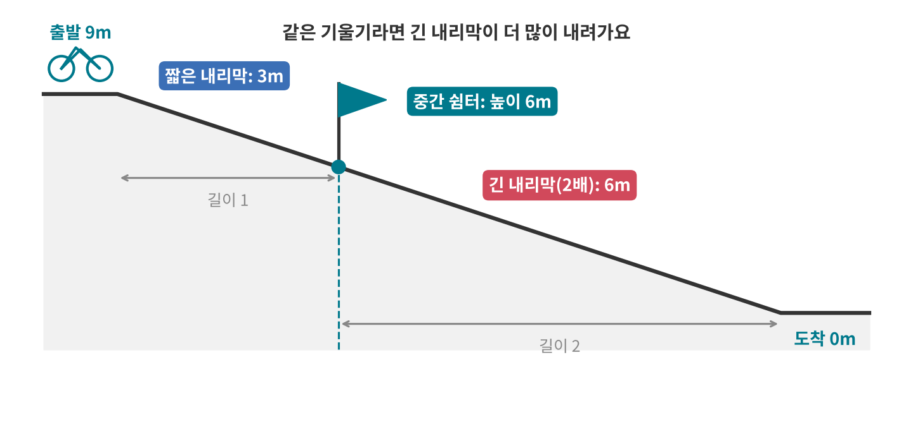
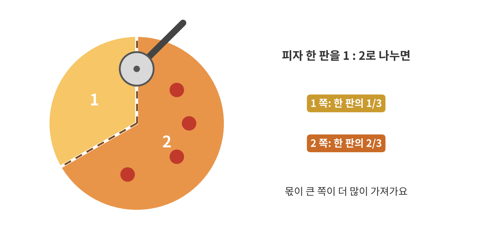
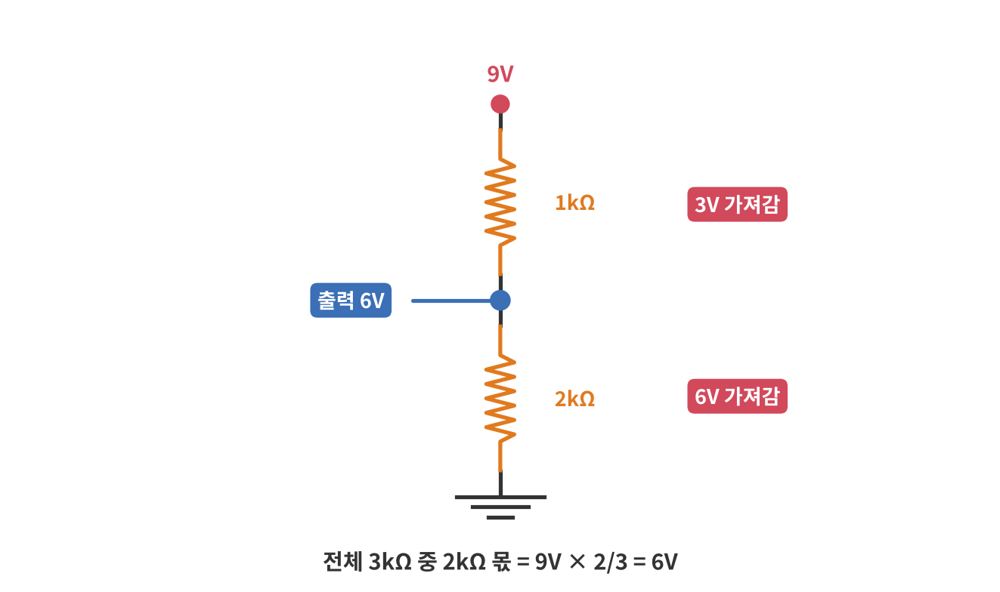
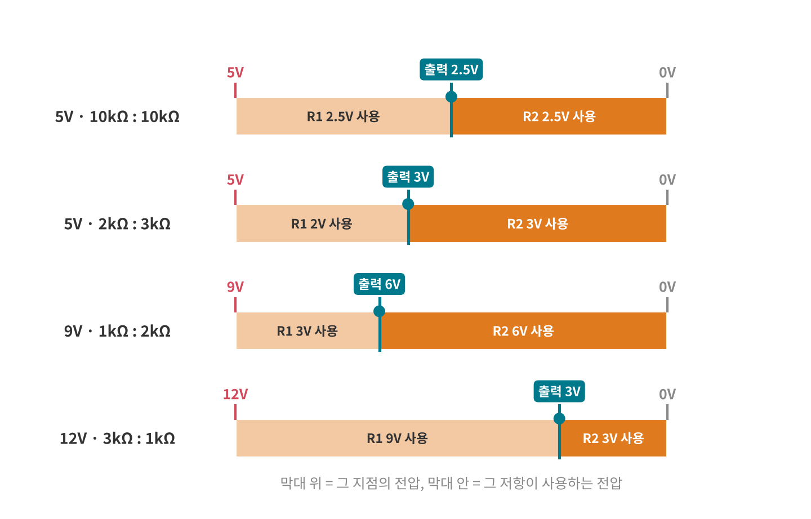
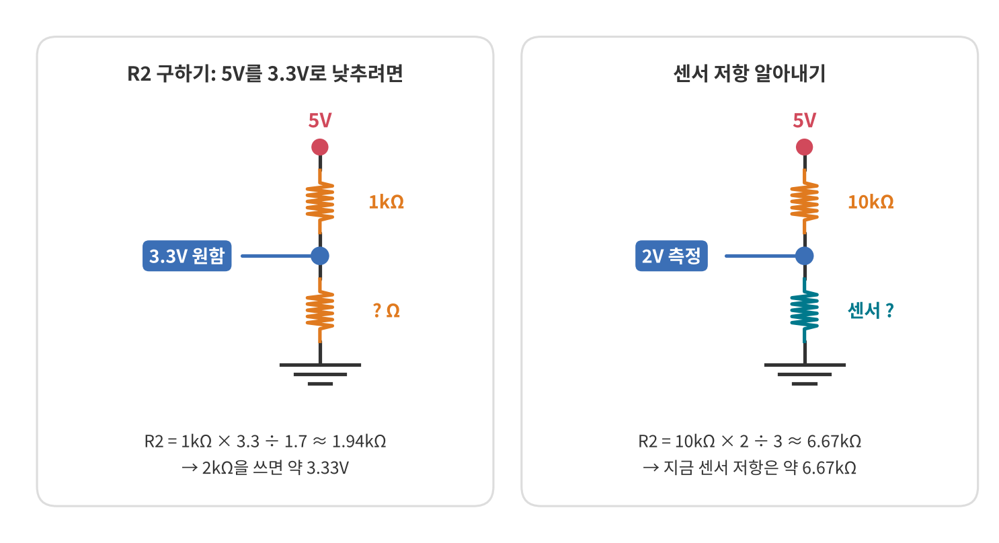
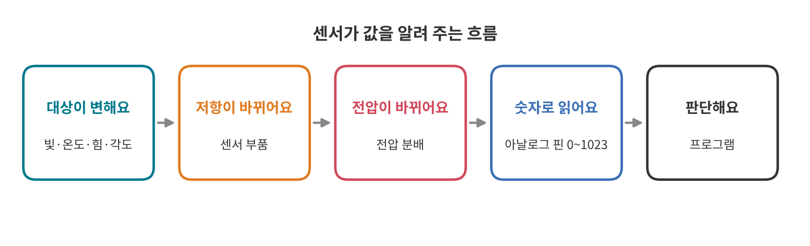
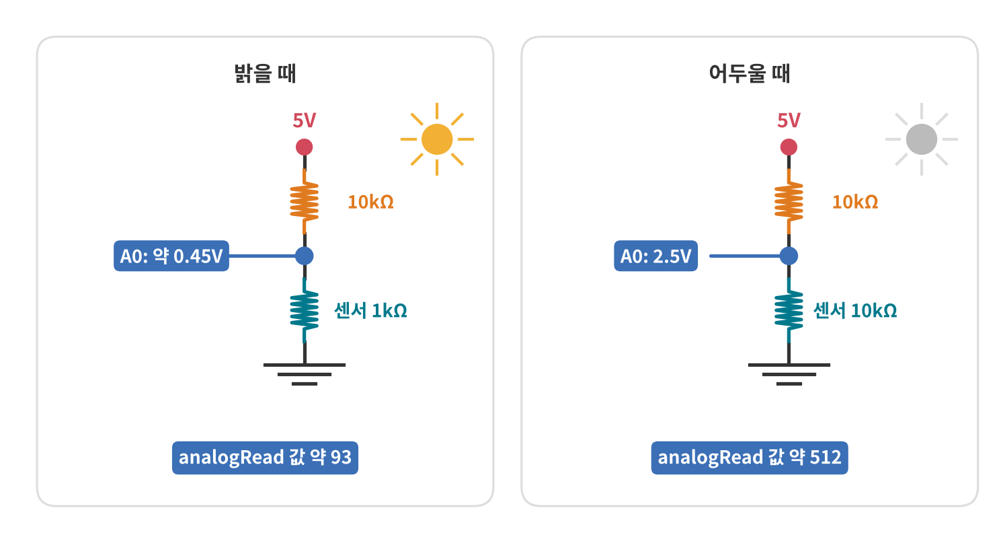
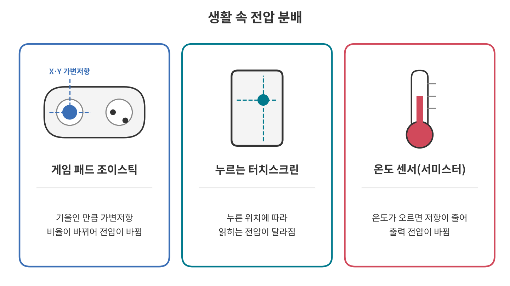
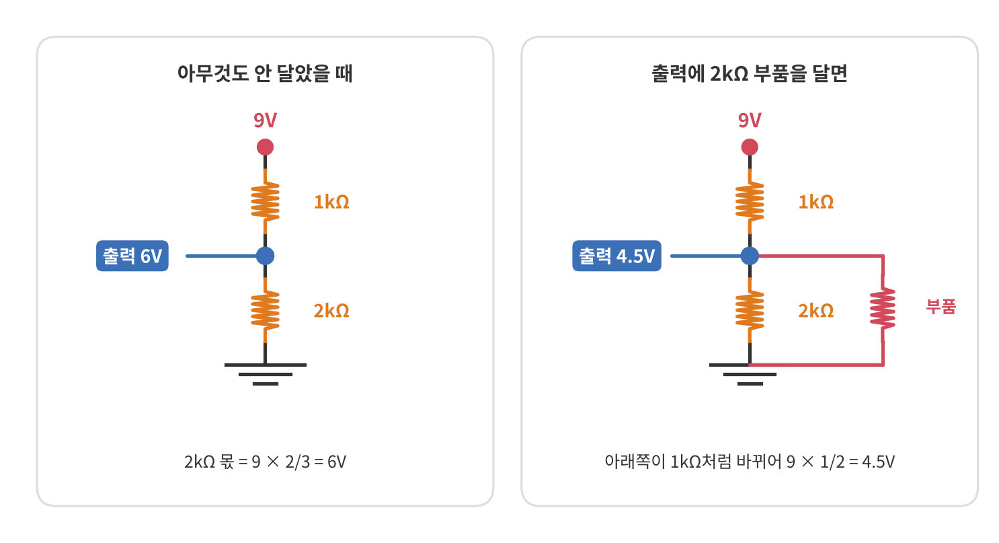

<!--
title: "전압 분배: 직렬 저항은 전압을 나눠 가져요"
field: 전자공학
order: 140
level: 기초
tags: [전자 기초, 아두이노]
summary: "저항을 한 줄로 이으면 전원 전압을 저항 크기의 비율대로 나눠 가져요. 이걸 전압 분배라고 해요."
notion_id: 40810cbca0ae8187aa2bfab5d7fd66ab
-->

# 전압 분배: 직렬 저항은 전압을 나눠 가져요

<!-- 목차 -->

## 1. 전압 분배를 먼저 한 줄로

저항을 한 줄로 이으면 전원 전압을 저항 크기의 비율대로 나눠 가져요. 이걸 전압 분배라고 해요.

앞 강좌 [키르히호프의 법칙: 갈림길과 한 바퀴로 보는 회로 규칙](<../전자공학 130 키르히호프의 법칙/index.md>)에서 직렬 회로는 "전압을 나눠 가진다"고 했어요. 이번에는 얼마씩 나눠 가지는지 계산하고 센서가 이 원리로 값을 알려 준다는 것까지 볼게요.

## 2. 예시로 먼저 감 잡기

### 2-1. 내리막이 두 개인 길

높이 9m에서 출발해 내리막 두 개를 지나 바닥까지 내려와요. 두 내리막은 기울기가 같고 두 번째 내리막이 첫 번째보다 두 배 길어요.

기울기가 같으면 길이만큼 내려가니 짧은 내리막에서 3m, 긴 내리막에서 6m를 내려와요. 전체 9m를 길이 비율(1 : 2)대로 나눠 가진 거예요.

두 내리막이 만나는 곳에는 중간 쉼터가 있어요. 쉼터의 높이는 9m − 3m = 6m예요. 3장에서는 이 쉼터 자리가 회로의 출력 점이 돼요.

### 2-2. 피자 나누기

피자 한 판을 두 사람이 1 : 2로 나눠요. 1 쪽은 한 판의 1/3을, 2 쪽은 2/3를 가져가요. 몫이 큰 쪽이 더 많이 가져가요.

### 2-3. 두 예시에서 찾은 규칙

1. 전체 양(높이, 피자)은 정해져 있다.
2. 각자 몫의 비율대로 나눠 가진다.
3. 몫이 클수록 더 많이 가져간다.

전기로 바꾸면 전체 양은 전원 전압, 몫은 저항이에요. 저항이 큰 쪽이 전압을 더 많이 가져가요.

## 3. 같은 장면을 회로로 바꾸기

3편에서 본 회로를 세로로 세워 그렸어요. 위는 9V, 아래는 0V(GND)이고 그 사이에 1kΩ(R1)과 2kΩ(R2)이 한 줄로 이어져 있어요.

- 1kΩ이 3V, 2kΩ이 6V를 가져가요.
- 저항이 1 : 2니 전압도 1 : 2예요.
- 두 저항 사이 점(출력)과 GND 사이에는 R2가 가져간 6V가 걸려요.

이 가운데 점의 전압을 출력 전압이라고 해요. 전압 분배에서는 대부분 이 값을 구하거나 이용해요.

## 4. 식이 나오는 과정

외우지 않아도 앞에서 배운 세 법칙을 이어 붙이면 식이 나와요.

1. 갈림길이 없으니 두 저항에 같은 전류가 흘러요(전류 법칙).
2. 전류는 전체 전압 ÷ 전체 저항이에요: I = V전원 ÷ (R1 + R2) (옴의 법칙)
3. R2가 가져가는 전압은 전류 × R2예요(옴의 법칙). 두 저항의 전압을 더하면 전원 전압이 돼요(전압 법칙).

2번을 3번에 넣으면 전압 분배 식이 돼요.

$$
V_{\text{출력}} = V_{\text{전원}} \times \frac{R_2}{R_1 + R_2}
$$

말로 풀면 "전원 전압 × (내 저항 ÷ 전체 저항)"이에요. 피자 한 판 × 내 몫의 비율과 같은 모양이에요. 2편 7-2에서 미리 써 본 식이 바로 이거예요.

같은 내용을 비율로도 쓸 수 있어요. 같은 전류가 흐르니 두 저항의 전압 비는 저항 비와 같아요.

$$
V_1 : V_2 = R_1 : R_2
$$

## 5. 저항을 알 때: 전압 구하기

막대 위 숫자는 그 지점의 전압이고 막대 안 숫자는 그 저항이 사용하는 전압이에요. 왼쪽 끝(전원)에서 R1이 사용한 만큼 내려가면 R1과 R2가 만나는 점, 곧 출력이에요. 거기서 R2가 나머지를 사용하면 오른쪽 끝에서 0V가 돼요. 그래서 출력 전압은 R2가 사용하는 전압과 같아요.

저항 두 개와 전원 전압을 알면 출력 전압을 바로 구할 수 있어요.

| 전원 | R1 | R2 | 계산 | 출력(R2 전압) |
| --- | --- | --- | --- | --- |
| 5V | 10kΩ | 10kΩ | 5 × 10 ÷ 20 | 2.5V |
| 5V | 2kΩ | 3kΩ | 5 × 3 ÷ 5 | 3V |
| 9V | 1kΩ | 2kΩ | 9 × 2 ÷ 3 | 6V |
| 12V | 3kΩ | 1kΩ | 12 × 1 ÷ 4 | 3V |

같은 저항 두 개를 이으면 언제나 절반이 나와요. 저항 단위가 둘 다 kΩ이면 kΩ끼리 그대로 나눠도 돼요.

잠깐 퀴즈: 6V 전원에 R1 = 4kΩ, R2 = 2kΩ을 이으면 출력 전압은?

2V예요. 6 × 2 ÷ (4 + 2) = 2V

## 6. 전압을 알 때: 저항 구하기

반대로 전압을 알고 저항 하나를 모를 때도 있어요. 4장의 비율 식(V1 : V2 = R1 : R2)을 돌려 쓰면 돼요. R1에 걸리는 전압은 전원 전압에서 출력 전압을 뺀 값이에요.

R2를 모를 때:

$$
R_2 = R_1 \times \frac{V_{\text{출력}}}{V_{\text{전원}} - V_{\text{출력}}}
$$

R1을 모를 때:

$$
R_1 = R_2 \times \frac{V_{\text{전원}} - V_{\text{출력}}}{V_{\text{출력}}}
$$

### 6-1. 원하는 전압을 만들 저항 고르기

5V 신호를 3.3V 부품에 넣으려고 R1 = 1kΩ을 정했어요. R2는 얼마여야 할까요?

1. R1이 가져갈 전압: 5V − 3.3V = 1.7V
2. R2 = 1kΩ × 3.3 ÷ 1.7 ≈ 1.94kΩ
3. 흔한 값인 2kΩ을 쓰면 출력은 5 × 2 ÷ 3 ≈ 3.33V예요.

3.3V 부품이 3.33V를 받아도 되는지는 부품 사양서의 최대 입력 전압으로 확인해요.

### 6-2. 센서의 지금 저항 알아내기

5V에 10kΩ(R1)과 센서(R2)를 이어 놓고 출력을 재니 2V가 나왔어요. 센서의 지금 저항은 얼마일까요?

1. R1이 가져간 전압: 5V − 2V = 3V
2. R2 = 10kΩ × 2 ÷ 3 ≈ 6.67kΩ

전압 하나만 재면 센서 저항을 거꾸로 알아낼 수 있어요. 아두이노가 센서를 읽는 방법이 바로 이거예요.

### 6-3. R1 구하기

9V에서 3V를 만들고 싶고 R2는 1kΩ으로 정했어요.

1. R1이 가져갈 전압: 9V − 3V = 6V
2. R1 = 1kΩ × 6 ÷ 3 = 2kΩ

## 7. 센서는 이렇게 값을 알려 줘요

빛, 온도, 누르는 힘, 휘어진 정도를 재는 센서 중에는 저항이 바뀌는 부품이 많아요. 이런 센서는 혼자서는 전압을 만들지 못해요. 그래서 고정 저항 하나와 짝을 지어 전압 분배 회로를 만들어요.

1. 대상이 변해요. 방이 어두워지거나 온도가 올라가요.
2. 센서의 저항이 바뀌어요.
3. 전압 분배 비율이 바뀌니 출력 전압이 바뀌어요.
4. 아두이노 같은 MCU 보드가 아날로그 핀으로 그 전압을 숫자로 읽어요.
5. 프로그램이 그 숫자를 보고 "어두워졌다", "뜨거워졌다"고 판단해요.

| 센서 | 무엇이 바뀌면 | 저항은 |
| --- | --- | --- |
| 조도 센서(CdS) | 빛이 밝아지면 | 작아져요 |
| 서미스터(NTC) | 온도가 오르면 | 작아져요 |
| 압력 센서(FSR) | 세게 누르면 | 작아져요 |
| 휨 센서 | 많이 휘면 | 커져요 |
| 가변저항 | 손잡이를 돌리면 | 비율이 바뀌어요 |

MCU는 저항을 직접 재지 못하고 전압만 읽을 수 있어요. 전압 분배가 저항의 변화를 MCU가 읽을 수 있는 전압의 변화로 바꿔 주는 다리 역할을 해요.

모든 센서가 이 방식은 아니에요. 온습도 센서나 거리 센서 중에는 센서 안에서 값을 계산해 디지털 신호로 보내 주는 것도 있어요. 쓰는 센서의 방식은 사양서에서 확인해요.

## 8. 아두이노에서는 이렇게 써요

### 8-1. 조도 센서로 밝기 읽기

2편 7-2의 예시를 이어서 볼게요. 5V에 10kΩ(R1)과 조도 센서(R2)를 잇고 가운데 점을 아날로그 핀 A0에 연결해요.

- 밝을 때 센서 1kΩ: 5 × 1 ÷ 11 ≈ 0.45V
- 어두울 때 센서 10kΩ: 5 × 10 ÷ 20 = 2.5V

아두이노 우노의 아날로그 핀은 0~5V를 0~1023 사이의 숫자로 바꿔요. 그래서 대략 "전압 ÷ 5V × 1023"이 읽히는 값이에요.

- 0.45V → 약 93
- 2.5V → 약 512

프로그램은 이 숫자가 커지면 어두워졌다고 판단할 수 있어요. 센서 저항값은 계산을 보여 주려고 정한 예시이고 실제 값은 제품 사양서를 확인해요.

### 8-2. 가변저항은 혼자서 전압 분배기예요

가변저항은 다리가 세 개예요. 양 끝을 5V와 GND에 잇고 가운데 다리를 아날로그 핀에 연결하면 손잡이를 돌릴 때 위쪽과 아래쪽 저항의 비율이 바뀌어요. 손잡이가 한가운데 있으면 출력은 절반인 2.5V예요.

1편 9-3의 볼륨 손잡이가 이 방식으로 손잡이 위치를 전압으로 바꿔요.

## 9. 생활 속 전압 분배

### 9-1. 게임 패드 조이스틱

게임 패드의 아날로그 스틱 안에는 가변저항이 두 개 들어 있어요. 하나는 좌우(X), 하나는 위아래(Y)를 맡아요. 스틱을 기울이면 각 가변저항의 비율이 바뀌어 출력 전압이 바뀌고 기기는 그 전압으로 얼마나 기울였는지 알아요([출처: SparkFun Thumb Joystick](https://www.sparkfun.com/thumb-joystick.html)).

### 9-2. 꾹 눌러야 반응하는 터치스크린

2편 8-2에서 본 저항막 터치스크린도 전압 분배예요. 누른 지점이 막을 두 부분으로 나누고 그 비율에 따라 읽히는 전압이 달라져요.

### 9-3. 온도를 재는 서미스터

NTC 서미스터는 온도가 오르면 저항이 작아지는 부품이에요. 고정 저항과 짝을 지어 두면 온도에 따라 출력 전압이 바뀌고 MCU는 그 전압으로 온도를 계산해요. 아두이노 온도계 실습에 자주 쓰여요.

## 10. 자주 헷갈리는 점

### 10-1. 전압 분배로 전원을 만들면 안 돼요

9V를 1kΩ과 2kΩ으로 나누면 6V가 나와요. 그런데 여기에 2kΩ짜리 부품을 연결하면 아래쪽은 2kΩ 두 개가 나란히 붙은 셈이 돼서 1kΩ처럼 동작해요. 비율이 1 : 1로 바뀌니 출력이 4.5V로 떨어져요.

모터처럼 전류를 많이 쓰는 부품을 달면 전압이 더 크게 흔들리고 저항이 뜨거워질 수도 있어요. 전압 분배는 센서 값을 읽거나 신호 전압을 맞출 때 쓰고 부품에 전원을 줄 때는 전압 레귤레이터를 써요.

### 10-2. 비율이 같아도 저항 크기가 중요해요

5V를 반으로 나누는 방법은 많아요. 그런데 저항이 너무 작으면 쓸데없이 전류가 많이 흘러요.

- 100Ω + 100Ω: 5 ÷ 200 = 0.025A = 25mA가 늘 흘러요.
- 10kΩ + 10kΩ: 5 ÷ 20,000 = 0.00025A = 0.25mA만 흘러요.

센서나 신호용 전압 분배에는 보통 kΩ 단위 저항을 써요.

### 10-3. 전압은 낮출 수만 있어요

전압 분배는 전원 전압을 나눠 가지는 거라서 출력은 항상 전원 전압보다 낮아요. 3.3V를 5V로 올리는 데는 쓸 수 없어요.

## 11. 한 장 요약

> 전압 분배: 직렬 저항은 전압을 저항 비율대로 나눠 가진다
>
> - V출력 = V전원 × R2 ÷ (R1 + R2)
> - 두 저항의 전압 비 = 저항 비 (V1 : V2 = R1 : R2)
> - 저항을 모르면: R2 = R1 × V출력 ÷ (V전원 − V출력)
> - 많은 센서는 저항이 바뀌고 전압 분배가 그 변화를 전압 변화로 바꾼다.
> - MCU는 그 전압을 숫자(아두이노 우노: 0~1023)로 읽어 변화를 알아챈다.
> - 전원용으로 쓰지 않고 전압을 높일 수 없다.

## 12. 셀프 퀴즈

<b>Q1.</b> 10V 전원에 R1 = 3kΩ, R2 = 2kΩ을 이었어요. 출력 전압(R2 전압)은 몇 V일까요?

정답 보기

4V예요. 10 × 2 ÷ (3 + 2) = 4V

<b>Q2.</b> 5V 전원에 R1 = 10kΩ과 센서를 이었더니 출력이 1V로 측정됐어요. 센서 저항은 몇 kΩ일까요?

정답 보기

2.5kΩ이에요. R1 전압은 5 − 1 = 4V이고 R2 = 10kΩ × 1 ÷ 4 = 2.5kΩ

<b>Q3.</b> 조도 센서를 R2 자리에 달았어요. 방이 밝아지면 아날로그 핀에서 읽히는 숫자는 커질까요, 작아질까요?

정답 보기

작아져요. 밝아지면 조도 센서 저항이 작아지고 R2의 몫이 줄어 출력 전압이 내려가요.

## 참고 자료

- [SparkFun: Voltage Dividers](https://learn.sparkfun.com/tutorials/voltage-dividers/all)
- [Arduino: analogRead()](https://www.arduino.cc/reference/en/language/functions/analog-io/analogread/)

## 강좌 이동

- 이전 강좌: [키르히호프의 법칙: 갈림길과 한 바퀴로 보는 회로 규칙](<../전자공학 130 키르히호프의 법칙/index.md>)
- 다음 강좌: 준비 중이에요.
